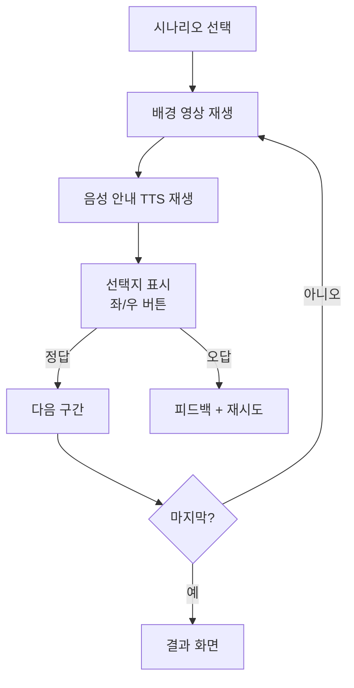

# 🎧 핵심 기능: 듣기 전용 모드 (Listening Mode)

> **컨셉:** 움직이는 배경 + 음성 안내 듣기 + 선택지 버튼
> **예시:** 네비게이션 안내를 듣고 좌/우 방향 선택

---

## 1. 컨셉 설명

사용자가 직접 말하지 않고, **듣기**에만 집중하는 모드입니다.
시각적 상황(움직이는 배경)과 함께 영어 음성을 듣고, 간단한 선택으로 이해도를 확인합니다.

### 예시 시나리오: 운전 중 네비게이션

```
[움직이는 차 안 영상]

🔊 TTS: "In 200 meters, turn right at the intersection."

┌─────────────────────────────────────┐
│                                     │
│     ⬅️           ➡️                │
│    [LEFT]       [RIGHT]             │
│                                     │
└─────────────────────────────────────┘
```

---

## 2. 서비스 플로우



---

## 3. 화면 구성

### 학습 화면
```
┌─────────────────────────────────────┐
│  [X]                                │
│                                     │
│  ┌─────────────────────────────┐    │
│  │                             │    │
│  │    [움직이는 배경 영상]       │    │
│  │    (차 안에서 도로 풍경)       │    │
│  │                             │    │
│  └─────────────────────────────┘    │
│                                     │
│  🔊 "Turn right at the next..."    │
│                                     │
│  ┌─────────┐      ┌─────────┐      │
│  │   ⬅️   │      │   ➡️   │      │
│  │  LEFT  │      │  RIGHT │      │
│  └─────────┘      └─────────┘      │
│                                     │
│  💡 다시 듣기                       │
└─────────────────────────────────────┘
```

---

## 4. 기술 구현

### 4.1. 상태 관리 (Zustand)
```typescript
interface ListeningState {
  currentStep: number;
  totalSteps: number;
  correctAnswers: number;
  isPlaying: boolean;
  
  playAudio: () => void;
  submitAnswer: (answer: 'LEFT' | 'RIGHT') => void;
  nextStep: () => void;
}
```

### 4.2. 구성 요소
| 요소 | 기술 |
|------|------|
| 배경 영상 | `react-native-video` (루프) |
| 음성 안내 | Google Cloud TTS |
| 버튼 | 간단한 TouchableOpacity |
| 애니메이션 | 정답 시 체크마크, 오답 시 X |

---

## 5. 시나리오 데이터 구조

```json
{
  "theme": "driving_navigation",
  "background_video": "car_driving_loop.mp4",
  "steps": [
    {
      "audio_text": "In 200 meters, turn right at the intersection.",
      "correct_answer": "RIGHT",
      "hint": "intersection = 교차로"
    },
    {
      "audio_text": "Take the left lane to enter the highway.",
      "correct_answer": "LEFT",
      "hint": "lane = 차선, highway = 고속도로"
    }
  ]
}
```

---

## 6. 확장 가능 시나리오

| 테마 | 배경 | 선택지 예시 |
|------|------|-----------|
| **운전 네비** | 차 안 영상 | 좌/우 방향 |
| **공항 안내** | 공항 터미널 | Gate A / Gate B |
| **기차역** | 플랫폼 | Platform 1 / Platform 2 |
| **피트니스** | 헬스장 | Start / Stop |

---

## 7. 학습 효과

- **저부담 학습**: 말하기 없이 듣기만 집중
- **상황 몰입**: 실제 상황과 유사한 배경 영상
- **즉각 피드백**: 정답/오답 즉시 확인
- **반복 가능**: "다시 듣기" 버튼으로 무한 복습
