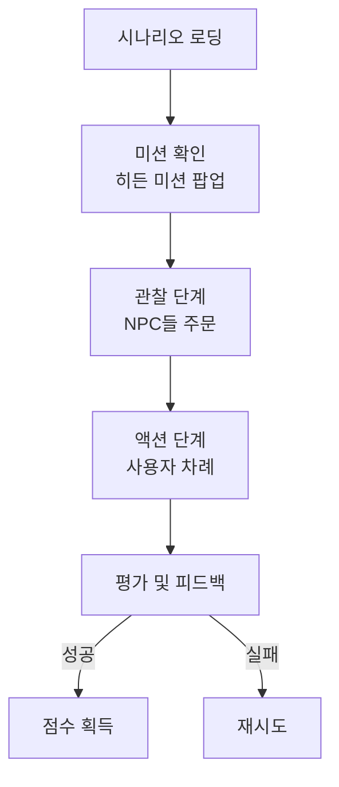

# 🎭 핵심 기능: 상황극 큐 시뮬레이션 (Scenario Queue Mode)

> **UI 스타일:** Top-Down 2D Pixel Art (Grid System)
> **구현 기술:** React Native Reanimated, Zustand, Gemini 3.0 Pro, Google TTS

---

## 1. 서비스 플로우



### 핵심 컨셉: Pattern + Twist
- **Pattern**: NPC들이 반복하는 행동 패턴 (예: 모두 현금 결제)
- **Twist**: 사용자만 다르게 해야 하는 미션 (예: 법인카드 결제)

---

## 2. 상태 머신 (Zustand)

```typescript
type GamePhase = 'LOADING' | 'INTRO' | 'NPC_TURN' | 'USER_TURN' | 'EVALUATING' | 'RESULT';

interface GameState {
  phase: GamePhase;
  queue: Character[]; // [NPC1, NPC2, USER]
  currentTurnIndex: number; // 0 -> 1 -> 2 (User)
  
  // Actions
  advanceQueue: () => void; // 앞사람 퇴장, 뒷사람 전진
  startUserTurn: () => void; // 마이크 활성화
}
```

---

## 3. 그리드 이동 시스템

### 좌표계 (32px 단위)
```
Counter: {x: 3, y: 1}
Queue[0]: {x: 3, y: 2} (현재 주문 중)
Queue[1]: {x: 3, y: 3} (대기 1)
Queue[2]: {x: 3, y: 4} (대기 2 - User)
```

### 이동 애니메이션 (Reanimated)
- **withTiming**: 좌표 보간
- **Walk**: Rotate -5deg <-> 5deg (뒤뚱거림)
- **Idle**: ScaleY 1.0 -> 0.95 -> 1.0 (숨쉬기)
- **Talk**: 말풍선 FadeIn + SlideUp

---

## 4. AI 평가 로직

### 판단 기준 (3단계)

| 순서 | 기준 | 설명 |
|------|------|------|
| 1 | **Context** | 질문에 맞는 대답인가? |
| 2 | **Mission** | 히든 미션 달성했는가? |
| 3 | **Language** | 의미가 통하는 영어인가? |

### 판정 매트릭스

| 상태 | Context | Mission | Language | 결과 |
|------|---------|---------|----------|------|
| **Perfect** | ✅ | ✅ | ✅ | SUCCESS |
| **Good** | ✅ | ✅ | △ | SUCCESS (문법 피드백) |
| **Forgot** | ✅ | ❌ | ✅ | FAIL (재시도) |
| **Nonsense** | ❌ | - | - | FAIL (다시 말하기) |

---

## 5. 프롬프트 설계

### 시나리오 생성
```
Generate a role-play scenario for an English learner.

1. Setting: {Theme} (e.g., Burger Shop)
2. NPCs: Create 2 NPCs. Pattern: "{Pattern}" (e.g., Order + Pay with Cash).
3. User Mission: Break the pattern. Twist: "{Twist}" (e.g., Must pay with Card).

Output JSON:
{
  "setting_description": "...",
  "npcs": [
    {"name": "Man", "line": "...", "voice_id": "en-US-Male-A"}
  ],
  "user_mission_goal": "...",
  "user_mission_constraint": "..."
}
```

### 평가 프롬프트
```
You are the "Game Master" of a role-playing game.
Current Scenario: "{scenario}"
NPC Question: "{npc_question}"
User Mission: "{mission}"
User Input (STT): "{user_text}"

Evaluate:
1. Is_Context_Valid: Does the user answer the NPC's question?
2. Is_Mission_Cleared: Does the user mention the mission keyword? (Semantic check)
3. Feedback: Provide feedback in Korean.

Output JSON:
{
  "status": "SUCCESS" | "FAIL_MISSION" | "FAIL_CONTEXT",
  "npc_response_text": "English response",
  "system_feedback_kr": "Korean feedback",
  "score": 1-100
}
```

---

## 6. 유연성 규칙

### 키워드 확장 (Semantic Matching)
- "Credit Card" = "Plastic", "Visa", "Charge it", "Not cash"
- 의도가 맞으면 성공

### 발음 오류 보정 (Fuzzy Matching)
- STT가 "Card"를 "Car"로 인식 → 문맥상 허용
- 프롬프트: "If the word sounds similar within context, accept it."

---

## 7. UI/UX 피드백

| 상황 | 시각 피드백 |
|------|-----------|
| 듣는 중 | `...` 애니메이션 |
| 분석 중 | `Thinking...` |
| 성공 | `!` 아이콘 + 효과음 |
| 미션 누락 | `?` 아이콘 + 고개 갸웃 |

---

## 8. 구현 로드맵

### Phase 1: 껍데기 (UI)
- [ ] AI로 픽셀 아트 에셋 생성 (Midjourney)
- [ ] 캐릭터 배치 (Absolute Position)
- [ ] 그리드 이동 애니메이션 (Reanimated)

### Phase 2: 뇌 연결 (Logic)
- [ ] Zustand 상태 관리
- [ ] TTS 재생 연동
- [ ] 턴 전환 로직

### Phase 3: 영혼 (AI)
- [ ] 시나리오 생성 API
- [ ] 평가 API 연동
- [ ] 성공/실패 분기 처리
