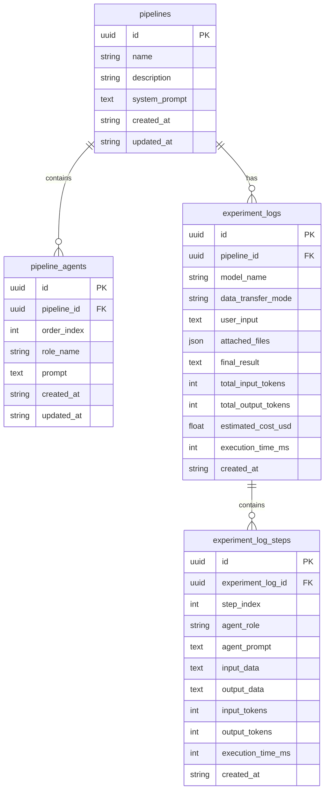

# AI Agent Lab - 개발 기획 문서

| 항목 | 내용 |
|------|------|
| **작성일** | 2026-02-08 |
| **상태** | Draft |
| **관련 문서** | [서비스 기획](../plan/ai-agent-lab.md) |

---

## 1. DB 스키마 설계

### 1.1 ERD (Entity Relationship Diagram)



### 1.2 테이블 상세

#### `pipelines` - 파이프라인 정보

| 컬럼 | 타입 | 설명 |
|------|------|------|
| id | UUID | PK |
| name | VARCHAR(255) | 파이프라인 이름 |
| description | TEXT | 파이프라인 설명 (선택) |
| system_prompt | TEXT | 통합 시스템 프롬프트 |
| created_at | TIMESTAMP | 생성일시 |
| updated_at | TIMESTAMP | 수정일시 |

#### `pipeline_agents` - 파이프라인 내 에이전트

| 컬럼 | 타입 | 설명 |
|------|------|------|
| id | UUID | PK |
| pipeline_id | UUID | FK → pipelines.id |
| order_index | INTEGER | 실행 순서 (0부터) |
| role_name | VARCHAR(100) | 에이전트 역할명 (예: "분석가") |
| prompt | TEXT | 개별 에이전트 프롬프트 |
| created_at | TIMESTAMP | 생성일시 |
| updated_at | TIMESTAMP | 수정일시 |

#### `experiment_logs` - 실험 로그

| 컬럼 | 타입 | 설명 |
|------|------|------|
| id | UUID | PK |
| pipeline_id | UUID | FK → pipelines.id |
| model_name | VARCHAR(50) | AI 모델명 (gemini-pro, gpt-4o 등) |
| data_transfer_mode | VARCHAR(1) | A/B/C 중 하나 |
| user_input | TEXT | 사용자 입력 텍스트 |
| attached_files | JSONB | 첨부파일 정보 [{type, url, name}] |
| final_result | TEXT | 최종 결과 |
| total_input_tokens | INTEGER | 총 입력 토큰 |
| total_output_tokens | INTEGER | 총 출력 토큰 |
| estimated_cost_usd | DECIMAL(10,6) | 예상 비용 (USD) |
| execution_time_ms | INTEGER | 총 실행시간 (ms) |
| created_at | TIMESTAMP | 실행일시 |

#### `experiment_log_steps` - 실험 단계별 로그

| 컬럼 | 타입 | 설명 |
|------|------|------|
| id | UUID | PK |
| experiment_log_id | UUID | FK → experiment_logs.id |
| step_index | INTEGER | 단계 순서 (0부터) |
| agent_role | VARCHAR(100) | 에이전트 역할명 |
| agent_prompt | TEXT | 해당 에이전트 프롬프트 |
| input_data | TEXT | 에이전트 입력 |
| output_data | TEXT | 에이전트 출력 |
| input_tokens | INTEGER | 입력 토큰 |
| output_tokens | INTEGER | 출력 토큰 |
| execution_time_ms | INTEGER | 실행시간 (ms) |
| created_at | TIMESTAMP | 생성일시 |

---

## 2. API 엔드포인트 설계

### 2.1 파이프라인 관리 API

| Method | Endpoint | 설명 |
|--------|----------|------|
| GET | `/api/v1/ai-lab/pipelines` | 파이프라인 목록 조회 |
| POST | `/api/v1/ai-lab/pipelines` | 파이프라인 생성 |
| GET | `/api/v1/ai-lab/pipelines/{id}` | 파이프라인 상세 조회 (에이전트 포함) |
| PUT | `/api/v1/ai-lab/pipelines/{id}` | 파이프라인 수정 |
| DELETE | `/api/v1/ai-lab/pipelines/{id}` | 파이프라인 삭제 |

#### Request/Response 스키마

```python
# 파이프라인 생성/수정 요청
class PipelineCreate(BaseModel):
    name: str = Field(..., min_length=1, max_length=255)
    description: str | None = None
    system_prompt: str
    agents: list[AgentCreate]

class AgentCreate(BaseModel):
    role_name: str = Field(..., min_length=1, max_length=100)
    prompt: str
    order_index: int

# 파이프라인 응답
class PipelineResponse(BaseModel):
    id: UUID
    name: str
    description: str | None
    system_prompt: str
    agents: list[AgentResponse]
    created_at: datetime
    updated_at: datetime

class AgentResponse(BaseModel):
    id: UUID
    role_name: str
    prompt: str
    order_index: int
```

### 2.2 실험 실행 API

| Method | Endpoint | 설명 |
|--------|----------|------|
| POST | `/api/v1/ai-lab/experiments/run` | 파이프라인 실행 |
| GET | `/api/v1/ai-lab/experiments/logs` | 실험 로그 목록 조회 |
| GET | `/api/v1/ai-lab/experiments/logs/{id}` | 실험 로그 상세 조회 |

#### Request/Response 스키마

```python
# 실험 실행 요청
class ExperimentRunRequest(BaseModel):
    pipeline_id: UUID
    model_name: Literal["gemini-pro", "gemini-flash", "gpt-4o", "gpt-4-turbo"]
    data_transfer_mode: Literal["A", "B", "C"]
    user_input: str
    attached_files: list[AttachedFile] | None = None

class AttachedFile(BaseModel):
    type: Literal["image", "video", "audio"]
    url: str  # 업로드된 파일 URL
    name: str

# 실험 결과 응답
class ExperimentRunResponse(BaseModel):
    log_id: UUID
    steps: list[StepResult]
    final_result: str
    total_input_tokens: int
    total_output_tokens: int
    estimated_cost_usd: float
    execution_time_ms: int

class StepResult(BaseModel):
    step_index: int
    agent_role: str
    output: str
    input_tokens: int
    output_tokens: int
    execution_time_ms: int

# 로그 목록 조회
class ExperimentLogListResponse(BaseModel):
    items: list[ExperimentLogSummary]
    total: int
    page: int
    size: int

class ExperimentLogSummary(BaseModel):
    id: UUID
    pipeline_name: str
    model_name: str
    total_tokens: int
    estimated_cost_usd: float
    execution_time_ms: int
    created_at: datetime
```

### 2.3 파일 업로드 API

| Method | Endpoint | 설명 |
|--------|----------|------|
| POST | `/api/v1/ai-lab/upload` | 멀티미디어 파일 업로드 |

```python
# 업로드 응답
class UploadResponse(BaseModel):
    url: str
    type: Literal["image", "video", "audio"]
    name: str
    size_bytes: int
```

### 2.4 모델 정보 API

| Method | Endpoint | 설명 |
|--------|----------|------|
| GET | `/api/v1/ai-lab/models` | 사용 가능한 AI 모델 목록 |

```python
class ModelInfo(BaseModel):
    id: str  # "gemini-pro"
    name: str  # "Gemini Pro"
    provider: str  # "google"
    input_price_per_1m: float
    output_price_per_1m: float
    supports_multimodal: bool
```

---

## 3. 서버 구조 (LangChain 통합)

### 3.1 디렉토리 구조

```
apps/server/app/
├── api/v1/
│   └── ai_lab.py              # AI Lab 라우터
├── models/
│   ├── pipeline.py            # Pipeline, PipelineAgent 모델
│   └── experiment_log.py      # ExperimentLog, ExperimentLogStep 모델
├── schemas/
│   └── ai_lab.py              # Pydantic 스키마
└── services/
    └── ai_lab/
        ├── __init__.py
        ├── pipeline_service.py    # 파이프라인 CRUD
        ├── experiment_service.py  # 실험 실행
        ├── chain_builder.py       # LangChain 체인 빌더
        └── model_registry.py      # AI 모델 관리
```

### 3.2 LangChain 체인 빌더

```python
# services/ai_lab/chain_builder.py
from langchain_google_genai import ChatGoogleGenerativeAI
from langchain.prompts import ChatPromptTemplate
from langchain.schema.runnable import RunnablePassthrough

class ChainBuilder:
    """파이프라인 설정을 기반으로 LangChain 체인 생성"""
    
    def __init__(self, model_name: str):
        self.model = self._get_model(model_name)
        
    def _get_model(self, model_name: str):
        if model_name.startswith("gemini"):
            return ChatGoogleGenerativeAI(
                model=model_name,
                temperature=0,
            )
        # OpenAI 확장 시 여기에 추가
        raise ValueError(f"Unknown model: {model_name}")
    
    def build_chain(
        self,
        system_prompt: str,
        agents: list[AgentConfig],
        data_transfer_mode: str,
    ):
        """에이전트 체인 구성"""
        chains = []
        
        for agent in agents:
            prompt = ChatPromptTemplate.from_messages([
                ("system", system_prompt),
                ("system", agent.prompt),
                ("human", "{input}"),
            ])
            
            chain = prompt | self.model
            chains.append((agent.role_name, chain))
        
        # data_transfer_mode에 따라 체인 연결 방식 결정
        return self._connect_chains(chains, data_transfer_mode)
```

### 3.3 실험 실행 서비스

```python
# services/ai_lab/experiment_service.py
class ExperimentService:
    def __init__(self, db: AsyncSession):
        self.db = db
    
    async def run_experiment(
        self,
        request: ExperimentRunRequest,
    ) -> ExperimentRunResponse:
        # 1. 파이프라인 로드
        pipeline = await self._get_pipeline(request.pipeline_id)
        
        # 2. 체인 빌드
        builder = ChainBuilder(request.model_name)
        chain = builder.build_chain(
            system_prompt=pipeline.system_prompt,
            agents=pipeline.agents,
            data_transfer_mode=request.data_transfer_mode,
        )
        
        # 3. 실행 및 토큰 추적
        start_time = time.time()
        steps = []
        total_input_tokens = 0
        total_output_tokens = 0
        
        current_input = request.user_input
        if request.attached_files:
            current_input = self._prepare_multimodal_input(
                current_input, request.attached_files
            )
        
        for agent in pipeline.agents:
            step_result = await self._run_agent(
                agent, current_input, chain
            )
            steps.append(step_result)
            
            # 토큰 집계
            total_input_tokens += step_result.input_tokens
            total_output_tokens += step_result.output_tokens
            
            # 다음 에이전트 입력 준비 (data_transfer_mode에 따라)
            current_input = self._prepare_next_input(
                request.data_transfer_mode,
                current_input,
                step_result.output,
                steps,
            )
        
        execution_time_ms = int((time.time() - start_time) * 1000)
        
        # 4. 비용 계산
        cost = self._calculate_cost(
            request.model_name,
            total_input_tokens,
            total_output_tokens,
        )
        
        # 5. 로그 저장
        log = await self._save_log(
            pipeline_id=request.pipeline_id,
            model_name=request.model_name,
            data_transfer_mode=request.data_transfer_mode,
            user_input=request.user_input,
            attached_files=request.attached_files,
            steps=steps,
            total_input_tokens=total_input_tokens,
            total_output_tokens=total_output_tokens,
            estimated_cost_usd=cost,
            execution_time_ms=execution_time_ms,
        )
        
        return ExperimentRunResponse(
            log_id=log.id,
            steps=steps,
            final_result=steps[-1].output,
            total_input_tokens=total_input_tokens,
            total_output_tokens=total_output_tokens,
            estimated_cost_usd=cost,
            execution_time_ms=execution_time_ms,
        )
```

---

## 4. 어드민 프론트엔드 구조

### 4.1 FSD 구조

```
apps/admin/
├── app/
│   └── (dashboard)/
│       └── ai-lab/
│           ├── page.tsx                    # /ai-lab → 파이프라인 목록
│           ├── pipelines/
│           │   ├── new/
│           │   │   └── page.tsx            # 파이프라인 생성
│           │   └── [id]/
│           │       └── edit/
│           │           └── page.tsx        # 파이프라인 수정
│           ├── experiment/
│           │   └── page.tsx                # 실험 테스트 + 최근 로그
│           └── logs/
│               └── page.tsx                # 전체 로그 조회
├── pages/
│   └── ai-lab/
│       ├── ui/
│       │   ├── PipelinesPage.tsx           # 파이프라인 목록 페이지
│       │   ├── PipelineEditorPage.tsx      # 파이프라인 편집 페이지
│       │   ├── ExperimentPage.tsx          # 실험 테스트 페이지
│       │   └── LogsPage.tsx                # 로그 조회 페이지
│       └── index.ts
├── features/
│   └── ai-lab/
│       ├── model/
│       │   ├── types.ts                    # 타입 정의
│       │   ├── usePipelines.ts             # 파이프라인 CRUD 훅
│       │   ├── useExperiment.ts            # 실험 실행 훅
│       │   └── useLogs.ts                  # 로그 조회 훅
│       ├── ui/
│       │   ├── PipelineCard.tsx            # 파이프라인 카드
│       │   ├── AgentEditor.tsx             # 에이전트 편집기
│       │   ├── ExperimentRunner.tsx        # 실험 실행 UI
│       │   ├── ExperimentResult.tsx        # 실험 결과 표시
│       │   ├── RecentLogs.tsx              # 최근 로그 (실험 페이지 하단)
│       │   └── LogDetailModal.tsx          # 로그 상세 모달
│       ├── api/
│       │   └── aiLabApi.ts                 # API 클라이언트
│       └── index.ts
└── entities/
    └── ai-lab/
        ├── model/
        │   └── types.ts                    # 엔티티 타입
        └── index.ts
```

### 4.2 주요 컴포넌트

#### ExperimentPage (실험 테스트 + 최근 로그)

```tsx
// pages/ai-lab/ui/ExperimentPage.tsx
export const ExperimentPage = () => {
  return (
    <div className="container mx-auto py-6 space-y-8">
      <h1 className="text-2xl font-bold">실험 테스트</h1>
      
      {/* 실험 실행 영역 */}
      <ExperimentRunner />
      
      {/* 실험 결과 영역 */}
      <ExperimentResult />
      
      {/* 최근 로그 영역 (동일 페이지에서 조회) */}
      <RecentLogs limit={10} />
    </div>
  );
};
```

---

## 5. 비용 계산 로직

```python
# services/ai_lab/cost_calculator.py
MODEL_PRICING = {
    "gemini-pro": {
        "input_per_1m": 1.25,
        "output_per_1m": 5.00,
    },
    "gemini-flash": {
        "input_per_1m": 0.075,
        "output_per_1m": 0.30,
    },
    "gpt-4o": {
        "input_per_1m": 5.00,
        "output_per_1m": 15.00,
    },
    "gpt-4-turbo": {
        "input_per_1m": 10.00,
        "output_per_1m": 30.00,
    },
}

def calculate_cost(
    model_name: str,
    input_tokens: int,
    output_tokens: int,
) -> float:
    pricing = MODEL_PRICING.get(model_name)
    if not pricing:
        return 0.0
    
    input_cost = (input_tokens / 1_000_000) * pricing["input_per_1m"]
    output_cost = (output_tokens / 1_000_000) * pricing["output_per_1m"]
    
    return round(input_cost + output_cost, 6)
```

---

## 6. 데이터 전달 모드 구현

```python
# A: 최종 출력만
def prepare_input_mode_a(prev_output: str) -> str:
    return prev_output

# B: 전체 히스토리
def prepare_input_mode_b(history: list[StepResult], prev_output: str) -> str:
    conversation = []
    for step in history:
        conversation.append(f"[{step.agent_role}]: {step.output}")
    conversation.append(f"[Previous Output]: {prev_output}")
    return "\n\n".join(conversation)

# C: 커스텀 필드 (JSON 추출)
def prepare_input_mode_c(prev_output: str, field_path: str = "result") -> str:
    try:
        data = json.loads(prev_output)
        # JSON에서 특정 필드 추출
        return str(data.get(field_path, prev_output))
    except json.JSONDecodeError:
        return prev_output
```

---

## 7. 검증 항목

### 7.1 서버 검증

```bash
# 타입 체크
mypy app --ignore-missing-imports

# 린트
ruff check app
ruff format app --check

# 테스트
pytest tests/ -v
```

### 7.2 어드민 검증

```bash
# TypeScript 컴파일
pnpm exec tsc --noEmit

# 린트
pnpm run lint
```

---

## 8. 체크리스트

### 서버 개발
- [ ] `pipelines` 모델 생성
- [ ] `pipeline_agents` 모델 생성
- [ ] `experiment_logs` 모델 생성
- [ ] `experiment_log_steps` 모델 생성
- [ ] Alembic 마이그레이션 생성/적용
- [ ] `ai_lab.py` 스키마 생성
- [ ] `pipeline_service.py` 구현
- [ ] `experiment_service.py` 구현
- [ ] `chain_builder.py` 구현 (Gemini)
- [ ] `model_registry.py` 구현
- [ ] `ai_lab.py` 라우터 구현
- [ ] 파일 업로드 API 구현

### 어드민 개발
- [ ] `ai-lab` feature 모듈 생성
- [ ] `aiLabApi.ts` API 클라이언트 구현
- [ ] `PipelinesPage.tsx` 구현
- [ ] `PipelineEditorPage.tsx` 구현
- [ ] `ExperimentPage.tsx` 구현 (로그 포함)
- [ ] `LogsPage.tsx` 구현
- [ ] 라우트 설정
