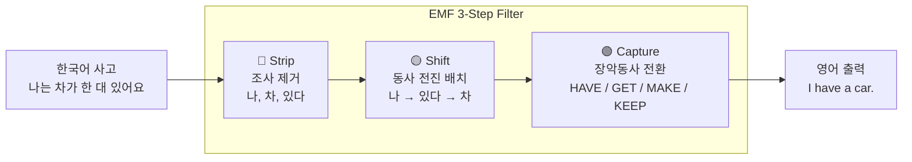
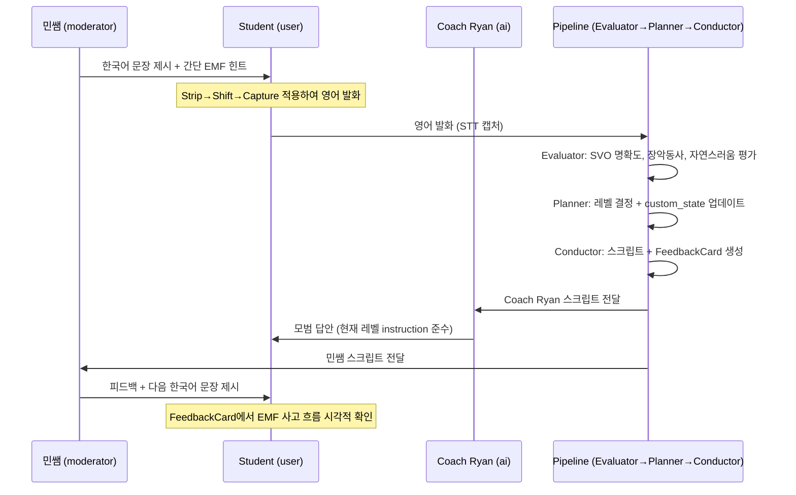
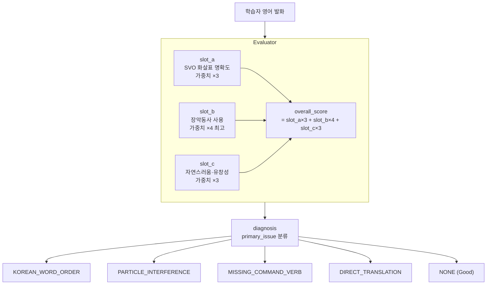
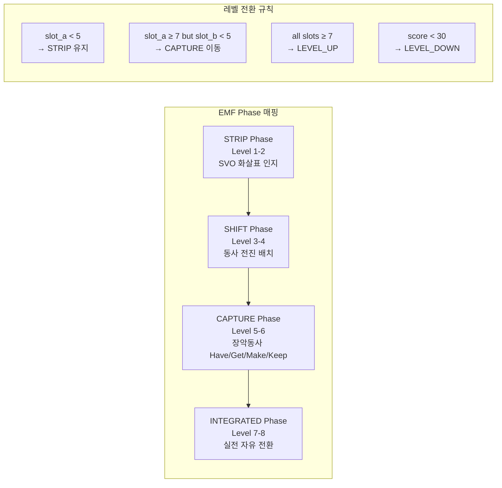
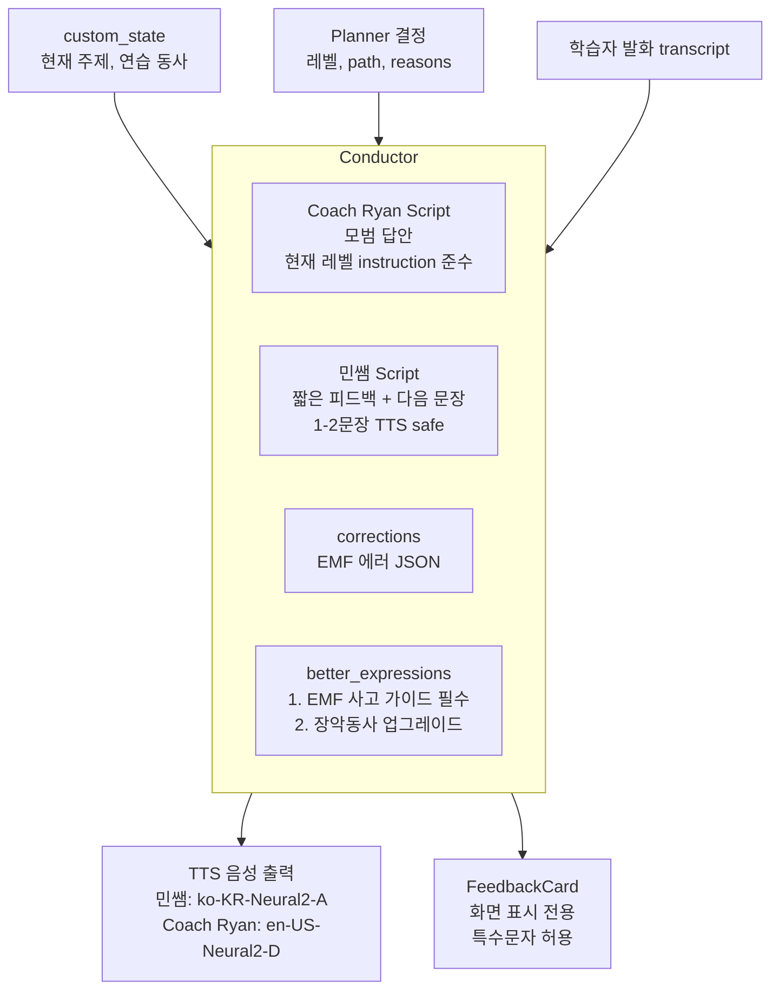
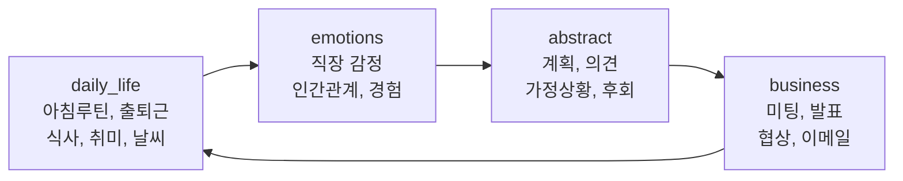

# EMF 당구공 영어 사고 전환 트레이닝 시나리오 개발 보고서

## 요약

Langacker의 인지문법(Cognitive Grammar)에서 제시한 **당구공 모델(Billiard Ball Model)**을 기반으로, 한국어 화자가 영어식 사고로 전환하는 훈련 시나리오를 설계하고 로컬 DB에 배포했다. 핵심은 한국어 조사 기반 사고에서 영어 어순 기반 사고로의 인지적 재구조화이며, 이를 음성 대화(STT/TTS)와 파이프라인 피드백으로 훈련한다.

> [!IMPORTANT] 핵심 원칙
> 코드 수정 없음. 모든 시나리오 로직은 프롬프트로 제어. 다른 템플릿에 영향 없이 이 템플릿에만 적용.

- **템플릿 ID**: `43ba87ed-ece8-4cc6-a1da-4cd66bb3eb45`
- **파이프라인**: v0.2 (Evaluator → Planner → Conductor)
- **참여자**: 3인 (민쌤, Student, Coach Ryan)
- **레벨**: 8단계

---

## 학술적 배경

이 시나리오는 단순한 학습 팁이 아니라 아래 6개 학문 분야의 이론적 토대 위에 설계되었다.

| 이론 | 학자 | 핵심 개념 | 적용 |
|------|------|----------|------|
| 인지문법 | Langacker (1987/2008) | 당구공 모델: agent→action→patient | SVO 화살표 인지 |
| 언어유형학 | Chomsky | 위격 언어 (위치 = 격) | 조사 없이 어순으로 역할 결정 |
| 심리언어학 | Altmann & Kamide | Incremental Processing | 단어 들어오는 순서대로 즉시 처리 |
| Competition Model | Bates & MacWhinney | 단서 유효성(cue validity) | 한국어=조사 단서 → 영어=어순 단서 전환 |
| 개념적 은유 | Lakoff & Johnson | CONTROL IS POSSESSION | Have/Get/Make/Keep 장악동사 |
| 기능 습득 이론 | DeKeyser | 선언적→절차적→자동화 | 반복 음성 발화로 자동화 |

### EMF 3단계 필터 (English Mindset Filter)



---

## 참여자 구성 및 턴 설계

### 참여자 역할

| # | 이름 | 타입 | 언어 | 핵심 역할 |
|---|------|------|------|----------|
| 0 | 민쌤 | moderator | 한국어 | 짧은 피드백 + 다음 한국어 문장 제시 |
| 1 | Student | user | 영어 | EMF 변환 직접 시도 (STT) |
| 2 | Coach Ryan | ai | 영어 | 사후 모범 답안 제시 (장악동사 시범) |

> [!NOTE] 턴 순서 설계 결정
> 초기 설계는 **민쌤→Ryan→Student** (모델 먼저) 였으나, 이 방식은 학생이 EMF 필터를 직접 돌리지 않고 Ryan 문장을 모방하는 문제가 있었다.
> Swain의 **pushed output 가설**과 Schmidt의 **noticing 가설**에 따라 **민쌤→Student→Ryan** 순서로 변경.
> 학생이 먼저 독립적으로 시도하고, Ryan이 사후 모범 답안을 보여주면 학생이 자신의 출력과 비교하며 갭을 인식한다.

### 턴 플로우



---

## v0.2 파이프라인 상세 설계

### Evaluator — EMF 품질 평가

기존의 서술형 점수 체계를 EMF 3단계에 맞게 재정의했다.



> [!TIP] slot_b 가중치가 가장 높은 이유
> 장악동사(Have/Get/Make/Keep) 사용이 EMF 훈련의 핵심 목표다. SVO 어순은 기본 문법 학습에서도 다루지만, 장악동사 사고는 EMF 고유의 인지 전환이기 때문에 가중치를 높였다.

### Planner — EMF 단계 진행 관리

`custom_state`를 통해 학습자의 EMF 습득 단계를 세션 간에 추적한다.



**custom_state 구조 (세션 간 영속)**

```json
{
  "current_emf_phase": "strip | shift | capture | integrated",
  "topic_category": "daily_life | emotions | abstract | business",
  "current_topic": "morning routine",
  "practice_verb": "have",
  "strip_mastery": 0.0,
  "shift_mastery": 0.0,
  "capture_mastery": 0.0,
  "verbs_practiced": ["have", "get"],
  "turns_at_current_level": 0,
  "consecutive_good_scores": 0
}
```

### Conductor — 스크립트 및 FeedbackCard 생성



#### FeedbackCard better_expressions 포맷

EMF 사고 가이드는 시각적으로만 표시 (TTS가 읽지 않음):

```json
{
  "hint": "나는 차가 한 대 있어요",
  "example": "Strip 나 차 있다, Shift 나 있다 차, Capture I have a car",
  "tier": "EMF"
}
```

장악동사 업그레이드:

```json
{
  "original": "My head hurts",
  "upgraded": "I have a headache",
  "tier": "HAVE possession"
}
```

---

## 레벨 정의 (8단계)

```mermaid
gantt
    title EMF 8단계 학습 진행
    dateFormat X
    axisFormat Level %s

    section STRIP Phase
    화살표 인지 입문 (단순 SVO)     : 1, 2
    화살표 확장 (SVO + 장소/시간)   : 2, 3

    section SHIFT Phase
    조사 스트립 훈련 (이미지화)      : 3, 4
    동사 전진 배치 (강한 동사)       : 4, 5

    section CAPTURE Phase
    장악동사 기초 Have와 Get         : 5, 6
    장악동사 마스터 Make와 Keep      : 6, 7

    section INTEGRATED Phase
    청크 빌딩과 구동사              : 7, 8
    실전 자유 전환                  : 8, 9
```



| Level | 이름 | 핵심 instruction |
|-------|------|----------------|
| 1 | 화살표 인지 입문 | Simple SVO only. One arrow per sentence. |
| 2 | 화살표 확장 | SVO + place/time at the END. |
| 3 | 조사 스트립 훈련 | Adjectives before nouns. No-Label Imaging. |
| 4 | 동사 전진 배치 | Strong specific verbs in second position. |
| 5 | 장악동사 기초 | HAVE for states, GET for acquisition and change. |
| 6 | 장악동사 마스터 | MAKE for causation, KEEP for maintenance + objectification. |
| 7 | 청크 빌딩과 구동사 | Phrasal verbs + chunk building left to right. |
| 8 | 실전 자유 전환 | All EMF skills combined. Full Scene Command. |

---

## 기술적 결정사항

> [!NOTE] 결정 1: 턴 순서 변경 — Student가 Ryan보다 먼저
> **이유**: 모델 먼저 제시 시 학생이 EMF 필터를 직접 돌리지 않고 모방에 그침. Swain pushed output 가설에 따라 독립 시도 → 사후 비교가 인지 전환에 더 효과적.

> [!NOTE] 결정 2: EMF 사고 가이드를 TTS가 아닌 FeedbackCard에 표시
> **이유**: Strip→Shift→Capture 흐름은 구조적/시각적 정보라 음성으로 읽으면 어색하고 TTS 지연 유발. FeedbackCard의 `hint/example` JSON 포맷을 그대로 활용해 코드 수정 없이 구현.

> [!NOTE] 결정 3: Evaluator slot_b (장악동사) 가중치 최대
> **이유**: overall_score = slot_a×3 + slot_b×4 + slot_c×3. 장악동사 사용이 EMF 훈련의 핵심 목표이므로 Planner 레벨 결정에 가장 큰 영향을 줘야 함.

> [!WARNING] TTS 특수문자 문제
> TTS 모델이 이모지, 괄호, 콜론, 별표 등을 직접 읽는 현상이 있음. 모든 스크립트 text 필드에는 영문자, 숫자, 한글, 공백, 마침표, 쉼표, 물음표, 느낌표, 아포스트로피만 허용하도록 Conductor 프롬프트에 명시. corrections/better_expressions는 TTS가 읽지 않으므로 JSON 포맷 사용 가능.

---

## 주제 진행 로테이션

Planner가 `custom_state`를 통해 자동으로 관리:



같은 레벨에서 연속 3회 70점 이상 → 다음 주제로 자동 전환

장악동사 로테이션: `have → get → make → keep → take → give → put → let`

---

## 테스트 결과 (초기 테스트)

첫 테스트에서 발견된 문제점과 수정 사항:

| 문제 | 원인 | 수정 |
|------|------|------|
| Coach Ryan이 Level 1에서 복합문 사용 | Conductor 프롬프트에 레벨 준수 강제 부족 | "MUST follow the current level instruction strictly" 추가 |
| 민쌤이 EMF 용어 없이 일반 영어 선생님처럼 피드백 | Conductor 프롬프트에 EMF 특화 규칙 미비 | 진단별 구체적 피드백 방향 추가 |
| FeedbackCard에 아무것도 표시 안됨 | Conductor가 빈 배열 반환 | "MUST generate at least 1 every turn" 명시 |
| 학생이 Ryan 문장을 단순화해서 모방만 함 | 턴 순서 문제 (Ryan이 먼저) | 순서 변경: Student(1) → Ryan(2) |

---

## 알려진 한계 및 다음 단계

> [!WARNING] 알려진 한계
> 이 EMF 프레임워크는 초급-중급 스캐폴딩으로 최적. 중급 이상에서는 레지스터 인식, 관계절, 수동태 등 별도 접근이 필요함 (학술 논문 결론 참조).

### 다음 단계

- [ ] 실제 세션 테스트를 통해 Evaluator 점수 정확도 검증
- [ ] Level 1-2에서 Coach Ryan 문장 복잡도 모니터링
- [ ] Planner custom_state 로테이션 로직 검증 (주제/동사 전환이 자연스러운지)
- [ ] FeedbackCard EMF 사고 가이드 표시 UX 검증
- [ ] 실서버 배포 (프롬프트 및 level_definitions 검증 후)

### 열린 질문

- 민쌤의 Level 3 이상에서 힌트 없이 제시할 때 학습자가 얼마나 버티는지?
- EMF 사고 가이드가 FeedbackCard에 매 턴 표시되면 정보 과부하가 될 수 있는가?
- `allow_user_topic: true` 상태에서 사용자가 입력한 주제가 Planner의 custom_state 로테이션과 충돌하지 않는가?
