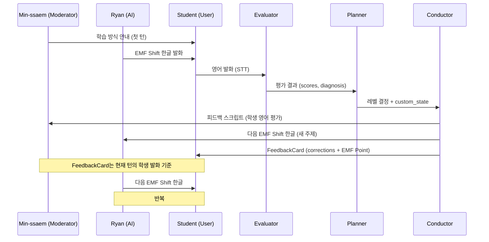

# EMF Reverse Learning 템플릿 개발 보고서

## 요약

기존 EMF(English Mapping Framework) 학습 방식을 **역방향으로 전환**하는 대화 템플릿을 구성했다. Ryan(외국인)이 영어 어순으로 배열된 어색한 한글(EMF Shift Korean)을 말하면, 학습자가 그 구조적 힌트를 듣고 영어 문장을 조립하는 방식이다.

**코드 수정 없이** 템플릿 PATCH API를 통한 설정값/프롬프트 변경만으로 구현했다.

> [!IMPORTANT] 핵심 컨셉
> 기존: 한국어 사고 → 영어 변환 (학습자가 Strip/Shift/Capture 수행)
> 변경: Ryan이 Shift 단계를 한글로 시연 → 학습자가 Capture(영어)만 수행. Ryan의 어색한 한글 자체가 영어 구조 힌트.

## 대상 템플릿

| 항목 | 값 |
|------|-----|
| Template ID | `a9b1baf9-867c-4632-a5d2-bca90ec98bdc` |
| Template Name | EMF Reverse Learning - Ryan's Shift Korean |
| Pipeline Mode | v0.2 (Evaluator → Planner → Conductor) |
| LLM Model | gemini-2.5-flash (Evaluator, Planner, Conductor 공통) |

## 구현한 내용

### 1. 참여자 역할 재정의

| 참여자 | Type | Order | 역할 |
|--------|------|-------|------|
| Min-ssaem | moderator | 0 | 첫 턴 학습 안내 + 매 턴 학생 영어 피드백 (1문장) |
| Ryan | ai | 1 | EMF Shift 한글 발화 (영어 SVO 어순의 어색한 한글) |
| Student | user | 2 | Ryan의 한글을 듣고 영어로 변환 |

> [!NOTE] 턴 순서 결정 방식
> `first_speaker` 설정은 `my_turn_service.py`에서 동작하지 않는다. 실제 턴은 `TurnOrchestrator`의 round-robin 로직 `(current_turn_index + 1) % len(participants)`에 의해 `order_index` 순서로 결정된다. 따라서 Min-ssaem을 order_index 0으로 배치하여 첫 발화자로 설정했다.

### 2. 턴 흐름

```
세션 시작: (-1+1)%3=0 → Min-ssaem (학습 방식 안내)
1라운드:  (0+1)%3=1 → Ryan (EMF Shift 한글)
          (1+1)%3=2 → Student (영어 발화)
          (2+1)%3=0 → Min-ssaem (피드백 + FeedbackCard)
2라운드:  (0+1)%3=1 → Ryan (새 주제)
          ...반복
```

### 3. Pipeline v0.2 프롬프트 설계

#### Evaluator (1,623자)

학생의 영어 발화를 EMF 관점에서 평가한다.

| Slot | 비중 | 평가 기준 |
|------|------|----------|
| slot_a | 25% | Ryan 한글에서 핵심 개념 파악 여부 |
| slot_b | 30% | 적절한 동사 선택. Ryan이 장악동사(있다/가지다)를 사용했으면 HAVE 요구, 일반동사(먹다)면 eat 허용 |
| slot_c | 25% | 영어 문법 완성도 (SVO, 전치사, 관사, 시제) |
| imitation | 10% | Ryan 구조 힌트 충실도 |
| complexity | 10% | 레벨 대비 복잡도 |

> [!WARNING] slot_b 평가 주의
> 초기 설계에서는 모든 표현에 장악동사를 강제하여 Ryan이 "먹다"라고 했을 때 학생의 "eat"에 감점을 줬다. Ryan이 장악동사 개념을 사용했을 때만 해당 control verb를 요구하도록 수정했다.

#### Planner (969자)

레벨 결정 및 custom_state 추적을 담당한다.

**레벨 변경 기준:**
- LEVEL_UP: 연속 2턴 overall_score 75 초과
- LEVEL_DOWN: overall_score 40 미만
- LEVEL_HOLD: 40-75 구간 또는 새 레벨 도착 직후
- 한 번에 1레벨 이상 점프 금지

**custom_state 추적 필드:**
- `current_control_verb`: 현재 레벨의 장악동사
- `verbs_mastered`: 습득 완료한 동사 목록
- `current_theme`: 현재 주제 (daily_life, emotions, work, relationships, abstract)
- `consecutive_success_count`: 연속 성공 횟수
- `last_emf_stage_focus`: Strip/Shift/Capture 중 취약 단계
- `turn_topic_history`: 최근 5개 토픽 (중복 방지)

#### Conductor (3,062자)

Ryan 스크립트와 Min-ssaem 피드백을 생성한다. 다음 처리 순서를 엄격히 따른다:

```
A. history_text에서 마지막 "Ryan:" 라인 찾기 (목표 표현)
B. user_transcript 읽기 (학생 발화)
C. corrections 생성 (A vs B 비교)
D. better_expressions 생성 (A와 B 기준, EMF Point)
E. Min-ssaem 텍스트 생성 (학생 영어만 평가, Ryan 한국어 평가 금지)
F. Ryan 다음 발화 생성 (완전히 독립된 새 주제)
```

### 4. Level Definitions (8단계)

EMF의 핵심 원칙에 따라 **동사는 단순하되 사고/상황은 복잡**하게 구성했다.

| Level | 이름 | 장악동사 | 표현 수준 |
|-------|------|---------|----------|
| 1 | 소유와 상태 장악 | HAVE, BE | 후회를 가지다, 접시 위에 많은 것 |
| 2 | 변화와 획득 장악 | GET | 신경에 올라타다, 통제 하에 두다 |
| 3 | 인과와 강제 장악 | MAKE | 엉망을 만들다, 감정을 만들다 |
| 4 | 이동과 배치 장악 | TAKE, PUT | 짐을 덜다, 압력을 놓다 |
| 5 | 유지와 전달 장악 | KEEP, GIVE | 기다리게 하다, 기회를 주다 |
| 6 | 비즈니스 복합 | 혼합 | 인과 보고, 협상, 책임 표현 |
| 7 | 감정 관용구 | 혼합 | 멘탈 잃다, 아이디어 없다 |
| 8 | 복합문 장악 | 혼합 | 관계대명사, 가정법, 순방향 처리 |

### 5. Ryan EMF Shift 한글 생성 규칙

Ryan의 한글은 영어 SVO 어순을 기계적으로 적용한 결과물이다.

**어순 규칙:** 주어 → 동사 → 목적어 → 시간/장소
- 동사는 반드시 두 번째 위치
- 시간/장소 부사는 항상 마지막 (한국어처럼 앞에 배치하지 않음)
- 모든 조사 제거 (이/가/은/는/을/를/에/에서)
- 쉼표로 단어 나열 금지 — 문장 형태로 작성
- 동사는 사전형(-다) 사용하여 한국인이 알아들을 수 있는 수준 유지

**장악동사 강제:** 현재 레벨의 level_instruction에 지정된 장악동사만 사용. Level 1이면 있다/이다만 허용.

### 6. FeedbackCard 데이터 구성

기존 FeedbackCard 컴포넌트의 코드 수정 없이 JSON 객체 형식으로 호환.

**corrections:** 학생 영어 오류 교정
```json
{"original": "in today morning", "corrected": "this morning"}
```

**better_expressions (EMF Point):** Strip/Shift/Capture 각 단계를 `\n`으로 줄 구분
```json
{
  "hint": "영어에서는 추상적 감정도 물건처럼 소유(Have)하는 구조로 표현합니다",
  "example": "나는 정말 후회돼\nStrip: 나, 후회, 행동\nShift: 나 가지다 후회 그것에 대한\nCapture: I have regrets about it.",
  "tier": "EMF Point"
}
```

> [!TIP] FeedbackCard 파싱 흐름
> Conductor JSON → `_normalize_string_list()` → `json.dumps(dict)` → string[] → FeedbackCard `parseItem()` → `{hint, example}` 파싱 → UI 렌더링

## 구현 흐름



## 기술적 결정사항

> [!NOTE] 결정: 코드 수정 없이 프롬프트만으로 구현
> 이 프로젝트는 다양한 템플릿을 실험하기 위한 AI Lab 환경이다. 특정 템플릿을 위한 코드 수정은 다른 템플릿에 영향을 줄 수 있으므로, PATCH API를 통한 설정값/프롬프트 변경만 진행했다.

> [!NOTE] 결정: LLM 모델 gemini-2.5-flash 선택
> 초기 gemini-2.0-flash에서 Ryan의 SVO 어순 강제, FeedbackCard hint/example 역할 구분, 템플릿 텍스트 복사 방지 등이 잘 동작하지 않아 gemini-2.5-flash로 업그레이드했다.

> [!NOTE] 결정: Conductor 처리 순서 명시 (A→F)
> Conductor가 Ryan 다음 스크립트를 먼저 생성하고 그 주제로 FeedbackCard를 오염시키는 문제가 반복되었다. 이를 해결하기 위해 "A. 이전 Ryan 발화 찾기 → B. 학생 발화 → C-D. 피드백 생성 → E. Min-ssaem → F. Ryan 신규 생성" 순서를 명시적으로 강제했다.

> [!NOTE] 결정: order_index로 턴 순서 제어
> `first_speaker: "moderator_first"` 설정이 `my_turn_service.py`에서 실제로 동작하지 않는 것을 확인했다. (해당 필드는 `run0_service.py`에서만 사용.) 대신 `order_index`를 Min-ssaem(0), Ryan(1), Student(2)로 설정하여 round-robin 로직으로 정확한 턴 순서를 구현했다.

## 반복 개선 과정에서 해결한 이슈

### 이슈 1: Ryan 동사 위치 (SOV → SVO)
- **증상:** Gemini 모델의 한국어 SOV 문법 편향으로 동사가 항상 문장 끝에 배치됨
- **시도:** 프롬프트에 SVO 규칙 명시, 자기검증 지시 추가, 모델 업그레이드
- **결과:** gemini-2.5-flash + self-check 지시로 개선됨. 완벽하지는 않으나 대부분 SVO 준수

### 이슈 2: FeedbackCard 주제 불일치
- **증상:** 학생이 "I feel happy"라고 했는데 FeedbackCard에 커피 관련 EMF Point 표시
- **원인:** Conductor가 Ryan 다음 주제를 먼저 생성하고 그 주제로 FeedbackCard를 오염
- **해결:** 처리 순서(A→F) 명시. "better_expressions: about step A and B only. Never about Ryan next topic from step F."

### 이슈 3: Min-ssaem 역할 혼선
- **증상:** 학생의 영어가 아닌 Ryan의 한국어 단어 선택을 교정 ("느끼보다 느끼다가 더 자연스러워요")
- **해결:** "Evaluate only the student ENGLISH. Never comment on Ryan Korean. Never discuss Ryan word choices."

### 이슈 4: `[object Object]` 표시
- **증상:** FeedbackCard에서 `[object Object]` 렌더링
- **원인:** Conductor가 `example` 필드를 중첩 JSON 객체로 반환 → `${example}` 템플릿 리터럴이 `[object Object]`로 변환
- **해결:** "ALL VALUES MUST BE PLAIN TEXT STRINGS. No nested objects."

### 이슈 5: better_expressions 템플릿 복사
- **증상:** example 필드에 "Korean thought - Strip: concepts - Shift: SVO reorder - Capture: English" 프롬프트 원문 그대로 출력
- **해결:** 프롬프트에서 복사 가능한 플레이스홀더 제거. "Do not copy placeholder text. Fill in real content."

### 이슈 6: Evaluator 장악동사 강제 평가
- **증상:** Ryan이 "먹다"(eat)를 사용했는데 학생의 "eat"에 감점 (HAVE를 사용하라고 평가)
- **해결:** slot_b 기준 수정. "When Ryan used a regular verb, the student should use the natural English equivalent. Do not penalize regular verbs when Ryan did not hint at a control verb."

### 이슈 7: 표현 단순화 문제
- **증상:** Level 1이 "concrete nouns only"로 제한되어 "나 가지다 책" 수준의 문장만 반복
- **해결:** level_definitions 재설계. 동사는 단순하되 사고/상황은 복잡하게. Level 1에서도 "나 가지다 후회 그것에 대한" 수준 허용

## 프롬프트 최적화

토큰 비용 절감을 위해 프롬프트를 반복 정리했다.

| 프롬프트 | 최종 길이 |
|---------|----------|
| evaluator_prompt | 1,623자 |
| planner_prompt | 969자 |
| conductor_prompt | 3,062자 |
| **합계** | **5,654자** |

## 관련 파일 (수정 없음, 참조만)

| 파일 | 역할 |
|------|------|
| `apps/server/app/services/conversation/conductor_service.py` | Conductor 스크립트 생성 |
| `apps/server/app/services/conversation/planner_service.py` | 레벨 결정 + custom_state |
| `apps/server/app/services/conversation/evaluator_service.py` | 학생 발화 평가 |
| `apps/server/app/services/conversation/turn_orchestrator.py` | 턴 순서 결정 (round-robin) |
| `apps/server/app/services/conversation/my_turn_service.py` | 세션 관리 + 파이프라인 실행 |
| `apps/admin/src/(fsd)/features/conversations/ui/FeedbackCard.tsx` | 피드백 UI 렌더링 |

## 알려진 이슈

1. **Ryan SVO 어순 완전 보장 불가:** gemini-2.5-flash에서도 간헐적으로 동사가 문장 끝에 배치됨. LLM의 한국어 문법 편향이 근본 원인이며, 프롬프트만으로는 100% 제어 불가. 코드 레벨의 후처리(문장 재배열) 또는 더 instruction-following이 강한 모델 사용이 근본 해결책.
2. **첫 턴 파이프라인 미실행:** 민쌤 안내(첫 턴)와 Ryan 첫 발화는 파이프라인(Evaluator/Planner/Conductor)을 거치지 않고 greeting_message 또는 기본 LLM 생성으로 처리됨. 첫 Ryan 발화의 장악동사 강제가 적용되지 않을 수 있음.

## 다음 단계

- [ ] 실제 세션 테스트를 통해 Level 1~3 표현 복잡도 검증
- [ ] Ryan SVO 어순 준수율 정량 측정 (10세션 이상)
- [ ] Level 6~8 (비즈니스, 관용구, 복합문) 실전 테스트
- [ ] FeedbackCard UI에서 Strip/Shift/Capture 줄바꿈이 정상 렌더링되는지 확인
- [ ] Conductor 모델 gemini-2.5-pro 비교 테스트 (SVO 어순 정확도 개선 여부)
- [ ] 사용자 피드백 수집 후 레벨 진행 속도(LEVEL_UP 기준) 조정
