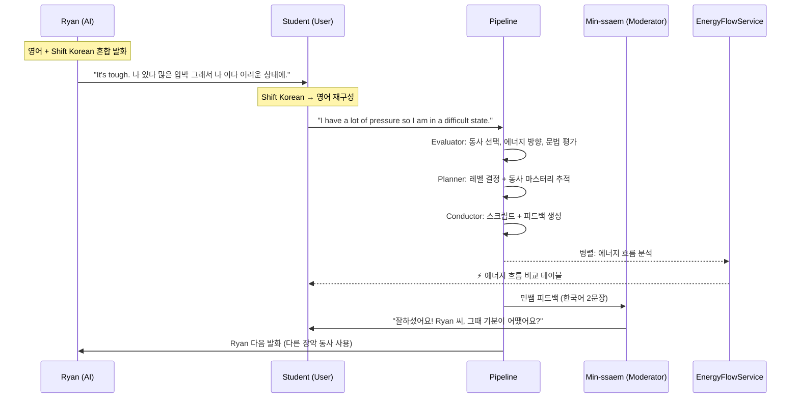

# EMF Reverse Learning v2 - Energy Flow 템플릿 개발 보고서

## 요약

기존 EMF 당구공 시나리오(v1)를 기반으로, **에너지 흐름(Energy Flow) 시각화**와 **역방향 학습(Reverse Learning)** 방식을 도입한 v2 템플릿을 설계·구현했다. 학생이 먼저 변환을 시도하는 것이 아니라, **AI(Ryan)가 먼저 영어+Shift Korean 혼합 발화**를 하고 학생이 Ryan의 한국어 부분을 영어로 재구성하는 역방향 흐름을 채택했다.

> [!IMPORTANT] 핵심 변경
> v1 대비 주요 차이: (1) 턴 순서 역전 (Ryan 먼저 → 학생 변환), (2) 에너지 흐름 비교 테이블 UI 신규, (3) 장악 동사 20개+ 다양성 강화, (4) 코드 수정 포함.

- **로컬 템플릿 ID**: `561c25b1-0ba1-4e3b-92ff-f4ba903ea84b`
- **프로덕션 템플릿 ID**: `d39fb054-3686-480c-9c53-5a43a098e213`
- **파이프라인**: v0.2 (Evaluator → Planner → Conductor + EnergyFlowService 병렬)
- **참여자**: 3인 (Min-ssaem, Ryan, Student)

---

## 학습 방식: Reverse Learning

### v1 vs v2 비교

| 항목 | v1 (당구공) | v2 (Energy Flow) |
|------|-----------|-----------------|
| 턴 순서 | 민쌤→Student→Coach Ryan | Ryan→Student→민쌤 |
| 학생 역할 | 한국어 → 영어 변환 (직접 생성) | Ryan의 Shift Korean → 영어 변환 (재구성) |
| Ryan 발화 | 사후 모범 답안 (순수 영어) | **영어 + Shift Korean 혼합 발화** |
| 에너지 흐름 | 없음 | 동사별 에너지 방향 비교 테이블 |
| 피드백 POINT | Strip/Shift/Capture (단일 절구) | Strip/Shift/Capture (Ryan의 한국어 전체) |

### 턴 플로우



---

## 참여자 구성

| # | 이름 | 타입 | LLM | 핵심 역할 |
|---|------|------|-----|----------|
| 0 | Min-ssaem | MODERATOR | gemini-2.5-flash-lite | 한국어 피드백(2문장) + Ryan에게 질문 |
| 1 | Ryan | AI | gemini-2.5-flash-lite | 영어 + Shift Korean 혼합 발화 |
| 2 | Student | USER | gemini-2.5-flash | Ryan의 한국어 → 영어 재구성 |

---

## 코드 변경사항

### 백엔드

| 파일 | 변경 유형 | 내용 |
|------|----------|------|
| `pipeline_schemas.py` | 수정 | `EnergyFlowOutput`, `ConductorOutput.energy_flow` 추가 |
| `energy_flow_service.py` | **신규** | 별도 LLM으로 에너지 흐름 비교 테이블 생성 |
| `conductor_service.py` | 수정 | JSON trailing comma 정리, `max_output_tokens` 4096, 로깅 강화 |
| `my_turn_service.py` | 수정 | Energy Flow 병렬 호출, `greeting_message` 바이패스, `!m.isUser` 필터 |
| `conversations.py` (API) | 수정 | `POST /sessions/{id}/energy-flow` 엔드포인트 추가 |
| `conversation.py` (Model) | 수정 | `energy_flow_enabled` 컬럼 추가 |

### 프론트엔드

| 파일 | 변경 유형 | 내용 |
|------|----------|------|
| `EnergyFlowCard.tsx` | **신규** | 에너지 흐름 비교 테이블 UI 컴포넌트 |
| `TranscriptTimeline.tsx` | 수정 | 사용자 메시지 아래 EnergyFlowCard 렌더링 |
| `useMyTurn.ts` | 수정 | `fetchEnergyFlow` 병렬 호출, `energyFlowEnabled` 토글 |
| `ConversationStage.tsx` | 수정 | 템플릿의 `energy_flow_enabled` 플래그 전달 |
| `TemplateEditor.tsx` | 수정 | Energy Flow 활성화 토글 UI |
| `types.ts` | 수정 | `energy_flow_enabled` 필드 추가 |

### 마이그레이션

- `q2r3s4t5u6v7_add_energy_flow_enabled.py`: `conversation_templates.energy_flow_enabled` 컬럼

---

## v0.2 파이프라인 상세

### Evaluator — 에너지 방향 기반 평가

기존 3-slot 평가에 **에너지 방향 기반 채점 체계**를 도입했다.

| 슬롯 | 가중치 | 평가 내용 |
|------|--------|----------|
| slot_a (25%) | 개념 추출 | Ryan의 한국어에서 개념을 얼마나 정확히 파악했나 |
| slot_b (30%) | **장악 동사 선택** | 에너지 방향에 맞는 동사를 사용했나 (HAVE vs GET vs PUT 등) |
| slot_c (25%) | 문법·완성도 | SVO 어순, 자연스러움, 다중 문장 처리 |
| imitation (10%) | 구조 모방 | Ryan의 구조적 힌트를 따랐나 |
| complexity (10%) | 복잡도 | 레벨에 맞는 복잡도인가 |

**에너지 방향 그룹 기반 slot_b 채점:**

| 에너지 방향 | 동사 그룹 |
|-----------|----------|
| 안으로 품음/받음 | HAVE, GET, CATCH, TAKE, BRING, PICK |
| 밖으로 보냄/놓음 | GIVE, PUT, THROW, PUSH, DROP |
| 유지/고정 | KEEP, HOLD, SET, RUN |
| 변환/분리 | MAKE, TURN, BREAK, CUT |

- 기본 매핑과 정확히 일치 → slot_b 만점
- 다른 동사지만 같은 에너지 방향 그룹 → slot_b 최대 7점
- 에너지 방향 반대 → slot_b 최대 4점 + `WRONG_ENERGY_DIRECTION` 진단

### Planner — 시나리오·동사 마스터리 관리

`custom_state`로 세션 간 동사 마스터리와 시나리오 테마를 추적:

```json
{
  "current_control_verb": "HAVE",
  "verbs_mastered": {"HAVE": {"mastered": true}, "GET": {"mastered": false}},
  "energy_direction_errors": 0,
  "current_scenario_theme": "work_deadline",
  "scenario_turn_count": 3,
  "theme_history": ["work_deadline", "relationship", "finance"]
}
```

### Conductor — 다양성 강화

주요 프롬프트 규칙:

1. **Min-ssaem**: 한국어 100%, 2문장 제한, 5가지 질문 유형 가이드라인
2. **Ryan**: 20개+ 장악 동사 목록, 연속 2턴 동일 동사 금지
3. **POINT**: Ryan의 한국어 전체를 Strip/Shift/Capture로 분석
4. **에너지 흐름**: ConductorService에서 제거 → 별도 EnergyFlowService로 병렬 처리

---

## 에너지 흐름 UI

EnergyFlowService가 동사별 에너지 방향 비교 테이블을 생성:

```
⚡ 에너지 흐름  HAVE
  내 영역 안에 품고 소유하는 힘

| 상황          | 영어                    | 에너지 방향        |
|--------------|------------------------|--------------------|
| 압박이 있어    | I HAVE pressure        | 안으로 품음         |
| 압박을 줘     | I PUT pressure on him  | 밖으로 놓음         |
| 압박을 받아    | I GET pressure from him | 안으로 받아들임      |
```

- 학생 메시지 아래 자동 표시
- 템플릿별 `energy_flow_enabled` 토글로 활성화/비활성화
- 메인 파이프라인과 독립적으로 병렬 실행 (지연 없음)

---

## 기술적 결정사항

> [!NOTE] 결정 1: 에너지 흐름 병렬 처리
> EnergyFlowService를 ConductorService에서 분리하여 별도 API로 병렬 호출. Conductor JSON 응답이 energy_flow 포함 시 토큰 한도(3000)를 초과하여 JSON 잘림 발생 → 별도 서비스로 분리하여 해결.

> [!NOTE] 결정 2: JSON Trailing Comma 정리
> Gemini 2.5 Flash가 `response_mime_type="application/json"` 설정에서도 가끔 trailing comma를 포함한 JSON을 반환. `_parse_response`에서 `re.sub(r',\s*([}\]])', ...)` 정규식으로 파싱 전 정리.

> [!NOTE] 결정 3: 스피커 필터링 범용화
> 프론트엔드에서 `m.speaker === 'Min-ssaem'` 하드코딩 대신 `!m.isUser` 필터 사용. 다른 템플릿에서도 moderator 이름이 달라도 정상 동작.

> [!WARNING] max_output_tokens 조정
> Conductor의 `max_output_tokens`를 3000 → 4096으로 상향. Conductor prompt가 ~8,600자(~2,150 토큰)이고 한국어+영어 혼합 JSON 응답이 길어질 수 있어 여유 확보.

---

## 디버깅 이력

| 문제 | 원인 | 해결 |
|------|------|------|
| 민쌤 "좋아요! 계속 연습해 볼게요." 반복 | Conductor JSON 파싱 실패 → fallback 트리거 | Trailing comma 정리 + max_output_tokens 4096 |
| JSON 잘림 (Unterminated string) | energy_flow 포함 시 3000 토큰 초과 | energy_flow를 별도 EnergyFlowService로 분리 |
| 민쌤 영어로 질문 | system_prompt에 한국어 강제 규칙 누락 | system_prompt에 "절대 영어로 말하지 않습니다" 명시 |
| Ryan HAVE/BE만 반복 | Conductor prompt에 동사 다양성 규칙 없음 | 20개 장악 동사 목록 + "연속 2턴 동일 동사 금지" |
| 에너지 흐름 미표시 | energy_flow_enabled 토글 미구현 | DB 컬럼 + 프론트엔드 토글 추가 |

---

## 프롬프트 점검 및 수정 이력

| # | 이슈 | 심각도 | 상태 |
|---|------|--------|------|
| 1 | conductor에 energy_flow JSON 예시 블록 잔재 | 🔴 | ✅ 수정 완료 |
| 2 | conductor Ryan 동사 다양성 규칙 중복 | 🟡 | ✅ 수정 완료 |
| 3 | evaluator 동사 매핑 6개 → 20개+ 확장 + 에너지 방향 그룹 채점 | 🟡 | ✅ 수정 완료 |
| 4 | system_prompt ↔ conductor 역할 중복 | 🟡 | ✅ 수정 완료 (system_prompt 282자로 축소, 첫 턴 규칙만 유지) |

---

## 테스트 결과

### 정상 동작 확인

- [x] 에너지 흐름 카드 표시
- [x] Min-ssaem 한국어 발화
- [x] Ryan 영어+Shift Korean 혼합 발화
- [x] POINT Strip/Shift/Capture 전체 절구 커버
- [x] 교정(Corrections) 정상 표시
- [x] 세션 주제 입력 → pipeline 전달 정상
- [x] energy_flow_enabled 토글 동작
- [x] evaluator 에너지 방향 그룹 기반 채점

### 실 테스트 필요

- [ ] Ryan 동사 다양성 — 20개 동사 프롬프트 적용 후 검증
- [ ] Min-ssaem 질문 다양성 — 5가지 질문 유형 가이드라인 적용 후 검증

---

## 배포 현황

| 환경 | 상태 | 템플릿 ID |
|------|------|----------|
| 로컬 | ✅ 배포 완료 | `561c25b1-0ba1-4e3b-92ff-f4ba903ea84b` |
| 프로덕션 | ✅ 배포 완료 | `d39fb054-3686-480c-9c53-5a43a098e213` |
