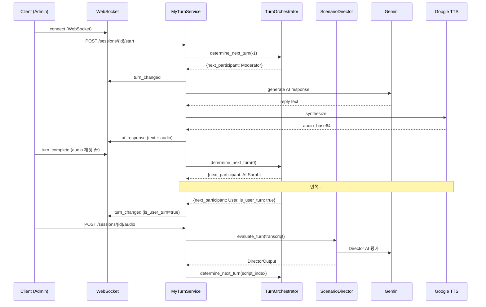
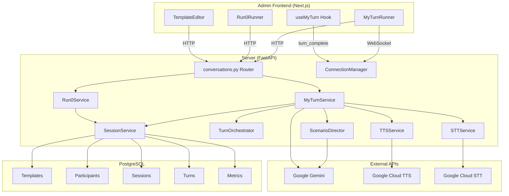

# My Turn 대화 시스템 — 코드베이스 분석 요약

> **분석일**: 2026-02-09
> **분석 범위**: Server (Python/FastAPI), Admin (Next.js), 문서 (docs/plan)

---

## 1. 현재 구현 상태 요약

### 1.1 서버 (Backend)

| 레이어 | 파일 | 상태 | 핵심 기능 |
|--------|------|------|-----------|
| **Models** | [conversation.py](file:///Users/ochihyo/Documents/antigravity/study-english/apps/server/app/models/conversation.py) | ✅ 완료 | Template, Participant, Session, Turn, Metrics 모델 정의 |
| **Schemas** | [conversation.py](file:///Users/ochihyo/Documents/antigravity/study-english/apps/server/app/schemas/conversation.py) | ✅ 완료 | Pydantic 스키마 (Create/Update/Response), RUN0 voice 스키마 |
| **API** | [conversations.py](file:///Users/ochihyo/Documents/antigravity/study-english/apps/server/app/api/v1/conversations.py) | ✅ 완료 | Template CRUD, Session CRUD, RUN0 voice, My Turn start/audio, WebSocket signaling |
| **RUN0 Service** | [run0_service.py](file:///Users/ochihyo/Documents/antigravity/study-english/apps/server/app/services/conversation/run0_service.py) | ✅ 완료 | STT→LLM→TTS 파이프라인, 인사말 생성, 타이밍 메트릭 |
| **Session Service** | [session_service.py](file:///Users/ochihyo/Documents/antigravity/study-english/apps/server/app/services/conversation/session_service.py) | ✅ 완료 | Session CRUD, Turn 추가/조회, 메트릭 계산, 타임아웃 |
| **My Turn Service** | [my_turn_service.py](file:///Users/ochihyo/Documents/antigravity/study-english/apps/server/app/services/conversation/my_turn_service.py) | ✅ 완료 | 세션 시작, 턴 완료, 유저 오디오 처리, AI 턴 실행 |
| **Turn Orchestrator** | [turn_orchestrator.py](file:///Users/ochihyo/Documents/antigravity/study-english/apps/server/app/services/conversation/turn_orchestrator.py) | ✅ 완료 | 스크립트 모드 (turn_sequence) + 라운드 로빈 fallback |
| **Scenario Director** | [scenario_director.py](file:///Users/ochihyo/Documents/antigravity/study-english/apps/server/app/services/conversation/scenario_director.py) | ✅ 완료 | Director AI (Gemini)로 유저 응답 평가 + 다음 턴 지시 |
| **STT Service** | [stt_service.py](file:///Users/ochihyo/Documents/antigravity/study-english/apps/server/app/services/conversation/stt_service.py) | ✅ 완료 | Google Cloud STT |
| **TTS Service** | [tts_service.py](file:///Users/ochihyo/Documents/antigravity/study-english/apps/server/app/services/conversation/tts_service.py) | ✅ 완료 | Google Cloud TTS, SSML 지원, 멀티보이스 |
| **Signaling** | [signaling.py](file:///Users/ochihyo/Documents/antigravity/study-english/apps/server/app/services/conversation/signaling.py) | ✅ 완료 | WebSocket ConnectionManager (단일 세션당 1 클라이언트) |
| **WebRTC Service** | [webrtc_service.py](file:///Users/ochihyo/Documents/antigravity/study-english/apps/server/app/services/conversation/webrtc_service.py) | ⚠️ 스텁 | SDP offer/answer 핸들링 (실제 미디어 스트리밍 미구현) |

### 1.2 Admin 프론트엔드

| 컴포넌트 | 파일 | 상태 | 핵심 기능 |
|----------|------|------|-----------|
| **TemplateEditor** | [TemplateEditor.tsx](file:///Users/ochihyo/Documents/antigravity/study-english/apps/admin/src/(fsd)/features/conversations/ui/TemplateEditor.tsx) | ✅ 완료 | 참여자 편집, 시나리오 스크립트, Director 프롬프트, scene context |
| **MyTurnRunner** | [MyTurnRunner.tsx](file:///Users/ochihyo/Documents/antigravity/study-english/apps/admin/src/(fsd)/features/conversations/ui/MyTurnRunner.tsx) | ✅ 완료 | 참여자 카드 UI, 녹음, 대화 기록, 턴 상태 표시 |
| **useMyTurn** | [useMyTurn.ts](file:///Users/ochihyo/Documents/antigravity/study-english/apps/admin/src/(fsd)/features/conversations/model/useMyTurn.ts) | ✅ 완료 | WebSocket + WebRTC 연결, 세션 시작/종료, 오디오 전송 |
| **Run0Runner** | [Run0Runner.tsx](file:///Users/ochihyo/Documents/antigravity/study-english/apps/admin/src/(fsd)/features/conversations/ui/Run0Runner.tsx) | ✅ 완료 | RUN0 HTTP 기반 테스트 UI |
| **TemplateList** | [TemplateList.tsx](file:///Users/ochihyo/Documents/antigravity/study-english/apps/admin/src/(fsd)/features/conversations/ui/TemplateList.tsx) | ✅ 완료 | 템플릿 목록/검색 |
| **SessionSettings** | [SessionSettings.tsx](file:///Users/ochihyo/Documents/antigravity/study-english/apps/admin/src/(fsd)/features/conversations/ui/SessionSettings.tsx) | ✅ 완료 | 세션 설정 (난이도, 음성 등) |

### 1.3 테스트

> ⚠️ **서버에 테스트 파일이 존재하지 않습니다.** `apps/server` 내에 `test*` 패턴으로 검색된 파일이 0개입니다.

---

## 2. 대화 플로우 분석

### 2.1 My Turn 플로우 (현재 구현)

### 2.2 턴 결정 로직

`TurnOrchestrator.determine_next_turn()`은 두 가지 모드를 지원합니다:

1. **스크립트 모드** (`turn_sequence` 존재 시): `script_index`에 해당하는 단계의 participant를 반환
2. **라운드 로빈** (기본): `order_index`순으로 참여자를 순환

---

## 3. "Cocktail Party" 템플릿 — AI 루프 이슈 분석

### 3.1 근본 원인

"Cocktail Party" 템플릿에서 AI들끼리만 대화하는 문제의 근본 원인:

**라운드 로빈 모드에서 `turn_complete` 시그널이 자동 체인을 형성:**

1. AI-1이 발화 → 오디오 재생 완료 → 클라이언트가 `turn_complete` 전송
2. `complete_turn()` → `determine_next_turn()` → 라운드 로빈으로 AI-2 선택
3. AI-2도 `is_user_turn=false` → 바로 `process_ai_turn()` 실행
4. AI-2 발화 → 클라이언트가 다시 `turn_complete` 전송
5. **무한 루프**: User 턴에 도달해도, User가 발화할 시간/기회 부재

> [!IMPORTANT]
> `MyTurnRunner.tsx`의 `useMyTurn` hook에서 `ai_response` 수신 시 오디오가 끝난 직후 자동으로 `turn_complete`를 전송합니다 (L119-123). 이것이 핵심 — **AI 턴 완료 시 즉시 다음 턴으로 넘어가므로 여러 AI가 연속으로 발화하면 User 턴에 도달하기 전까지 멈추지 않습니다.**

### 3.2 "Basic Greeting Test" 와의 차이

- **Basic Greeting Test**: 참여자 2명 (AI 1명 + User 1명) → 라운드 로빈이 AI→User→AI→User로 정상 작동
- **Cocktail Party**: 참여자 4명+ (Moderator + AI들 + User) → Moderator→AI-1→AI-2→User 순서지만, `complete_turn`이 각 AI 발화 후 자동 발생하여 User 턴까지 AI들이 연속 발화

### 3.3 해결 방안 (이전 대화에서 이미 수정됨)

대화 이력에 따르면, 이 이슈는 **Conversation `ea5362cf`** (Debugging AI Conversation Loop)에서 이미 디버깅 및 수정되었습니다. Director AI의 프롬프트에 "유저 참여 우선" 규칙이 강화되었고, 오케스트레이션 프롬프트가 불변(immutable)으로 처리되었습니다.

---

## 4. 하드코딩된 콘텐츠 점검

### 4.1 결과: 서버에 하드코딩된 참여자 이름 없음 ✅

| 파일 | "Sarah"/"Mike" 언급 | 용도 |
|------|---------------------|------|
| `tts_service.py` L22, L28 | `AVAILABLE_VOICES` 딕셔너리 | TTS 음성의 **표시 이름** (UI 레이블), 대화 로직과 무관 |
| `models/conversation.py` L50, L192 | 독스트링 예시 | 코드 문서화용, 로직에 영향 없음 |
| `schemas/conversation.py` L68 | 필드 description | 스키마 문서화용, 로직에 영향 없음 |

> [!NOTE]
> 참여자 이름, 페르소나, 음성 설정은 **모두 DB (ConversationTemplate + ConversationParticipant)에서 동적으로 로드**됩니다. Admin UI의 `TemplateEditor`에서 자유롭게 설정 가능합니다.

### 4.2 Admin UI에서 설정 가능한 정적 콘텐츠

`TemplateEditor.tsx`에서 설정 가능한 항목들:

| 항목 | Admin UI 필드 | DB 컬럼 |
|------|---------------|---------|
| 참여자 이름 | ✅ `이름` 입력란 | `participants.name` |
| 참여자 페르소나 | ✅ `페르소나` textarea | `participants.persona` |
| 첫 인사말 | ✅ `첫 인사말 (Greeting)` 입력란 | `participants.greeting_message` |
| 기본 음성 | ✅ `기본 목소리` select | `participants.voice_id` |
| 참여자 순서 | ✅ 화살표 버튼 (위/아래) | `participants.order_index` |
| 장면 설명 | ✅ `장면 콘텍스트` textarea | `templates.scene_context` |
| 시나리오 스크립트 | ✅ 턴 순서 에디터 | `templates.turn_sequence` |
| Director 추가 지시 | ✅ `Additional Instructions` textarea | `templates.director_system_prompt` |

---

## 5. 미구현 기능 (Master Plan 기준)

### Phase 2: WebRTC 기반 구축 (미구현)

| 기능 | 현재 상태 | 필요 작업 |
|------|-----------|-----------|
| WebRTC 미디어 스트리밍 | ❌ `webrtc_service.py`는 스텁 | 실제 `aiortc` 기반 미디어 트랙 처리 |
| 실시간 STT (스트리밍) | ❌ HTTP 기반 배치 STT만 존재 | Google STT 스트리밍 API 연동 |
| 서버→클라이언트 TTS 스트리밍 | ❌ base64 전체 전송 | WebRTC DataChannel 또는 미디어 트랙으로 스트리밍 |
| ICE candidate 처리 | ❌ 무시됨 (L490-491) | 완전한 ICE 핸들링 |

### Phase 3: 턴 관리 완성 (부분 구현)

| 기능 | 현재 상태 | 필요 작업 |
|------|-----------|-----------|
| 턴 순서 DB 스키마 | ✅ `turn_sequence` JSON 필드 | 완료 |
| 턴 순서 설정 UI | ✅ `TemplateEditor` 시나리오 스크립트 | 완료 |
| 서버 턴 오케스트레이터 | ✅ `TurnOrchestrator` | 개선 필요 (아래 참고) |
| 클라이언트 턴 동기화 | ✅ WebSocket `turn_changed` | 기본 구현 완료 |

### Phase 4: 자유난입 모드 (미구현)

| 기능 | 현재 상태 |
|------|-----------|
| VAD (음성 활동 감지) | ❌ |
| 화자 분리 | ❌ |
| 실시간 발화 감지 | ❌ |

### Phase 5: 최적화 & 고급 기능 (미구현)

| 기능 | 현재 상태 |
|------|-----------|
| 힌트 시스템 | ❌ |
| 피드백/점수 시스템 | ❌ |
| 발음 평가 | ❌ |
| E2E 지연 최적화 | 부분 (RUN0 타이밍 메트릭만 존재) |

---

## 6. 재사용 가능한 코드

### 6.1 서비스 레이어

| 코드 | 재사용 가능 범위 |
|------|-----------------|
| `SessionService` | Session CRUD, Turn 관리, 메트릭 계산 — My Turn과 RUN0 공용 |
| `TTSService` | 독립적인 TTS 유틸리티 — SSML, 멀티보이스, 파일 저장 |
| `STTService` | 독립적인 STT 유틸리티 |
| `ConnectionManager` (signaling) | WebSocket 관리 — 세션별 연결 추적 |
| `ScenarioDirector` | Director AI 패턴 — 다른 시나리오에도 적용 가능 |

### 6.2 Admin 프론트엔드

| 코드 | 재사용 가능 범위 |
|------|-----------------|
| `VoiceRecorder` | 음성 녹음 컴포넌트 — 어디서든 재사용 가능 |
| `useMyTurn` hook | WebSocket + WebRTC 연결 패턴 |
| `TemplateEditor` | 템플릿 편집 UI 패턴 (참여자, 시나리오 스크립트) |
| `conversationsApi.ts` | API 클라이언트 함수들 |

### 6.3 모델/스키마

| 코드 | 비고 |
|------|------|
| `ConversationTemplate` 모델 | 다자 대화의 기반 모델 — 잘 설계됨 |
| `ConversationParticipant` 모델 | 멀티보이스, 페르소나, 순서 지원 |
| `ConversationTurn` 모델 | 상세 타이밍 필드 (t0~t3) 포함 — 레이턴시 분석에 유용 |
| Pydantic 스키마 구조 | Base → Create/Update → Response 패턴 일관성 |

---

## 7. 아키텍처 다이어그램

