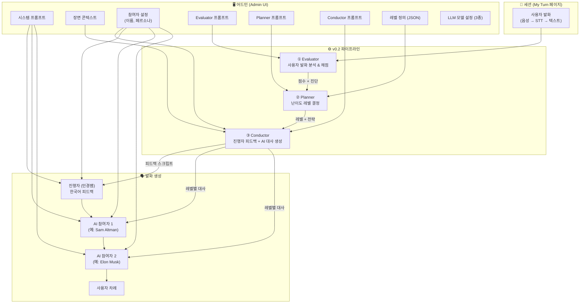
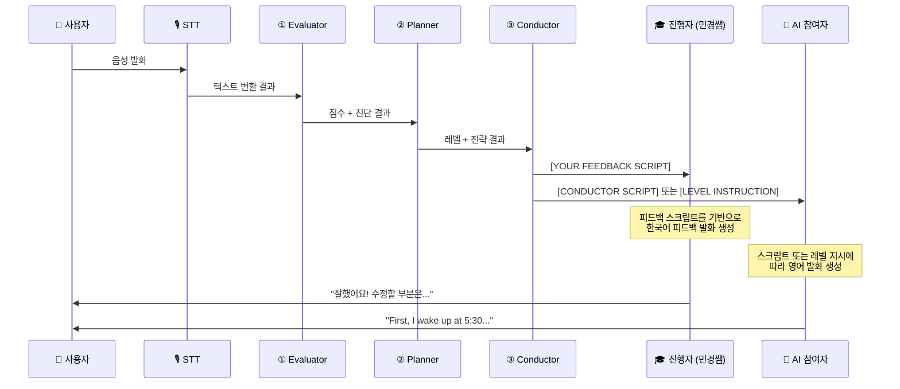
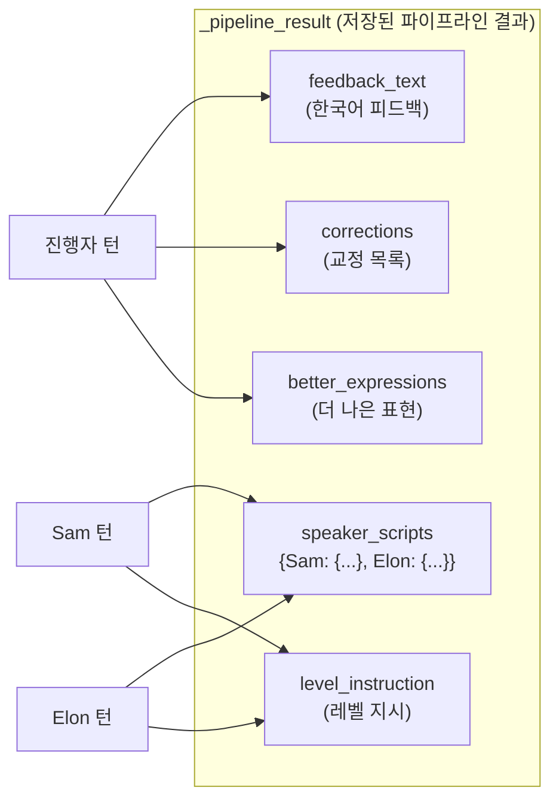

# Narrative Sync v0.2 파이프라인 개발 보고서

> **최종 수정일**: 2026-03-04  
> **대상**: 기획자, 개발자, 운영자

---

## 1. 전체 구조: 어드민 설정 → 파이프라인 → 발화 생성

### 1.1 전체 흐름도



### 1.2 어드민 설정값들의 연결 관계

| 어드민 설정 | 어디에서 사용되는가 | 역할 |
|------------|-------------------|------|
| **시스템 프롬프트** | 모든 AI 참여자의 LLM 호출 시 | AI의 기본 성격, 대화 규칙, A-B-C 서사 구조 등을 정의 |
| **장면 콘텍스트** | AI 턴 생성 시 + Conductor | 대화의 배경 상황 (예: "아침 기상과 직후 행동에 대해 이야기") |
| **참여자 설정** | AI 턴 생성 시 + Conductor | 각 AI의 이름, 역할(moderator/ai/user), 페르소나 |
| **Evaluator 프롬프트** | Evaluator 모듈 | 사용자 발화를 어떤 기준으로 채점할지 결정 |
| **Planner 프롬프트** | Planner 모듈 | 채점 결과를 보고 어떤 레벨로 이동할지 결정 |
| **Conductor 프롬프트** | Conductor 모듈 | 진행자 피드백과 AI 대사를 어떻게 생성할지 결정 |
| **레벨 정의 (JSON)** | Planner 모듈 | 몇 단계 난이도 체계를 쓸 것인가, 각 단계의 설명과 지시문 |
| **LLM 모델 (3종)** | 각 파이프라인 모듈 | 각 모듈이 사용하는 AI 모델 (예: gemini-2.0-flash) |

### 1.3 설정의 적용 원리

**커스텀 프롬프트 = 완전 대체 (Override)**

3개 파이프라인 모듈 모두 동일한 규칙을 따릅니다:
- 커스텀 프롬프트가 **비어 있으면** → 코드에 내장된 **기본 Base Prompt**가 사용됨
- 커스텀 프롬프트를 **입력하면** → 기본 Base Prompt를 **완전히 대체**함 (추가가 아님!)

```
Evaluator: custom_prompt or EVALUATOR_BASE_PROMPT
Planner:   custom_prompt or PLANNER_BASE_PROMPT
Conductor: custom_prompt or CONDUCTOR_BASE_PROMPT
```

---

## 2. 파이프라인 각 모듈 상세 설명

### 2.1 Evaluator (채점자)

**역할**: 사용자가 방금 말한 영어 문장을 분석하고 점수를 매깁니다.

**채점 기준**:
- **서사 슬롯 A/B/C** — 문장에 도입(A), 본론(B), 마무리(C)가 있는지 (각 0~10점)
- **모방 점수** — 이전에 AI가 보여준 패턴을 얼마나 잘 따라했는지 (0~10점)
- **복잡도 점수** — 사용한 문법/어휘의 난이도 (0~10점)
- **유창도** — 말 속도, 멈춤 횟수, 머뭇거림 (um, uh) 감지
- **종합 점수** — 100점 만점으로 환산

**진단(Diagnosis)**: 주요 문제점 하나를 식별합니다:
- `MISSING_SLOT_A`: 도입부 없음
- `MISSING_SLOT_B`: 본론 없음
- `MISSING_SLOT_C`: 마무리 없음
- `LOW_IMITATION`: 패턴 미사용
- `NONE`: 양호

**Base Prompt 핵심 내용**:
```
당신은 영어 학습 파이프라인의 Evaluator 모듈입니다.
사용자의 최신 발화를 분석하여 STRICT JSON 평가를 생성하세요.

채점 기준:
1. 서사 슬롯 (A/B/C) — 각 0~10점
2. 모방 점수 (0~10)
3. 복잡도 점수 (0~10)
4. 유창도 (멈춤 횟수, 분당 단어 수)
5. 진단 — 주요 문제 식별

※ 출력: 엄격한 JSON 형식
```

---

### 2.2 Planner (전략가)

**역할**: Evaluator의 채점 결과를 보고 "다음 턴에 몇 레벨로 갈지"를 결정합니다.

**결정 로직** (LLM 기반, 사용자 실력에 맞게 자유롭게 레벨 지정):
- 사용자의 **실제 입증된 실력**에 맞는 레벨로 직접 지정
- Level 1 → Level 7 같은 **다단계 점프 가능**
- Level 8 → Level 3 같은 **다단계 하향도 가능**
- 원어민 수준 발화 → **즉시 Level 10**
- 기본 SVO도 못 하면 → **즉시 Level 1**
- LLM API 장애 시에만 규칙 기반 fallback 동작

**레벨 정의** (기본 10단계, Admin에서 커스텀 가능):

| 레벨 | 이름 | 예시 |
|------|------|------|
| 1 | 기본 SVO | I wake up. I eat breakfast. |
| 2 | 시간/장소 추가 | I wake up at 7. I eat in the kitchen. |
| 3 | 형용사 추가 | I drink hot coffee. I eat a big breakfast. |
| 4 | 부사 추가 | I slowly wake up. I carefully make breakfast. |
| 5 | 접속사 | I wake up and stretch, but I'm still tired. |
| 6 | 복문 | When I wake up, I feel tired because I slept late. |
| 7 | 구동사 | I get up early. I look forward to breakfast. |
| 8 | 비유/관용표현 | I feel like a million bucks after my morning jog. |
| 9 | 복합 시제 | I had been sleeping until my alarm went off. |
| 10 | 원어민 수준 | 모든 구조를 자유롭게 혼합하여 자연스럽게 표현 |

**출력**: `new_level`, `path`, `reasons`, `focus_area`

**Base Prompt 핵심 내용**:
```
당신은 영어 학습 대화 시스템의 Planner 모듈입니다.
Evaluator의 진단을 분석하여 학생에게 최적의 다음 난이도 레벨을 결정하세요.
사용자의 실제 입증된 실력에 맞게 레벨을 직접 지정하세요 — 소폭 증감에 제한하지 마세요.

결정 가이드라인:
- 사용자의 실제 입증된 언어 능력을 기반으로 레벨을 지정
- 사용자 실력에 가장 잘 맞는 레벨로 직접 설정
- Level 1 → Level 7 같은 다단계 점프 가능
- Level 8 → Level 3 같은 다단계 하향 가능
- 원어민 수준 → 즉시 Level 10
- 기본 SVO도 못 하면 → 즉시 Level 1

※ 출력: new_level, path, action_code, reasons, focus_area (JSON)
```

---

### 2.3 Conductor (지휘자)

**역할**: Planner의 결정을 받아 **두 가지를 동시에 생성**합니다:

1. **진행자(민경쌤) 피드백 스크립트** — 한국어로:
   - 칭찬 또는 격려 (1~2문장)
   - 오류 교정 (틀린 표현 → 올바른 표현)
   - 더 자연스러운 표현 제안 (구동사, 연어 등)
   - 이번 라운드의 레벨 미션 안내

2. **AI 참여자별 영어 대사** — 해당 레벨에 맞춰:
   - 각 AI의 페르소나 성격 반영
   - A-B-C 서사 구조 (Context → Core Story → Feeling)
   - 2~4문장

**Base Prompt 핵심 내용**:
```
당신은 영어 학습 대화 시스템의 Conductor 모듈입니다.

Job 1: 진행자(민경쌤) 피드백 생성 (한국어)
  - 칭찬, 교정, 더 나은 표현 제안, 레벨 미션 안내

Job 2: AI 참여자별 레벨 지시문 생성 (영어)
  - A-B-C 서사 구조 데모
  - 각 페르소나 성격 반영
  - 지정 레벨의 문법 구조 사용

규칙:
  - return_to_user_after는 항상 false
  - 진행자는 한국어, AI 참여자는 영어
  - 각 AI 대사는 2~4문장

※ 출력: feedback_text, level_instruction, corrections,
         better_expressions, scripts (JSON)
```

---

## 3. 어드민 프롬프트 작성 가이드

### 3.1 시스템 프롬프트 (가장 중요!)

시스템 프롬프트는 **모든 AI 참여자가 매 턴 보는 기본 지침**입니다. 여기에 적은 내용이 대화 전체의 동작을 결정합니다.

**반드시 포함해야 할 내용**:

```
1. A-B-C 서사 구조 설명
   → "모든 발화는 A(도입) → B(본론) → C(감상/느낌) 구조를 따른다"

2. 첫 라운드 행동 지시
   → "첫 라운드에서는 자기 이야기를 직접 들려줘라. 사용자에게 질문하지 마라."
   ※ 이것이 없으면 AI가 질문만 하는 문제가 발생합니다!

3. 레벨 1 기본 패턴
   → "처음에는 Level 1 (SVO 구조)로 시작한다"
   → "앵커 구문: First, I... Then, I... Overall, I feel..."

4. 역할 정의
   → "진행자는 한국어로 피드백을 주는 선생님 역할"
   → "AI 참여자는 영어로 자기 이야기를 들려주는 역할"

5. 금지 사항
   → "사용자에게 질문하지 마라"
   → "다른 참여자의 발화를 평가하지 마라"
   → "자기 이야기만 해라"
```

**예시** (Morning Routine 템플릿용):
```
You are a participant in an English learning group conversation about daily routines.

## A-B-C Narrative Structure
Every response must follow the A-B-C structure:
- [A] Context: Set the scene (time, place, situation) - 1 sentence
- [B] Core Story: Describe actions with specific details - 2-3 sentences
- [C] Feeling: Share your emotion or reflection - 1 sentence

## Rules
1. In the FIRST ROUND, share YOUR OWN morning routine story. Do NOT ask the user questions.
2. Start at Level 1: Use simple Subject-Verb-Object sentences only.
3. Use anchor phrases: "First, I..." "Then, I..." "Overall, I feel..."
4. Stay in character according to your persona.
5. Do NOT comment on what others said. Just tell your own story.
```

### 3.2 장면 콘텍스트 (Scene Context)

대화의 **배경 상황**을 서술합니다. 모든 AI가 이 맥락 안에서 대화합니다.

**예시**:
```
오늘의 주제는 '아침 기상과 직후 행동'입니다.
참여자들은 자신의 모닝 루틴에 대해 A-B-C 구조로 이야기합니다.
사용자가 AI 참여자들의 패턴을 관찰한 후 자신만의 이야기를 만들어 말하는 것이 목표입니다.
```

### 3.3 참여자 설정

각 참여자에 **이름**과 **페르소나**를 설정합니다. 페르소나는 AI가 자신의 캐릭터를 유지하는 데 사용됩니다.

**예시**:

| 이름 | 역할 | 페르소나 |
|------|------|---------|
| 민경쌤 | moderator | 한국어로 피드백을 주는 친절한 영어 선생님. 학생의 발화를 교정하고 격려한다. |
| Sam Altman | ai | OpenAI CEO. 새벽에 일어나 명상을 하고 기술 뉴스를 읽는다. 차분하고 낙관적인 성격. |
| Elon Musk | ai | SpaceX CEO. 매우 바쁜 아침을 보내며 로켓에 대해 생각한다. 유머러스하고 직설적인 성격. |
| 학습자 | user | (사용자 본인 — 설정하지 않아도 됨) |

### 3.4 파이프라인 3종 프롬프트

- **비워두면**: 위에서 설명한 **기본 Base Prompt**가 자동 적용
- **입력하면**: Base Prompt를 **완전히 대체** (일부 규칙만 바꾸고 싶어도 전체를 입력해야 함)
- 꼭 필요한 경우가 아니면 **비워두는 것을 권장** (기본 동작이 잘 설계되어 있습니다)

### 3.5 레벨 정의 (JSON)

- **비워두면**: 기본 10단계 정의가 적용
- **입력하면**: Planner가 이 정의를 사용 (단계 수, 이름, 설명, 지시문 모두 커스텀)

**형식**:
```json
[
  {"level": 1, "name": "기본 SVO", "description": "Simple SVO", "instruction": "Use only simple SVO sentences."},
  {"level": 2, "name": "시간/장소 추가", "description": "Add time/place", "instruction": "Add time and place details."},
  ...
]
```

꼭 10단계일 필요 없습니다. 3단계, 5단계, 20단계든 자유롭게 정의 가능합니다.

---

## 4. 사용자 발화 처리 → 진행자 명령 전달 과정

사용자가 말을 하면 다음 순서로 처리됩니다:



### 상세 과정:

1. **사용자 발화**: 음성 → STT → 텍스트
2. **Evaluator**: 텍스트를 분석하여 채점 (A/B/C 슬롯, 모방도, 복잡도 등)
3. **Planner**: 채점 결과 + 세션 히스토리를 보고 다음 레벨 결정
4. **Conductor**: 레벨 결정을 받아서 두 가지 생성:
   - 진행자용: **피드백 스크립트** (한국어, 교정 포함)
   - AI용: **레벨별 영어 대사** (페르소나 반영)
5. **결과 저장**: `variant._pipeline_result`에 저장
6. **차례 진행**: 진행자 → AI1 → AI2 → 사용자 순서로 발화

### 진행자에게 전달되는 정보:

```
[YOUR FEEDBACK SCRIPT - Say this in Korean]:
"잘했어요! '아침에 일어났습니다'를 'I woke up in the morning'으로 잘 표현했네요.
다만 'I eat breakfast' 보다는 'I have breakfast'가 더 자연스러워요.
이번 라운드는 Level 3 — 형용사를 넣어볼까요?"

Corrections to mention: I eat → I have
Better expressions: I eat breakfast → I have a hearty breakfast
```

---

## 5. 진행자 → AI 참여자 전달 과정

### 5.1 진행자(민경쌤)와 AI 참여자는 다른 지시를 받습니다

파이프라인은 **한 번만 실행**되고 결과를 `_pipeline_result`에 저장합니다.
그 후 각 참여자의 턴이 올 때마다 `_pipeline_result`에서 **본인에게 해당하는 정보**를 꺼내 사용합니다.



### 5.2 AI 참여자 턴의 동작 과정

1. AI 참여자의 턴이 오면 `process_ai_turn()` 함수가 호출됨
2. 다음 정보를 조합하여 LLM에 전달:
   - **시스템 프롬프트** (Admin에서 설정한 기본 규칙)
   - **YOUR IDENTITY** (이름, 역할, 페르소나)
   - **참여자 목록** (누가 대화에 참여 중인지)
   - **장면 콘텍스트** (Admin에서 설정한 배경)
   - **대화 기록** (최근 20턴)
   - **파이프라인 결과** (아래 중 하나):
     - `[CONDUCTOR SCRIPT]`: Conductor가 생성한 **정확한 대사** → 그대로 읽기
     - `[LEVEL INSTRUCTION]`: 스크립트가 없을 때 → **해당 레벨 규칙에 맞게 자유 생성**

3. LLM이 위 정보를 종합하여 자연스러운 영어 발화를 생성

### 5.3 첫 라운드 (파이프라인 미실행)

첫 라운드에서는 사용자가 아직 말을 안 했으므로 **파이프라인이 실행되지 않습니다.**
→ `_pipeline_result`가 없음
→ AI 참여자는 **시스템 프롬프트만으로** 발화

**따라서 시스템 프롬프트에 "첫 라운드에서는 자기 이야기를 직접 해라, 질문하지 마라"를 반드시 적어야 합니다!**

---

## 6. 세션 기록 및 로깅

### 6.1 파이프라인 로그 (pipeline_logs 테이블)

사용자가 말할 때마다 파이프라인이 실행되고, 각 모듈의 입출력이 `pipeline_logs` 테이블에 기록됩니다.

| 필드 | 설명 | 예시 |
|------|------|------|
| `trace_id` | 하나의 파이프라인 실행을 묶는 ID | `a1b2c3d4-e5f6-...` |
| `session_id` | 어떤 세션에서 발생했는지 | 세션 UUID |
| `turn_index` | 몇 번째 턴에서 발생했는지 | `3` |
| `module_name` | 어떤 모듈의 기록인지 | `evaluator`, `planner`, `conductor` |
| `schema_version` | 데이터 구조 버전 | `0.2.0` |
| `input_json` | 모듈에 입력된 데이터 (JSONB) | Evaluator: `{transcript, topic}` |
| `output_json` | 모듈이 출력한 데이터 (JSONB) | Evaluator: `{narrative_scores, aggregate, diagnosis}` |
| `duration_ms` | 실행 시간 (밀리초) | `1234.5` |
| `model_name` | 사용된 LLM 모델명 | `gemini-2.0-flash` |
| `error_message` | 에러 발생 시 에러 메시지 | `null` (정상) |
| `created_at` | 기록 생성 시간 | `2026-03-04 17:30:00` |

### 6.2 하나의 턴에서 생성되는 로그 예시

사용자가 한 번 말하면 → 3개 로그가 동일한 `trace_id`로 연결됩니다:

```
trace_id: "abc-123"
├── [evaluator] input: {transcript: "I wake up morning..."}
│                output: {overall_score: 55, primary_issue: "MISSING_SLOT_C"}
│                duration: 800ms, model: gemini-2.0-flash
│
├── [planner]   input: (evaluator output)
│                output: {new_level: 2, path: "LEVEL_HOLD", reasons: [...]}
│                duration: 600ms, model: gemini-2.0-flash
│
└── [conductor] input: (planner output)
                 output: {feedback_text: "잘했어요!...", scripts: [...]}
                 duration: 1200ms, model: gemini-2.0-flash
```

### 6.3 세션 variant에 저장되는 파이프라인 상태

세션의 `variant` JSON 필드에는 다음이 누적됩니다:

```json
{
  "_pipeline_state": {
    "recent_scores": [55, 72, 68, 85],
    "last_strategy": "LEVEL_ADJUST",
    "consecutive_helpers": 0,
    "turn_count": 4,
    "current_level": 3
  },
  "_pipeline_result": {
    "feedback_text": "잘했어요! ...",
    "level": 3,
    "level_instruction": "Level 3: Add adjectives...",
    "corrections": ["I eat → I have"],
    "better_expressions": ["morning → in the morning"],
    "speaker_scripts": {
      "Sam Altman": {"text": "First, I wake up...", "instruction": "..."},
      "Elon Musk": {"text": "First, I get up...", "instruction": "..."}
    },
    "user_emotion": "neutral"
  }
}
```

### 6.4 🔴 미구현: 프롬프트 버전 추적

> [!WARNING]
> **현재 파이프라인 로그에는 "실행 시점에 사용된 프롬프트 내용"이 기록되지 않습니다.**
>
> 즉, 나중에 프롬프트를 수정하면 이전 세션에서 **어떤 프롬프트로 실행됐는지** 확인할 수 없습니다.
> 이는 실험실 환경에서 중요한 추적 기능이므로, 다음 과제로 추가해야 합니다.

**추가해야 할 과제**:
1. `pipeline_logs` 테이블에 `prompt_text` 컬럼 추가 — 실행 시점의 프롬프트 원문 저장
2. 또는 `prompt_version` 컬럼 + 별도의 `prompt_versions` 테이블로 버전 관리
3. 세션 목록에서 "이 세션은 어떤 버전의 프롬프트로 실행됐는가"를 확인할 수 있어야 함

---

## 7. 알려진 이슈 및 추가 과제

### 7.1 해결된 이슈

| 이슈 | 원인 | 해결 |
|------|------|------|
| Sam이 질문만 하고 자기 이야기를 안 함 | 첫 라운드에 파이프라인 결과가 없어 시스템 프롬프트만으로 동작 | 시스템 프롬프트에 "첫 라운드에서는 자기 이야기를 해라" 규칙 추가 필요 (Admin 설정) |
| Evaluator 커스텀이 추가 로직이었음 | Evaluator만 `base + custom` (append) 방식이었음 | 3개 모듈 모두 `custom or base` (override) 방식으로 통일 |
| 난이도 지시문 하드코딩 | v0.2에서도 v0.1의 `difficulty_instruction` 적용 | v0.2 모드에서는 파이프라인 레벨 시스템이 대체하므로 비활성화 |
| 레벨 정의 하드코딩 | `LEVEL_DEFINITIONS` 상수가 코드에 고정 | `level_definitions` JSON 필드로 Admin 커스텀 가능하게 변경 |
| 첫 라운드 지시문 하드코딩 | `first_round_instruction` 코드에 하드코딩 | 시스템 프롬프트로 해결하도록 변경, 별도 필드 제거 |
| 프롬프트 빈칸 저장 불가 | `|| undefined` 로 빈 문자열이 누락됨 | `model_fields_set` 사용, 빈 문자열/null 모두 저장 가능 |
| Planner UI 설명 오류 | "Decision Table, LLM 미사용"으로 표시 | "LLM 기반 레벨 결정 + 규칙 기반 fallback"으로 수정 |
| `p.personality` 참조 에러 | 모델에 없는 속성 참조 (500 에러) | `p.persona`로 수정 |

### 7.2 추가 과제 (미구현)

| 과제 | 설명 | 중요도 |
|------|------|--------|
| **프롬프트 버전 추적** | 실행 시점의 프롬프트를 로그에 기록하여 "어떤 프롬프트로 실행했는지" 추적 가능 | ⭐⭐⭐ |
| **Conductor 레벨 지시문 연동** | Conductor 내부의 `LEVEL_INSTRUCTIONS` 상수도 Admin의 `level_definitions`에서 읽도록 하기 | ⭐⭐ |
| **Planner 커스텀 프롬프트 시 레벨 정의 주입** | Planner 프롬프트를 커스텀하면 동적 레벨 정의 주입이 누락될 수 있음 | ⭐⭐ |
| **레벨 정의 UI 개선** | JSON 텍스트 직접 편집 → 테이블 형태의 시각적 편집기로 개선 | ⭐ |
| **파이프라인 실행 결과 시각화** | 세션 상세 페이지에서 Evaluator/Planner/Conductor 결과를 시각적으로 확인 | ⭐⭐ |

### 7.3 중요 주의사항

1. **시스템 프롬프트가 가장 중요합니다**: 파이프라인은 2라운드부터 작동합니다. 1라운드의 AI 동작은 오직 시스템 프롬프트로만 제어됩니다.

2. **커스텀 프롬프트 = 완전 대체입니다**: 기본 Base Prompt의 일부만 수정하고 싶어도, 전체를 복사해서 수정한 후 붙여넣어야 합니다.

3. **레벨 정의를 커스텀하면 Planner 프롬프트도 주의**: Planner 프롬프트를 커스텀하면서 레벨 정의도 커스텀하는 경우, 프롬프트 내에 레벨 설명이 일치하는지 확인해야 합니다.

4. **v0.1 (basic) 모드의 Director는 v0.2와 무관합니다**: `pipeline_mode`가 `v0.2`일 때는 Director/ScenarioDirector가 관여하지 않습니다.
