# STT 스트리밍 파이프라인 개발 완료 보고서

## 1. 아키텍처 개요

### 동기식 (Sync) vs 스트리밍 (Streaming) 비교

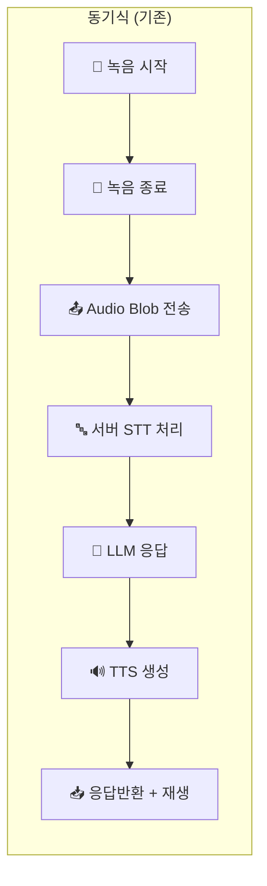

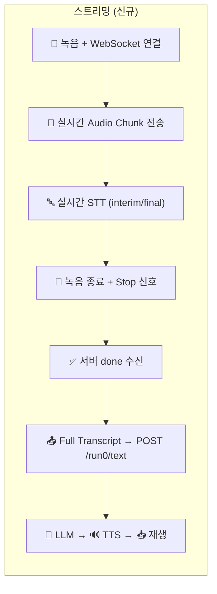

### 전체 시스템 흐름도

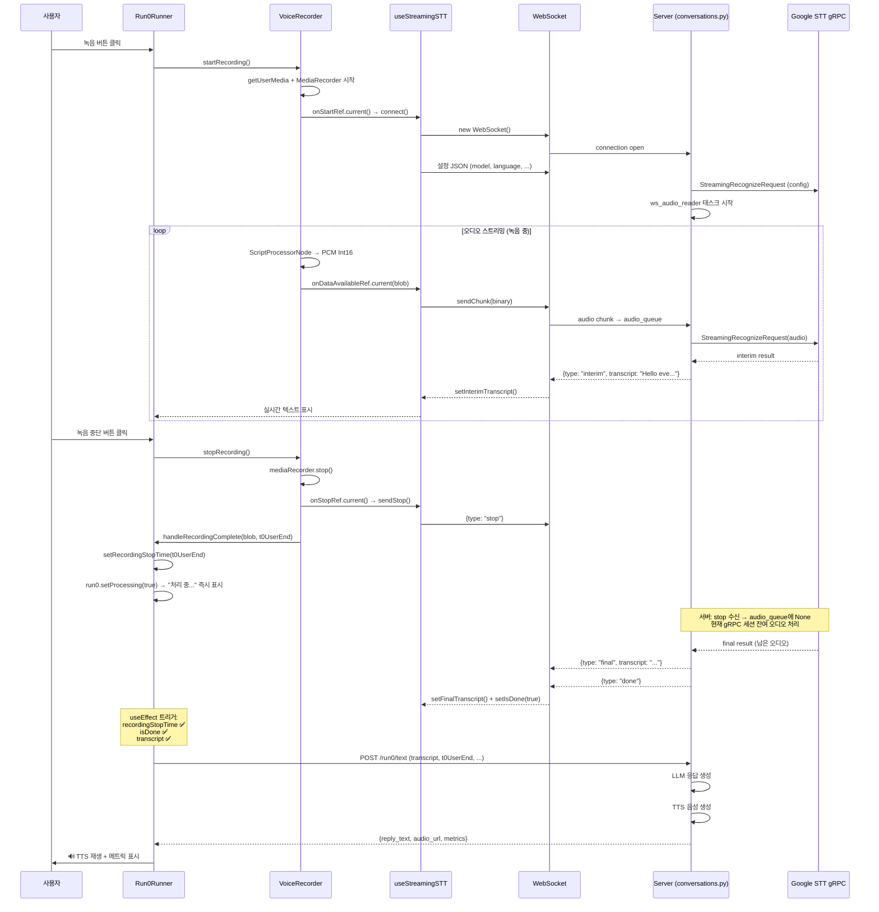

---

## 2. 해결된 이슈 상세

### 이슈 #1: WebSocket 연결 즉시 종료 ("connection open → connection closed")

**증상**: 서버 로그에 `connection open → connection closed`만 출력되고 오디오 청크 로그 없음.

**원인**: `useVoiceRecorder`의 `startRecording`이 `useCallback`으로 생성되어, 내부 이벤트 핸들러(`mediaRecorder.onstop`, `onaudioprocess`)가 **생성 시점의 콜백**을 클로저로 캡처(stale closure).

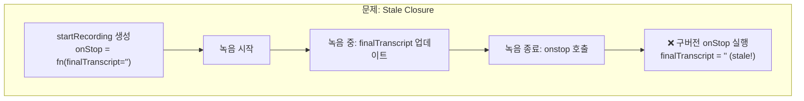

**해결**: 모든 콜백(`onStart`, `onStop`, `onDataAvailable`, `onError`)을 `useRef`로 변환. 이벤트 핸들러가 항상 최신 콜백을 참조하도록 변경.

```diff
  // useVoiceRecorder.ts
- onStart?.();
+ onStartRef.current?.();

- onDataAvailable(new Blob([int16Data.buffer]));
+ onDataAvailableRef.current?.(new Blob([int16Data.buffer]));

- onStopRef.current?.(result);  // onStop만 ref
+ onStopRef.current?.(result);  // 모든 콜백 ref 변환

  // deps에서 콜백 제거 (ref이므로 불필요)
- }, [maxDuration, onStart, onStop, onError, ...]);
+ }, [maxDuration, levelUpdateInterval, updateAudioLevel, performStop]);
```

---

### 이슈 #2: 녹음 후 다음 프로세스 미진행 (finalTranscript 비어있음)

**증상**: 녹음 종료 후 `handleRecordingComplete` 호출되지만 `finalTranscript = ''`으로 진행 불가.

**원인**: **콜백 실행 순서 문제**. `mediaRecorder.onstop` → `handleRecordingComplete` → `sendStop` 순서로 실행되어, `sendStop` 전에 이미 빈 transcript로 체크 완료.

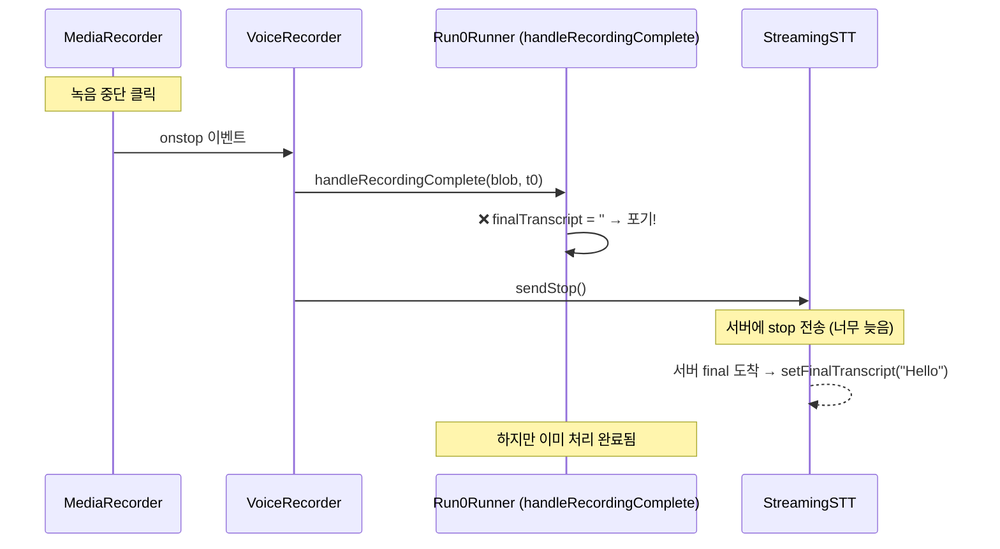

**해결**: `handleRecordingComplete`에서 직접 처리하지 않고, `useEffect`로 분리하여 **두 조건(녹음종료 + transcript 도착) 모두 충족** 시 자동 트리거.

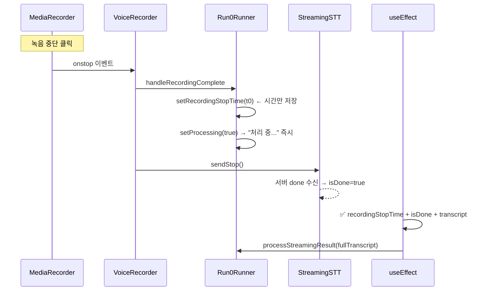

---

### 이슈 #3: 첫 문장만 인식, 이후 발화 무시

**증상**: "I think" (1.5초 쉼) "the first option is the best choice" → "I think"만 인식.

**원인 1 (서버)**: `is_final` 후 `break`로 스트리밍 즉시 종료.

```python
# 문제 코드
async for result in session.stream(audio_chunk_generator()):
    await websocket.send_json(result)
    if result.get("is_final"):
        break  # ← 첫 문장에서 종료!
```

**원인 2 (Google STT)**: `voice_activity_timeout.speech_end_timeout` 설정으로 gRPC 응답 스트림 자체가 `is_final` 후 종료.

**원인 3 (클라이언트)**: `setFinalTranscript(result.transcript)` — 새 final이 이전 값을 **덮어쓰기**.

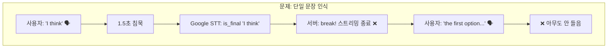

**해결**: 3단계 수정

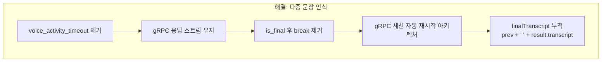

#### 서버: gRPC 세션 자동 재시작 아키텍처

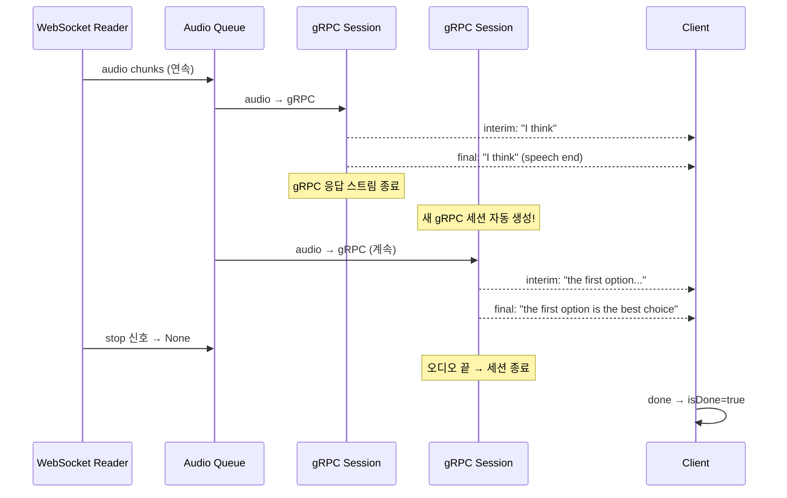

#### 클라이언트: Transcript 누적

```diff
  // useStreamingSTT.ts
- setFinalTranscript(result.transcript);        // 덮어쓰기
+ setFinalTranscript((prev) =>
+     prev ? `${prev} ${result.transcript}` : result.transcript  // 누적
+ );
```

---

### 이슈 #4: 중단 버튼 클릭 후 3초 대기

**증상**: 녹음 중단 후 약 3초 대기 후에야 다음 단계로 진행.

**원인**: Google STT의 `voice_activity_timeout.speech_end_timeout` (5초)가 마지막 발화 후 speech end를 기다림.

**해결**: `voice_activity_timeout` 설정 자체를 제거. `sendStop()` → 오디오 스트림 종료 → gRPC가 잔여 오디오 즉시 처리 → `done` 반환.

```diff
  # streaming_stt_service.py
  streaming_features = StreamingRecognitionFeatures(
      interim_results=self.interim_results,
-     enable_voice_activity_events=True,
-     voice_activity_timeout=VoiceActivityTimeout(
-         speech_end_timeout={"seconds": 5},
-     ),
+     # 제거 → stop 신호로만 종료 제어
  )
```

---

### 이슈 #5: STT 레이턴시 측정 오류

#### 5-1: STT 레이턴시가 E2E보다 큼 (STT 6.24s > E2E 5.69s)

**원인**: `finalTimestamp - connectTime`으로 계산. `connectTime` = 녹음 시작 시점이므로 **녹음 전체 시간이 포함**됨.

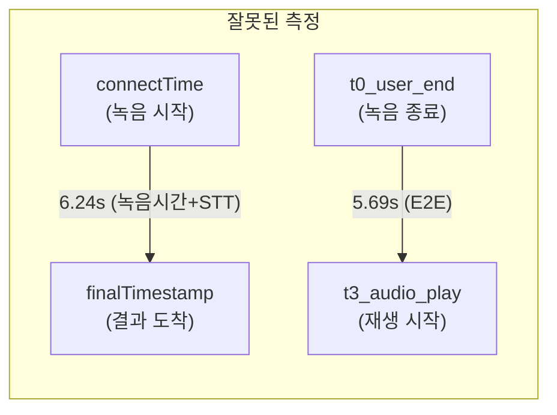

#### 5-2: STT 레이턴시가 0ms

**원인**: `max(0, finalTimestamp - recordingStopTime)` — 스트리밍에서 transcript이 녹음 중 도착하므로 항상 0 또는 음수.

#### 최종 해결

서버에서 `t1_server_received - t0_user_end`로 계산. 이 값은 녹음 종료 → 서버 POST 도착 시간으로, **E2E = STT + LLM + TTS + Client** 합산이 정확히 맞음.

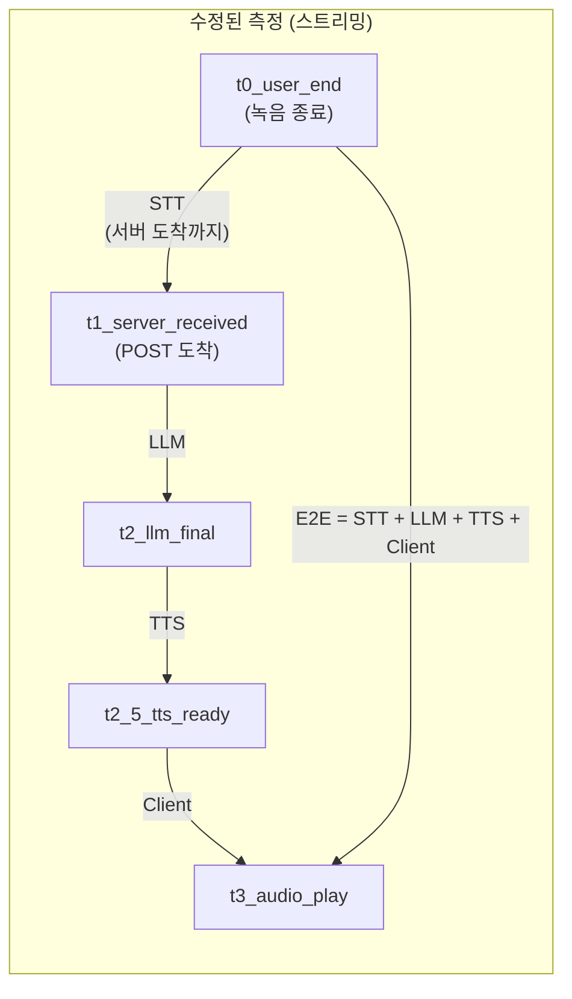

```diff
  # run0_service.py
  if stt_latency_ms is not None:
-     asr_latency_ms = int(stt_latency_ms)  # 클라이언트 0ms
+     asr_latency_ms = max(0, int(t1_server_received - t0_user_end))
```

---

### 이슈 #6: 정확도 표시 불일치 (상단 75% vs 하단 25%)

**원인**: 상단 카드는 **정확도**(1 - WER = 75%), 하단 테이블은 **에러율**(WER = 25%)을 표시. 같은 데이터지만 역수 관계로 혼동 유발.

**해결**: 하단 테이블도 **정확도**로 통일. 컬럼명 "WER/CER" → "단어정확도/문자정확도".

```diff
  // MetricsDashboard.tsx (하단 테이블)
- <th>WER</th><th>CER</th>
+ <th>단어정확도</th><th>문자정확도</th>

- {(r.metrics.wer * 100).toFixed(1)}%     // 에러율 25%
+ {((1 - r.metrics.wer) * 100).toFixed(1)}%  // 정확도 75%
```

---

### 이슈 #7: "처리 중..." 표시 1초 지연

**원인**: `isProcessing`이 `processStreamingResult` 내부에서 설정되므로, `useEffect` 트리거까지 1초 대기.

**해결**: `handleRecordingComplete`에서 **즉시** `run0.setProcessing(true)` 호출. `useRun0`에 `setProcessing` 메서드 추가.

```diff
  // Run0Runner.tsx - handleRecordingComplete
  if (isStreamingMode) {
      setRecordingStopTime(t0UserEnd);
+     run0.setProcessing(true);  // 즉시 "처리 중..." 표시
  }
```

---

### 이슈 #8: 중단 시 partial transcript로 처리 (데이터 손실)

**증상**: "I think the first option is the best choice" 중 "I think is the"만 저장됨.

**원인 1**: `useEffect`의 `||` 연산자가 `finalTranscript`가 truthy이면 `interimTranscript`를 무시.

```typescript
// 문제: 첫 final "I think" 이 truthy → 두번째 interim 무시
const transcript = finalTranscript || interimTranscript;  // = "I think"
```

**원인 2**: `useEffect`가 `recordingStopTime` 설정 즉시 실행 → 아직 처리 중인 gRPC 세션 결과를 기다리지 않고 `disconnect()` 호출.

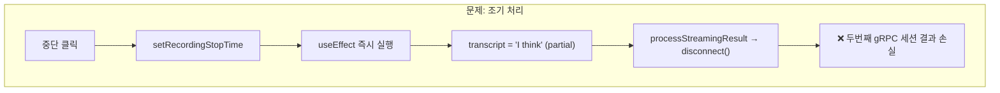

**해결**: 두 가지 수정

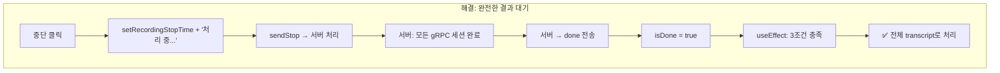

```diff
  // 수정 1: || → join (전체 누적)
- const transcript = finalTranscript || interimTranscript;
+ const transcript = [finalTranscript, interimTranscript]
+     .filter(Boolean).join(' ').trim();

  // 수정 2: isDone 조건 추가 (서버 완료까지 대기)
- if (!isStreamingMode || !recordingStopTime) return;
+ if (!isStreamingMode || !recordingStopTime || !streamingSTT.isDone) return;

  // 수정 3: disconnect() 제거 (서버가 자연스럽게 닫음)
- streamingSTT.disconnect();
```

---

## 3. 최종 아키텍처 요약

### 수정된 파일 목록

| 파일 | 변경 요약 |
|---|---|
| [useVoiceRecorder.ts](file:///Users/ochihyo/Documents/antigravity/study-english/apps/admin/src/(fsd)/features/conversations/model/useVoiceRecorder.ts) | 모든 콜백 ref 변환 (stale closure 해결) |
| [useStreamingSTT.ts](file:///Users/ochihyo/Documents/antigravity/study-english/apps/admin/src/(fsd)/features/conversations/model/useStreamingSTT.ts) | `isDone` 상태 추가, `finalTranscript` 누적 |
| [Run0Runner.tsx](file:///Users/ochihyo/Documents/antigravity/study-english/apps/admin/src/(fsd)/features/conversations/ui/Run0Runner.tsx) | useEffect 기반 처리, isDone 대기, setProcessing 즉시 호출 |
| [useRun0.ts](file:///Users/ochihyo/Documents/antigravity/study-english/apps/admin/src/(fsd)/features/conversations/model/useRun0.ts) | `setProcessing` 메서드 노출 |
| [MetricsDashboard.tsx](file:///Users/ochihyo/Documents/antigravity/study-english/apps/admin/src/(fsd)/features/conversations/ui/MetricsDashboard.tsx) | WER/CER 정확도 표시 통일 |
| [conversations.py](file:///Users/ochihyo/Documents/antigravity/study-english/apps/server/app/api/v1/conversations.py) | gRPC 세션 자동 재시작, 공유 오디오 큐 |
| [streaming_stt_service.py](file:///Users/ochihyo/Documents/antigravity/study-english/apps/server/app/services/conversation/streaming_stt_service.py) | `voice_activity_timeout` 제거 |
| [run0_service.py](file:///Users/ochihyo/Documents/antigravity/study-english/apps/server/app/services/conversation/run0_service.py) | STT latency = `t1_server_received - t0_user_end` |
| [conversationsApi.ts](file:///Users/ochihyo/Documents/antigravity/study-english/apps/admin/src/(fsd)/features/conversations/api/conversationsApi.ts) | `sttLatencyMs` 파라미터 추가 |

### 레이턴시 측정 체계

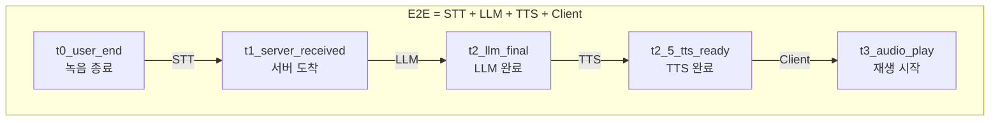

| 구간 | 동기식 계산 | 스트리밍 계산 | 측정 주체 |
|---|---|---|---|
| **STT** | `t1_asr_final - t0_user_end` | `t1_server_received - t0_user_end` | 서버 |
| **LLM** | `t2_llm_final - t1_server_received` | 동일 | 서버 |
| **TTS** | `t2_5_tts_ready - t2_llm_final` | 동일 | 서버 |
| **Client** | `t3_audio_play - t2_5_tts_ready` | 동일 | 클라이언트 |
| **E2E** | `t3_audio_play - t0_user_end` | 동일 | 클라이언트 |
