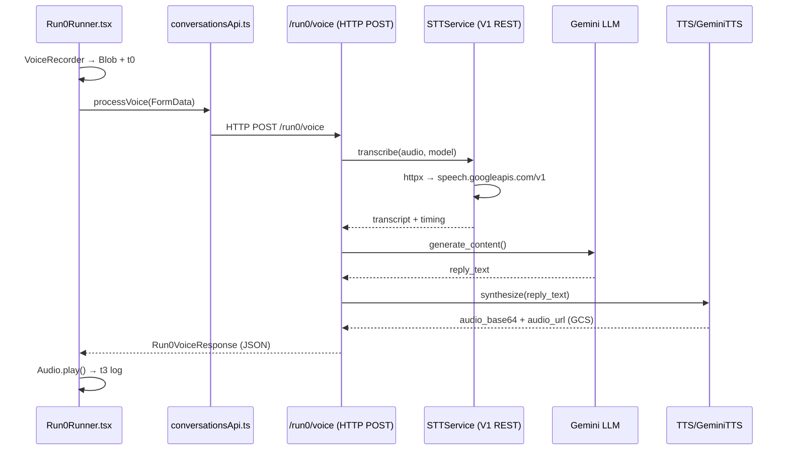
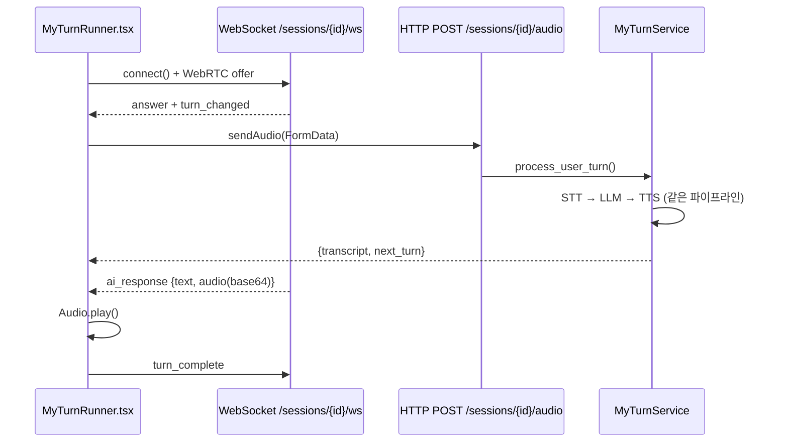
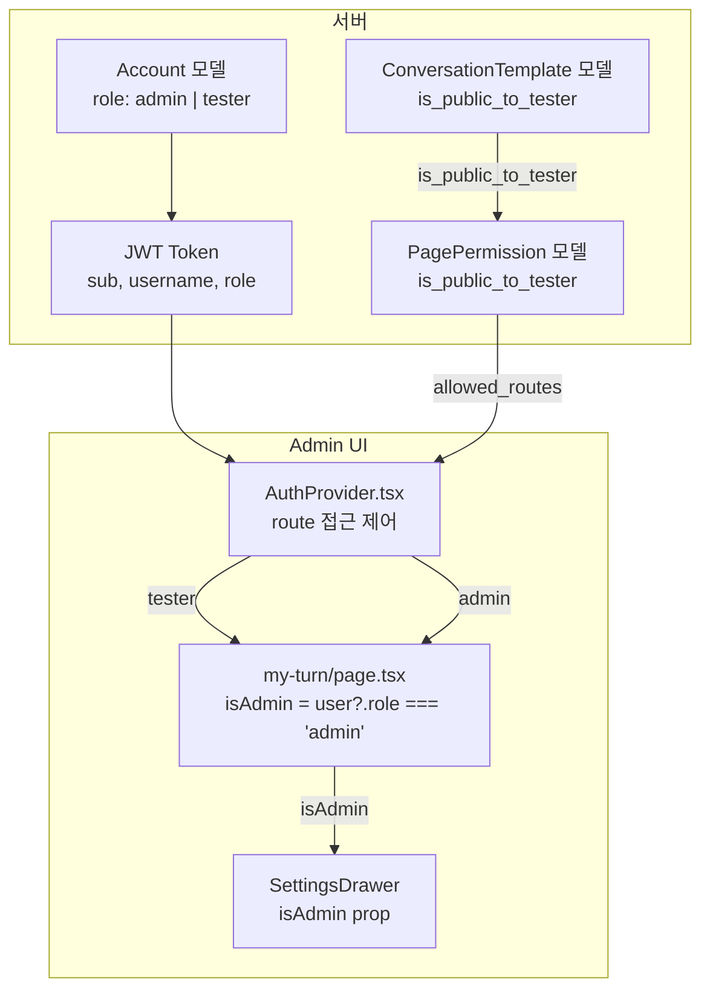
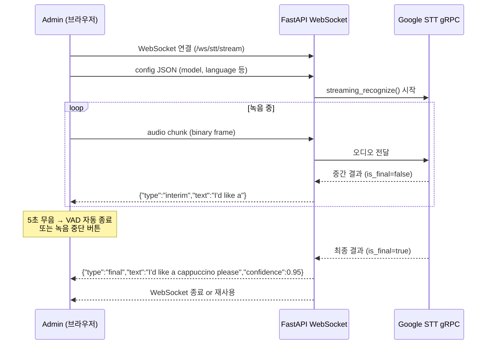

# STT / TTS 개선 구현 계획 (수정본)

## 코드 분석 결과 요약

### Latency Lab (Run0) 데이터 흐름



### My Turn 데이터 흐름



### 현재 기술적 상태

| 항목 | 현재 구현 | 위치 |
|------|---------|------|
| **STT API** | V1 REST `speech:recognize` + httpx + API Key | [stt_service.py](file:///Users/ochihyo/Documents/antigravity/study-english/apps/server/app/services/conversation/stt_service.py) |
| **STT 인코딩** | WEBM_OPUS 우선 → LINEAR16 폴백 (pydub 변환) | stt_service.py L60-87 |
| **STT 모델 목록** | latest_long, latest_short, command_and_search, phone_call, chirp_2, chirp | [conversations.py](file:///Users/ochihyo/Documents/antigravity/study-english/apps/server/app/api/v1/conversations.py) L494-504 |
| **TTS Cloud** | REST httpx + API Key, WaveNet/Neural2 음성 | [tts_service.py](file:///Users/ochihyo/Documents/antigravity/study-english/apps/server/app/services/conversation/tts_service.py) |
| **TTS Gemini** | google-cloud-texttospeech SDK, Flash/Pro/Lite, 감정 프롬프트 | [gemini_tts_service.py](file:///Users/ochihyo/Documents/antigravity/study-english/apps/server/app/services/conversation/gemini_tts_service.py) |
| **오디오 저장** | [StorageService](file:///Users/ochihyo/Documents/antigravity/study-english/apps/server/app/services/storage_service.py#24-101) 싱글톤 — 로컬/GCS 자동 전환 | [storage_service.py](file:///Users/ochihyo/Documents/antigravity/study-english/apps/server/app/services/storage_service.py) |
| **Admin 녹음** | [useVoiceRecorder.ts](file:///Users/ochihyo/Documents/antigravity/study-english/apps/admin/src/%28fsd%29/features/conversations/model/useVoiceRecorder.ts) → MediaRecorder → Blob, 수동 정지만 | [VoiceRecorder.tsx](file:///Users/ochihyo/Documents/antigravity/study-english/apps/admin/src/(fsd)/features/conversations/ui/VoiceRecorder.tsx) |
| **실험 상태** | [useRun0.ts](file:///Users/ochihyo/Documents/antigravity/study-english/apps/admin/src/%28fsd%29/features/conversations/model/useRun0.ts) — processVoice HTTP mutation, t3 로깅 | [useRun0.ts](file:///Users/ochihyo/Documents/antigravity/study-english/apps/admin/src/(fsd)/features/conversations/model/useRun0.ts) |
| **지표 표시** | STT/LLM/TTS/ClientLoad/E2E 5개 카드 + 바 차트 | [MetricsDashboard.tsx](file:///Users/ochihyo/Documents/antigravity/study-english/apps/admin/src/(fsd)/features/conversations/ui/MetricsDashboard.tsx) |
| **Run0 기본값** | sttModel: `latest_long`, voiceId: `en-US-Neural2-F` | useRun0.ts L50-63 |

### 접근 제어 시스템 (admin / tester)



| 구분 | Tester 화면 | Admin 화면 |
|------|-----------|----------|
| **시나리오 목록** | `is_public_to_tester=True` 템플릿만 | 전체 템플릿 |
| **SettingsDrawer** | 발화 속도 + 난이도 슬라이더 **만** | + 파이프라인 모델 (STT/LLM/TTS) 전체 선택 |
| **모델 API 호출** | STT/TTS 옵션 fetch 안 함 (`enabled: isAdmin`) | STT/TTS 모델 목록 fetch |
| **저장 기능** | 없음 | 「모델 설정을 템플릿에 저장」 버튼 |
| **서버 필터** | JWT role=tester → `tester_only=True` | 필터 없음 |

**핵심 파일:**
- [account.py](file:///Users/ochihyo/Documents/antigravity/study-english/apps/server/app/models/account.py) — `Account.role`, `PagePermission.is_public_to_tester`
- [auth_service.py](file:///Users/ochihyo/Documents/antigravity/study-english/apps/server/app/services/auth_service.py) — [get_allowed_routes()](file:///Users/ochihyo/Documents/antigravity/study-english/apps/server/app/services/auth_service.py#68-81), JWT 생성
- [AuthProvider.tsx](file:///Users/ochihyo/Documents/antigravity/study-english/apps/admin/src/(fsd)/shared/providers/AuthProvider.tsx) — route 접근 제어, [isRouteAllowed()](file:///Users/ochihyo/Documents/antigravity/study-english/apps/admin/src/%28fsd%29/shared/providers/AuthProvider.tsx#23-32)
- [auth.ts](file:///Users/ochihyo/Documents/antigravity/study-english/apps/admin/src/(fsd)/shared/lib/auth.ts) — `AuthUser.role: 'admin' | 'tester'`
- [my-turn/page.tsx](file:///Users/ochihyo/Documents/antigravity/study-english/apps/admin/src/app/(dashboard)/conversations/my-turn/page.tsx) — `isAdmin = user?.role === 'admin'` → [SettingsDrawer(isAdmin)](file:///Users/ochihyo/Documents/antigravity/study-english/apps/admin/src/%28fsd%29/features/conversations/ui/SettingsDrawer.tsx#75-454)
- [SettingsDrawer.tsx](file:///Users/ochihyo/Documents/antigravity/study-english/apps/admin/src/(fsd)/features/conversations/ui/SettingsDrawer.tsx) — `isAdmin` 조건부 모델 선택 UI

> [!IMPORTANT]
> Phase 3/4에서 My Turn에 STT/TTS 설정을 추가할 때, **admin 전용 UI**로 구현하고 tester에게는 노출하지 않아야 합니다. 기존 [SettingsDrawer](file:///Users/ochihyo/Documents/antigravity/study-english/apps/admin/src/%28fsd%29/features/conversations/ui/SettingsDrawer.tsx#75-454)의 `isAdmin` 분기 패턴을 따릅니다.

---

## User Review Required

> [!IMPORTANT]
> **chirp_3 기본값**: 비용 동일($0.016/분)에 정확도/다중언어 감지 우수. STT 기본값을 `chirp_3`로 설정합니다.

> [!IMPORTANT]
> **SDK 설치 요청**: 서버(poetry), admin(pnpm) 패키지 설치는 사용자에게 명령을 전달합니다. 직접 실행하지 않습니다.

> [!WARNING]
> **기존 모델 보존**: 현재 선택 가능한 모든 STT/TTS 모델은 제거하지 않고 새 모델을 추가합니다.

---

## Phase 1: Latency Lab — STT 개선

### 1-1. SDK 설치 (사용자 실행)

```bash
# 서버 — google-cloud-speech SDK (V2 API + gRPC 스트리밍 포함)
cd apps/server && poetry add google-cloud-speech@latest

# Admin — 추가 패키지 없음 (WebSocket은 브라우저 네이티브)
```

> [!NOTE]
> `google-cloud-speech` SDK에 V2 API, gRPC 스트리밍, `AutoDetectDecodingConfig` 등이 모두 포함되어 있습니다.

---

### 1-2. Server — STT Engine

#### [MODIFY] [stt_service.py](file:///Users/ochihyo/Documents/antigravity/study-english/apps/server/app/services/conversation/stt_service.py)

1. **V2 SDK 동기식 인식 추가** (`transcribe_v2`)
   - `google.cloud.speech_v2` SDK 사용
   - `chirp_3` (기본값), `chirp_2` 모델 지원
   - `AutoDetectDecodingConfig` (인코딩 자동 감지 → pydub 불필요)
   - `enableWordConfidence`, 욕설 필터, Phrase Hints
   - 기존 [transcribe()](file:///Users/ochihyo/Documents/antigravity/study-english/apps/server/app/services/conversation/stt_service.py#32-173) 메서드 100% 보존

2. **gRPC 스트리밍 인식 추가** (`streaming_transcribe`)
   - `streaming_recognize` RPC 사용
   - `interim_results=True` (중간 결과)
   - `voice_activity_timeout.speech_end_timeout = 5s` (VAD)
   - AsyncGenerator로 중간/최종 결과 yield

3. **정확도 유틸리티** (`calculate_wer`, `calculate_cer`)
   - 레벤슈타인 거리 기반

---

### 1-3. Server — 스트리밍 아키텍처 (WebSocket + gRPC)



**구현 위치:**

#### [NEW] [streaming_stt_service.py](file:///Users/ochihyo/Documents/antigravity/study-english/apps/server/app/services/conversation/streaming_stt_service.py)

- gRPC 스트리밍 연결 관리 전용 서비스
- `StreamingSTTSession` 클래스: 하나의 스트리밍 세션 관리
- 재연결 로직, 타임아웃 처리, 에러 핸들링

#### [MODIFY] [conversations.py](file:///Users/ochihyo/Documents/antigravity/study-english/apps/server/app/api/v1/conversations.py)

- **새 WebSocket 엔드포인트**: `@router.websocket("/ws/stt/stream")`
- 클라이언트→서버: binary audio chunks + config JSON
- 서버→클라이언트: 중간/최종 결과 JSON
- STT 모델 목록에 `chirp_3` ⭐ 추가, 인식 방식(`sync`/`streaming`) 추가

---

### 1-4. Server — Schema & Model 변경

#### [MODIFY] [conversation.py (schemas)](file:///Users/ochihyo/Documents/antigravity/study-english/apps/server/app/schemas/conversation.py)

- `Run0VoiceResponse`에 Optional 필드 추가: [wer](file:///Users/ochihyo/Documents/antigravity/study-english/apps/admin/src/%28fsd%29/features/conversations/ui/SettingsDrawer.tsx#75-454), `cer`, `ttfr_ms`, `word_confidences`

#### [MODIFY] [conversation.py (models)](file:///Users/ochihyo/Documents/antigravity/study-english/apps/server/app/models/conversation.py)

- [ConversationTurn](file:///Users/ochihyo/Documents/antigravity/study-english/apps/server/app/models/conversation.py#320-380) 새 컬럼: `recognition_mode`, [wer](file:///Users/ochihyo/Documents/antigravity/study-english/apps/admin/src/%28fsd%29/features/conversations/ui/SettingsDrawer.tsx#75-454), `cer`, `ttfr_ms`, `word_confidences` (JSON), `speech_end_method`
- [SessionMetrics](file:///Users/ochihyo/Documents/antigravity/study-english/apps/server/app/models/conversation.py#387-452) 새 컬럼: `avg_wer`, `avg_cer`
- **Alembic 마이그레이션 필요** (실행 명령은 구현 시 전달)

---

### 1-5. Server — Run0 Service 연동

#### [MODIFY] [run0_service.py](file:///Users/ochihyo/Documents/antigravity/study-english/apps/server/app/services/conversation/run0_service.py)

- [process_voice()](file:///Users/ochihyo/Documents/antigravity/study-english/apps/server/app/api/v1/conversations.py#557-632)에 `recognition_mode` 파라미터 추가
- chirp 모델 선택 시 `transcribe_v2()` 호출
- 응답에 [wer](file:///Users/ochihyo/Documents/antigravity/study-english/apps/admin/src/%28fsd%29/features/conversations/ui/SettingsDrawer.tsx#75-454), `cer`, `ttfr_ms` 포함
- 기존 동작 (V1 모델) 변경 없음

---

### 1-6. Admin — UI 변경

#### [MODIFY] [Run0ConfigPanel.tsx](file:///Users/ochihyo/Documents/antigravity/study-english/apps/admin/src/(fsd)/features/conversations/ui/Run0ConfigPanel.tsx)

- STT 섹션에 **인식 방식** 드롭다운 추가: `동기식` / `스트리밍`
- 추천 모델 뱃지: `chirp_3 ⭐ (기본값)`
- 기존 V1 모델 유지

#### [MODIFY] [useRun0.ts](file:///Users/ochihyo/Documents/antigravity/study-english/apps/admin/src/(fsd)/features/conversations/model/useRun0.ts)

- [Run0Config](file:///Users/ochihyo/Documents/antigravity/study-english/apps/admin/src/%28fsd%29/features/conversations/model/useRun0.ts#21-49)에 `recognitionMode: 'sync' | 'streaming'` 추가
- `DEFAULT_RUN0_CONFIG.sttModel` → `chirp_3`
- [LatencyMetrics](file:///Users/ochihyo/Documents/antigravity/study-english/apps/admin/src/%28fsd%29/features/conversations/model/useRun0.ts#70-78)에 `ttfrMs`, [wer](file:///Users/ochihyo/Documents/antigravity/study-english/apps/admin/src/%28fsd%29/features/conversations/ui/SettingsDrawer.tsx#75-454), `cer` 추가
- 스트리밍 모드: WebSocket 연결 + 오디오 chunk 전송 로직

#### [MODIFY] [Run0Runner.tsx](file:///Users/ochihyo/Documents/antigravity/study-english/apps/admin/src/(fsd)/features/conversations/ui/Run0Runner.tsx)

- 스트리밍 모드 시 **실시간 자막** 영역 추가
- WER/CER 결과 표시

#### [MODIFY] [MetricsDashboard.tsx](file:///Users/ochihyo/Documents/antigravity/study-english/apps/admin/src/(fsd)/features/conversations/ui/MetricsDashboard.tsx)

- WER/CER, TTFR, 말끝남 방식 컬럼 추가

---

### 1-7. Admin — base64 + GCS 업로드 로직 분리

#### [NEW] [useAudioStorage.ts](file:///Users/ochihyo/Documents/antigravity/study-english/apps/admin/src/(fsd)/features/conversations/model/useAudioStorage.ts)

현재 [useRun0.ts](file:///Users/ochihyo/Documents/antigravity/study-english/apps/admin/src/%28fsd%29/features/conversations/model/useRun0.ts)에 인라인으로 있는 오디오 처리 로직을 독립 훅으로 분리:
- `audio_base64` → `data:audio/mp3;base64,...` 변환
- `audio_url` → `resolveMediaUrl()` (GCS 프록시 포함)
- 향후 리포트/다운로드 기능에서 재사용

---

### 1-8. Admin — 말끝남(End-of-Speech) 측정

#### [MODIFY] [useVoiceRecorder.ts](file:///Users/ochihyo/Documents/antigravity/study-english/apps/admin/src/(fsd)/features/conversations/model/useVoiceRecorder.ts)

- **VAD 5초 타임아웃**: `AnalyserNode` 기반 무음 감지, 5초 지속 시 자동 종료
- [onStop](file:///Users/ochihyo/Documents/antigravity/study-english/apps/admin/src/%28fsd%29/features/conversations/ui/VoiceRecorder.tsx#41-45) 콜백에 `speechEndMethod: 'vad' | 'button'` 추가

---

## Phase 2: Latency Lab — TTS 개선 (Phase 1 완료 후 상세 작성)

| Phase | 범위 | 핵심 내용 |
|-------|------|----------|
| **2** | Latency Lab TTS | 전체 모델 선택 UI, A/B 비교, 감정 프롬프트, 성능 지표 |

## Phase 3/4: My Turn — STT/TTS 적용

> [!CAUTION]
> **Phase 3/4는 Phase 1/2 레이턴시 측정 결과에 따라 결정합니다.**
> Latency Lab에서 스트리밍 vs 동기식의 레이턴시를 비교 측정한 후, My Turn에 어떤 방식을 적용할지 판단합니다.
> Phase 3/4의 상세 계획은 Phase 1/2 완료 후 작성합니다.

| 고려 사항 | 설명 |
|---------|------|
| **스트리밍 vs 동기식** | Phase 1 STT 측정 결과 기반 결정 |
| **admin/tester 구분** | [SettingsDrawer(isAdmin)](file:///Users/ochihyo/Documents/antigravity/study-english/apps/admin/src/%28fsd%29/features/conversations/ui/SettingsDrawer.tsx#75-454) 패턴 유지 — STT/TTS 설정은 admin만 |
| **서버 필터** | [list_templates](file:///Users/ochihyo/Documents/antigravity/study-english/apps/server/app/api/v1/conversations.py#58-88)의 JWT 기반 `tester_only` 필터 유지 |
| **참여자별 설정** | 기존 [saveParticipantModels()](file:///Users/ochihyo/Documents/antigravity/study-english/apps/admin/src/%28fsd%29/features/conversations/api/conversationsApi.ts#313-332) API + [SettingsDrawer](file:///Users/ochihyo/Documents/antigravity/study-english/apps/admin/src/%28fsd%29/features/conversations/ui/SettingsDrawer.tsx#75-454) 확장 |

---

## Verification Plan

### 서버 테스트 (pytest)

```bash
cd apps/server && poetry run pytest tests/ -v
```

1. `tests/test_stt_accuracy.py` — WER/CER 계산 정확도
2. `tests/test_conversations_api.py` — chirp_3 모델 목록 확인, 기존 모델 보존

### Admin 빌드

```bash
cd apps/admin && pnpm build
```

### 수동 테스트

1. **동기식 STT (chirp_3)**: 녹음 → STT 결과 확인 → 기존 파이프라인 정상 진행
2. **스트리밍 STT**: 녹음 중 실시간 자막 → VAD 자동 종료 → 최종 결과
3. **기존 기능 보호**: latest_long 모델로 테스트 → 회귀 없음 확인
