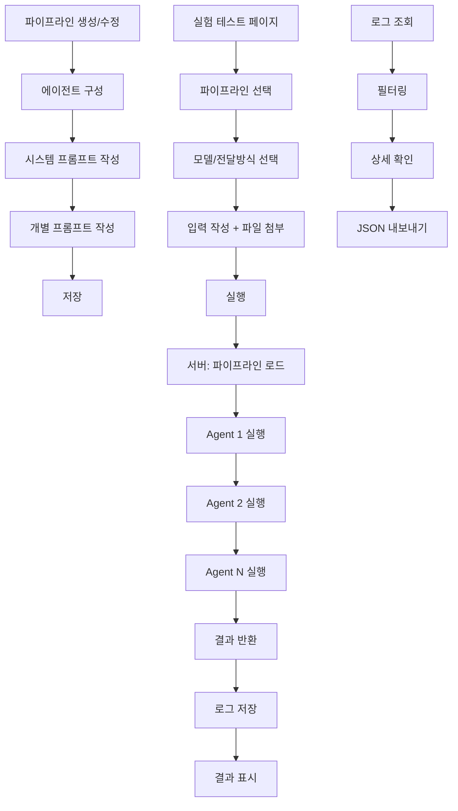

# AI Agent Lab (AI 에이전트 실험실)

| 항목 | 내용 |
|------|------|
| **작성일** | 2026-02-08 |
| **상태** | Draft |
| **관련 문서** | [개발 기획](../develop/ai-agent-lab-api.md), [실행계획](../tasks/TASK-AI-AGENT-LAB.md) |

---

## 📋 사용자 요청 (User Request)

> 랭체인을 활용한 어드민에 기능 개발을 할거야. 어드민에서 프롬프트를 바꿔가며 실험을 해볼 수 있도록 만들고싶어. 1개의 에이전트만 사용할 것이 아니고 여러개를 연결해서 사용할 수 있도록 만들거야. 몇개의 에이전트를 사용할 지 직접 CRUD가 가능해야해. 실험실이기 때문에 여러개의 로직 구성은 하지 않고 단일 플로우 로직으로만 구현할거야.

---

## 📝 서비스 개요 (Service Overview)

### 목적
LangChain 기반 **멀티 에이전트 파이프라인**을 어드민에서 직접 구성하고 테스트할 수 있는 실험 환경 제공

### 핵심 가치
- **프롬프트 실험**: 다양한 프롬프트 조합을 빠르게 테스트
- **모델 비교**: 동일 프롬프트로 다른 AI 모델 성능 비교
- **비용 추적**: 실험별 토큰 사용량 및 예상 비용 모니터링
- **재현성**: 저장된 파이프라인 설정으로 결과 재현 가능

---

## 🎯 핵심 기능 (Core Features)

### 1. 파이프라인 관리 (Pipeline Management)

#### 1.1 파이프라인 CRUD
- **생성**: 파이프라인 이름, 설명, 시스템 프롬프트 설정
- **조회**: 저장된 파이프라인 목록 및 상세 정보
- **수정**: 기존 파이프라인 불러와서 편집
- **삭제**: 불필요한 파이프라인 제거

#### 1.2 에이전트 구성
| 항목 | 설명 |
|------|------|
| 에이전트 수 | 동적으로 추가/삭제 (1~10개) |
| 개별 프롬프트 | 각 에이전트가 수행할 역할/지시 |
| 실행 순서 | 드래그 앤 드롭으로 순서 변경 |

#### 1.3 통합 시스템 프롬프트
- 모든 에이전트가 공유하는 컨텍스트
- 페르소나, 언어 스타일, 제약사항 정의

### 2. 실험 설정 (Experiment Configuration)

#### 2.1 AI 모델 선택
| 모델 | 지원 여부 | 비고 |
|------|----------|------|
| Google Gemini Pro | ✅ 1차 개발 | 메인 모델 |
| Google Gemini Flash | ✅ 1차 개발 | 빠른 테스트용 |
| OpenAI GPT-4o | 🔜 확장 예정 | 비교 테스트용 |
| OpenAI GPT-4-turbo | 🔜 확장 예정 | 비교 테스트용 |

#### 2.2 에이전트 간 데이터 전달 방식
| 옵션 | 설명 |
|------|------|
| **A: 최종 출력만** | 이전 에이전트의 마지막 응답만 전달 |
| **B: 전체 히스토리** | 누적된 모든 대화 내용 전달 |
| **C: 커스텀 필드** | JSON 내 특정 필드만 추출하여 전달 |

#### 2.3 멀티모달 입력
- **텍스트**: 기본 입력
- **이미지**: JPG, PNG, WebP 업로드
- **동영상**: MP4, WebM 업로드
- **음성**: WAV, MP3 업로드

### 3. 실험 실행 (Experiment Execution)

```
┌─────────────────────────────────────────────────────────────┐
│ 실험 테스트 페이지                                           │
├─────────────────────────────────────────────────────────────┤
│                                                             │
│  [파이프라인 선택] ▼  [AI 모델] ▼  [데이터 전달 방식] ▼      │
│                                                             │
│  ┌─────────────────────────────────────────────────────┐    │
│  │ 입력                                                │    │
│  │ ┌───────────────────────────────────────────────┐   │    │
│  │ │ 여기에 지시를 입력하세요...                     │   │    │
│  │ └───────────────────────────────────────────────┘   │    │
│  │ [📎 파일 첨부]                                      │    │
│  └─────────────────────────────────────────────────────┘    │
│                                                             │
│  [▶ 실행]                                                   │
│                                                             │
│  ┌─────────────────────────────────────────────────────┐    │
│  │ 결과                                                │    │
│  │ ─────────────────────────────────────────────────   │    │
│  │ [Agent 1: 분석가]                                   │    │
│  │   "입력된 데이터를 분석한 결과..."                   │    │
│  │                                                     │    │
│  │ [Agent 2: 검증자]                                   │    │
│  │   "분석 결과를 검증하면..."                         │    │
│  │                                                     │    │
│  │ [Agent 3: 요약자]                                   │    │
│  │   "최종 요약: ..."                                  │    │
│  └─────────────────────────────────────────────────────┘    │
│                                                             │
│  ⏱️ 실행시간: 3.2s  |  🎫 토큰: 1,234  |  💰 비용: $0.012   │
│                                                             │
└─────────────────────────────────────────────────────────────┘
```

### 4. 로그 시스템 (Logging System)

#### 4.1 기록 항목
| 항목 | 설명 |
|------|------|
| 파이프라인 설정 | 사용된 파이프라인 ID, 이름 |
| 시스템 프롬프트 | 전체 공유 프롬프트 |
| 에이전트 프롬프트 | 각 에이전트별 개별 프롬프트 |
| 사용자 입력 | 텍스트 + 첨부파일 정보 |
| 각 단계 결과 | 에이전트별 응답 |
| 최종 결과 | 마지막 에이전트 출력 |
| 실행 시간 | 전체 및 단계별 소요 시간 (ms) |
| 토큰 사용량 | 입력/출력 토큰 수 |
| 예상 비용 | 모델별 단가 기준 USD |
| AI 모델 | 사용된 모델명 |
| 데이터 전달 방식 | A/B/C 중 선택값 |
| 실행 일시 | 타임스탬프 |

#### 4.2 로그 조회
- 날짜/파이프라인별 필터링
- 상세 로그 확인 (각 단계 펼쳐보기)
- JSON 형태로 내보내기

---

## 📱 화면 구성 (Screen Layout)

### 페이지 구조

```
/admin/ai-lab/
├── pipelines/                 # 파이프라인 목록
├── pipelines/new              # 파이프라인 생성
├── pipelines/[id]/edit        # 파이프라인 수정
├── experiment/                # 실험 테스트
└── logs/                      # 로그 조회
```

### 1. 파이프라인 목록 페이지 (`/admin/ai-lab/pipelines`)

```
┌─────────────────────────────────────────────────────────────┐
│ AI Agent Lab > 파이프라인 관리                              │
├─────────────────────────────────────────────────────────────┤
│                                        [+ 새 파이프라인]    │
│                                                             │
│  ┌─────────────────────────────────────────────────────┐    │
│  │ 📋 콘텐츠 분석 파이프라인                           │    │
│  │ 에이전트 3개 | 최종 수정: 2026-02-08                │    │
│  │                                [수정] [삭제] [테스트]│    │
│  └─────────────────────────────────────────────────────┘    │
│                                                             │
│  ┌─────────────────────────────────────────────────────┐    │
│  │ 📋 번역 + 검수 파이프라인                           │    │
│  │ 에이전트 2개 | 최종 수정: 2026-02-07                │    │
│  │                                [수정] [삭제] [테스트]│    │
│  └─────────────────────────────────────────────────────┘    │
│                                                             │
└─────────────────────────────────────────────────────────────┘
```

### 2. 파이프라인 편집 페이지 (`/admin/ai-lab/pipelines/[id]/edit`)

```
┌─────────────────────────────────────────────────────────────┐
│ AI Agent Lab > 파이프라인 편집                              │
├─────────────────────────────────────────────────────────────┤
│                                                             │
│  파이프라인 이름: [콘텐츠 분석 파이프라인              ]    │
│  설명:           [콘텐츠를 분석하고 개선안을 제시합니다]    │
│                                                             │
│  ─────────────────────────────────────────────────────────  │
│  📌 시스템 프롬프트 (모든 에이전트 공유)                    │
│  ┌─────────────────────────────────────────────────────┐    │
│  │ 당신은 전문 콘텐츠 분석가입니다.                     │    │
│  │ 항상 한국어로 응답하며, 구체적인 예시를 들어...      │    │
│  └─────────────────────────────────────────────────────┘    │
│                                                             │
│  ─────────────────────────────────────────────────────────  │
│  🤖 에이전트 목록                          [+ 에이전트 추가]│
│                                                             │
│  ┌─ Agent 1 ────────────────────────────────────────────┐   │
│  │ 역할: [분석가                                       ]│   │
│  │ ┌───────────────────────────────────────────────────┐│   │
│  │ │ 입력된 콘텐츠의 구조, 톤, 핵심 메시지를 분석하세요.││   │
│  │ │ 강점과 약점을 구분하여 정리해주세요.              ││   │
│  │ └───────────────────────────────────────────────────┘│   │
│  │                                          [↑] [↓] [🗑]│   │
│  └──────────────────────────────────────────────────────┘   │
│                                                             │
│  ┌─ Agent 2 ────────────────────────────────────────────┐   │
│  │ 역할: [개선안 제시자                                ]│   │
│  │ ┌───────────────────────────────────────────────────┐│   │
│  │ │ 이전 분석 결과를 바탕으로 구체적인 개선안을...    ││   │
│  │ └───────────────────────────────────────────────────┘│   │
│  │                                          [↑] [↓] [🗑]│   │
│  └──────────────────────────────────────────────────────┘   │
│                                                             │
│                                                             │
│                               [취소]  [저장]                │
│                                                             │
└─────────────────────────────────────────────────────────────┘
```

### 3. 실험 테스트 페이지 (`/admin/ai-lab/experiment`)

위 "실험 실행" 섹션 참조

### 4. 로그 조회 페이지 (`/admin/ai-lab/logs`)

```
┌─────────────────────────────────────────────────────────────┐
│ AI Agent Lab > 실험 로그                                    │
├─────────────────────────────────────────────────────────────┤
│                                                             │
│  [날짜 범위 선택]  [파이프라인 선택 ▼]  [검색]              │
│                                                             │
│  ┌─────────────────────────────────────────────────────┐    │
│  │ #12 | 콘텐츠 분석 파이프라인 | Gemini Pro           │    │
│  │ 2026-02-08 14:32:15 | 3.2s | 1,234 tokens | $0.012  │    │
│  │                                        [상세 보기]   │    │
│  └─────────────────────────────────────────────────────┘    │
│                                                             │
│  ┌─────────────────────────────────────────────────────┐    │
│  │ #11 | 번역 + 검수 파이프라인 | Gemini Flash         │    │
│  │ 2026-02-08 14:28:03 | 1.8s | 856 tokens | $0.004    │    │
│  │                                        [상세 보기]   │    │
│  └─────────────────────────────────────────────────────┘    │
│                                                             │
│  [1] [2] [3] ... [10]                          [JSON 내보내기]│
│                                                             │
└─────────────────────────────────────────────────────────────┘
```

---

## 🔄 서비스 플로우 (Service Flow)



---

## 💰 비용 계산 기준 (Cost Calculation)

### Google Gemini (2026년 기준 예상)

| 모델 | 입력 (1M tokens) | 출력 (1M tokens) |
|------|-----------------|-----------------|
| Gemini Pro | $1.25 | $5.00 |
| Gemini Flash | $0.075 | $0.30 |

### OpenAI (확장 시)

| 모델 | 입력 (1M tokens) | 출력 (1M tokens) |
|------|-----------------|-----------------|
| GPT-4o | $5.00 | $15.00 |
| GPT-4-turbo | $10.00 | $30.00 |

---

## 🔜 다음 단계 (Next Steps)

- [ ] 개발 기획 문서 작성 (API 설계, DB 스키마)
- [ ] 실행계획 문서 작성 (체크리스트)
- [ ] 사용자 승인 후 개발 착수
