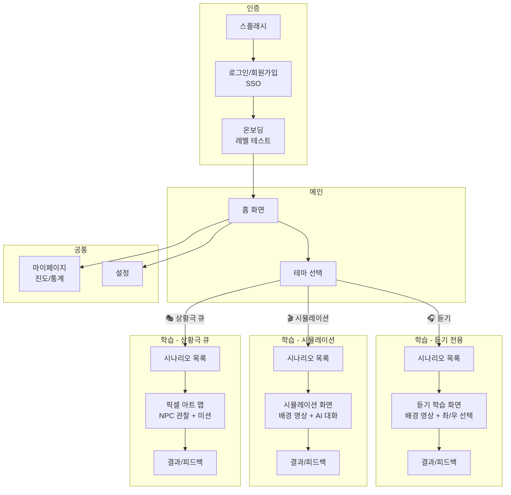

# 📱 앱 화면 구성 및 학습 플로우 기획

| 항목 | 내용 |
|------|------|
| **작성일** | 2026-01-31 |
| **상태** | Draft |
| **관련 문서** | [벤치마킹](./benchmarking-english-apps.md) |

---

## 📋 사용자 요청 (User Request)

> 1. 앱을 켜서 학습을 시작하는 플로우는 어떻게 되는지 조사가 필요할 것 같아. 다른 서비스들 모두 학습 목차를 제공하는 편인가? 우리 서비스에는 그게 필요할까? 주로 시뮬레이션인데 목차가 필요할까?
> 2. 전체적으로 어떤 화면들이 필요한지 기획이 필요해. 3가지의 시뮬레이션 테마(듣기 전용, 상황극, ?) 중 1개를 선택해서 학습을 시작하는거야.

---

## 🔍 리서치: 다른 서비스들의 학습 시작 플로우

### 목차(커리큘럼) 제공 여부 비교

| 서비스 | 목차 방식 | 특징 |
|--------|----------|------|
| **Duolingo** | ✅ 선형 Path (강제) | 잠금 해제 방식, 순서대로만 진행 |
| **Speak** | ✅ 코스 목록 + Day | 레벨별 유닛 선택 가능 |
| **Cake** | ✅ 패스(Path) | 숏폼 클립은 자유, 패스는 순차 |
| **말해보카** | ✅ 단어장 목록 | 테마별 단어장 선택 |

### 두 가지 접근법

```
┌─────────────────────────────────────────────────────────────┐
│  1️⃣ 선형 커리큘럼 (Linear Curriculum)                      │
│  ────────────────────────────────────────────────────────   │
│  • Duolingo 스타일                                          │
│  • 장점: 체계적 학습, 이탈 방지, 진도 명확                   │
│  • 단점: 자유도 낮음, 원하는 주제 바로 학습 불가             │
│  • 적합: 장기 학습 유도, 초보자                             │
└─────────────────────────────────────────────────────────────┘

┌─────────────────────────────────────────────────────────────┐
│  2️⃣ 자유 선택 (Free Choice)                                │
│  ────────────────────────────────────────────────────────   │
│  • Netflix 스타일                                           │
│  • 장점: 높은 자유도, 즉각적 니즈 충족                       │
│  • 단점: 체계적 학습 어려움, 진도 관리 복잡                  │
│  • 적합: 상황별 학습, 직장인 (특정 상황만 필요)             │
└─────────────────────────────────────────────────────────────┘
```

---

## 💡 우리 서비스에 목차가 필요할까?

### 서비스 특성 분석

| 특성 | 우리 서비스 | 일반 학습 앱 |
|------|------------|-------------|
| **핵심** | 상황별 시뮬레이션 | 문법/단어 순차 학습 |
| **학습 단위** | 시나리오 (카페, 공항...) | 레슨 (Unit 1, 2, 3...) |
| **타겟** | 특정 상황 필요한 직장인/대학생 | 처음부터 배우는 학습자 |
| **콘텐츠 관계** | 독립적 (카페 ≠ 공항의 전제) | 의존적 (과거형 → 현재완료) |

### 🎯 결론: **하이브리드 방식** 권장

```
우리 서비스 = 자유 선택 기반 + 가벼운 가이드

• 시뮬레이션은 각각 독립적 → 순서 강제 불필요
• 하지만 "어디서부터 시작할지 모르겠다" 해결 필요
• 레벨 테스트 후 "추천 시나리오" 제공
```

---

## 📱 화면 구성 기획

### 3가지 학습 테마 (확정)

| 테마 | 설명 | 사용자 인터랙션 |
|------|------|---------------|
| **1. 듣기 전용** | 움직이는 배경 + 음성 듣기 + 선택 | 좌/우 버튼 선택 |
| **2. 시뮬레이션** | 배경 영상 + AI 대화 | 마이크로 음성 발화 |
| **3. 상황극 큐** | 픽셀 아트 맵 + NPC 관찰 + 미션 | 패턴 파악 후 발화 |

### 테마별 핵심 차이

```
┌─────────────────────────────────────────────────────────────┐
│  🎧 듣기 전용 (Listening Mode)                              │
│  ────────────────────────────────────────────────────────   │
│  • 말하기 없음, 듣기만 집중                                  │
│  • 예: 네비게이션 안내 듣고 좌/우 선택                       │
│  • 저부담 학습, 초보자 적합                                  │
└─────────────────────────────────────────────────────────────┘

┌─────────────────────────────────────────────────────────────┐
│  🎬 시뮬레이션 (Simulation Mode)                            │
│  ────────────────────────────────────────────────────────   │
│  • 1:1 AI 대화                                              │
│  • 예: 카페에서 주문하기 (배경 영상 + 미션)                  │
│  • 기존 기획 그대로 (Voice-to-Action)                       │
└─────────────────────────────────────────────────────────────┘

┌─────────────────────────────────────────────────────────────┐
│  🎭 상황극 큐 (Scenario Queue Mode)                         │
│  ────────────────────────────────────────────────────────   │
│  • Top-Down 2D 픽셀 아트                                    │
│  • NPC들 관찰 → 패턴 파악 → 내 차례에 다르게 행동           │
│  • 예: 모두 현금 결제하는데 나만 카드로 결제                 │
│  • 히든 미션 + 게임화                                       │
└─────────────────────────────────────────────────────────────┘
```

### 전체 화면 맵 (Screen Map)



---

## 📄 상세 화면 정의

### 1. 스플래시 (Splash Screen)
- 앱 로고 표시
- 자동 로그인 체크 → 홈 or 로그인으로 분기

### 2. 로그인/회원가입 (Auth)
```
┌─────────────────────────────────────┐
│                                     │
│         [앱 로고]                    │
│                                     │
│    "AI와 함께하는 영어 회화"         │
│                                     │
│  ┌─────────────────────────────┐    │
│  │ 🟡 카카오로 시작하기         │    │
│  └─────────────────────────────┘    │
│  ┌─────────────────────────────┐    │
│  │ 🟢 네이버로 시작하기         │    │
│  └─────────────────────────────┘    │
│  ┌─────────────────────────────┐    │
│  │ ⚪ Google로 시작하기         │    │
│  └─────────────────────────────┘    │
│                                     │
│     이용약관 | 개인정보처리방침       │
└─────────────────────────────────────┘
```

### 3. 온보딩 (Onboarding)
```
Step 1: 학습 목표 선택
  - 일상 회화
  - 비즈니스 영어
  - 여행 영어
  - 자유롭게 대화하기

Step 2: 현재 수준 선택 (간단)
  - 왕초보
  - 약간의 영어 가능
  - 중급
  - 고급

Step 3: 간단한 음성 테스트 (선택)
  - 짧은 문장 따라 말하기
  - AI가 발음 수준 측정

Step 4: 맞춤 추천 결과
  - "OO님의 레벨은 Level 2입니다"
  - "추천 시나리오: 카페에서 주문하기"
```

### 4. 홈 화면 (Home)
```
┌─────────────────────────────────────┐
│  👋 안녕하세요, OO님!               │
│  🔥 3일 연속 학습 중                │
│                                     │
│  ━━━━━━━━━━━━━━━━━━━━━━━━━━━━━━━━   │
│  오늘의 추천                         │
│  ┌─────────────────────────────┐    │
│  │ 🎬 카페에서 주문하기         │    │
│  │ Level 2 · 5분               │    │
│  │ [시작하기]                   │    │
│  └─────────────────────────────┘    │
│                                     │
│  ━━━━━━━━━━━━━━━━━━━━━━━━━━━━━━━━   │
│  학습 테마 선택                      │
│                                     │
│  ┌─────┐  ┌─────┐  ┌─────┐         │
│  │ 🎧 │  │ 🎬 │  │ 🎭 │         │
│  │듣기 │  │시뮬 │  │상황극│        │
│  └─────┘  └─────┘  └─────┘         │
│                                     │
│  ━━━━━━━━━━━━━━━━━━━━━━━━━━━━━━━━   │
│                                     │
│  [🏠홈] [📊진도] [👤마이]            │
└─────────────────────────────────────┘
```

### 5. 테마별 시나리오 목록
```
┌─────────────────────────────────────┐
│  ← 상황극                           │
│                                     │
│  카테고리: [전체] [일상] [비즈니스]   │
│                                     │
│  ┌─────────────────────────────┐    │
│  │ 🎬 카페에서 주문하기  ✅완료  │    │
│  │ Level 2 · 5분               │    │
│  └─────────────────────────────┘    │
│  ┌─────────────────────────────┐    │
│  │ 🎬 공항에서 체크인하기       │    │
│  │ Level 2 · 7분               │    │
│  └─────────────────────────────┘    │
│  ┌─────────────────────────────┐    │
│  │ 🔒 면접 보기 (Level 3 필요)  │    │
│  │ Level 3 · 10분              │    │
│  └─────────────────────────────┘    │
│                                     │
└─────────────────────────────────────┘
```

### 6. 시뮬레이션 학습 화면
```
┌─────────────────────────────────────┐
│  [X]                      [일시정지] │
│                                     │
│  ┌─────────────────────────────┐    │
│  │                             │    │
│  │    [배경 루프 영상]          │    │
│  │    (카페 내부)               │    │
│  │                             │    │
│  └─────────────────────────────┘    │
│                                     │
│  💬 미션: 아이스 아메리카노 주문하기  │
│                                     │
│  🤖 AI: "Hi, what can I get        │
│         for you today?"             │
│                                     │
│  ┌─────────────────────────────┐    │
│  │ 🎤 눌러서 말하기             │    │
│  └─────────────────────────────┘    │
│                                     │
│  💡 힌트: "I'd like..."            │
└─────────────────────────────────────┘
```

### 7. 결과/피드백 화면
```
┌─────────────────────────────────────┐
│  🎉 미션 완료!                       │
│                                     │
│  ━━━━━━━━━━━━━━━━━━━━━━━━━━━━━━━━   │
│  📊 오늘의 학습 결과                 │
│                                     │
│  정확도: 85%                        │
│  자신감: ⭐⭐⭐⭐☆                   │
│  획득 XP: +50                       │
│                                     │
│  ━━━━━━━━━━━━━━━━━━━━━━━━━━━━━━━━   │
│  ✨ 더 좋은 표현                     │
│                                     │
│  [당신의 표현]                       │
│  "I want ice americano"            │
│                                     │
│  [친근한 표현] 🔊                    │
│  "I'd like an iced americano"      │
│                                     │
│  [원어민 표현] 🔊                    │
│  "Could I get an iced americano?"  │
│                                     │
│  ┌─────────────────────────────┐    │
│  │ 다음 시나리오                │    │
│  └─────────────────────────────┘    │
│  ┌─────────────────────────────┐    │
│  │ 홈으로                       │    │
│  └─────────────────────────────┘    │
└─────────────────────────────────────┘
```

### 8. 마이페이지 (My Page)
```
┌─────────────────────────────────────┐
│  OO님의 학습 현황                    │
│                                     │
│  ━━━━━━━━━━━━━━━━━━━━━━━━━━━━━━━━   │
│  🔥 연속 학습: 3일                   │
│  📚 완료 시나리오: 12개              │
│  ⭐ 총 XP: 1,250                    │
│                                     │
│  ━━━━━━━━━━━━━━━━━━━━━━━━━━━━━━━━   │
│  레벨 현황                           │
│  ┌─────────────────────────────┐    │
│  │ Level 2 ████████░░ 80%      │    │
│  │ → Level 3까지 2개 남음       │    │
│  └─────────────────────────────┘    │
│                                     │
│  ━━━━━━━━━━━━━━━━━━━━━━━━━━━━━━━━   │
│  테마별 완료율                       │
│  듣기: ████░░░░ 40%                 │
│  시뮬레이션: ██████░░ 60%           │
│  상황극 큐: ██░░░░░░ 20%            │
│                                     │
└─────────────────────────────────────┘
```

---

## ✅ 확정된 결정사항

### 3가지 테마 (확정)
1. **🎧 듣기 전용** - 움직이는 배경 + 음성 듣기 + 좌/우 버튼 선택
2. **🎬 시뮬레이션** - 배경 루프 영상 + 1:1 AI 대화 (Voice-to-Action)
3. **🎭 상황극 큐** - 픽셀 아트 맵 + NPC 관찰 + 히든 미션 (Pattern + Twist)

### 목차(커리큘럼) 방식 (확정)
- **자유 선택 + AI 추천** 방식 채택
- 순서 강제 없음 (시나리오가 독립적이므로)
- 홈에서 "오늘의 추천 시나리오" 제공
- 테마별/난이도별 필터링

---

## 🔜 다음 단계

1. [x] 3가지 테마 확정
2. [ ] 레벨에 따른 시나리오 잠금 여부 결정
3. [ ] 데이터 스키마 설계
4. [ ] 관리자 페이지 기획
