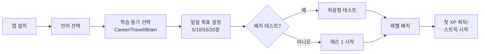
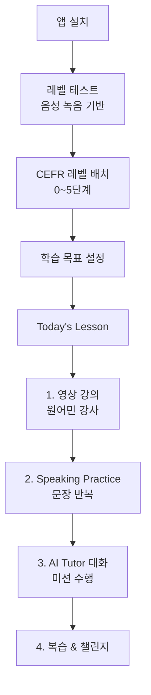
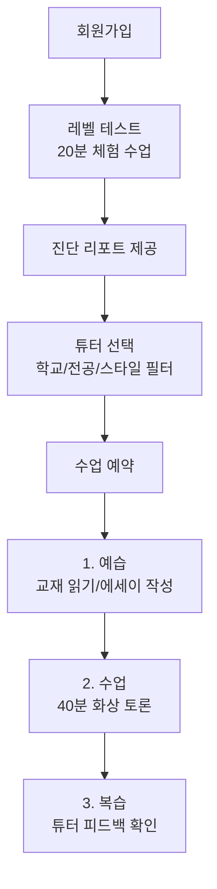
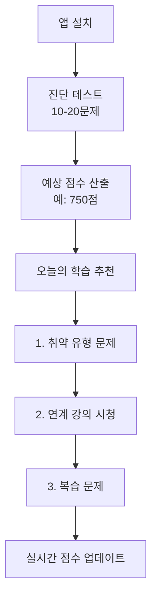
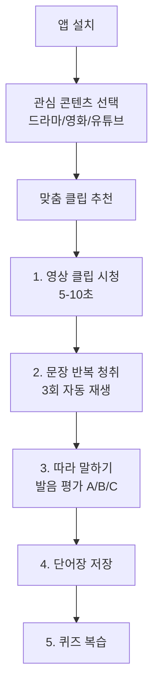

# 📊 영어 회화 앱 벤치마킹 종합 보고서

| 항목 | 내용 |
|------|------|
| **작성일** | 2026-01-30 |
| **상태** | Approved |
| **관련 Task** | [TASK-002](../tasks/TASK-002-benchmarking-english-apps.md) |

---

## 📋 사용자 요청 (User Request)

> 서비스 플로우 관점, 화면 구성 관점, 레벨/진도 시스템 관점에서 벤치마킹을 진행해줘. 링글, 말해보카, 스픽, 듀오링고 등 많은 영어회화 공부 앱 서비스가 있을거야. 아주 오래 걸려도 좋으니까 상세하게 자세히 벤치마킹을 진행해.

---

## 📊 벤치마킹 대상 서비스 개요

| 서비스 | 유형 | 핵심 차별점 | 타겟 |
|--------|------|------------|------|
| **Duolingo** | 종합 언어 학습 | 게임화의 교과서, 글로벌 1위 | 전 연령 |
| **Speak (스픽)** | AI 음성 회화 | GPT-4o 기반 실시간 대화 | 직장인, 학생 |
| **말해보카** | 단어 + 스피킹 | 간격 반복 학습, 리그 시스템 | 수험생, 직장인 |
| **Ringle (링글)** | 1:1 화상 튜터 | 아이비리그 튜터 매칭 | 고급 학습자 |
| **Santa (산타)** | AI 토익 학습 | 실시간 점수 예측 | 토익 준비생 |
| **Cake (케이크)** | 영상 클립 학습 | 숏폼 콘텐츠 기반 | MZ세대 |

---

# 1️⃣ Duolingo (듀오링고)

## 1.1 서비스 플로우



### 온보딩 핵심 전략
- **Endowed Progress Effect**: 온보딩 완료 시 이미 진도가 시작된 것처럼 보여줌
- **Quick Win**: 레슨 1은 거의 실패할 수 없게 설계 → 첫 성취감
- **Loss Aversion**: 첫날부터 스트릭 시작 → "기록 깨지면 안돼"

## 1.2 화면 구성 (UI/UX)

### 메인 화면: Learning Path ("Snake")
```
┌─────────────────────────────────────┐
│  Section: Rookie                     │
│  ┌───┐                              │
│  │ ○ │ Unit 1: Greetings            │
│  └─┬─┘                              │
│    │                                │
│  ┌─▼─┐                              │
│  │ ● │ Unit 2: Order food ◄ 현재    │
│  └─┬─┘                              │
│    │                                │
│  ┌─▼─┐                              │
│  │ ○ │ Unit 3: Talk about family    │
│  └───┘                              │
│                                     │
│  [Practice Hub] - AI 맞춤 복습       │
└─────────────────────────────────────┘
```

### 학습 화면 특징
- **하트 시스템**: 무료 유저 5개 하트, 오답 시 1개 소모
- **즉각 피드백**: 정답(초록) / 오답(빨강) 애니메이션
- **Explain My Answer**: GPT-4 기반 상세 설명 (Duolingo Max)

## 1.3 레벨/진도 시스템

### 구조
```
Course
├── Section (Rookie, Explorer, Champion...)
│   ├── Unit (테마별: 음식 주문, 가족 소개...)
│   │   ├── Level 1 (5-6 레슨)
│   │   ├── Level 2
│   │   ├── ...
│   │   └── Legendary Level (보라색, 최고 숙련도)
```

### 게임화 요소
| 요소 | 설명 | 심리 효과 |
|------|------|----------|
| **Streak** | 연속 학습일 | Loss Aversion |
| **XP** | 경험치 | 성취감 |
| **Leagues** | 주간 리그 (브론즈→다이아) | 경쟁심 |
| **Gems** | 재화 (스트릭 프리즈 구매) | 투자 효과 |
| **Friends Quest** | 친구와 협동 미션 | 사회적 책임감 |

### 2025년 트렌드
- **Video Call**: AI 캐릭터 "Lily"와 영상통화 형식 대화
- **Character Narrative**: 캐릭터별 스토리라인 강화

---

# 2️⃣ Speak (스픽)

## 2.1 서비스 플로우



### 학습 루틴: Input → Drill → Output
1. **Input**: 원어민 강사 영상으로 핵심 표현 학습
2. **Drill**: AI와 함께 문장 반복 (스마트 리뷰 알고리즘)
3. **Output**: AI 튜터와 실제 상황처럼 대화

## 2.2 화면 구성 (UI/UX)

### 메인 화면
```
┌─────────────────────────────────────┐
│  오늘의 학습                         │
│  ┌─────────────────────────────┐    │
│  │ 📺 Lesson 23: 카페에서 주문 │    │
│  │ ⏱ 15분 예상                 │    │
│  │ [시작하기]                   │    │
│  └─────────────────────────────┘    │
│                                     │
│  AI 튜터와 프리토킹                  │
│  [새 대화 시작]                      │
│                                     │
│  복습할 문장: 12개                   │
└─────────────────────────────────────┘
```

### AI 튜터 대화 화면
- **실시간 응답**: GPT-4o로 0.5초 내외 반응
- **발음 분석**: 음절별 시각화 피드백
- **3-Mood 추천**: 같은 표현을 친근/격식/원어민체로 제안

## 2.3 레벨/진도 시스템

### CEFR 기반 레벨
| 레벨 | 설명 | 학습 내용 |
|------|------|----------|
| **Level 0** | 입문 | 알파벳, 기초 단어 |
| **Level 1** | 초급 | 인사, 자기소개 |
| **Level 2** | 중초급 | 여행, 식당 |
| **Level 3** | 중급 | 의견 표현, 비즈니스 기초 |
| **Level 4** | 중고급 | 토론, 관용구 |
| **Level 5** | 고급 | 원어민 수준 대화 |

### 동기 부여 요소
- **불꽃 포인트**: 스피킹 점수 누적
- **연속 학습일**: 스트릭 시스템
- **개인화 커리큘럼**: 관심사 기반 콘텐츠 추천

---

# 3️⃣ 말해보카

## 3.1 서비스 플로우

```mermaid
graph TD
    A[앱 설치] --> B[어휘 레벨 테스트<br/>아는/모르는 단어 선택]
    B --> C[어휘량 측정<br/>상위 N%]
    C --> D[학습 목표 선택<br/>수능/토익/일상]
    D --> E[맞춤형 학습 경로 생성]
    
    E --> F[오늘의 학습]
    F --> G[1. 새 단어 학습]
    G --> H[2. 문장 속 빈칸 퀴즈]
    H --> I[3. 스피킹 모드]
    I --> J[4. 복습 (간격 반복)]
```

## 3.2 화면 구성 (UI/UX)

### 특징
- **미니멀 레이아웃**: 하단 탭 4개 (학습/리그/캐릭터/설정)
- **한 손 조작 최적화**: 큰 버튼, 하단 배치
- **고대비 피드백**: 정답(초록), 오답(빨강)

### 학습 화면
```
┌─────────────────────────────────────┐
│  Q. 빈칸에 알맞은 단어는?            │
│                                     │
│  "I need to _____ my English."      │
│                                     │
│  ┌─────────┐  ┌─────────┐          │
│  │ improve │  │ approveㅤ│          │
│  └─────────┘  └─────────┘          │
│  ┌─────────┐  ┌─────────┐          │
│  │ remove  │  │ proveㅤㅤ │          │
│  └─────────┘  └─────────┘          │
│                                     │
│  🔊 [음성 듣기]                      │
└─────────────────────────────────────┘
```

## 3.3 레벨/진도 시스템

### 핵심 기능
- **간격 반복 학습 (Spaced Repetition)**: 망각 곡선 기반 복습
- **리그 시스템**: 브론즈 → 다이아몬드 주간 경쟁
- **캐릭터 커스터마이징**: 다이아 재화로 꾸미기

---

# 4️⃣ Ringle (링글)

## 4.1 서비스 플로우



### 튜터 매칭 시스템
- **Ivy League 튜터**: 하버드, 스탠포드 등 명문대 출신
- **필터링**: 관심 분야, 전공, 말투 스타일
- **실시간 첨삭**: 수업 중 문장 교정

## 4.2 화면 구성 (UI/UX)

### 수업 화면
```
┌─────────────────────────────────────┐
│  [튜터 영상]          [내 영상]      │
│                                     │
│  ────────────────────────────────   │
│  Today's Topic: Climate Change      │
│                                     │
│  📝 실시간 첨삭 노트                 │
│  ┌─────────────────────────────┐    │
│  │ ❌ "I think that is good"   │    │
│  │ ✅ "I believe it's beneficial"│   │
│  └─────────────────────────────┘    │
└─────────────────────────────────────┘
```

## 4.3 레벨/진도 시스템

### 특징
- **진단 리포트**: 문법, 어휘, 유창성 등 세부 평가
- **수업 히스토리**: 모든 수업 녹화본 + 피드백 기록
- **인증서**: 일정 수업 완료 시 수료증 발급

---

# 5️⃣ Santa (산타토익)

## 5.1 서비스 플로우



## 5.2 핵심 특징

### AI 기반 학습
- **실시간 점수 예측**: 문제 풀 때마다 점수 변동
- **취약점 분석**: AI가 부족한 유형 자동 파악
- **강의-문제 연계**: 틀린 문제와 관련 강의 자동 추천

## 5.3 레벨/진도 시스템

| 요소 | 설명 |
|------|------|
| **예상 점수** | 실시간 갱신되는 토익 예상 점수 |
| **취약 유형** | Part별, 유형별 정답률 시각화 |
| **학습 캘린더** | 일일 학습량 기록 |

---

# 6️⃣ Cake (케이크)

## 6.1 서비스 플로우



## 6.2 화면 구성 (UI/UX)

### 숏폼 스타일 UI
```
┌─────────────────────────────────────┐
│  [영상 클립]                         │
│  ┌─────────────────────────────┐    │
│  │                             │    │
│  │    📺 Friends Scene         │    │
│  │                             │    │
│  │  "How you doin'?"           │    │
│  │  "잘 지내?"                  │    │
│  └─────────────────────────────┘    │
│                                     │
│  🔁 반복  🎤 말하기  📚 단어장       │
│                                     │
│  ⬆️ 스와이프하여 다음 클립            │
└─────────────────────────────────────┘
```

### 탭 구성
- **홈**: 맞춤 추천, 오늘의 표현
- **패스(Path)**: 단계별 커리큘럼
- **스피킹**: 상황별 대화
- **내 정보**: 학습 현황, 별 개수

## 6.3 레벨/진도 시스템

| 요소 | 설명 |
|------|------|
| **별(Star)** | 학습 완료 시 획득 |
| **XP** | 경험치 → 레벨업 |
| **리그** | 주간 별 개수 경쟁 |
| **Streak** | 연속 학습일 |
| **하트** | 무료 유저 생명 제한 (유료 시 무제한) |

---

# 📊 종합 비교표

## 서비스 유형별 분류

| 유형 | 서비스 | 특징 |
|------|--------|------|
| **AI 회화** | Speak, (우리 서비스) | 실시간 AI 대화, 음성 분석 |
| **게임화 학습** | Duolingo, 말해보카, Cake | 스트릭, 리그, XP |
| **1:1 튜터** | Ringle | 프리미엄, 실시간 첨삭 |
| **시험 준비** | Santa | 점수 예측, 취약점 분석 |

## 게임화 요소 비교

| 요소 | Duolingo | Speak | 말해보카 | Cake |
|------|----------|-------|---------|------|
| **Streak** | ✅ | ✅ | ✅ | ✅ |
| **XP/포인트** | ✅ | ✅ (불꽃) | ✅ (다이아) | ✅ (별) |
| **리그** | ✅ | ❌ | ✅ | ✅ |
| **캐릭터** | ✅ | ❌ | ✅ | ❌ |
| **하트(생명)** | ✅ | ❌ | ❌ | ✅ |

## 레벨 시스템 비교

| 서비스 | 레벨 기준 | 특징 |
|--------|----------|------|
| **Duolingo** | Unit/Section | Tree → Path 전환, Legendary 도전 |
| **Speak** | CEFR (0-5) | 국제 표준 기반 |
| **말해보카** | 어휘량 | 상위 N% 표시 |
| **Santa** | 예상 점수 | 실시간 점수 변동 |
| **Cake** | XP → Level | 단순 경험치 누적 |

## 온보딩 비교

| 서비스 | 테스트 유형 | 소요 시간 | 결과 |
|--------|-----------|----------|------|
| **Duolingo** | 적응형 퀴즈 | 5-10분 | Path 배치 |
| **Speak** | 음성 녹음 | 10-15분 | CEFR 레벨 |
| **말해보카** | 단어 선택 | 3-5분 | 어휘량 측정 |
| **Ringle** | 화상 수업 | 20분 | 진단 리포트 |
| **Santa** | 객관식 | 5-10분 | 예상 점수 |

---

# 💡 우리 서비스를 위한 인사이트

## 1. 온보딩 전략

### 채택할 요소
- ✅ **Quick Win**: 첫 레슨은 쉽게 → 성취감 제공 (Duolingo)
- ✅ **음성 기반 레벨 테스트**: 실제 스피킹 능력 측정 (Speak)
- ✅ **목표 설정**: 학습 동기 선택 → 맞춤 콘텐츠 (Duolingo)

### 우리만의 차별점
- 🌟 **시뮬레이션 체험**: 온보딩에서 바로 1개 간단한 시뮬레이션 체험
- 🌟 **AI 톤 분석 맛보기**: "자신감 있게 말해보세요" 피드백 제공

## 2. 레벨/진도 시스템

### 채택할 요소
- ✅ **CEFR 기반 레벨** (Speak): 국제 표준, 신뢰성
- ✅ **섹션/유닛 구조** (Duolingo): 테마별 학습
- ✅ **실시간 성장 표시**: 학습할수록 레벨 게이지 상승

### 우리만의 차별점
- 🌟 **3-Mood 진도**: 친근체/격식체/네이티브체 각각 숙련도 표시
- 🌟 **상황별 마스터**: 카페, 공항, 회의실 등 상황별 완료율

## 3. 게임화 요소

### 필수 채택
- ✅ **Streak (연속 학습일)**: 모든 서비스가 사용 → 검증된 효과
- ✅ **XP/포인트**: 학습량 시각화
- ✅ **즉각 피드백**: 정답/오답 애니메이션 + 효과음

### 선택적 채택
- 🤔 **리그 시스템**: 경쟁 요소 (MVP 이후 고려)
- 🤔 **캐릭터**: 커스터마이징 (MVP 이후 고려)
- ❌ **하트 시스템**: 사용자 이탈 우려 (제외)

## 4. UI/UX 원칙

### 채택할 요소
- ✅ **미니멀 레이아웃**: 핵심 기능에 집중 (말해보카)
- ✅ **한 손 조작**: 모바일 최적화 (말해보카)
- ✅ **숏폼 스타일**: 세로형 스크롤, 빠른 전환 (Cake)
- ✅ **실시간 첨삭 UI**: 교정 내용 시각화 (Ringle)

---

# 🎯 최종 권장 사항

## MVP에 반드시 포함할 것

| 항목 | 근거 |
|------|------|
| **SSO 로그인** | 진입 장벽 최소화 |
| **간단한 레벨 테스트** | 맞춤형 콘텐츠 제공 |
| **Streak 시스템** | 검증된 리텐션 효과 |
| **즉각 피드백 UI** | 학습 동기 유지 |
| **CEFR 기반 레벨** | 국제 표준 신뢰성 |

## MVP 이후 고려할 것

| 항목 | 우선순위 |
|------|----------|
| 리그/리더보드 | Medium |
| 캐릭터/아바타 | Low |
| Friends 기능 | Low |
| 인증서/뱃지 | Medium |

---

## 🔜 다음 단계

1. [ ] 온보딩 플로우 상세 기획
2. [ ] 레벨 시스템 상세 설계 (CEFR 기반)
3. [ ] 데이터 스키마 설계
4. [ ] 관리자 페이지 기획
