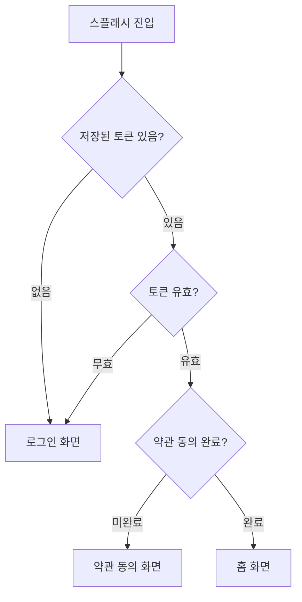
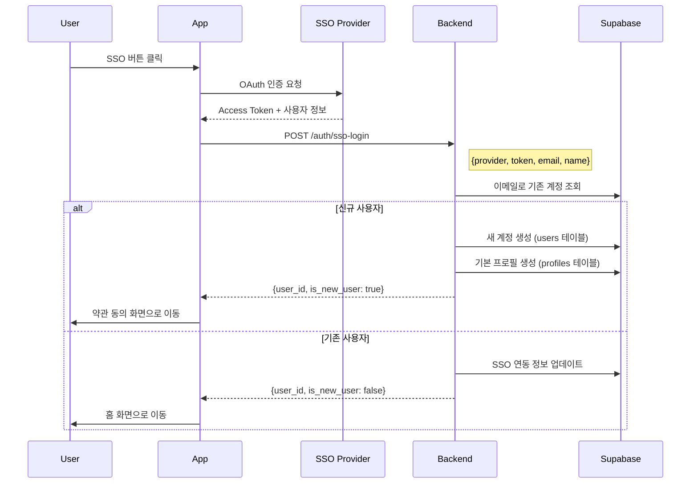
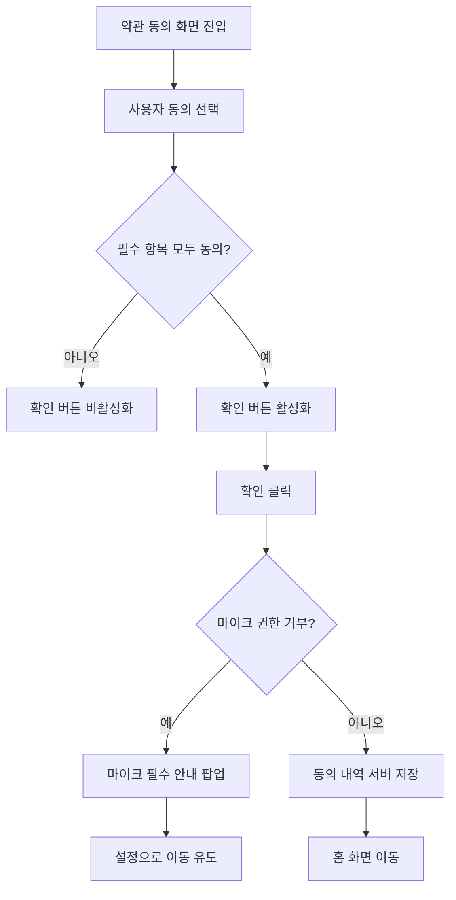
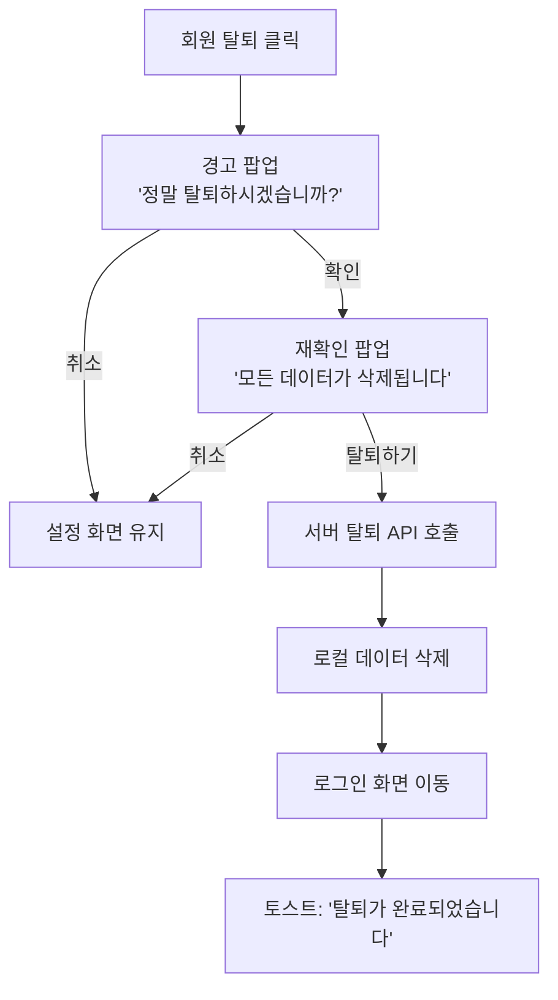

# 📱 핵심 화면 UI/기능 명세서

| 항목 | 내용 |
|------|------|
| **작성일** | 2026-01-31 |
| **상태** | Draft |
| **대상 화면** | 스플래시, 로그인, 약관동의, 설정 |

---

## 1. 스플래시 (Splash Screen)

### 1.1. 화면 목적
- 앱 초기 로딩 중 브랜드 노출
- 자동 로그인 체크 및 라우팅

### 1.2. UI 요소

| 요소 | 설명 |
|------|------|
| 앱 로고 | 중앙 배치, 페이드인 애니메이션 |
| 로딩 인디케이터 | 하단 또는 로고 아래 작은 스피너 |
| 배경 | 브랜드 컬러 또는 그라데이션 |

### 1.3. 와이어프레임

```
┌─────────────────────────────────────┐
│                                     │
│                                     │
│                                     │
│            [앱 로고]                 │
│                                     │
│            ◌ 로딩중...              │
│                                     │
│                                     │
│                                     │
└─────────────────────────────────────┘
```

### 1.4. 기능 명세

| 기능 | 설명 | 우선순위 |
|------|------|----------|
| 자동 로그인 체크 | 저장된 토큰으로 세션 유효성 확인 | P0 |
| 라우팅 분기 | 로그인 유효 → 홈, 무효 → 로그인 화면 | P0 |
| 앱 업데이트 체크 | 최신 버전 확인, 필수 업데이트 시 스토어 이동 | P1 |
| 네트워크 체크 | 오프라인 시 알림 표시 | P1 |

### 1.5. 플로우차트



---

## 2. 로그인/회원가입 (Auth Screen)

### 2.1. 화면 목적
- SSO 기반 간편 로그인/회원가입
- 내부 계정 생성 및 연동

### 2.2. UI 요소

| 요소 | 설명 |
|------|------|
| 앱 로고 | 상단 배치 |
| 환영 문구 | "AI와 함께하는 영어 회화" |
| SSO 버튼 (카카오) | 노란색, 카카오 아이콘 |
| SSO 버튼 (네이버) | 초록색, 네이버 아이콘 |
| SSO 버튼 (Google) | 흰색/회색, Google 아이콘 |
| SSO 버튼 (Apple) | 검정색, Apple 아이콘 (iOS만) |
| 하단 링크 | 이용약관, 개인정보처리방침 |

### 2.3. 와이어프레임

```
┌─────────────────────────────────────┐
│                                     │
│            [앱 로고]                 │
│                                     │
│     "AI와 함께하는 영어 회화"        │
│                                     │
│  ┌─────────────────────────────┐    │
│  │ 🟡 카카오로 시작하기         │    │
│  └─────────────────────────────┘    │
│  ┌─────────────────────────────┐    │
│  │ 🟢 네이버로 시작하기         │    │
│  └─────────────────────────────┘    │
│  ┌─────────────────────────────┐    │
│  │ ⚪ Google로 시작하기         │    │
│  └─────────────────────────────┘    │
│  ┌─────────────────────────────┐    │
│  │ ⚫ Apple로 시작하기          │    │  ← iOS만 표시
│  └─────────────────────────────┘    │
│                                     │
│     이용약관 | 개인정보처리방침       │
└─────────────────────────────────────┘
```

### 2.4. 기능 명세

| 기능 | 설명 | 우선순위 |
|------|------|----------|
| 카카오 로그인 | Kakao SDK 연동, OAuth 인증 | P0 |
| 네이버 로그인 | Naver SDK 연동, OAuth 인증 | P0 |
| Google 로그인 | Google Sign-In 연동 | P0 |
| Apple 로그인 | Sign in with Apple (iOS 필수) | P0 |
| 내부 계정 생성 | SSO 성공 후 내부 DB에 사용자 생성 | P0 |
| 기존 계정 연동 | 동일 이메일 시 기존 계정과 연결 | P1 |
| 로그인 실패 처리 | 에러 메시지 토스트 표시 | P0 |

### 2.5. 내부 계정 생성 로직



### 2.6. 에러 케이스

| 에러 | 메시지 | 처리 |
|------|--------|------|
| SSO 취소 | "로그인이 취소되었습니다" | 로그인 화면 유지 |
| 네트워크 오류 | "인터넷 연결을 확인해주세요" | 재시도 버튼 |
| 서버 오류 | "일시적인 오류가 발생했습니다" | 재시도 버튼 |

---

## 3. 약관 동의 및 권한 설정 (Consent Screen)

### 3.1. 화면 목적
- 법적 필수 약관 동의 수집
- 앱 권한(마이크 등) 요청
- 개인정보 수집 동의

### 3.2. UI 요소

| 요소 | 설명 |
|------|------|
| 전체 동의 체크박스 | 모든 항목 일괄 동의 |
| 개별 약관 항목 | 체크박스 + 약관명 + 상세보기 버튼 |
| 필수/선택 구분 | 라벨로 구분 |
| 확인 버튼 | 필수 항목 모두 동의 시 활성화 |

### 3.3. 와이어프레임

```
┌─────────────────────────────────────┐
│  ← 이전                             │
│                                     │
│  📋 서비스 이용을 위해               │
│     동의가 필요합니다                │
│                                     │
│  ━━━━━━━━━━━━━━━━━━━━━━━━━━━━━━━━   │
│                                     │
│  ☑️ 전체 동의하기                    │
│                                     │
│  ━━━━━━━━━━━━━━━━━━━━━━━━━━━━━━━━   │
│                                     │
│  ☑️ [필수] 서비스 이용약관      [>]  │
│  ☑️ [필수] 개인정보 처리방침    [>]  │
│  ☑️ [필수] 마이크 접근 권한     [>]  │
│  ☐ [선택] 음성 데이터 수집 동의 [>]  │
│  ☐ [선택] 마케팅 정보 수신     [>]  │
│  ☐ [선택] 푸시 알림            [>]  │
│                                     │
│  ━━━━━━━━━━━━━━━━━━━━━━━━━━━━━━━━   │
│                                     │
│  ┌─────────────────────────────┐    │
│  │         확인                 │    │  ← 필수 항목 전체 동의 시 활성화
│  └─────────────────────────────┘    │
│                                     │
└─────────────────────────────────────┘
```

### 3.4. 약관 항목 상세

| 항목 | 유형 | 설명 | 상세 내용 |
|------|------|------|----------|
| 서비스 이용약관 | 필수 | 서비스 전반 이용 조건 | 웹뷰 연결 |
| 개인정보 처리방침 | 필수 | 개인정보 수집/이용 안내 | 웹뷰 연결 |
| 마이크 접근 권한 | 필수 | 음성 인식을 위한 권한 | OS 권한 요청 팝업 |
| 음성 데이터 수집 동의 | 선택 | AI 개선을 위한 음성 저장 | 하단 시트 설명 |
| 마케팅 정보 수신 | 선택 | 이벤트/할인 정보 수신 | - |
| 푸시 알림 | 선택 | 학습 리마인더 등 | OS 권한 요청 팝업 |

### 3.5. 기능 명세

| 기능 | 설명 | 우선순위 |
|------|------|----------|
| 전체 동의 토글 | 모든 항목 동시 체크/해제 | P0 |
| 개별 동의 체크 | 각 항목 독립적 체크 | P0 |
| 필수 항목 검증 | 필수 미동의 시 확인 버튼 비활성화 | P0 |
| 약관 상세 보기 | 웹뷰로 약관 전문 표시 | P0 |
| 마이크 권한 요청 | OS 네이티브 권한 팝업 | P0 |
| 푸시 권한 요청 | OS 네이티브 권한 팝업 | P1 |
| 동의 상태 저장 | 서버에 동의 내역 기록 | P0 |

### 3.6. 플로우차트



---

## 4. 설정 화면 (Settings Screen)

### 4.1. 화면 목적
- 앱 및 계정 관련 설정 관리
- 동의 사항 변경
- 로그아웃/탈퇴 처리

### 4.2. UI 요소 (섹션별)

```
┌─────────────────────────────────────┐
│  ← 설정                             │
│                                     │
│  ━━━ 계정 ━━━━━━━━━━━━━━━━━━━━━━━━   │
│  프로필 관리                    [>]  │
│  연결된 계정 (카카오)           [>]  │
│                                     │
│  ━━━ 학습 설정 ━━━━━━━━━━━━━━━━━━━   │
│  모국어               한국어    [>]  │
│  배우고자 하는 언어    영어     [>]  │
│                                     │
│  ━━━ 알림 ━━━━━━━━━━━━━━━━━━━━━━━━   │
│  학습 리마인더              [ON/OFF] │
│  이벤트/마케팅 알림         [ON/OFF] │
│                                     │
│  ━━━ 개인정보 ━━━━━━━━━━━━━━━━━━━━   │
│  음성 데이터 수집 동의      [ON/OFF] │
│  마케팅 정보 수신 동의      [ON/OFF] │
│                                     │
│  ━━━ 앱 관리 ━━━━━━━━━━━━━━━━━━━━━   │
│  캐시 삭제                 12.3MB   │
│  앱 버전                   1.0.0    │
│                                     │
│  ━━━ 약관 및 정책 ━━━━━━━━━━━━━━━━   │
│  서비스 이용약관                [>]  │
│  개인정보 처리방침              [>]  │
│  오픈소스 라이선스              [>]  │
│                                     │
│  ━━━━━━━━━━━━━━━━━━━━━━━━━━━━━━━━   │
│  로그아웃                           │
│  회원 탈퇴                          │
│                                     │
└─────────────────────────────────────┘
```

### 4.3. 섹션별 기능 명세

#### 4.3.1. 계정 섹션

| 기능 | 설명 | 우선순위 |
|------|------|----------|
| 프로필 관리 | 닉네임, 프로필 이미지 변경 | P1 |
| 연결된 계정 | SSO 연결 상태 확인, 다른 SSO 추가 연결 | P2 |

#### 4.3.2. 학습 설정 섹션

| 기능 | 설명 | 우선순위 |
|------|------|----------|
| 모국어 설정 | UI 언어 변경 (한국어/영어/일본어 등) | P1 |
| 학습 언어 설정 | 배우고자 하는 언어 선택 | P0 |

#### 4.3.3. 알림 섹션

| 기능 | 설명 | 우선순위 |
|------|------|----------|
| 학습 리마인더 | 매일 학습 알림 ON/OFF | P1 |
| 마케팅 알림 | 이벤트/할인 알림 ON/OFF | P2 |

#### 4.3.4. 개인정보 섹션

| 기능 | 설명 | 우선순위 |
|------|------|----------|
| 음성 데이터 수집 | AI 개선용 음성 저장 동의 변경 | P0 |
| 마케팅 동의 | 마케팅 수신 동의 변경 | P2 |

#### 4.3.5. 앱 관리 섹션

| 기능 | 설명 | 우선순위 |
|------|------|----------|
| 캐시 삭제 | 로컬 캐시 클리어, 용량 표시 | P1 |
| 앱 버전 | 현재 버전 표시, 업데이트 있으면 표시 | P1 |

#### 4.3.6. 약관 섹션

| 기능 | 설명 | 우선순위 |
|------|------|----------|
| 이용약관 보기 | 웹뷰로 약관 표시 | P0 |
| 개인정보처리방침 | 웹뷰로 약관 표시 | P0 |
| 오픈소스 라이선스 | 사용된 라이브러리 라이선스 표시 | P2 |

#### 4.3.7. 로그아웃/탈퇴

| 기능 | 설명 | 우선순위 |
|------|------|----------|
| 로그아웃 | 토큰 삭제, 로그인 화면 이동 | P0 |
| 회원 탈퇴 | 확인 팝업 → 탈퇴 처리 → 로그인 화면 | P0 |

### 4.4. 회원 탈퇴 플로우



---

## 5. 데이터 스키마 (관련 테이블)

```sql
-- 사용자 기본 정보
CREATE TABLE users (
  id UUID PRIMARY KEY DEFAULT gen_random_uuid(),
  email VARCHAR(255) UNIQUE NOT NULL,
  created_at TIMESTAMP DEFAULT NOW(),
  deleted_at TIMESTAMP -- Soft delete
);

-- SSO 연동 정보
CREATE TABLE user_sso (
  id UUID PRIMARY KEY,
  user_id UUID REFERENCES users(id),
  provider VARCHAR(50) NOT NULL, -- 'kakao', 'naver', 'google', 'apple'
  provider_user_id VARCHAR(255) NOT NULL,
  connected_at TIMESTAMP DEFAULT NOW()
);

-- 사용자 프로필
CREATE TABLE profiles (
  user_id UUID PRIMARY KEY REFERENCES users(id),
  nickname VARCHAR(50),
  profile_image_url TEXT,
  native_language VARCHAR(10) DEFAULT 'ko',
  learning_language VARCHAR(10) DEFAULT 'en'
);

-- 동의 내역
CREATE TABLE user_consents (
  user_id UUID PRIMARY KEY REFERENCES users(id),
  terms_agreed BOOLEAN DEFAULT FALSE,
  privacy_agreed BOOLEAN DEFAULT FALSE,
  voice_data_agreed BOOLEAN DEFAULT FALSE,
  marketing_agreed BOOLEAN DEFAULT FALSE,
  push_agreed BOOLEAN DEFAULT FALSE,
  agreed_at TIMESTAMP DEFAULT NOW(),
  updated_at TIMESTAMP
);

-- 알림 설정
CREATE TABLE notification_settings (
  user_id UUID PRIMARY KEY REFERENCES users(id),
  learning_reminder BOOLEAN DEFAULT TRUE,
  marketing_notification BOOLEAN DEFAULT FALSE
);
```

---

## ✅ 체크리스트

| 화면 | UI 정의 | 기능 명세 | 플로우 |
|------|---------|----------|--------|
| 스플래시 | ✅ | ✅ | ✅ |
| 로그인/회원가입 | ✅ | ✅ | ✅ |
| 약관 동의 | ✅ | ✅ | ✅ |
| 설정 | ✅ | ✅ | ✅ |

---

## 🔜 다음 단계

1. [x] 핵심 화면 UI/기능 명세
2. [ ] 디자인 시스템 정의 (컬러, 폰트, 컴포넌트)
3. [ ] Figma 와이어프레임 작성
4. [ ] 개발 착수
