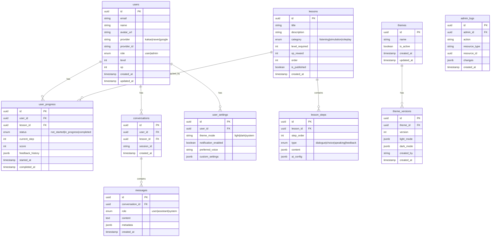

# 데이터 스키마 설계

| 항목 | 내용 |
|------|------|
| **작성일** | 2026-02-01 |
| **상태** | Draft |
| **관련 문서** | [architecture.md](./architecture.md) |

---

## 1. ER 다이어그램



---

## 2. 테이블 상세 정의

### 2.1 users (사용자)

| 컬럼 | 타입 | 제약 | 설명 |
|------|------|------|------|
| id | UUID | PK | 사용자 고유 ID |
| email | VARCHAR(255) | UNIQUE, NOT NULL | 이메일 |
| name | VARCHAR(100) | NOT NULL | 이름 |
| avatar_url | TEXT | - | 프로필 이미지 URL |
| provider | VARCHAR(20) | NOT NULL | OAuth 제공자 |
| provider_id | VARCHAR(255) | NOT NULL | 제공자별 사용자 ID |
| role | ENUM | DEFAULT 'user' | 권한 (user/admin) |
| level | INTEGER | DEFAULT 1 | 현재 레벨 |
| xp | INTEGER | DEFAULT 0 | 경험치 |
| created_at | TIMESTAMP | DEFAULT now() | 생성일 |
| updated_at | TIMESTAMP | DEFAULT now() | 수정일 |

**인덱스:**
- `idx_users_email` (email)
- `idx_users_provider` (provider, provider_id)

---

### 2.2 themes (테마)

| 컬럼 | 타입 | 제약 | 설명 |
|------|------|------|------|
| id | UUID | PK | 테마 고유 ID |
| name | VARCHAR(100) | NOT NULL | 테마 이름 |
| is_active | BOOLEAN | DEFAULT false | 현재 활성 테마 |
| created_at | TIMESTAMP | DEFAULT now() | 생성일 |
| updated_at | TIMESTAMP | DEFAULT now() | 수정일 |

### 2.3 theme_versions (테마 버전)

| 컬럼 | 타입 | 제약 | 설명 |
|------|------|------|------|
| id | UUID | PK | 버전 고유 ID |
| theme_id | UUID | FK → themes | 테마 ID |
| version | INTEGER | NOT NULL | 버전 번호 |
| light_mode | JSONB | NOT NULL | 라이트 모드 색상 |
| dark_mode | JSONB | NOT NULL | 다크 모드 색상 |
| created_by | VARCHAR(100) | - | 생성자 |
| created_at | TIMESTAMP | DEFAULT now() | 생성일 |

**테마 JSON 구조:**
```json
{
  "background": "0 0% 100%",
  "foreground": "222.2 84% 4.9%",
  "card": "0 0% 100%",
  "card-foreground": "222.2 84% 4.9%",
  "primary": "24.6 95% 53.1%",
  "primary-foreground": "0 0% 100%",
  "secondary": "217.2 91.2% 59.8%",
  "secondary-foreground": "0 0% 100%",
  "muted": "210 40% 96.1%",
  "muted-foreground": "215.4 16.3% 46.9%",
  "accent": "210 40% 96.1%",
  "accent-foreground": "222.2 47.4% 11.2%",
  "destructive": "0 84.2% 60.2%",
  "destructive-foreground": "0 0% 100%",
  "success": "142.1 76.2% 36.3%",
  "success-foreground": "0 0% 100%",
  "warning": "24.6 95% 53.1%",
  "warning-foreground": "0 0% 100%",
  "border": "214.3 31.8% 91.4%",
  "input": "214.3 31.8% 91.4%",
  "ring": "24.6 95% 53.1%"
}
```

---

### 2.4 lessons (레슨)

| 컬럼 | 타입 | 제약 | 설명 |
|------|------|------|------|
| id | UUID | PK | 레슨 고유 ID |
| title | VARCHAR(200) | NOT NULL | 레슨 제목 |
| description | TEXT | - | 레슨 설명 |
| category | ENUM | NOT NULL | 카테고리 |
| level_required | INTEGER | DEFAULT 1 | 필요 레벨 |
| xp_reward | INTEGER | DEFAULT 10 | 완료 시 XP |
| order | INTEGER | NOT NULL | 정렬 순서 |
| is_published | BOOLEAN | DEFAULT false | 공개 여부 |
| created_at | TIMESTAMP | DEFAULT now() | 생성일 |

---

## 3. SQLAlchemy 모델 예시

```python
# app/models/user.py
from sqlalchemy import Column, String, Integer, Enum, DateTime
from sqlalchemy.dialects.postgresql import UUID
from app.core.database import Base
import uuid
from datetime import datetime

class User(Base):
    __tablename__ = "users"
    
    id = Column(UUID(as_uuid=True), primary_key=True, default=uuid.uuid4)
    email = Column(String(255), unique=True, nullable=False, index=True)
    name = Column(String(100), nullable=False)
    avatar_url = Column(String)
    provider = Column(String(20), nullable=False)
    provider_id = Column(String(255), nullable=False)
    role = Column(Enum("user", "admin", name="user_role"), default="user")
    level = Column(Integer, default=1)
    xp = Column(Integer, default=0)
    created_at = Column(DateTime, default=datetime.utcnow)
    updated_at = Column(DateTime, default=datetime.utcnow, onupdate=datetime.utcnow)
```

---

## 4. 다음 단계

1. [ ] API 명세 작성 (`api-spec.md`)
2. [ ] FastAPI 프로젝트 초기화
3. [ ] SQLAlchemy 모델 구현
4. [ ] Alembic 마이그레이션 설정
