# 데이터 스키마 설계

| 항목 | 내용 |
|------|------|
| **작성일** | 2026-02-02 |
| **상태** | Draft |
| **관련 문서** | [architecture.md](./architecture.md), [research-cms.md](./research-cms.md) |

---

## 1. ER 다이어그램

```mermaid
erDiagram
    %% 사용자 관련
    users ||--o{ user_progress : has
    users ||--o{ conversations : has
    users ||--o{ user_settings : has
    users ||--o{ user_cohorts : assigned_to
    
    %% 실험 관련
    experiments ||--o{ experiment_variables : has
    experiments ||--o{ user_cohorts : contains
    experiments ||--o{ experiment_logs : generates
    
    %% 콘텐츠 관련
    scenarios ||--o{ scenario_steps : contains
    scenarios ||--o{ user_progress : tracked_by
    
    %% AI 관련
    ai_prompts ||--o{ ai_prompt_versions : has
    
    %% 대화 관련
    conversations ||--o{ messages : contains
    
    %% 테마 관련
    themes ||--o{ theme_versions : has

    users {
        uuid id PK
        string email
        string name
        string avatar_url
        string provider "kakao|naver|google"
        string provider_id
        enum role "user|admin"
        int level
        int xp
        timestamp created_at
        timestamp updated_at
    }
    
    user_settings {
        uuid id PK
        uuid user_id FK
        string theme_mode "light|dark|system"
        boolean notification_enabled
        string preferred_voice
        jsonb custom_settings
    }
    
    experiments {
        uuid id PK
        string name
        text hypothesis
        enum status "draft|running|completed|paused"
        enum learning_theme "listening|simulation|myturn|all"
        timestamp start_date
        timestamp end_date
        int target_sample_size
        uuid created_by FK
        timestamp created_at
    }
    
    experiment_variables {
        uuid id PK
        uuid experiment_id FK
        string variable_key
        jsonb control_value
        jsonb treatment_value
        float traffic_split
        timestamp created_at
    }
    
    user_cohorts {
        uuid id PK
        uuid user_id FK
        uuid experiment_id FK
        enum variant "control|treatment"
        timestamp assigned_at
        boolean completed
    }
    
    experiment_logs {
        uuid id PK
        uuid experiment_id FK
        uuid user_id FK
        enum variant "control|treatment"
        string event_type
        jsonb event_data
        enum learning_theme
        uuid scenario_id FK
        timestamp created_at
    }
    
    ai_prompts {
        uuid id PK
        string name
        enum target_theme "listening|simulation|myturn"
        boolean is_active
        timestamp created_at
        timestamp updated_at
    }
    
    ai_prompt_versions {
        uuid id PK
        uuid prompt_id FK
        int version
        text system_prompt
        float temperature
        string model
        int max_tokens
        jsonb eval_weights
        uuid created_by FK
        timestamp created_at
    }
    
    scenarios {
        uuid id PK
        string title
        text description
        enum category "listening|simulation|myturn"
        enum status "draft|testing|published"
        int level_required
        int xp_reward
        int order
        uuid created_by FK
        timestamp created_at
        timestamp updated_at
    }
    
    scenario_steps {
        uuid id PK
        uuid scenario_id FK
        int step_order
        enum type "dialogue|choice|speaking|observe|imitate|internalize"
        jsonb content
        jsonb ai_config
    }
    
    user_progress {
        uuid id PK
        uuid user_id FK
        uuid scenario_id FK
        enum status "not_started|in_progress|completed"
        int current_step
        int score
        jsonb feedback_history
        timestamp started_at
        timestamp completed_at
    }
    
    conversations {
        uuid id PK
        uuid user_id FK
        uuid scenario_id FK
        string session_id
        timestamp created_at
    }
    
    messages {
        uuid id PK
        uuid conversation_id FK
        enum role "user|assistant|system"
        text content
        jsonb metadata
        timestamp created_at
    }
    
    themes {
        uuid id PK
        string name
        boolean is_active
        timestamp created_at
        timestamp updated_at
    }
    
    theme_versions {
        uuid id PK
        uuid theme_id FK
        int version
        jsonb light_mode
        jsonb dark_mode
        uuid created_by FK
        timestamp created_at
    }
    
    admin_logs {
        uuid id PK
        uuid admin_id FK
        string action
        string resource_type
        uuid resource_id
        jsonb changes
        timestamp created_at
    }
```

---

## 2. 테이블 상세 정의

### 2.1 users (사용자)

| 컬럼 | 타입 | 제약 | 설명 |
|------|------|------|------|
| id | UUID | PK | 사용자 고유 ID |
| email | VARCHAR(255) | UNIQUE, NOT NULL | 이메일 |
| name | VARCHAR(100) | NOT NULL | 이름 |
| avatar_url | TEXT | - | 프로필 이미지 URL |
| provider | VARCHAR(20) | NOT NULL | OAuth 제공자 |
| provider_id | VARCHAR(255) | NOT NULL | 제공자별 사용자 ID |
| role | ENUM | DEFAULT 'user' | 권한 (user/admin) |
| level | INTEGER | DEFAULT 1 | 현재 레벨 |
| xp | INTEGER | DEFAULT 0 | 경험치 |
| created_at | TIMESTAMP | DEFAULT now() | 생성일 |
| updated_at | TIMESTAMP | DEFAULT now() | 수정일 |

**인덱스:**
- `idx_users_email` (email)
- `idx_users_provider` (provider, provider_id)

---

### 2.2 experiments (실험)

| 컬럼 | 타입 | 제약 | 설명 |
|------|------|------|------|
| id | UUID | PK | 실험 고유 ID |
| name | VARCHAR(200) | NOT NULL | 실험명 |
| hypothesis | TEXT | - | 가설 설명 |
| status | ENUM | DEFAULT 'draft' | draft/running/completed/paused |
| learning_theme | ENUM | NOT NULL | listening/simulation/myturn/all |
| start_date | TIMESTAMP | - | 실험 시작일 |
| end_date | TIMESTAMP | - | 실험 종료일 |
| target_sample_size | INTEGER | - | 목표 샘플 수 |
| created_by | UUID | FK → users | 생성자 |
| created_at | TIMESTAMP | DEFAULT now() | 생성일 |

---

### 2.3 experiment_variables (실험 변수)

| 컬럼 | 타입 | 제약 | 설명 |
|------|------|------|------|
| id | UUID | PK | 변수 고유 ID |
| experiment_id | UUID | FK → experiments | 실험 ID |
| variable_key | VARCHAR(100) | NOT NULL | 변수 키 (예: sim_feedback_timing) |
| control_value | JSONB | NOT NULL | Control 그룹 값 |
| treatment_value | JSONB | NOT NULL | Treatment 그룹 값 |
| traffic_split | FLOAT | DEFAULT 0.5 | 트래픽 분배율 |
| created_at | TIMESTAMP | DEFAULT now() | 생성일 |

---

### 2.4 user_cohorts (사용자 코호트)

| 컬럼 | 타입 | 제약 | 설명 |
|------|------|------|------|
| id | UUID | PK | 코호트 고유 ID |
| user_id | UUID | FK → users | 사용자 ID |
| experiment_id | UUID | FK → experiments | 실험 ID |
| variant | ENUM | NOT NULL | control/treatment |
| assigned_at | TIMESTAMP | DEFAULT now() | 배정 시간 |
| completed | BOOLEAN | DEFAULT false | 실험 완료 여부 |

**인덱스:**
- `idx_cohorts_user_experiment` (user_id, experiment_id) UNIQUE

---

### 2.5 experiment_logs (실험 로그)

| 컬럼 | 타입 | 제약 | 설명 |
|------|------|------|------|
| id | UUID | PK | 로그 고유 ID |
| experiment_id | UUID | FK → experiments | 실험 ID |
| user_id | UUID | FK → users | 사용자 ID |
| variant | ENUM | NOT NULL | control/treatment |
| event_type | VARCHAR(50) | NOT NULL | 이벤트 타입 |
| event_data | JSONB | - | 이벤트 데이터 |
| learning_theme | ENUM | - | 학습 테마 |
| scenario_id | UUID | FK → scenarios | 시나리오 ID |
| created_at | TIMESTAMP | DEFAULT now() | 생성일 |

**인덱스:**
- `idx_logs_experiment` (experiment_id, created_at)
- `idx_logs_user` (user_id, created_at)

---

### 2.6 ai_prompts (AI 프롬프트)

| 컬럼 | 타입 | 제약 | 설명 |
|------|------|------|------|
| id | UUID | PK | 프롬프트 고유 ID |
| name | VARCHAR(100) | NOT NULL | 프롬프트명 |
| target_theme | ENUM | NOT NULL | 적용 학습 테마 |
| is_active | BOOLEAN | DEFAULT false | 활성 상태 |
| created_at | TIMESTAMP | DEFAULT now() | 생성일 |
| updated_at | TIMESTAMP | DEFAULT now() | 수정일 |

---

### 2.7 ai_prompt_versions (AI 프롬프트 버전)

| 컬럼 | 타입 | 제약 | 설명 |
|------|------|------|------|
| id | UUID | PK | 버전 고유 ID |
| prompt_id | UUID | FK → ai_prompts | 프롬프트 ID |
| version | INTEGER | NOT NULL | 버전 번호 |
| system_prompt | TEXT | NOT NULL | 시스템 프롬프트 |
| temperature | FLOAT | DEFAULT 0.7 | Temperature |
| model | VARCHAR(50) | NOT NULL | 모델명 |
| max_tokens | INTEGER | DEFAULT 1000 | 최대 토큰 |
| eval_weights | JSONB | - | 평가 기준 가중치 |
| created_by | UUID | FK → users | 생성자 |
| created_at | TIMESTAMP | DEFAULT now() | 생성일 |

---

### 2.8 scenarios (시나리오)

| 컬럼 | 타입 | 제약 | 설명 |
|------|------|------|------|
| id | UUID | PK | 시나리오 고유 ID |
| title | VARCHAR(200) | NOT NULL | 제목 |
| description | TEXT | - | 설명 |
| category | ENUM | NOT NULL | listening/simulation/myturn |
| status | ENUM | DEFAULT 'draft' | draft/testing/published |
| level_required | INTEGER | DEFAULT 1 | 필요 레벨 |
| xp_reward | INTEGER | DEFAULT 10 | 완료 시 XP |
| order | INTEGER | NOT NULL | 정렬 순서 |
| created_by | UUID | FK → users | 생성자 |
| created_at | TIMESTAMP | DEFAULT now() | 생성일 |
| updated_at | TIMESTAMP | DEFAULT now() | 수정일 |

---

### 2.9 themes (테마)

| 컬럼 | 타입 | 제약 | 설명 |
|------|------|------|------|
| id | UUID | PK | 테마 고유 ID |
| name | VARCHAR(100) | NOT NULL | 테마 이름 |
| is_active | BOOLEAN | DEFAULT false | 활성 테마 여부 |
| created_at | TIMESTAMP | DEFAULT now() | 생성일 |
| updated_at | TIMESTAMP | DEFAULT now() | 수정일 |

---

## 3. 다음 단계

1. [ ] SQLAlchemy 모델 구현
2. [ ] Alembic 마이그레이션 설정
3. [ ] 실험 관련 API 구현
4. [ ] 변수 관리 API 구현
