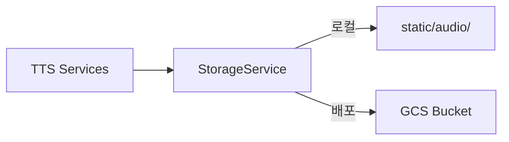

# GCS 오디오 스토리지 연동

Cloud Run은 stateless라 `static/audio/`에 저장된 파일이 재시작 시 삭제됩니다. GCS(Google Cloud Storage)로 마이그레이션합니다.

## 설계 방향

**핵심**: `StorageService`를 만들어 파일 저장 로직을 추상화. 로컬 개발은 디스크, 배포는 GCS.

## Proposed Changes

### Storage Service

#### [NEW] [storage_service.py](file:///Users/ochihyo/Documents/antigravity/study-english/apps/server/app/services/storage_service.py)
- `upload_audio(audio_bytes, filename)` → 공개 URL 반환
- 환경변수 `GCS_BUCKET_NAME` 유무로 GCS/로컬 자동 전환
- GCS: `google-cloud-storage` 라이브러리 사용
- 로컬: `static/audio/`에 저장 + `/static/audio/filename` 반환

---

### TTS Services 수정 (3개)

[_save_audio_file()](file:///Users/ochihyo/Documents/antigravity/study-english/apps/server/app/services/conversation/gemini_tts_service.py#183-212) 내부에서 `StorageService.upload_audio()` 호출로 변경

#### [MODIFY] [tts_service.py](file:///Users/ochihyo/Documents/antigravity/study-english/apps/server/app/services/conversation/tts_service.py)
- [_save_audio_file()](file:///Users/ochihyo/Documents/antigravity/study-english/apps/server/app/services/conversation/gemini_tts_service.py#183-212) → `StorageService.upload_audio()` 호출

#### [MODIFY] [gemini_tts_service.py](file:///Users/ochihyo/Documents/antigravity/study-english/apps/server/app/services/conversation/gemini_tts_service.py)
- [_save_audio_file()](file:///Users/ochihyo/Documents/antigravity/study-english/apps/server/app/services/conversation/gemini_tts_service.py#183-212) → `StorageService.upload_audio()` 호출

#### [MODIFY] [tts_service.py (ai_lab)](file:///Users/ochihyo/Documents/antigravity/study-english/apps/server/app/services/ai_lab/tts_service.py)
- 파일 저장 부분 → `StorageService.upload_audio()` 호출

---

### 환경 설정

#### [MODIFY] [.env](file:///Users/ochihyo/Documents/antigravity/study-english/apps/server/.env)
- `GCS_BUCKET_NAME=` 추가 (로컬에서는 비워둠 → 디스크 저장)

#### [MODIFY] [.env.example](file:///Users/ochihyo/Documents/antigravity/study-english/apps/server/.env.example)
- `GCS_BUCKET_NAME=` 추가

#### [MODIFY] [config.py](file:///Users/ochihyo/Documents/antigravity/study-english/apps/server/app/core/config.py)
- `GCS_BUCKET_NAME: str = ""` 추가

#### [MODIFY] [pyproject.toml](file:///Users/ochihyo/Documents/antigravity/study-english/apps/server/pyproject.toml)
- `google-cloud-storage` 의존성 추가

---

### GCP 인프라

- GCS 버킷 생성: `study-english-audio`
- 공개 읽기 설정 (또는 Signed URL)
- Cloud Run에 `GCS_BUCKET_NAME` 환경변수 추가

## 동작 방식

| 환경 | `GCS_BUCKET_NAME` | 저장 위치 | 반환 URL |
|------|-------------------|----------|---------|
| 로컬 | (비어있음) | `static/audio/` | `/static/audio/file.mp3` |
| GCP | `study-english-audio` | GCS 버킷 | `https://storage.googleapis.com/study-english-audio/file.mp3` |

## Verification Plan

### 로컬 테스트
- `GCS_BUCKET_NAME` 비움 → 기존처럼 `static/audio/`에 저장 확인
- `GCS_BUCKET_NAME` 설정 → GCS 업로드 확인

### 배포 테스트
- Run0/AI Lab에서 음성 생성 → GCS URL 반환 확인
- 브라우저에서 GCS URL 재생 확인
