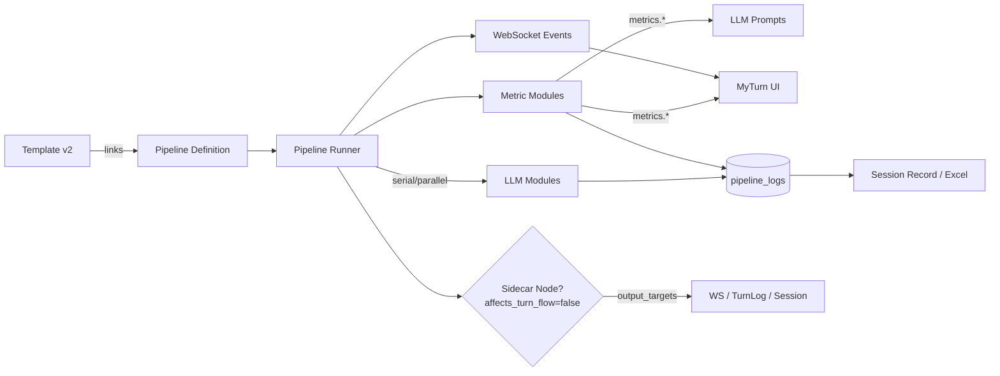

# 학습 모듈 & 파이프라인 재설계 기획서

## 1. 배경 및 목표
- 현재 템플릿에 LLM 프롬프트/모델이 직접 박혀 있어 재사용과 히스토리 관리가 어려움.
- v0.1/v0.2 파이프라인 흐름이 코드에 하드코딩되어 있어 새로운 조합/병렬 실행을 만들기 힘듦.
- 요청 사항:
  - LLM 모듈을 별도로 생성/버전화하고, 템플릿은 모듈을 참조하는 방식으로 전환.
  - 파이프라인도 데이터 기반으로 정의하여 직렬/병렬 조합을 자유롭게 구성.
  - 모듈/파이프라인 관리 전용 페이지 + API 추가, 변경 히스토리와 사유 기록.
  - 기존 템플릿/세션 기록 경험은 유지하되 MyTurn 실행 시 새 파이프라인을 사용.

### 1.1 현행 시스템 분석 (As-Is)

#### 파이프라인 모드
- **basic 모드**: `ScenarioDirector`가 단독으로 사용자 발화를 평가(`evaluate_turn`)하고 다음 턴을 결정. 별도의 Evaluator/Planner/Conductor 없이 단일 서비스로 동작.
- **v0.2 모드**: `Evaluator → Planner → Conductor` 직렬 파이프라인. 각 모듈이 `evaluator_service.py`, `planner_service.py`, `conductor_service.py`로 구현되어 있으며, `my_turn_service.py`의 `process_user_turn()` 안에서 순차 호출됨.
- 파이프라인 모드 전환은 `conversation_templates.pipeline_mode` 컬럼(`"basic"` 또는 `"v0.2"`)으로 결정.

#### 템플릿 ↔ 프롬프트 결합 현황
| 필드 | 테이블 | 역할 |
|---|---|---|
| `system_prompt` | `conversation_templates` | 기본 LLM 시스템 프롬프트 |
| `director_system_prompt` | `conversation_templates` | basic 모드 ScenarioDirector 커스텀 프롬프트 |
| `evaluator_prompt` | `conversation_templates` | v0.2 Evaluator 커스텀 프롬프트 |
| `planner_prompt` | `conversation_templates` | v0.2 Planner 커스텀 프롬프트 |
| `conductor_prompt` | `conversation_templates` | v0.2 Conductor 커스텀 프롬프트 |
| `evaluator_llm_model` | `conversation_templates` | Evaluator LLM 모델 오버라이드 |
| `planner_llm_model` | `conversation_templates` | Planner LLM 모델 오버라이드 |
| `conductor_llm_model` | `conversation_templates` | Conductor LLM 모델 오버라이드 |
| `director_llm_model` | `conversation_templates` | ScenarioDirector LLM 모델 |

#### 파이프라인 로그 현황
- `pipeline_logs` 테이블에 `module_name`(`"evaluator"`, `"planner"`, `"conductor"`) 문자열로 모듈 식별.
- `prompt_used` 컬럼에 실행 시점의 프롬프트 원문 저장 (마이그레이션으로 추가됨).
- `ObservationService`(Layer 2)가 `module_name` 하드코딩으로 필터링하여 집계.

#### 별도 서비스
- `EnergyFlowService`: EMF(에너지 흐름) 분석 전용 LLM 서비스. Conductor와 독립적으로 실행 가능.
- `energy_flow_enabled` 플래그가 `conversation_templates`에 존재하여 템플릿 단위로 활성/비활성 제어.

## 2. 주요 구성 요소
1. **LLM 모듈(Learning Module)**
   - 이름, 설명, 파이프라인 모드(v0.1, v0.2 등), 기본 LLM 모델, 프롬프트 버전 컬렉션.
   - 모듈 버전별로 change reason, 작성자, 작성일을 저장.
2. **파이프라인 정의**
   - 파이프라인 메타데이터 + 노드 그래프(직렬/병렬)로 구성.
   - 노드마다 어떤 LLM 모듈을 사용하는지, 입력/출력 키 매핑, 실행 옵션 정의.
3. **템플릿 ↔ 파이프라인 링크**
   - 템플릿은 특정 파이프라인 버전을 참조.
   - 필요 시 템플릿 단위 override(모듈 교체 등) 허용 여부 결정.
4. **파이프라인 실행 러너**
   - 현재의 v0.2 파이프라인(`evaluator → planner → conductor` 직렬 하드코딩)과 basic 모드(`ScenarioDirector` 단독)를 대체하는 범용 오케스트레이터.
   - 노드 그래프를 따라 입력 컨텍스트를 전달하고, 병렬 노드는 asyncio.gather 등으로 동시 실행.
   - ⚠️ **주의**: 현재 코드에 `director`는 v0.2 파이프라인의 일부가 아니라 basic 모드 전용. v0.2에서는 Conductor가 대본(scripts)과 피드백을 직접 생성하여 `process_ai_turn()`에서 소비됨.
5. **세션 로그/관찰 뷰**
   - 모듈 이름/ID 기반으로 로그 저장 → 기존 UI는 모듈 리스트를 일반화해서 렌더.

## 3. 데이터 모델 초안
```
learning_modules (
    id UUID PK,
    name TEXT UNIQUE,
    description TEXT,
    pipeline_mode VARCHAR (enum: v0.1, v0.2, ...),
    default_llm_model TEXT,
    module_type VARCHAR DEFAULT 'llm',   -- llm | metric | hybrid (측정 전용 모듈 구분)
    created_by UUID,
    created_at TIMESTAMP,
    updated_at TIMESTAMP
)

learning_module_versions (
    id UUID PK,
    module_id UUID FK -> learning_modules,
    version INT,
    prompt_text TEXT,
    change_reason TEXT,
    llm_model_override TEXT NULL,
    generation_config JSONB NULL,  -- temperature, max_output_tokens, response_mime_type 등
    output_schema JSONB NULL,      -- 모듈 출력 구조 정의 (다운스트림 소비자 호환성 보장용)
    is_active BOOLEAN,
    created_by UUID,
    created_at TIMESTAMP
)

pipelines (
    id UUID PK,
    name TEXT,
    description TEXT,
    pipeline_mode VARCHAR,
    version INT,
    -- graph JSONB는 사용하지 않음 (결정 Q1: pipeline_nodes 테이블로 분리 저장)
    is_active BOOLEAN,
    created_by UUID,
    created_at TIMESTAMP
)
-- 파이프라인 버전 전략: 새 버전 생성 시 현재 pipeline_nodes를 전부 복사하여
-- 새 pipeline 레코드(version+1)에 연결. 이전 버전의 노드는 읽기 전용으로 보존.
-- template_pipeline_links가 특정 version을 pin하므로 기존 템플릿은 영향 없음.

-- ⚠️ 기존 pipeline_logs 테이블에 신규 필드 추가 필요:
pipeline_logs ALTER (
    ADD node_key VARCHAR(50) NULL,       -- pipeline_nodes.node_key와 매칭 (ObservationService 집계 키)
    ADD module_version TEXT NULL,         -- learning_module_versions.version
    ADD pipeline_id UUID NULL FK -> pipelines  -- 실행된 파이프라인 참조
)
-- ⚠️ 기존 필드 확인: prompt_used(TEXT) 컬럼은 이미 존재 (마이그레이션 e026f4a8b9c1).

pipeline_nodes (
    id UUID PK,
    pipeline_id UUID FK -> pipelines ON DELETE CASCADE,
    node_key TEXT,          -- 예: evaluator, planner_a
    module_id UUID FK -> learning_modules,
    module_version_id UUID FK -> learning_module_versions NULL,  -- NULL이면 모듈의 is_active 버전 사용
    node_type VARCHAR,      -- serial | parallel_group | merge 등
    input_scope JSONB,      -- all_context / prev_only / explicit { modules: ["evaluator"] }
    input_mapping JSONB,
    output_mapping JSONB,
    affects_turn_flow BOOLEAN DEFAULT true,   -- false이면 sidecar/백그라운드 분석 (UI만 갱신)
    output_targets JSONB DEFAULT '{"websocket": false, "turn_log": false, "session_record": false}',
    activation_condition JSONB NULL,  -- 선택형 분석용 (예: {"flag": "energy_flow_enabled", "value": true})
    next_nodes TEXT[],
    execution_order INT DEFAULT 0  -- 동일 레벨 내 정렬 순서
)
-- 인덱스: idx_pipeline_nodes_pipeline_id (pipeline_id)
-- 인덱스: idx_pipeline_nodes_module_id (module_id)

template_pipeline_links (
    id UUID PK,
    template_id UUID FK -> conversation_templates ON DELETE CASCADE UNIQUE,  -- 1:1 관계
    pipeline_id UUID FK -> pipelines ON DELETE RESTRICT,
    pipeline_version INT,
    overrides JSONB NULL    -- 템플릿 단위 override가 필요할 경우
    -- overrides 예: { "nodes": { "planner": { "module_version_id": "uuid-xxx" } } }
)
```

> `template_pipeline_links` 테이블도 새로 생성되어 템플릿과 파이프라인을 1:1로 연결합니다. 기존 `conversation_templates`에 추가 컬럼을 붙이지 않습니다.


> `pipeline_nodes` 역시 신규 생성 테이블로, graph JSONB를 사용했던 기존 설계와 분리됩니다.


> 위 세 테이블은 기존 DB 구조와 별도로 신규 생성됩니다. 기존 conversation_templates/pipeline_logs 등을 재활용하지 않으며, 아래 pipeline_nodes / template_pipeline_links 역시 모두 새 테이블입니다.

> **결정 Q1**: 파이프라인 정의는 `pipeline_nodes` 테이블로 분리 저장. JSON 붙여넣기 입력은 서버가 파싱해 노드 레코드로 변환하고, UI는 해당 레코드들을 다시 조합해 프리뷰/수정 가능하도록 함. (JSON 단일 필드 방식은 사용하지 않음.)

## 4. API 설계 개요
1. **LLM 모듈 API**
   - `GET /learning-modules` 목록 + 필터(모드별 등)
   - `POST /learning-modules` 생성
   - `POST /learning-modules/{id}/versions` 새 프롬프트 등록(변경 사유 필수)
   - `POST /learning-modules/{id}/activate-version` 특정 버전 활성화
   - `GET /learning-modules/{id}/history` 버전 목록 + diff 옵션
2. **파이프라인 API**
   - `GET /pipelines`
   - `POST /pipelines` (그래프 정의 포함)
   - `POST /pipelines/{id}/versions`
   - `GET /pipelines/{id}` / `history`
3. **템플릿 연동**
   - `PUT /templates/{id}/pipeline` → 어떤 파이프라인/버전을 쓸지 저장.
   - 기존 템플릿 prompt 컬럼은 점진적으로 deprecated (초기엔 겸용 허용).
4. **실행 API 영향**
   - MyTurn 관련 API는 파이프라인 정보를 응답에 포함(예: `pipeline_modules`: [ { name, version } ] )
   - 세션 기록 API는 기존 스키마 유지하되 모듈명 필드 추가.

> **오픈 질문 Q2**: 파이프라인 그래프를 정의할 때 관리자 UI에서 작성할 JSON 포맷을 구체적으로 어느 정도까지 제한하고 싶은지? (예: 노드/간선만 허용 vs DSL 형태)

## 5. UI 플로우
1. **학습 모듈 + 파이프라인 통합 관리 페이지 (신규)**
   - 하나의 페이지에서 모듈과 파이프라인을 동시에 다룸. 상단은 모듈 섹션(리스트, 버전 히스토리, 신규 버전 작성), 하단은 파이프라인 섹션(DAG 구성, 노드별 모듈 배치)으로 레이아웃 분리.
   - 모듈 섹션에서 새 버전 생성 시 change reason 필수 입력. 파이프라인 섹션에서는 노드 추가/편집 시 모듈을 즉시 참조할 수 있게 구성.
   - 모듈 생성 시 `module_type`을 지정하여 LLM/측정/하이브리드 모듈을 구분하고, 측정 모듈(예: `response_delay_calc`, `fluency_metrics`, `slot_scoring`, `anchor_detection`)은 LLM 프롬프트에서 참조 가능하도록 태그 지정.
   - 파이프라인 편집 UI는 "폼 기반 빌더"가 기본(노드 추가 버튼 + 이전/다음 선택 + 옵션 패널). 동시에 "JSON 입력/붙여넣기" 탭도 제공해, AI가 생성해준 정의를 그대로 붙여 넣고 검증할 수 있도록 함. JSON 탭은 최소 스키마(`{ nodes: [...], edges: [...] }`)만 우선 지원하고, 필요 시 필드를 확장.
   - 페이지 내에서 탭 또는 accordion으로 그룹화해 이동 없이 조립 가능하도록 설계.
   - 파이프라인/모듈 이름은 자동 생성 대신 저장 시 사용자가 직접 입력(중복 감지는 시스템에서 처리).
2. **템플릿 관리 페이지 v2 (신규)**
   - 현행 템플릿 페이지는 유지(v1). 별개의 v2 페이지를 만들어 새 파이프라인 시스템을 사용할 템플릿만 이쪽에서 생성/편집.
   - 마이그레이션 완료 전까지 v1/v2 병행 운영, 이후 MyTurn에서 호출하는 API를 v2 구조로 전환.
   - v2 템플릿은 기본적으로 프롬프트 문자열을 직접 담지 않고, 파이프라인 참조만 저장.
3. **MyTurn / 세션 기록 UI**
   - API 응답에 포함된 모듈 리스트를 바탕으로 카드 렌더(모듈명+버전 표시).
   - 병렬 노드 결과도 순서대로 펼쳐 볼 수 있게 구성.
   - LLM 노드 상세에는 “참조 중인 측정 모듈” 목록을 함께 표시하여 어떤 지표가 프롬프트에 주입되었는지 확인 가능하게 함.

### 5.1 측정 모듈 선택 & 프롬프트 바인딩
- LLM 모듈 버전 편집 시 “참조할 측정 모듈”을 멀티셀렉트로 지정할 수 있음.
- 선택 가능한 예시 지표: `response_delay_calc`, `fluency_metrics`, `slot_scoring`, `slot_missing_detector`, `wpm_tracker`, `user_sentiment`, `energy_flow`, `custom_metric_x` 등.
- **측정 모듈 실행 방식 구분:**
  - `module_type=metric` 중 **코드 기반(rule-based)**: `response_delay_calc`, `wpm_tracker` 등은 LLM 호출 없이 Python 코드로 계산. 버전 관리는 코드 배포 시점에 연동되며, `learning_module_versions.prompt_text`에는 계산 로직 설명/참고 메모만 기록.
  - `module_type=metric` 중 **LLM 기반**: `user_sentiment`, `energy_flow` 등은 LLM 프롬프트로 분석. 프롬프트 변경 = 새 버전 생성.
  - `module_type=hybrid`: 코드 전처리 후 LLM 호출 또는 그 반대. 두 가지 버전(코드+프롬프트)을 함께 관리.
- 파이프라인 러너는 해당 측정 모듈을 먼저 실행해 output을 LLM 모듈 프롬프트 변수로 주입. 예: `{{metrics.response_delay_sec}}`, `{{metrics.fluency.words_per_minute}}`.
- **프롬프트 변수 바인딩 규약:**
  - 문법: Mustache 스타일 `{{변수명}}` 사용 (Jinja2가 아님).
  - 지원 네임스페이스: `metrics.*` (측정 모듈 출력), `context.*` (세션/턴 메타데이터), `prev.*` (직전 노드 출력), `output.<node_key>.*` (특정 노드 출력).
  - 러너는 `input_mapping`에 정의된 키만 바인딩하며, 누락된 변수는 빈 문자열로 대체하고 경고 로그를 남김.
- UI에서 사용자 정의 지표 모듈을 추가하면 자동으로 이 목록에 등장하므로, LLM 프롬프트가 지표 조합을 자유롭게 활용할 수 있음.
- 동일한 `metrics.*` 경로를 프론트엔드에서도 그대로 읽어 UI 요소(배지/그래프)를 렌더하도록 명시하여, 측정 결과를 LLM 프롬프트와 UI가 동시에 공유.

### 5.2 선택형 분석(에너지 흐름 등) 활성화
- `energy_flow`처럼 세션 중 병렬로 돌리는 분석은 metric 모듈로 등록해두고, 템플릿 v2나 세션 variant에서 `energy_flow_enabled` 같은 토글을 설정.
- 파이프라인 노드에 “활성 조건” 필드를 두어, 해당 플래그가 true일 때만 energy_flow 노드를 실행하고 결과를 `metrics.energy_flow`에 저장.
- UI는 기존과 동일하게 해당 지표가 존재할 때만 그래프/배지를 렌더하면 되므로, 메트릭 노출 여부가 자연스럽게 제어됨.

### 5.3 세션 영향 여부 제어 (Sidecar 노드)
- 각 노드에는 `affects_turn_flow` 플래그를 두어, true이면 결과가 다음 LLM 단계/턴 분기 결정에 영향을 주고, false이면 "sidecar"로 실행되어 UI/로그만 업데이트.
- 예: energy_flow 모듈을 `affects_turn_flow=false`로 두면, 사용자 발화 직후 별도의 LLM 없이 측정값만 계산해 UI에 띄우고, 메인 세션 플로우는 지연되지 않음.
- 반대로 동일한 노드를 true로 설정하면, 해당 결과가 다음 planner/conductor 입력에도 포함되어 세션 진행에 관여하도록 구성 가능.
- Sidecar 노드 출력은 `output_targets` 옵션으로 **WebSocket 실시간 이벤트**, **turn log(DB)**, **세션 기록/엑셀** 3개 채널 중 원하는 조합을 선택해 브라우저 UI에서 소비할 “3개의 구멍”을 미리 확보해 둔다.
- 기본값은 세 채널 모두 OFF이며, 필요할 때 템플릿/모듈 설정에서 개별 채널을 켜는 방식으로 제어.

### 5.4 WebSocket 이벤트 스키마
- sidecar 및 메인 모듈 결과는 명시적 이벤트 타입으로 전송:
  - `pipeline:module_output` — `{ "type": "pipeline:module_output", "node_key": "evaluator", "turn_index": 5, "output": { ... } }`
  - `pipeline:sidecar_metric` — `{ "type": "pipeline:sidecar_metric", "node_key": "energy_flow", "turn_index": 5, "payload": { ... } }`
  - `pipeline:status` — 진행률/타임아웃 알림.
- 프론트엔드는 node_key 기준으로 렌더러를 선택하고, 동일 payload를 turn log에도 저장하여 실시간·사후 분석 데이터를 일치시킨다.

## 6. 파이프라인 실행 러너 설계

### 6.0 현행 실행 흐름과의 대응

#### 6.0.1 `process_user_turn()` — 파이프라인 생산자
현재 `my_turn_service.py`에서 `process_user_turn()` 내 분기:
```python
if pipeline_mode == "v0.2":
    # EvaluatorService → PlannerService → ConductorService (직렬)
else:
    # ScenarioDirector.evaluate_turn() (단독)
```
새 러너는 이 두 경로를 모두 흡수해야 하며, 기존 v0.2 파이프라인의 결과가 `session.variant["_pipeline_result"]`에 저장되어 `process_ai_turn()`에서 소비되는 패턴도 유지해야 함.

#### 6.0.2 `process_ai_turn()` — 파이프라인 결과 소비자
`process_ai_turn()`은 파이프라인이 생성한 결과를 **직접 소비하여 AI 응답을 생성**하는 핵심 소비자이다. 현재 다음 4단계 우선순위로 동작:

| 우선순위 | 조건 | 동작 | 비고 |
|---|---|---|---|
| 1 | `greeting_message` 존재 + 첫 턴 | LLM 미호출, 인사말 사용 | 파이프라인과 독립 |
| 2 | v0.2 + `speaker_scripts[name].text` 존재 | LLM 미호출, Conductor 대본 사용 | **핵심 bypass 경로** |
| 3 | `engine_trace.intervention_emitted_text` 존재 | LLM 미호출, intervention 텍스트 사용 | moderator 제외 |
| 4 | 위 조건 미충족 | generation prompt 구성 → LLM 호출 | 기본 경로 |

**새 러너에서의 대응:**
- 러너는 파이프라인 실행 후 결과를 표준 컨텍스트 객체에 저장. `process_ai_turn()`은 이 컨텍스트로부터 데이터를 읽음.
- 파이프라인 결과와 `process_ai_turn()` 사이의 **출력 계약(output contract)** 정의:
  ```
  _pipeline_result = {
      "feedback_text": str,
      "feedback_instruction": str,
      "level": int,
      "level_instruction": str,
      "corrections": list[dict],
      "better_expressions": list[dict],
      "energy_flow": dict | None,
      "speaker_scripts": { "<name>": { "text": str, "instruction": str } },
      "user_emotion": str,
      "question_progress": dict,
      "engine_trace": dict | None
  }
  ```
- 이 계약은 파이프라인의 **마지막 노드(Conductor 역할)**가 반드시 충족해야 하며, 모듈 프롬프트를 변경하더라도 이 구조는 유지되어야 함.
- ⚠️ `process_ai_turn()`은 **모든 AI 참가자마다 호출**되므로, 출력 계약이 깨지면 모든 AI 응답이 중단됨.

### 6.1 현재 에너지 흐름(EnergyFlow) 통합
현재 EnergyFlow는 **두 개의 독립적인 경로**로 존재하며, 목적과 트리거가 다름:

| 경로 | 위치 | 트리거 | 출력 | 용도 |
|---|---|---|---|---|
| Conductor 내장 | `conductor_service.py` (`ConductorOutput.energy_flow`) | 파이프라인 직렬 실행 중 자동 | `variant["_pipeline_result"]["energy_flow"]` | 세션 기록/피드백 |
| 독립 API | `energy_flow_service.py` → `POST /sessions/{id}/energy-flow` | 클라이언트 별도 호출 | 별도 JSON 응답 (비교 테이블) | 실시간 UI 시각화 |

**새 파이프라인에서의 통합 방안:**
- Conductor 내장 경로: Conductor 프롬프트에서 `energy_flow` 필드 생성을 **제거**하고, 전용 노드로 분리.
- 독립 API 경로: `EnergyFlowService`를 `module_type=metric`(LLM 기반) 노드로 등록, `affects_turn_flow=false` sidecar로 병렬 실행.
- 두 경로를 **단일 sidecar 노드**(`node_key: energy_flow_analyzer`)로 통합하되, `output_targets` 설정으로 WS(실시간 UI) + turn_log(세션 기록) 모두 커버.
- 통합 시 기존 독립 API(`POST /sessions/{id}/energy-flow`)는 deprecate하고 WebSocket 이벤트로 전환.

> **미결정 Q8**: Conductor 내장 energy_flow 제거 시점 및 독립 API deprecation 일정.

### 6.2 컨텍스트 객체
1. **컨텍스트 객체**
   - 세션/턴 정보 + 모듈별 output map + 실패/재시도 메타.
   - 현재 `session.variant` JSON에 저장되는 상태를 전용 런타임 컨텍스트 객체로 이관.
   - **variant 키 분류** (현행 → 이관 계획):
     | 키 | 구분 | 이관 대상 | 비고 |
     |---|---|---|---|
     | `_pipeline_result` | 런타임 전용 (현재 턴) | 컨텍스트 객체 | 턴마다 덮어쓰기 |
     | `_pipeline_state` | 영구 (SessionState) | 컨텍스트 객체 + DB flush | 턴 간 상태 유지 |
     | `_question_progress` | 영구 (진행 상태) | 컨텍스트 객체 + DB flush | custom_state 내부 |
     | `_force_moderator_turn` | 런타임 플래그 | 컨텍스트 객체 | 턴 제어 |
     | `_consecutive_ai_turns` | 런타임 카운터 | 컨텍스트 객체 | 안전장치 |
     | `current_script_index` | 영구 (위치) | 기존 variant 유지 | 세션 재개 필요 |
     | `participants`, `user_topic` | 영구 (설정) | 기존 variant 유지 | 세션 설정 |
   - **런타임 컨텍스트 구현**: 메모리 상 Python 객체(`PipelineContext` 클래스)로 관리. 파이프라인 실행 완료 후 영구 항목만 `session.variant`에 flush.
2. **노드 실행 순서**
   - DAG으로 정의된 그래프를 위상 정렬 → serial 노드는 순차 실행, parallel 그룹은 gather.
   - 각 노드는 `input_scope`에 따라 입력 범위를 결정: 전체 세션 컨텍스트(`all_context`), 직전 노드 출력만(`prev_only`), 혹은 특정 노드들의 output만 선택적으로 전달.
   - `input_mapping`을 통해 전달된 데이터 중 필요한 key만 모듈 프롬프트 변수로 바인딩.
   - `affects_turn_flow=false` 노드는 메인 DAG와 병렬로 비동기 실행(완료 여부와 무관하게 다음 노드 진행)하며, 결과만 컨텍스트/로그/WS payload에 기록.
3. **오류 처리**
   - 노드 실패 시 재시도 정책(기본 1~2회) → 실패 시 파이프라인 중단/대체 노드 호출 여부 정책 필요.
   - **현재 참조**: `run_ai_turn_background()`에서 이미 3회 재시도 로직 존재. 러너 설계 시 노드 단위 재시도로 세분화.
   - Sidecar 노드(`affects_turn_flow=false`) 실패 시: 메인 플로우에 영향 없이 실패 로그만 기록. 해당 metrics는 누락된 채로 진행.
   - 메인 노드 실패 시: 재시도 소진 후 세션에 에러 상태를 기록하고, 사용자에게 폴백 응답(예: 이전 턴의 AI 응답을 재사용하거나 "잠시 후 다시 시도" 메시지)을 반환.
   - 부분 실행 로그: 파이프라인 중간 실패 시에도 이미 완료된 노드의 로그는 turn log에 보존.
   - **파이프라인 전체 타임아웃**: 노드 단위 재시도와 별도로, 전체 파이프라인 실행에 상한(기본 15초)을 설정. 초과 시 완료된 노드 결과로 폴백 응답을 구성하고, 미완료 노드는 취소 후 로그에 `timeout` 기록.
4. **DAG 유효성 검증**
   - 파이프라인 저장 시 서버에서 자동 검증: 순환 참조 감지, 누락된 모듈 참조, 연결되지 않은 고립 노드, `merge` 노드의 입력 노드 존재 여부.
   - 검증 실패 시 저장을 거부하고 구체적인 오류 메시지를 반환.
5. **로그 저장**
   - 기존 `pipeline_logs` 구조와 동일하게 로그를 남기되, `module_name`/`module_version`/`node_key`를 함께 기록.
   - 기존 `prompt_used` 필드에 실행 시점 프롬프트 원문 저장은 유지.
   - 병렬 노드의 출력은 기본적으로 배열로 전달하지만, 필요 시 "합치기" 노드를 따로 둬서 여러 결과 중 하나만 고르거나 요약하도록 구성할 수 있음(예: 두 planner의 결론을 하나로 합치는 전용 LLM).
6. **전체 타임아웃/폴백**
   - 턴당 파이프라인 최대 실행 시간(예: 15초)을 설정하고 초과 시 나머지 노드를 취소, fallback 멘트/컨덕터 스크립트를 생성.
   - 타임아웃 발생은 `pipeline:status` WebSocket 이벤트와 turn log에 기록.
7. **런타임 컨텍스트 vs variant**
   - variant에 저장 중인 주요 키 분류:
     - 런타임 전용: `_pipeline_result`, `_pipeline_state`, `_consecutive_ai_turns`.
     - 지속 필요: `_question_progress`, `_force_moderator_turn`, `current_script_index`, `participants`, `user_topic`.
   - 새 러너는 `SessionRuntimeContext` 객체를 두어 런타임 전용 키를 메모리에만 보관하고, 턴 종료 시 필요한 항목만 variant에 동기화.
   - 장기적으로 Redis 등 외부 스토어 검토 가능하나, 1차 릴리스는 in-process 컨텍스트 + DB 스냅샷으로 진행.
6. **실측 데이터 주입 (계속 유지)**
   - 현재 `process_user_turn()`에서 계산하는 `measured_wpm`, `response_delay_sec` 등은 파이프라인 러너의 컨텍스트에 자동 주입하여 각 노드가 참조할 수 있도록 함.
   - `context.measured.*` 네임스페이스로 통일.

> **오픈 질문 Q3**: 병렬 노드 간 데이터 결합 방식을 단순 배열로 둘지, 특정 aggregator 모듈을 두고 결과를 병합할지 선호하는 구조가 있는지?

### 6.3 크로스-모듈 상태 관리
- 메인 파이프라인은 “턴 진행에 직접 영향을 주는 노드”만 순차적으로 배치한다. 순차 파이프라인 안에서 Evaluator → Planner → Conductor와 같은 직렬 흐름을 자유롭게 구성할 수 있고, 노드 수/종류에 제한이 없다.
- UI 요소, 자동 진단, 통계 등 **턴에 영향 주지 않는 병렬 분석**은 sidecar 노드나 별도 API로 언제든 추가/제거할 수 있게 설계한다.
- 여러 노드의 결과를 합쳐서 다음 턴 상태를 만드는 로직(예: 질문 진행도 계산)은 "후처리 Hook" 또는 별도의 `merge` 노드로 정의하여, 사용자가 파이프라인 그래프에 원하는 만큼 추가할 수 있게 한다.

### 6.4 TurnOrchestrator 연동
`turn_orchestrator.py`가 다음 발화자 결정/턴 시퀀싱을 담당하며, 파이프라인 결과에 의해 동작이 변경됨:
- `question_completed=true` → `_force_moderator_turn` 설정 → Moderator가 다음 발화
- `needs_encouragement` → `bridge_participant` 선택 → 1명 AI만 응답 후 사용자에게 턴 반환
- `conductor_output.return_to_user_after` → 격려 응답 후 사용자 턴

**새 러너에서의 위치:**
- 파이프라인 러너의 책임 범위는 **모듈 실행 + 결과 취합**까지이며, **턴 시퀀싱은 러너 외부**에서 처리.
- 러너 실행 완료 후 `process_user_turn()`이 결과를 기반으로 TurnOrchestrator에 지시.
- 즉, 기존 패턴(파이프라인 → variant 저장 → complete_turn → Orchestrator)은 유지하되, 러너 내부가 교체됨.

### 6.5 출력 스키마 검증
- 파이프라인을 구성하는 모든 노드는 사용자가 자유롭게 정의하므로, 출력 구조를 하드코딩하지 않는다. 모듈 버전 생성 시 필요한 경우에만 `output_schema`(JSON Schema 또는 설명)를 등록해 참고용으로 사용하고, 등록하지 않으면 그대로 raw JSON을 전달한다.
- 기존 Evaluator/Planner/Conductor처럼 다운스트림 코드가 특정 필드를 필요로 하는 경우에도, 해당 템플릿이 어떤 구성인지에 따라 필드 정의를 업데이트할 수 있도록 Admin UI에서 직접 스키마를 수정/추가할 수 있게 한다.
- 러너는 `output_schema`가 있을 때만 검증 로그를 남기며, 일치하지 않아도 실행을 막지 않는다. 즉, 모든 노드가 새로운 필드를 추가해도 코드 수정 없이 바로 활용할 수 있다.

### 6.7 EnergyFlow 이중 경로 정리
현재 EnergyFlow는 두 경로가 공존한다:
1. **Conductor 내장 출력** — Conductor 프롬프트가 `energy_flow` 텍스트를 생성하여 `ConductorOutput.energy_flow`에 저장. 세션 기록/피드백에서 사용.
2. **독립 API** — `/sessions/{id}/energy-flow` 엔드포인트가 `EnergyFlowService`를 호출해 비교표를 생성. 실시간 UI에서 별도 호출.

새 파이프라인에서는 다음과 같이 정리한다.
- Conductor 내장 경로는 유지하되, 장기적으로 필요 없을 경우 Conductor 프롬프트에서 해당 서술을 제거하고 별도 노드로 이전.
- 실시간 비교표는 `energy_flow_analyzer` metric 모듈을 sidecar 노드로 등록하여, 템플릿 옵션(`energy_flow_enabled`)에 따라 WebSocket/turn log/세션 기록에 값을 보낸다.
- 기존 독립 API는 단계적으로 deprecate할 수 있도록 WebSocket 이벤트(`pipeline:sidecar_metric`)로 동일 데이터 제공.
> **결정 필요(Q8)**: Conductor 내장 경로를 언제 제거하고 sidecar로 완전히 전환할지 일정 수립.

### 6.6 `process_ai_turn()` 소비 계약
- 새 러너는 `SessionRuntimeContext.pipeline_result`에 다음 구조를 저장:
  ```json
  {
    "speaker_scripts": {
      "AI Tutor": {"text": "...", "emotion": "neutral", "metadata": {...}}
    },
    "engine_traces": {
      "conductor": {...},
      "planner": {...}
    },
    "interventions": {
      "AI Tutor": {"emitted_text": "Can you say that again?", "prompt_key": "repair_say_again"}
    },
    "return_to_user_after": false
  }
  ```
- `process_ai_turn()`는 위 구조를 이용해 다음을 수행:
  1. `speaker_scripts[participant.name].text`가 있으면 LLM 호출을 생략하고 해당 텍스트/오디오만 재생.
  2. 없으면 기존 LLM 호출 경로 수행하되, `engine_traces`를 turn log에 첨부.
  3. `interventions`가 존재하면 greet bypass/encouragement 로직을 그대로 적용.
  4. `return_to_user_after`가 true이면 turn orchestrator에게 즉시 사용자 턴 부여.
- Variant `_pipeline_result`는 더 이상 누적하지 않고, 각 턴 처리 후 런타임 컨텍스트에서 제거.

## 7. 마이그레이션 전략
1. **사전 준비**
   - 템플릿별로 사용 중인 evaluator/planner/conductor/director 프롬프트/모델 정보를 추출하되, v2 템플릿에서는 “프롬프트 없음” 상태로 시작해 새 모듈을 조립하게 유도.
2. **자동 모듈 생성**
   - 각 템플릿 x 모듈 조합마다 learning_module + version 레코드를 생성 (이름 규칙: `<템플릿명>-<모듈>` 등).
   - 활성 버전 포인터는 생성된 버전을 가리키게 설정.
3. **파이프라인 생성**
   - v0.1/v0.2 기본 순서에 맞춰 pipeline 레코드를 자동 생성하여 템플릿과 연결.
4. **MyTurn 서비스 업데이트**
   - 새 파이프라인 러너가 준비된 뒤 템플릿 v2가 pipeline id를 참조하면 실행 경로 자동 변경. MyTurn API는 일정 시점에 v2 템플릿의 파이프라인만 읽도록 전환.
5. **검증**
   - 샌드박스에서 기존 템플릿으로 세션 실행 → 결과가 기존과 동등한지 비교.

### 7.1 템플릿 단위 모듈 override
- 기본은 파이프라인 버전을 공유하지만, 템플릿 v2 편집 화면에서 특정 노드만 다른 모듈/버전을 지정할 수 있는 override 슬롯을 제공.
- override 내역은 템플릿 레코드의 `overrides` JSON에 저장하고, 실행 시 러너가 우선 적용.
- 각 LLM 모듈은 자체 버전 히스토리를 가지며, 파이프라인 자체도 버전 관리 대상이므로 "모듈 버전 → 파이프라인 버전 → 템플릿 override" 순으로 우선순위를 정의.

### 7.2 basic 모드(ScenarioDirector) 하위호환 전략
- 기존 basic 템플릿은 `pipeline_mode="basic"`으로 계속 동작한다. **새로운 파이프라인 관리 페이지에서 만든 파이프라인**은 `template_pipeline_links`를 통해 연결한 템플릿에서만 사용된다.
- 즉, DB 마이그레이션 이후에도 basic/v0.2 템플릿은 그대로 두고, 새 템플릿은 원하는 LLM/sidecar/측정 모듈을 조합해 파이프라인을 자유롭게 생성할 수 있다.
- 향후 ScenarioDirector 기능을 파이프라인 모듈로 대체할 계획은 있지만 일정은 미정이며, 템플릿별로 준비가 되면 링크만 설정하면 된다.
- `hesitation → encouragement`와 같은 기존 분기 로직은 `activation_condition`을 통해 노드 수준에서 표현 가능하므로, 파이프라인 그래프만 수정하면 언제든 기존 동작을 재현/변형할 수 있다.

> **오픈 질문 Q4**: 자동 생성된 모듈/파이프라인의 네이밍 규칙이나 그룹화 방식에 대해 선호가 있는지?

### 7.3 `pipeline_mode` 전환 메커니즘
현재 `my_turn_service.py`에서 `pipeline_mode`는 `"basic"` 또는 `"v0.2"`만 존재한다. 새 파이프라인 시스템 도입 시 전환 로직:

1. **분기 기준**: `template_pipeline_links` 레코드 존재 여부로 자동 분기.
   - `template_pipeline_links`가 있으면 → 새 파이프라인 러너 사용
   - 없으면 → 기존 `pipeline_mode` 컨트론 유지 (`"v0.2"` 또는 `"basic"`)
2. **동시 운영**: 같은 시점에 기존 v0.2 세션과 새 파이프라인 세션이 공존 가능. 템플릿 단위로 전환.
3. **코드 변경**: `process_user_turn()` 상단에 3번째 분기 추가:
   ```python
   link = await get_pipeline_link(session.template_id)
   if link:
       result = await pipeline_runner.execute(link.pipeline_id, context)
   elif pipeline_mode == "v0.2":
       # 기존 하드코딩 경로
   else:
       # ScenarioDirector
   ```
4. **완전 전환 후**: 모든 템플릿이 `template_pipeline_links`를 가지면 기존 `pipeline_mode` 분기 코드 제거.

## 8. 세션 기록 영향
- 저장 방식: turn log에 `module_name`, `module_version`, `pipeline_id`, `node_key` 필드를 추가해 추적.
  - **대상 테이블**: 기존 `pipeline_logs` 테이블에 필드를 추가. `conversation_turns`에는 변경 없음.
  - 기존 `pipeline_logs` 필드 현황:
    ```
    id, trace_id, session_id, turn_index, module_name(VARCHAR 20),
    schema_version, input_json(JSONB), output_json(JSONB),
    duration_ms, model_name, prompt_used(TEXT), error_message, created_at
    ```
  - 추가 필드: `node_key`(VARCHAR 50), `module_version`(TEXT), `pipeline_id`(UUID FK).
- UI: 카드 렌더 시 모듈 리스트를 순회하면서 evaluator/planner/conductor 등 역할명이 아니라 모듈명을 그대로 노출.
- 기존 엑셀/레포트 기능 변경 범위:
  - `_write_turns_sheet()`: `node_key`, `module_version` 컬럼 추가.
  - `_write_pipeline_detail_sheet()`: 현재 evaluator/planner/conductor 3개 컬럼 고정 → `pipeline_logs`의 모든 `node_key`를 동적으로 컬럼으로 생성하는 범용 로직으로 교체.
  - 병렬 노드 결과: 한 턴에 여러 모듈 결과가 있을 때, `node_key` 기준으로 컬럼을 가로로 전개 (Planner_A | Planner_B).
  - metric 모듈 출력: LLM 모듈과 동일한 형식으로 컬럼 추가. `module_type` 컬럼을 추가하여 구분 가능하게.
- *turn log = 기존 `pipeline_logs` 및 파생 테이블을 의미하며, 실시간 WebSocket payload와 사후 조회(세션 기록 탭/엑셀)에 동일한 데이터를 제공하는 핵심 기록원.*

### 8.1 Session Observation 시스템 호환성
- 기존 `ObservationService`(Layer 2)는 `pipeline_logs.module_name`에서 `"evaluator"`, `"planner"`, `"conductor"` 등 **하드코딩된 이름**으로 데이터를 집계함.
  ```python
  # observation_service.py L260-270 (현재 코드)
  evaluator_logs = [log for log in pipeline_logs if log.module_name == "evaluator" and log.output_json]
  planner_logs = [log for log in pipeline_logs if log.module_name == "planner" and log.output_json]
  conductor_logs = [log for log in pipeline_logs if log.module_name == "conductor" and log.output_json]
  ```
- 새 시스템에서 모듈명이 자유롭게 바뀌면(예: `"Language Analyzer"`) 기존 집계 로직이 깨질 수 있음.
- **대응 전략**: `pipeline_nodes`에 `node_key` 필드(예: `evaluator`, `planner`)를 표준 역할 식별자로 사용. `ObservationService`는 `module_name` 대신 `node_key`를 기준으로 집계하도록 업데이트. `node_key`는 파이프라인 내에서 고유해야 하며, `pipeline_logs`에도 `node_key` 필드를 추가.
- **`_normalize_primary_issue()` 호환성**: Evaluator가 반환하는 `diagnosis.primary_issue` 형태가 새 모듈에서도 동일해야 함. 기존 EMF 패턴(`MISSING_SLOT_A` → `INCOMPLETE_EXPRESSION`) 정규화 로직은 모듈의 출력 스키마 계약으로 문서화하여 유지.

### 8.2 ReportingLLMService(Layer 3) 호환성
- `ReportingLLMService`는 전체 대화 transcript를 LLM에 전달하므로 모듈명 변경 자체에는 영향 없음.
- **하지만** `_build_pipeline_details()` 메서드에 **동일한 하드코딩 문제**가 존재:
  ```python
  # reporting_llm_service.py L346-374 (현재 코드)
  if log.module_name == "evaluator":
      turn_data["evaluator"] = { ... }
  elif log.module_name == "planner":
      turn_data["planner"] = { ... }
  elif log.module_name == "conductor":
      turn_data["conductor"] = { ... }
  ```
- **대응**: ObservationService와 동일하게 `node_key` 기반으로 업데이트. 나아가 특정 모듈 이름을 하드코딩하지 않고 `pipeline_logs`의 모든 노드 출력을 동적으로 구조화하는 범용 로직으로 교체.

## 9. 배포/롤아웃 계획
1. 단계1: 백엔드 스키마 + API + 모듈/파이프라인 관리 UI 추가(기존 템플릿 영향 없음).
2. 단계2: 마이그레이션 실행, 일부 템플릿을 새 모듈 기반으로 전환하여 테스트.
3. 단계3: MyTurn 실행 경로를 새 파이프라인 러너로 전환 → 병렬 기능 포함한 신규 파이프라인 운영.
4. 단계4: 기존 템플릿에서 직접 프롬프트 편집하는 UI/API 제거.

### 9.1 롤백(Rollback) 전략
각 단계에서 문제 발생 시 이전 상태로 돌아가는 절차:
- **템플릿 레벨**: `template_pipeline_links` 레코드를 삭제하면 해당 템플릿은 자동으로 기존 `pipeline_mode` 경로로 복귀 (§7.3 분기 로직 활용).
- **모듈 버전 레벨**: 문제가 있는 버전의 `is_active`를 false로 설정하고 이전 버전을 활성화. 진행 중 세션에는 영향 없음(세션 스냅샷, §9.2 참조).
- **파이프라인 버전 레벨**: `template_pipeline_links.pipeline_version`을 이전 버전으로 변경. 이전 버전의 노드는 읽기 전용으로 보존되어 있으므로 언제든 복귀 가능.
- **전체 롤백**: 단계3 전환 후 심각한 문제 발생 시, 모든 `template_pipeline_links`를 삭제하여 전체 시스템을 기존 하드코딩 경로로 복귀.

### 9.2 세션 스냅샷 & 동시성 안전
- 세션 시작 시점에 사용 중인 `pipeline_id`, `pipeline_version`, 각 노드의 `module_version`을 `session_runtime_snapshot` 필드(JSON)에 저장.
- 세션 도중 모듈 버전이 변경되더라도 snapshot을 기반으로 실행하여 동시성 문제를 방지.
- turn log/세션 기록에도 snapshot 요약을 남겨 사후 분석 시 어떤 버전이 사용되었는지 역추적 가능.

## 10. 테스트 및 모니터링
- 단위 테스트: 파이프라인 러너, DAG 검증, 병렬 실행/에러 분기.
- 통합 테스트: 실제 모듈/파이프라인 데이터를 이용한 end-to-end 세션.
- 로깅: 파이프라인 실행 trace_id, 노드별 duration, 실패 이유 등을 수집 → 세션 기록 페이지와 연결.

## 11. 추가 확인이 필요한 사항
1. **결정 Q1:** 파이프라인 그래프는 `pipeline_nodes` 테이블로 분리 저장.
2. **결정 Q2:** JSON 탭은 최소 스키마만 제공한 뒤 필요 시 확장 (폼 빌더가 기본 경로).
3. **결정 Q3:** 병렬 노드 결과를 합치는 방식은 템플릿 실험에 따라 자유롭게 구성(배열 전달 + 선택적 aggregator 노드). 추가 제약 없음.
4. **결정 Q4:** 모듈/파이프라인 이름은 자동 생성하지 않고 저장 시 사용자가 직접 입력.
5. **결정 Q5:** 템플릿별로 특정 노드를 override할 수 있으며, 우선순위는 “모듈 버전 → 파이프라인 버전 → 템플릿 override”.

> 추가로 궁금한 사항이 있으면 알려주세요. 위 질문들에 대한 답을 받으면 설계를 더 구체화할 수 있습니다.

### 11.1 결정된 사항 (기존) vs 미결정 사항 (신규)
| # | 항목 | 상태 | 비고 |
|---|---|---|---|
| Q1 | 파이프라인 그래프 저장 방식 | ✅ 결정 | `pipeline_nodes` 테이블 분리 |
| Q2 | JSON 탭 스키마 범위 | ✅ 결정 | 최소 스키마 + 점진적 확장 |
| Q3 | 병렬 노드 결합 방식 | ✅ 결정 | 배열 + 선택적 aggregator |
| Q4 | 네이밍 규칙 | ✅ 결정 | 사용자 직접 입력 |
| Q5 | 템플릿 override 우선순위 | ✅ 결정 | 모듈 버전 → 파이프라인 버전 → 템플릿 override |
| Q6 | basic 모드 전환 시점/방식 | ✅ 기본 유지 + 필요 시 템플릿별 전환 | 섹션 7.2 |
| Q7 | `session.variant` 런타임/영구 분리 | ✅ 결정 | 섹션 6 (런타임 컨텍스트) |
| Q8 | EnergyFlow 이중 경로 | ✅ sidecar/노드로 자유 구성 | 섹션 6.7 |
| Q9 | `process_ai_turn()` 소비 계약 | ✅ 정의 | 섹션 6.6 |
| Q10 | 출력 스키마 검증 정책 | ✅ 자유 출력(필요 시 참고용 schema) | 섹션 6.5 |
| Q11 | 크로스-모듈 상태 결합 (hook vs 노드) | ✅ 메인 순차 + sidecar 분리 | 섹션 6.3 |
| Q12 | generation_config 저장 위치 | ✅ 결정 | learning_module_versions.generation_config |
| Q14 | 세션 버전 스냅샷 | ✅ 결정 | 섹션 9.2 |
| Q15 | Sidecar WebSocket 스키마 | ✅ 정의 | 섹션 5.4 |
| Q16 | pipeline_mode 전환 전략 | ✅ 개요 | 섹션 7.3 |
| Q17 | ReportingLLM/ObservationService 업데이트 | ✅ 계획 | 섹션 8.1~8.2 |

## 13. 시스템 흐름 (Mermaid)



## 14. 사용자 시나리오 예시

### 시나리오 A: 기본 첫 세션 파이프라인 구성
1. 관리자(콘텐츠 기획자)가 통합 관리 페이지에서 `Evaluator v2`, `Planner v2`, `Conductor v2`, `Director v2` LLM 모듈을 등록하고 버전 히스토리를 작성한다.
2. `response_delay_calc`, `energy_flow` 등 측정 모듈을 `module_type=metric`으로 생성하고, 필요한 경우 Lab에서 실험 후 “모듈 버전 생성” 버튼으로 저장한다.
3. 파이프라인 빌더에서 `Evaluator → Planner → Conductor → Director` 순서의 직렬 플로우를 만든 뒤, `energy_flow` 노드를 sidecar로 병렬 연결하고 `output_targets`를 WebSocket+turn log로 설정한다.
4. 새 템플릿 v2를 만들고 해당 파이프라인을 링크한다. 특정 템플릿만 Planner 모듈 버전을 바꾸고 싶다면 override 슬롯에서 교체한다.
5. 마이턴 세션을 시작하면 러너가 pipeline_nodes 정의를 따라 각 모듈을 호출하고, sidecar 노드는 실시간 UI에 energy_flow 그래프를 띄운다. 세션 기록 탭에서도 각 모듈 output과 metrics가 동일하게 노출된다.

### 시나리오 C: 템플릿별 측정 모듈 조합 변경
1. Template X는 response_delay + energy_flow 두 지표를 모두 사용하지만, Template Y는 energy_flow만 필요하다.
2. 통합 관리 페이지에서 Template Y의 파이프라인 override 슬롯을 열고, Evaluator 노드의 “참조 측정 모듈” 목록에서 response_delay를 제외한다.
3. energy_flow sidecar 노드는 Template Y에서도 동일하게 동작하지만, response_delay는 metrics에 기록되지 않으므로 LLM 프롬프트와 UI에는 노출되지 않는다.

### 시나리오 D: 병렬 Planner + 합치기 노드 사용
1. 특정 학습 템플릿에서 Planner를 두 개의 서로 다른 LLM 모듈(A/B)로 병렬 실행해 다양한 전략을 확인하고 싶다.
2. 파이프라인 노드에서 `Planner_A`와 `Planner_B`를 병렬로 정의하고, 다음 단계에 `PlannerMerge` LLM 모듈을 추가한다.
3. `PlannerMerge`는 두 planner의 output 배열을 받아 “어떤 경로를 채택할지” 결정하고, 결과를 Conductor로 전달한다.
4. 세션 기록 탭에서는 Planner A/B의 output과 Merge 결과가 모두 표시되므로, 어느 모듈이 기여했는지 추적 가능하다.

### 시나리오 E: 에너지 흐름만 UI에 노출 (세션 흐름 영향 X)
1. Template Z에서 energy_flow 분석이 필요하지만, 메인 턴 로직과는 별개로 UI에만 띄우고 싶다.
2. energy_flow 노드를 `affects_turn_flow = false`, `output_targets = { WebSocket }`로 설정한다.
3. 사용자 발화가 들어오면 메인 파이프라인은 즉시 다음 LLM으로 진행하고, energy_flow는 백그라운드에서 계산해 WebSocket으로만 push한다. turn log/세션 기록에는 남지 않는다.

## 15. 보안 및 권한
- 모듈/파이프라인 CRUD는 기존 어드민 인증/인가 체계(계정 기반)를 따름.
- `created_by` UUID는 현재 로그인한 admin 계정 ID.
- 프롬프트 내용은 민감 데이터로 취급: 모듈 버전의 `prompt_text`는 API 조회 시 admin 권한 필요.
- 기존 `is_public_to_tester` 접근 제어 체계(`conversation_templates`)와의 관계: 파이프라인/모듈 자체에는 접근 제어 없이 템플릿 단위로만 제어. 모듈은 여러 템플릿에서 공유 가능하므로 별도 접근 제어 불필요.
- **모듈 삭제 보호**: 파이프라인에서 참조 중인 모듈은 FK RESTRICT로 삭제 방지. 비활성화는 허용하되, 비활성화 시 해당 모듈을 사용하는 파이프라인 목록을 경고로 표시.

## 16. 성능 고려사항

### 16.1 파이프라인 실행 지연
- 현재 v0.2 직렬 파이프라인(Evaluator → Planner → Conductor)은 3개 LLM 호출이 순차 실행되므로 총 지연 = Σ(각 모듈 duration).
- 새 파이프라인에서 병렬 노드를 활용하면 지연 = max(병렬 그룹 duration). 단, 병렬 LLM 호출 시 API rate limit 고려.
- Sidecar 노드는 메인 플로우와 독립 실행이므로 사용자 체감 지연에 영향 없음.

### 16.2 `session.variant` 크기
- 현재 `_pipeline_result`, `_pipeline_state`, `_question_progress` 등이 `session.variant` JSON에 축적됨.
- 파이프라인 노드가 증가하면 variant 크기가 커질 수 있음. 단일 턴 결과만 유지하고 히스토리는 `pipeline_logs`에서 조회하는 방식으로 제한.

### 16.3 DB 인덱스
- 신규 테이블 인덱스: `pipeline_nodes(pipeline_id)`, `pipeline_nodes(module_id)`, `learning_module_versions(module_id, is_active)`.
- `pipeline_logs`에 `node_key` 필드 추가 시 인덱스도 함께 생성: `idx_pipeline_logs_node_key (node_key, session_id)`.
- `template_pipeline_links(template_id)` — UNIQUE 제약 활용.

### 16.4 LLM 모델 기본값 관리
- 현재 개별 서비스에서 기본 모델을 하드코딩 (예: `"gemini-2.0-flash"`, `"gemini-2.5-flash"`). 새 시스템에서는 `learning_modules.default_llm_model`로 통합하되, 기존 어드민 설정 페이지의 모델 입력/변경 기능과 중복되지 않도록 마이그레이션 시점에 정리.

### 16.5 세션 스냅샷 (중복)
- §9.2에서 설명한 snapshot 전략을 성능/안정성 측면에서도 고려. 세션마다 snapshot JSON을 캐시하여 반복 직렬화를 줄인다.

### 16.6 WebSocket 부하
- 새 이벤트 타입이 늘어나므로 이벤트 필터링/샘플링 정책을 도입. 필요 시 관리자 UI에서 노드별 WebSocket 출력 비활성화 가능.

## 17. 기존 서비스들과의 관계

### 17.1 run0_service.py
- `run0_service.py`는 과거 파이프라인 실험용 서비스로, 현재도 일부 테스트 경로에서 참조 가능. 새 시스템에서 역할을 명확히 해야 함:
  - **옵션 A**: run0_service를 새 파이프라인 러너의 thin wrapper로 대체하여, 기존 자동화 스크립트가 새 파이프라인을 호출하도록 업데이트.
  - **옵션 B**: run0_service를 완전히 폐기하고, 동일 기능을 학습 모듈 관리 페이지의 "테스트 실행" 버튼으로 이전.
- 결정 전까지 run0_service는 유지하되, 새 러너와 기능 중복 여부를 조사.

### 17.2 Streaming STT/TTS 연동
- `streaming_stt_service.py`는 실시간 음성 → 텍스트 전환을 제공. 현재는 최종 transcript가 확정된 뒤 파이프라인을 실행.
- 새 파이프라인에서도 동일 타이밍을 유지하되, 추후 확장을 위해 다음 사항을 문서화:
  - 부분 transcript가 확정되면 evaluator sidecar 노드를 실행해 빠른 피드백 제공 가능.
  - STT 스트림 종료 이벤트가 도착하면 파이프라인 러너를 트리거(현재 `t0_user_end` 측정도 유지).
- TTS 스트리밍은 Conductor output을 기반으로 하므로, `speaker_scripts` 구조에 audio_config를 포함시키면 즉시 재생 가능.

### 16.5 동시성 안전 — 버전 스냅샷
- 모듈 버전을 활성화하는 **도중** 실행 중인 세션에 미치는 영향을 방지해야 함.
- **세션 시작 시 스냅샷**: 세션이 시작될 때 파이프라인/모듈 버전 정보를 `session.variant["_pipeline_snapshot"]`에 스냅샷으로 저장.
- 세션 도중 모듈 활성 버전이 변경되어도, 해당 세션은 스냅샷 기준으로 실행 → 세션 내 일관성 보장.
- 새 세션부터 변경된 버전이 적용됨.
- `pipeline_logs`에는 실제 실행된 `module_version`이 기록되므로 추적 가능.

### 16.6 WebSocket 이벤트 스키마
Sidecar 노드(`affects_turn_flow=false`)가 WebSocket으로 결과를 전송할 때의 이벤트 스키마:
```json
{
    "type": "sidecar_result",
    "node_key": "energy_flow_analyzer",
    "module_name": "Energy Flow",
    "data": { ... },
    "session_id": "uuid",
    "turn_index": 5
}
```
- `type`: 프론트엔드에서 핸들러를 매핑하는 이벤트 타입. 기존 `"ai_response"`, `"pipeline_status"` 등과 구분.
- `node_key`: 프론트엔드에서 어떤 UI 컴포넌트에 데이터를 전달할지 결정하는 키.
- `data`: 모듈 출력 원문 (JSON). 특정 구조를 강제하지 않음.
- 프론트엔드는 `node_key` 기반으로 **동적 렌더링**: 알려진 `node_key`(예: `energy_flow_analyzer`)는 전용 컴포넌트로, 미지의 `node_key`는 JSON 뷰어로 표시.

### 16.7 스트리밍과의 상호작용
- 현재 `streaming_stt_service.py`가 실시간 음성 인식을 제공. 새 파이프라인에서:
  - 스트리밍 STT 완료 후 최종 transcript가 확정되면 파이프라인 실행 시작 (현행과 동일).
  - 부분 transcript로 조기 평가를 시작하는 최적화는 향후 고려사항으로 분류.
  - LLM 응답의 스트리밍 출력(token-by-token)은 현재 미지원이며, 새 파이프라인에서도 동일하게 전체 응답 완료 후 전달.
