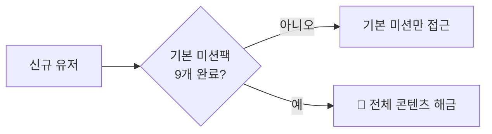

# 🔓 레벨 및 콘텐츠 접근 시스템 기획

| 항목 | 내용 |
|------|------|
| **작성일** | 2026-01-31 |
| **상태** | Confirmed |
| **관련 문서** | [벤치마킹](./benchmarking-english-apps.md), [화면 기획](./app-screens-learning-flow.md) |

---

## 🎯 채택 방식: 기본 미션 완료 → 전체 해금

### 핵심 원칙

```
테마별 3개씩 완료 → 전체 콘텐츠 해금
난이도 경고 팝업 ❌ → 난이도 표시만 ✅
```

---

## 📋 해금 조건

### 기본 미션팩 (총 9개)

| 테마 | 완료 필요 | 예상 소요 |
|------|----------|----------|
| 🎧 듣기 전용 | 3개 | 1~2일 |
| 🎬 시뮬레이션 | 3개 | 1~2일 |
| 🎭 상황극 큐 | 3개 | 1~2일 |
| **합계** | **9개** | **3~5일** |

### 해금 플로우



---

## 📱 UX 설계

### 1. 홈 화면 (미완료 상태)

```
┌─────────────────────────────────────┐
│  👋 안녕하세요, OO님!               │
│                                     │
│  ━━━━━━━━━━━━━━━━━━━━━━━━━━━━━━━━   │
│  📋 기본 미션 진행 중                │
│                                     │
│  🎧 듣기: ██░░░░ 1/3                │
│  🎬 시뮬: ████░░ 2/3                │
│  🎭 상황극: ░░░░░░ 0/3              │
│                                     │
│  완료하면 모든 콘텐츠가 해금돼요! 🎉  │
│  ━━━━━━━━━━━━━━━━━━━━━━━━━━━━━━━━   │
│                                     │
│  [오늘의 미션 시작하기]              │
└─────────────────────────────────────┘
```

### 2. 시나리오 목록 (미완료 상태)

```
┌─────────────────────────────────────┐
│  ← 시뮬레이션                        │
│                                     │
│  ┌─────────────────────────────┐    │
│  │ 🎬 카페에서 주문하기         │    │
│  │ Level 2 · 5분               │    │
│  └─────────────────────────────┘    │
│  ┌─────────────────────────────┐    │
│  │ 🎬 공항에서 체크인하기       │    │
│  │ Level 2 · 7분               │    │
│  └─────────────────────────────┘    │
│  ┌─────────────────────────────┐    │
│  │ 🔒 면접 보기                 │    │
│  │ Level 4 · 기본 미션 완료 후  │    │
│  └─────────────────────────────┘    │
│                                     │
└─────────────────────────────────────┘
```

### 3. 해금 완료 시

```
┌─────────────────────────────────────┐
│  🎉 축하합니다!                      │
│                                     │
│  기본 미션 9개를 모두 완료했어요!     │
│                                     │
│  이제 모든 시나리오를                │
│  자유롭게 학습할 수 있어요!           │
│                                     │
│  ━━━━━━━━━━━━━━━━━━━━━━━━━━━━━━━━   │
│                                     │
│  [시나리오 둘러보기]                 │
└─────────────────────────────────────┘
```

### 4. 해금 후 시나리오 목록

```
┌─────────────────────────────────────┐
│  ← 시뮬레이션                        │
│                                     │
│  ┌─────────────────────────────┐    │
│  │ 🎬 카페에서 주문하기 ✅       │    │
│  │ Level 2 · 5분               │    │
│  └─────────────────────────────┘    │
│  ┌─────────────────────────────┐    │
│  │ 🎬 면접 보기                 │    │
│  │ Level 4 · 10분              │    │  ← 잠금 해제, 난이도만 표시
│  └─────────────────────────────┘    │
│                                     │
└─────────────────────────────────────┘
```

---

## 📊 난이도 표시

경고 팝업 없이, 시나리오 카드에 난이도만 표시합니다.

| Level | 표시 | 설명 |
|-------|------|------|
| 1 | `Level 1` | 왕초보 |
| 2 | `Level 2` | 기초 |
| 3 | `Level 3` | 중급 |
| 4 | `Level 4` | 고급 |
| 5 | `Level 5` | 네이티브 |

---

## 🗂️ 데이터 스키마

```sql
-- 사용자 해금 상태
CREATE TABLE user_progress (
  user_id UUID PRIMARY KEY,
  listening_completed INT DEFAULT 0,  -- 듣기 완료 수
  simulation_completed INT DEFAULT 0, -- 시뮬 완료 수
  scenario_queue_completed INT DEFAULT 0, -- 상황극 완료 수
  is_unlocked BOOLEAN DEFAULT FALSE,  -- 전체 해금 여부
  unlocked_at TIMESTAMP
);
```

### 해금 로직 (Pseudo Code)

```python
def check_unlock(user_id):
    progress = get_user_progress(user_id)
    
    if (progress.listening_completed >= 3 and
        progress.simulation_completed >= 3 and
        progress.scenario_queue_completed >= 3):
        
        unlock_all_content(user_id)
        return True
    
    return False
```

---

## ✅ 확정 사항

| 항목 | 결정 |
|------|------|
| **해금 조건** | 테마별 3개씩, 총 9개 완료 |
| **예상 소요** | 3~5일 |
| **난이도 표시** | 시나리오 카드에 Level 표시 |
| **경고 팝업** | ❌ 없음 |
| **과금** | MVP 이후 결정 |

---

## 🔜 다음 단계

1. [x] 레벨/잠금 시스템 기획
2. [ ] 전체 데이터 스키마 설계
3. [ ] 관리자 페이지 기획
