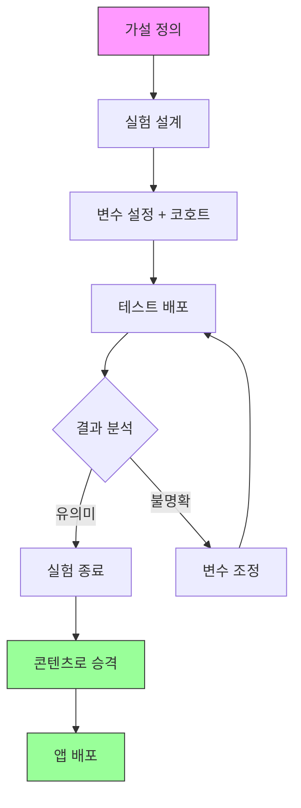

# 📡 연구 CMS (Research CMS) 기획서

| 항목 | 내용 |
|------|------|
| **작성일** | 2026-02-01 |
| **상태** | Draft |
| **관련 문서** | [architecture.md](./architecture.md), [app-screens-learning-flow.md](./app-screens-learning-flow.md) |

---

## 1. CMS 목적

> **일반 CMS가 아닌, 연구/실험 플랫폼**

| 일반 CMS | 연구 CMS (우리) |
|----------|----------------|
| 콘텐츠 CRUD | **가설 → 실험 설계 → 배포 → 측정 → 분석 → 반복** |
| 사용자 관리 | **A/B 테스트 코호트 관리** |
| 로그 보기 | **실험 결과 통계 분석** |
| 설정 변경 | **Feature Flags + 실시간 변수 조정** |

---

## 2. 메뉴 구조 (3대 카테고리)

```
┌─────────────────────────────────────────────────────────────┐
│                      연구 CMS                               │
├─────────────────────────────────────────────────────────────┤
│                                                             │
│  ┌─────────────┐  ┌─────────────┐  ┌─────────────┐         │
│  │  🧪 실험실  │  │ 📦 콘텐츠   │  │ ⚙️ 앱관리   │         │
│  │    Lab     │  │  Contents  │  │   Settings  │         │
│  └─────────────┘  └─────────────┘  └─────────────┘         │
│                                                             │
│   실험 설계        검증된 콘텐츠     앱 전역 설정             │
│   변수 테스트      시나리오 관리     테마/UI                  │
│   분석/리포트      커리큘럼 배포     사용자 관리              │
│                                                             │
└─────────────────────────────────────────────────────────────┘
```

---

## 3. 🧪 실험실 (Lab)

### 3.1 실험 관리 (Experiments)

```
실험실/
├── 실험 목록                    # 진행중/완료/보류 실험들
├── 실험 생성
│   ├── 가설 정의               # "실시간 피드백이 학습 완료율을 높인다"
│   ├── 변수 설정               # 독립변수, 종속변수
│   ├── 코호트 설정             # A/B 그룹 비율
│   └── 성공 지표               # 측정할 메트릭
├── 실험 배포                    # 실험 활성화/비활성화
└── 분석 대시보드               # 결과 분석, 통계
```

### 3.2 변수 관리 (Variables)

**학습 테마별 실험 가능 변수:**

#### 🎧 듣기 전용 (Listening Mode)

| 카테고리 | 변수명 | 타입 | 설명 | 실험 가설 |
|----------|--------|------|------|----------|
| **UI** | `listening_button_position` | enum | 좌우 버튼 위치 | 하단 vs 중앙 |
| **UI** | `listening_subtitle_visible` | boolean | 자막 표시 여부 | 자막 유무에 따른 이해도 |
| **피드백** | `listening_feedback_timing` | enum | 피드백 타이밍 | 즉시 vs 세션 종료 후 |
| **피드백** | `listening_correct_highlight` | boolean | 정답 강조 효과 | 시각 피드백의 효과 |
| **플로우** | `listening_repeat_mode` | boolean | 반복 청취 허용 | 반복이 학습에 미치는 영향 |
| **난이도** | `listening_speed_multiplier` | number | 재생 속도 | 느린 속도의 효과 |
| **모드** | `listening_subway_mode` | boolean | 지하철 모드 (오디오 only) | 화면 없이 학습 효과 |
| **배경** | `listening_background_type` | enum | 배경 유형 | 영상 vs 정적 이미지 |

#### 🎬 시뮬레이션 (Simulation Mode)

| 카테고리 | 변수명 | 타입 | 설명 | 실험 가설 |
|----------|--------|------|------|----------|
| **VDE** | `sim_background_video` | string | 배경 영상 URL | 몰입도 테스트 |
| **VDE** | `sim_background_type` | enum | 배경 유형 | 영상 vs 이미지 vs 블러 |
| **피드백** | `sim_feedback_timing` | enum | 피드백 시점 | 실시간 vs 턴 종료 후 |
| **피드백** | `sim_show_pronunciation_score` | boolean | 발음 점수 표시 | 점수 표시의 압박감 |
| **피드백** | `sim_mood_suggestions_count` | number | 추천 표현 개수 | 3개 vs 5개 |
| **사고버퍼** | `sim_thinking_buffer_seconds` | number | 사고 시간 UI | 5초 vs 10초 버퍼 |
| **사고버퍼** | `sim_thinking_buffer_visible` | boolean | 타이머 표시 | 시간 압박 유무 |
| **힌트** | `sim_hint_initial_visible` | boolean | 힌트 기본 표시 | 힌트 의존도 |
| **힌트** | `sim_hint_expand_delay_ms` | number | 힌트 확장 딜레이 | 자연스러운 힌트 노출 |
| **AI** | `sim_ai_persona` | string | AI 페르소나 | 친근 vs 포멀 |
| **AI** | `sim_ai_response_style` | enum | AI 응답 스타일 | 짧게 vs 자세히 |
| **AI** | `sim_evaluation_strictness` | enum | 평가 엄격도 | 관대 vs 엄격 |

#### 🎭 상황극 큐 (MyTurn / Scenario Queue)

| 카테고리 | 변수명 | 타입 | 설명 | 실험 가설 |
|----------|--------|------|------|----------|
| **플로우** | `myturn_step_order` | array | 단계 순서 | 관찰→모방→반복→내재화 순서 변경 |
| **플로우** | `myturn_observe_before_imitate` | boolean | 관찰 단계 포함 | 관찰의 필요성 |
| **플로우** | `myturn_repeat_count` | number | 반복 횟수 | 2회 vs 3회 |
| **관찰** | `myturn_npc_count` | number | NPC 수 | 관찰할 NPC 수 |
| **관찰** | `myturn_pattern_highlight` | boolean | 패턴 힌트 표시 | 힌트 제공 여부 |
| **모방** | `myturn_guide_text_visible` | boolean | 가이드 텍스트 | 가이드 의존도 |
| **모방** | `myturn_audio_followalong` | boolean | 따라 말하기 모드 | 동시 발화 효과 |
| **내재화** | `myturn_twist_difficulty` | enum | 변형 난이도 | 쉬운 변형 vs 어려운 변형 |
| **게임화** | `myturn_hidden_mission` | boolean | 히든 미션 존재 | 게임화의 효과 |
| **UI** | `myturn_pixel_art_style` | enum | 픽셀 아트 스타일 | 스타일 A/B |
| **UI** | `myturn_camera_zoom` | enum | 카메라 줌 레벨 | close vs wide |

### 3.3 AI 프롬프트 관리

```
┌─────────────────────────────────────────────────────────────┐
│  AI Agent: "English Tutor"                    [버전: v3.2] │
├─────────────────────────────────────────────────────────────┤
│                                                             │
│  적용 대상: [🎬 시뮬레이션 ▼]                               │
│                                                             │
│  ━━ System Prompt ━━━━━━━━━━━━━━━━━━━━━━━━━━━━━━━━━━━━━━   │
│  ┌─────────────────────────────────────────────────────┐   │
│  │ You are a friendly English conversation partner.    │   │
│  │ - Evaluate the user's intent, not grammar          │   │
│  │ - Respond naturally as a native speaker            │   │
│  │ - Provide 3 alternative expressions (casual,       │   │
│  │   polite, native-like)                             │   │
│  │ ...                                                 │   │
│  └─────────────────────────────────────────────────────┘   │
│                                                             │
│  ━━ 설정 ━━━━━━━━━━━━━━━━━━━━━━━━━━━━━━━━━━━━━━━━━━━━━━━   │
│                                                             │
│  Temperature:     [0.0 ─────●── 1.0]  0.7                  │
│  Model:           [gemini-1.5-pro ▼]                       │
│  Max Tokens:      [1000]                                   │
│                                                             │
│  ━━ 평가 기준 가중치 ━━━━━━━━━━━━━━━━━━━━━━━━━━━━━━━━━━━━   │
│                                                             │
│  의도 파악:       [──────●────] 40%                        │
│  발음 정확도:     [────●──────] 30%                        │
│  자연스러움:      [────●──────] 30%                        │
│                                                             │
│  [테스트 콘솔] [버전 히스토리] [저장] [실험에 배포]          │
│                                                             │
└─────────────────────────────────────────────────────────────┘
```

### 3.4 분석 대시보드

```
┌─────────────────────────────────────────────────────────────┐
│  📊 실험 분석: "실시간 피드백 효과"                          │
│  기간: 2026-02-01 ~ 2026-02-14 (진행중)                     │
├─────────────────────────────────────────────────────────────┤
│                                                             │
│  ━━ 핵심 지표 (Primary Metrics) ━━━━━━━━━━━━━━━━━━━━━━━━   │
│                                                             │
│  완료율                        체류시간                     │
│  ┌───────────────────┐        ┌───────────────────┐        │
│  │ Control:   45%    │        │ Control:   4.2분  │        │
│  │ Treatment: 62% 📈 │        │ Treatment: 5.8분 📈│        │
│  │ Δ +17% (p<0.05)   │        │ Δ +1.6분         │        │
│  └───────────────────┘        └───────────────────┘        │
│                                                             │
│  ━━ 일별 추이 ━━━━━━━━━━━━━━━━━━━━━━━━━━━━━━━━━━━━━━━━━━   │
│                                                             │
│  [차트: 시간에 따른 완료율 변화]                             │
│                                                             │
│  ━━ 세그먼트 분석 ━━━━━━━━━━━━━━━━━━━━━━━━━━━━━━━━━━━━━━━   │
│                                                             │
│  레벨별:                                                    │
│  - 초급: Treatment 효과 큼 (+25%)                           │
│  - 중급: 효과 미미 (+5%)                                    │
│                                                             │
│  ━━ 로그 샘플 ━━━━━━━━━━━━━━━━━━━━━━━━━━━━━━━━━━━━━━━━━━   │
│                                                             │
│  | 사용자 | 그룹 | 완료 | 체류시간 | 피드백 횟수 |           │
│  |--------|------|------|---------|------------|           │
│  | #1234  | B    | ✅   | 6.2분   | 12번       |           │
│  | #5678  | A    | ❌   | 2.1분   | 0번        |           │
│                                                             │
│  [상세 리포트 다운로드] [실험 종료] [승격 → 콘텐츠]           │
│                                                             │
└─────────────────────────────────────────────────────────────┘
```

---

## 4. 📦 콘텐츠 관리 (Contents)

> 실험실에서 **검증 완료**된 콘텐츠를 앱에 배포

```
콘텐츠 관리/
├── 시나리오 목록
│   ├── 🎧 듣기 전용
│   ├── 🎬 시뮬레이션
│   └── 🎭 상황극 큐
├── 시나리오 에디터
│   ├── 기본 정보 (제목, 난이도, 시간)
│   ├── 스텝 구성
│   └── 미리보기
├── 배포 관리
│   ├── Draft (작성중)
│   ├── Testing (실험중)
│   └── Published (배포됨)
└── 커리큘럼 배치
    └── 추천 알고리즘 설정
```

### 시나리오 에디터

```
┌─────────────────────────────────────────────────────────────┐
│  시나리오: "카페에서 주문하기"                  [🎬 시뮬레이션]│
├─────────────────────────────────────────────────────────────┤
│                                                             │
│  제목: [카페에서 주문하기                    ]              │
│  레벨: [Level 2 ▼]  예상 시간: [5분]                       │
│  카테고리: [일상 ▼]                                        │
│                                                             │
│  ━━ 스텝 구성 ━━━━━━━━━━━━━━━━━━━━━━━━━━━━━━━━━━━━━━━━━━   │
│                                                             │
│  ┌─ Step 1 ──────────────────────────────────────┐ [🗑️]   │
│  │ 타입: [인사 ▼]                                 │        │
│  │ AI 발화: "Hi, welcome! What can I get for you?"│        │
│  │ 사용자 미션: "아이스 아메리카노 주문"            │        │
│  │ 정답 범위: I'd like / Can I get / One iced...  │        │
│  └───────────────────────────────────────────────┘        │
│                                                             │
│  ┌─ Step 2 ──────────────────────────────────────┐ [🗑️]   │
│  │ 타입: [사이즈 확인 ▼]                          │        │
│  │ AI 발화: "What size would you like?"           │        │
│  │ 사용자 미션: "라지 사이즈 요청"                  │        │
│  └───────────────────────────────────────────────┘        │
│                                                             │
│  [+ 스텝 추가]                                              │
│                                                             │
│  ━━ 배경 설정 ━━━━━━━━━━━━━━━━━━━━━━━━━━━━━━━━━━━━━━━━━━   │
│                                                             │
│  배경 영상: [cafe_interior.mp4 ▼]  [미리보기]               │
│                                                             │
│  [저장] [미리보기] [실험 배포] [앱 배포]                      │
│                                                             │
└─────────────────────────────────────────────────────────────┘
```

---

## 5. ⚙️ 앱관리 (Settings)

> 실험과 무관한 **전역 설정**

```
앱관리/
├── 테마 관리
│   ├── 색상 편집기
│   ├── 다크모드 설정
│   └── 미리보기
├── 사용자 관리
│   ├── 사용자 목록
│   ├── 관리자 권한
│   └── 계정 정지
├── 공지사항
└── 시스템 설정
    ├── 앱 버전 관리
    └── 점검 모드
```

---

## 6. 데이터 모델

### 실험 (Experiment)

```sql
experiments
├── id: uuid
├── name: string              -- "실시간 피드백 효과"
├── hypothesis: text          -- 가설 설명
├── status: enum              -- draft / running / completed / paused
├── learning_theme: enum      -- listening / simulation / myturn / all
├── start_date: timestamp
├── end_date: timestamp
├── target_sample_size: int
├── created_at: timestamp
└── created_by: uuid (admin)
```

### 실험 변수 (Experiment Variables)

```sql
experiment_variables
├── id: uuid
├── experiment_id: uuid
├── variable_key: string      -- "sim_feedback_timing"
├── control_value: json       -- {"value": "delayed"}
├── treatment_value: json     -- {"value": "realtime"}
├── traffic_split: float      -- 0.5 (50:50)
└── created_at: timestamp
```

### 사용자 코호트 (User Cohort)

```sql
user_cohorts
├── id: uuid
├── user_id: uuid
├── experiment_id: uuid
├── variant: enum             -- control / treatment
├── assigned_at: timestamp
└── completed: boolean
```

### 실험 로그 (Experiment Logs)

```sql
experiment_logs
├── id: uuid
├── experiment_id: uuid
├── user_id: uuid
├── variant: enum
├── event_type: string        -- "session_start", "step_complete", "session_end"
├── event_data: json          -- { step: 3, duration: 45, ... }
├── learning_theme: enum
├── scenario_id: uuid
└── created_at: timestamp
```

---

## 7. 플로우: 실험 → 콘텐츠 배포



---

## 8. 우선순위

### MVP (1차)
1. **변수 관리** - 학습 테마별 Feature Flags
2. **AI 프롬프트 관리** - 프롬프트 에디터 + 테스트
3. **시나리오 에디터** - 기본 CRUD
4. **로그 수집** - 사용자 행동 로그

### Phase 2
5. **실험 관리** - A/B 테스트 설계/배포
6. **분석 대시보드** - 기본 통계
7. **코호트 관리** - 사용자 그룹 분류

### Phase 3
8. **고급 분석** - 세그먼트 분석, 퍼널 분석
9. **자동화** - 실험 → 콘텐츠 자동 승격

---

## 9. 확장성 고려

### 신규 학습 테마 추가 시

```json
// 학습 테마 정의 (DB 또는 설정)
{
  "id": "new_theme",
  "name": "새로운 학습 테마",
  "icon": "🆕",
  "variables": [
    {
      "key": "new_variable_1",
      "label": "변수 설명",
      "type": "boolean",
      "defaultValue": false
    },
    // ...
  ]
}
```

- 학습 테마는 **플러그인처럼** 추가 가능하도록 설계
- 각 테마별 변수를 **JSON 스키마**로 정의
- 실험실에서 해당 테마 변수 자동 로드
