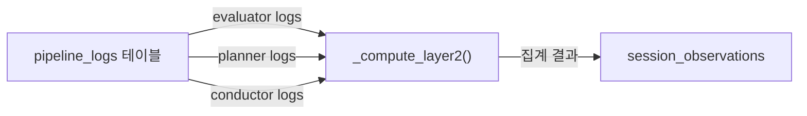

# Phase 2: Pipeline LLM 집계 (Layer 2)

---

## 명령 프롬프트 (이 텍스트를 Claude 세션에 복사하세요)

```
아래 기획서를 읽고 Phase 2를 구현해줘.
기획서 경로: docs/plan/session-observation-impl-phase2.md
개요 기획서 경로: docs/plan/session-observation-system.md (참고용)
Phase 1 기획서 경로: docs/plan/session-observation-impl-phase1.md (참고용 - 이미 구현 완료)

선행 조건 확인:
- Phase 1이 완료되어야 함 (session_observations 테이블, ObservationService 존재)
- `ObservationService._compute_layer2()` 메서드가 현재 pass (stub)인 상태

구현할 것:
1. ObservationService._compute_layer2() 메서드 구현 (Pipeline 로그 집계)
2. output_json 파싱 유틸리터 메서드 추가
3. 검증 테스트

주의사항:
- 특정 템플릿(EMF 등)에 종속되지 않는 범용 설계
- pipeline_logs.output_json은 JSONB이므로 파싱 실패에 대해 안전하게 처리
- template_specific_data는 있으면 저장하되, 특정 템플릿 키를 하드코딩하지 말 것
- 서버 CLAUDE.md의 코드 컨벤션을 준수할 것
```

---

## 목표

- `ObservationService._compute_layer2()` 구현 — Pipeline 실행 로그에서 관찰 메트릭 집계
- 기존 stub (`pass`)를 실제 구현으로 교체
- 안전한 JSON 파싱 + 에러 핸들링



---

## 현재 코드베이스 컨텍스트 (이 Phase에서 참조하는 파일들)

### 핵심 파일 경로

| 파일 | 역할 | 수정/생성 |
|------|------|----------|
| `apps/server/app/services/conversation/observation_service.py` | ObservationService | **수정** (_compute_layer2 구현) |
| `apps/server/app/models/pipeline_log.py` | PipelineLog 모델 | 참조만 |
| `apps/server/app/schemas/pipeline_schemas.py` | Pipeline 출력 스키마 정의 | 참조만 |

### PipelineLog 모델 (참조)

```python
# apps/server/app/models/pipeline_log.py
class PipelineLog(Base):
    __tablename__ = "pipeline_logs"

    id = Column(UUID(as_uuid=True), primary_key=True, default=uuid4)
    trace_id = Column(String(36), nullable=False, index=True)
    session_id = Column(UUID(as_uuid=True), ForeignKey("conversation_sessions.id", ondelete="CASCADE"),
                        nullable=False, index=True)
    turn_index = Column(Integer, nullable=False)
    module_name = Column(String(20), nullable=False)  # evaluator, planner, conductor
    schema_version = Column(String(20), nullable=False, default="0.2.0")
    input_json = Column(JSONB, nullable=True)
    output_json = Column(JSONB, nullable=True)
    duration_ms = Column(Float, nullable=True)
    model_name = Column(String(100), nullable=True)
    prompt_used = Column(Text, nullable=True)
    error_message = Column(Text, nullable=True)
    created_at = Column(DateTime, default=datetime.utcnow, nullable=False)

    session = relationship("ConversationSession", backref="pipeline_logs")
```

### Pipeline Output 스키마 (참조 — `pipeline_schemas.py`에서 핵심 부분)

**EvaluatorOutput** 구조:
```python
{
    "aggregate": {
        "slot_avg": float,        # 0-10
        "imitation_score": int,    # 0-10
        "complexity_score": int,   # 0-10
        "overall_score": int       # 0-100  ← Layer 2에서 집계
    },
    "diagnosis": {
        "primary_issue": str,      # "MISSING_SLOT_A", "LOW_IMITATION", "NONE" 등
        "secondary_issues": list[str],
        "recommended_action": str  # "CONTINUE", "TRIGGER_HELPER" 등
    },
    "fluency": {
        "pause_count": int,
        "words_per_minute": float  # ← Layer 2에서 추이 추적
    }
}
```

**PlannerOutput** 구조:
```python
{
    "decision": {
        "path": str,               # "LEVEL_UP", "LEVEL_HOLD", "LEVEL_DOWN", "LEVEL_JUMP"
        "action_code": str,        # "LEVEL_ADJUST"
        "reason": list[str]
    },
    "persona_plan": {
        "current_level": int,      # 1-10  ← Layer 2에서 추이 추적
        "tone": str,
        "speakers": list[str]
    }
}
```

**ConductorOutput** 구조:
```python
{
    "scripts": list[dict],         # [{speaker_name, text, instruction}]
    "corrections": list[str],      # ← Layer 2에서 총 횟수 집계
    "better_expressions": list[str],
    "feedback_text": str
}
```

### 현재 ObservationService._compute_layer2 (수정 대상)

```python
# apps/server/app/services/conversation/observation_service.py (약 823행)
def _compute_layer2(
    self, obs: SessionObservation, pipeline_logs: list[PipelineLog],
) -> None:
    """Pipeline 로그 집계. Phase 2에서 구현."""
    pass
```

### SessionObservation Layer 2 필드 (이미 Phase 1에서 생성됨)

```python
# Layer 2 필드들 (session_observation.py에 이미 존재)
avg_overall_score = Column(Float, nullable=True)
score_trend = Column(String(20), nullable=True)
level_progression = Column(JSONB, nullable=True)
max_level_reached = Column(Integer, nullable=True)
level_up_count = Column(Integer, default=0)
level_down_count = Column(Integer, default=0)
primary_issues = Column(JSONB, nullable=True)
correction_count = Column(Integer, default=0)
fluency_wpm_trend = Column(JSONB, nullable=True)
template_specific_data = Column(JSONB, nullable=True)
```

---

## Task 2-1: `_compute_layer2` 구현

### 수정 파일: `apps/server/app/services/conversation/observation_service.py`

**기존 stub을 아래 구현으로 교체하세요.**

> [!IMPORTANT] 설계 원칙
> - `output_json`은 JSONB이므로 dict로 접근 가능하나, 키가 없을 수 있음 → `.get()` 사용 필수
> - 각 module_name별로 필터링: `evaluator`, `planner`, `conductor`
> - `_compute_trend` 헬퍼 메서드는 Phase 1에서 이미 구현되어 있음 (정수 배열용)
> - 부동소수점 배열에도 사용할 수 있도록 별도 `_compute_float_trend` 추가 또는 기존 메서드 일반화

```python
def _compute_layer2(
    self, obs: SessionObservation, pipeline_logs: list[PipelineLog],
) -> None:
    """Pipeline 로그에서 Layer 2 메트릭 집계.

    Evaluator: overall_score, primary_issue, fluency.words_per_minute
    Planner: current_level, decision.path
    Conductor: corrections
    """
    if not pipeline_logs:
        return

    evaluator_logs = [
        log for log in pipeline_logs
        if log.module_name == "evaluator" and log.output_json
    ]
    planner_logs = [
        log for log in pipeline_logs
        if log.module_name == "planner" and log.output_json
    ]
    conductor_logs = [
        log for log in pipeline_logs
        if log.module_name == "conductor" and log.output_json
    ]

    # ── Evaluator 집계 ──
    overall_scores: list[float] = []
    primary_issues_counter: dict[str, int] = {}
    wpm_values: list[float] = []

    for log in evaluator_logs:
        out = log.output_json
        # aggregate.overall_score
        score = self._safe_get_nested(out, "aggregate", "overall_score")
        if score is not None:
            try:
                overall_scores.append(float(score))
            except (TypeError, ValueError):
                pass

        # diagnosis.primary_issue
        issue = self._safe_get_nested(out, "diagnosis", "primary_issue")
        if issue and issue != "NONE":
            primary_issues_counter[issue] = primary_issues_counter.get(issue, 0) + 1

        # fluency.words_per_minute
        wpm = self._safe_get_nested(out, "fluency", "words_per_minute")
        if wpm is not None:
            try:
                wpm_val = float(wpm)
                if wpm_val > 0:
                    wpm_values.append(wpm_val)
            except (TypeError, ValueError):
                pass

    if overall_scores:
        obs.avg_overall_score = round(
            sum(overall_scores) / len(overall_scores), 1
        )
        obs.score_trend = self._compute_trend_float(overall_scores)

    # 빈도 TOP 3
    if primary_issues_counter:
        sorted_issues = sorted(
            primary_issues_counter.items(),
            key=lambda x: x[1],
            reverse=True,
        )
        obs.primary_issues = [issue for issue, _ in sorted_issues[:3]]

    if wpm_values:
        obs.fluency_wpm_trend = [round(v, 1) for v in wpm_values]

    # ── Planner 집계 ──
    levels: list[int] = []
    level_up = 0
    level_down = 0

    for log in planner_logs:
        out = log.output_json
        # persona_plan.current_level
        level = self._safe_get_nested(out, "persona_plan", "current_level")
        if level is not None:
            try:
                levels.append(int(level))
            except (TypeError, ValueError):
                pass

        # decision.path
        path = self._safe_get_nested(out, "decision", "path")
        if path:
            path_upper = str(path).upper()
            if "UP" in path_upper or "JUMP" in path_upper:
                level_up += 1
            elif "DOWN" in path_upper:
                level_down += 1

    if levels:
        obs.level_progression = levels
        obs.max_level_reached = max(levels)

    obs.level_up_count = level_up
    obs.level_down_count = level_down

    # ── Conductor 집계 ──
    total_corrections = 0

    for log in conductor_logs:
        out = log.output_json
        corrections = out.get("corrections", []) if isinstance(out, dict) else []
        if isinstance(corrections, list):
            total_corrections += len(corrections)

    obs.correction_count = total_corrections

    # ── template_specific_data ──
    # Pipeline 로그의 custom_state 등 템플릿 고유 데이터가 있으면 수집
    # 특정 템플릿 키를 하드코딩하지 않고, planner에 custom_state가 있으면 그대로 저장
    template_data = self._extract_template_specific_data(planner_logs)
    if template_data:
        obs.template_specific_data = template_data
```

### 추가할 헬퍼 메서드

**기존 `_compute_trend` 아래에 추가하세요:**

```python
@staticmethod
def _compute_trend_float(values: list[float], window: int = 3) -> str:
    """부동소수점 배열의 추이 계산. _compute_trend의 float 버전."""
    if len(values) < window * 2:
        return "insufficient_data"
    first_avg = sum(values[:window]) / window
    last_avg = sum(values[-window:]) / window
    if first_avg == 0:
        return "improving" if last_avg > 0 else "stable"
    change = (last_avg - first_avg) / first_avg
    if change > 0.2:
        return "improving"
    elif change < -0.2:
        return "declining"
    return "stable"

@staticmethod
def _safe_get_nested(data: dict | None, *keys: str):
    """중첩 딕셔너리에서 안전하게 값을 추출.

    예: _safe_get_nested(output_json, "aggregate", "overall_score")
    """
    if not isinstance(data, dict):
        return None
    current = data
    for key in keys:
        if not isinstance(current, dict):
            return None
        current = current.get(key)
        if current is None:
            return None
    return current

@staticmethod
def _extract_template_specific_data(
    planner_logs: list,
) -> dict | None:
    """Planner 로그에서 템플릿 고유 데이터 추출.

    custom_state 등 템플릿별 특수 데이터가 있으면 마지막 로그의
    데이터를 그대로 반환. 특정 키를 하드코딩하지 않음.
    """
    for log in reversed(planner_logs):
        if not isinstance(log.output_json, dict):
            continue
        custom_state = log.output_json.get("custom_state")
        if custom_state and isinstance(custom_state, dict):
            return custom_state
    return None
```

---

## 검증 방법

### 1. 기존 세션으로 수동 재생성 테스트

```bash
# 서버 시작
cd apps/server && poetry run uvicorn app.main:app --reload

# Pipeline 로그가 있는 완료된 세션 ID로 수동 생성
curl -X POST http://localhost:8000/api/v1/conversations/sessions/{session_id}/observation/generate | python -m json.tool

# 응답에서 확인할 것:
# - layer2.avg_overall_score가 값이 있는지 (null이 아닌지)
# - layer2.level_progression이 배열로 존재하는지
# - layer2.primary_issues가 배열로 존재하는지
# - layer2.correction_count가 0보다 큰지
# - layer2.score_trend가 "improving"/"stable"/"declining"/"insufficient_data" 중 하나인지
```

### 2. Pipeline 로그가 없는 세션 테스트 (기본 모드)

```bash
# Pipeline 모드가 "basic"인 세션으로 테스트 — Layer 2 필드가 null이어야 함
curl -X POST http://localhost:8000/api/v1/conversations/sessions/{basic_session_id}/observation/generate | python -m json.tool

# Layer 2 필드들이 모두 null/기본값인지 확인
```

### 3. 에러 핸들링 확인

```bash
# Python 콘솔에서 직접 테스트
cd apps/server
poetry run python -c "
from app.services.conversation.observation_service import ObservationService

# _safe_get_nested 테스트
assert ObservationService._safe_get_nested({'a': {'b': 3}}, 'a', 'b') == 3
assert ObservationService._safe_get_nested({'a': {'b': 3}}, 'a', 'c') is None
assert ObservationService._safe_get_nested(None, 'a') is None
assert ObservationService._safe_get_nested({}, 'a', 'b') is None
print('_safe_get_nested: ALL PASS')

# _compute_trend_float 테스트
assert ObservationService._compute_trend_float([50, 55, 60, 70, 75, 80]) == 'improving'
assert ObservationService._compute_trend_float([80, 75, 70, 60, 55, 50]) == 'declining'
assert ObservationService._compute_trend_float([60, 62, 58, 61, 59, 60]) == 'stable'
assert ObservationService._compute_trend_float([60, 70]) == 'insufficient_data'
print('_compute_trend_float: ALL PASS')
"
```

---

## 완료 체크리스트

- [ ] `_compute_layer2()` 메서드가 stub에서 실제 구현으로 교체됨
- [ ] `_safe_get_nested()` 헬퍼 메서드 추가
- [ ] `_compute_trend_float()` 헬퍼 메서드 추가
- [ ] `_extract_template_specific_data()` 헬퍼 메서드 추가
- [ ] Pipeline 로그가 있는 세션 — Layer 2 필드에 값이 채워짐
- [ ] Pipeline 로그가 없는 세션 — Layer 2 필드가 null/기본값
- [ ] `output_json`이 비정상적인 경우에도 에러 없이 동작
- [ ] 기존 Layer 1 기능에 영향 없음
