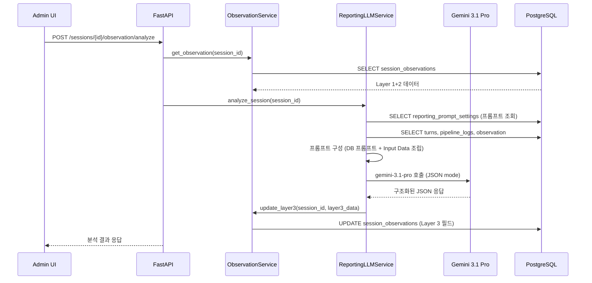

# Phase 3: Reporting LLM Service (Layer 3)

---

## 명령 프롬프트 (이 텍스트를 Claude 세션에 복사하세요)

```
아래 기획서를 읽고 Phase 3을 구현해줘.
기획서 경로: docs/plan/session-observation-impl-phase3.md
개요 기획서 경로: docs/plan/session-observation-system.md (§4.3 Reporting LLM + 프롬프트 참고)

선행 조건 확인:
- Phase 1, 2가 완료되어야 함 (session_observations 테이블 존재, Layer 1+2 자동 생성 동작)
- ObservationService.update_layer3() 메서드가 이미 Phase 1에서 구현됨

구현할 것:
1. Reporting LLM 프롬프트 관리 기능 (DB 모델 + CRUD API)
2. ReportingLLMService 신규 생성 (gemini-3.1-pro 호출, 프롬프트를 DB에서 읽기)
3. 수동 트리거 API 엔드포인트 추가
4. 검증 테스트

주의사항:
- 특정 템플릿(EMF 등)에 종속되지 않는 범용 설계
- Reporting LLM 프롬프트는 DB에 저장하여 Admin UI에서 편집 가능하게 구현
- 프롬프트가 아직 DB에 없으면 코드 내 기본값(DEFAULT_PROMPT)을 사용하되, 첫 호출 시 DB에 자동 저장
- LLM 출력은 JSON Schema 모드로 호출하여 구조화된 응답 보장
- 프롬프트에 특정 템플릿 이름이나 로직을 하드코딩하지 마세요
- 서버 CLAUDE.md의 코드 컨벤션을 준수할 것
- 기존 Gemini API 호출 패턴이 있다면 그 패턴을 따르세요
```

---

## 목표

- **Reporting LLM 프롬프트 관리** — DB 저장 + Admin CRUD API (글로벌 설정, 템플릿 비종속)
- `ReportingLLMService` 신규 서비스 생성 — Layer 3 분석 전담, 프롬프트를 DB에서 읽기
- Admin 세션 상세 페이지에서 수동 트리거할 수 있는 API 엔드포인트
- 구조화된 프롬프트로 gemini-3.1-pro 호출
- JSON Schema 모드로 일관된 출력 보장



---

## 현재 코드베이스 컨텍스트 (이 Phase에서 참조하는 파일들)

### 핵심 파일 경로

| 파일 | 역할 | 수정/생성 |
|------|------|----------|
| `apps/server/app/models/reporting_prompt_setting.py` | 프롬프트 설정 모델 | **신규 생성** |
| `apps/server/alembic/versions/xxx_add_reporting_prompt_settings.py` | DB 마이그레이션 | **신규 생성** |
| `apps/server/app/services/conversation/reporting_llm_service.py` | Reporting LLM Service | **신규 생성** |
| `apps/server/app/api/v1/conversations.py` | API 라우터 | **수정** (엔드포인트 추가) |
| `apps/server/app/services/conversation/observation_service.py` | ObservationService | 참조만 (update_layer3 사용) |
| `apps/server/app/models/session_observation.py` | SessionObservation 모델 | 참조만 |
| `apps/server/app/models/conversation.py` | Session, Turn 모델 | 참조만 |
| `apps/server/app/models/pipeline_log.py` | PipelineLog 모델 | 참조만 |

### 기존 Gemini API 호출 패턴 확인

> [!IMPORTANT]
> 현재 코드베이스에서 Gemini API를 어떻게 호출하는지 확인하세요.
> `my_turn_service.py` 또는 `evaluator/planner/conductor` 서비스를 참조하여 동일한 패턴을 따르세요.
>
> **검색 힌트**: 프로젝트에서 `google.generativeai` 또는 `genai` 또는 `google.genai` import를 검색하세요.
> ```bash
> grep -r "generativeai\|google.genai\|import genai" apps/server/app/ --include="*.py"
> ```

### ObservationService.update_layer3 (Phase 1에서 이미 구현됨)

```python
async def update_layer3(
    self, session_id: UUID, layer3_data: dict,
) -> SessionObservation:
    """Layer 3 결과 업데이트. Phase 3에서 호출."""
    observation = await self._get_existing(session_id)
    if not observation:
        raise ValueError(
            f"Observation for session {session_id} not found. "
            "Generate Layer 1+2 first."
        )
    for key, value in layer3_data.items():
        if hasattr(observation, key):
            setattr(observation, key, value)
    await self.db.flush()
    return observation
```

### Layer 3 필드 목록 (SessionObservation에 이미 존재)

```python
# Layer 3 필드들
learning_behavior_summary     # Text: 한국어 2-3문장 요약
engagement_level               # String(20): high/medium/low
key_learning_points            # JSONB: list[str] (최대 5개)
struggle_points                # JSONB: list[str] (최대 3개)
communication_style            # String(20): reactive/proactive/balanced
topic_maintenance_score        # Float: 0-100
question_back_count            # Integer
natural_conversation_score     # Float: 0-100
improvement_suggestions        # JSONB: list[str] (한국어)
elaboration_adequacy           # JSONB: {overall_score, trend, evaluated_turns[]}
explicit_clarification_analysis # JSONB: {count, details[]}
response_start_quality         # String(20): good/fair/poor
response_start_quality_detail  # JSONB: list[dict]
flow_maintenance               # String(20): strong/moderate/weak
flow_maintenance_detail        # JSONB: list[dict]
coping_attempt                 # JSONB: {count, examples[]}
clarification_success          # JSONB: {no_clarification, total, successful, failed, details[]}
avoidance_vs_response          # JSONB: {avoidance_count, response_count, ratio, pattern}

# 메타 (LLM 실행 정보)
reporting_llm_model            # String(100)
reporting_llm_duration_ms      # Float
```

---

## Task 3-0: Reporting LLM 프롬프트 관리 (DB + CRUD API)

### 설계 의도

Reporting LLM의 시스템 프롬프트를 하드코딩하지 않고 DB에 저장하여 Admin에서 편집할 수 있게 합니다.

- **글로벌 설정**: 특정 템플릿에 종속되지 않는 전역 프롬프트
- **활성 버전 관리**: `is_active` 플래그로 현재 사용 중인 프롬프트 1개만 활성
- **기본값 fallback**: DB에 프롬프트가 없으면 코드 내 `DEFAULT_SYSTEM_PROMPT`를 사용
- **버전 히스토리**: 프롬프트 수정 시 기존 프롬프트를 비활성화하고 새 행 생성 (이력 추적 가능)

### 3-0-1: 모델 생성

**신규 파일: `apps/server/app/models/reporting_prompt_setting.py`**

```python
"""Reporting LLM Prompt Setting model.

Global (template-agnostic) prompt management for the Reporting LLM.
Only one row with is_active=True should exist at any time.
"""

from datetime import datetime
from uuid import uuid4

from sqlalchemy import Boolean, Column, DateTime, String, Text
from sqlalchemy.dialects.postgresql import UUID

from app.models.base import Base


class ReportingPromptSetting(Base):
    """Reporting LLM prompt configuration.

    Attributes:
        id: Unique identifier.
        name: Human-readable label (e.g., "v1 기본 프롬프트", "v2 상세 분석").
        system_prompt: The full system instruction text sent to the LLM.
        llm_model: LLM model name override (default: gemini-3.1-pro).
        temperature: LLM temperature (default: 0.3).
        is_active: Whether this prompt is the currently active one.
        created_at: Creation timestamp.
        updated_at: Last update timestamp.
    """

    __tablename__ = "reporting_prompt_settings"

    id = Column(UUID(as_uuid=True), primary_key=True, default=uuid4)
    name = Column(String(100), nullable=False, default="기본 프롬프트")
    system_prompt = Column(Text, nullable=False)
    llm_model = Column(String(100), nullable=False, default="gemini-3.1-pro")
    temperature = Column(String(10), nullable=False, default="0.3")
    is_active = Column(Boolean, nullable=False, default=True, index=True)
    created_at = Column(DateTime, default=datetime.utcnow, nullable=False)
    updated_at = Column(DateTime, default=datetime.utcnow, onupdate=datetime.utcnow, nullable=False)
```

> [!TIP] `models/__init__.py` 또는 `models/base.py` 업데이트
> 새 모델을 import해야 Alembic이 인식합니다. 기존 프로젝트의 모델 등록 패턴을 확인하세요.
> ```bash
> grep -r "import.*PipelineLog\|import.*SessionObservation" apps/server/app/models/ --include="*.py"
> ```

### 3-0-2: DB 마이그레이션

```bash
cd apps/server
poetry run alembic revision --autogenerate -m "add_reporting_prompt_settings"
poetry run alembic upgrade head
```

### 3-0-3: CRUD API 엔드포인트

**수정 파일: `apps/server/app/api/v1/conversations.py`**

아래 엔드포인트들을 추가하세요:

```python
from app.models.reporting_prompt_setting import ReportingPromptSetting

# ── Reporting LLM 프롬프트 관리 ──

@router.get("/reporting-prompt")
async def get_active_reporting_prompt(db: DbSession):
    """현재 활성 Reporting LLM 프롬프트 조회."""
    result = await db.execute(
        select(ReportingPromptSetting)
        .where(ReportingPromptSetting.is_active == True)
        .order_by(ReportingPromptSetting.updated_at.desc())
        .limit(1)
    )
    prompt = result.scalar_one_or_none()
    if not prompt:
        return {
            "id": None,
            "name": "기본 프롬프트 (코드 내장)",
            "system_prompt": None,  # Admin UI에서 편집 시 기본값 로딩
            "llm_model": "gemini-3.1-pro",
            "temperature": "0.3",
            "is_active": True,
            "is_default": True,  # DB에 저장된 것이 없음을 표시
        }
    return {
        "id": str(prompt.id),
        "name": prompt.name,
        "system_prompt": prompt.system_prompt,
        "llm_model": prompt.llm_model,
        "temperature": prompt.temperature,
        "is_active": prompt.is_active,
        "is_default": False,
        "created_at": prompt.created_at.isoformat() if prompt.created_at else None,
        "updated_at": prompt.updated_at.isoformat() if prompt.updated_at else None,
    }


@router.put("/reporting-prompt")
async def update_reporting_prompt(
    db: DbSession,
    body: dict,  # {name, system_prompt, llm_model?, temperature?}
):
    """Reporting LLM 프롬프트 업데이트 (새 버전 생성).

    기존 활성 프롬프트를 비활성화하고 새 프롬프트를 활성 상태로 생성합니다.
    """
    system_prompt = body.get("system_prompt")
    if not system_prompt or not system_prompt.strip():
        raise HTTPException(status_code=400, detail="system_prompt is required")

    # 기존 활성 프롬프트 비활성화
    existing = await db.execute(
        select(ReportingPromptSetting)
        .where(ReportingPromptSetting.is_active == True)
    )
    for row in existing.scalars().all():
        row.is_active = False

    # 새 프롬프트 생성
    new_prompt = ReportingPromptSetting(
        name=body.get("name", "사용자 정의 프롬프트"),
        system_prompt=system_prompt.strip(),
        llm_model=body.get("llm_model", "gemini-3.1-pro"),
        temperature=body.get("temperature", "0.3"),
        is_active=True,
    )
    db.add(new_prompt)
    await db.commit()
    await db.refresh(new_prompt)

    return {
        "id": str(new_prompt.id),
        "name": new_prompt.name,
        "llm_model": new_prompt.llm_model,
        "is_active": True,
        "message": "프롬프트가 업데이트되었습니다",
    }


@router.get("/reporting-prompt/history")
async def get_reporting_prompt_history(db: DbSession):
    """Reporting LLM 프롬프트 버전 이력 조회."""
    result = await db.execute(
        select(ReportingPromptSetting)
        .order_by(ReportingPromptSetting.created_at.desc())
        .limit(20)
    )
    prompts = result.scalars().all()
    return {
        "items": [
            {
                "id": str(p.id),
                "name": p.name,
                "llm_model": p.llm_model,
                "temperature": p.temperature,
                "is_active": p.is_active,
                "created_at": p.created_at.isoformat() if p.created_at else None,
            }
            for p in prompts
        ],
        "total": len(prompts),
    }


@router.get("/reporting-prompt/default")
async def get_default_reporting_prompt():
    """코드 내장 기본 프롬프트 텍스트를 반환. Admin UI에서 리셋 시 사용."""
    from app.services.conversation.reporting_llm_service import DEFAULT_SYSTEM_PROMPT
    return {
        "system_prompt": DEFAULT_SYSTEM_PROMPT,
        "llm_model": "gemini-3.1-pro",
        "temperature": "0.3",
    }
```

---

## Task 3-1: ReportingLLMService 생성

### 신규 파일: `apps/server/app/services/conversation/reporting_llm_service.py`

> [!IMPORTANT] 핵심 원칙
> 1. **템플릿 비종속**: 프롬프트에 특정 템플릿 이름/로직 하드코딩 금지
> 2. **프롬프트 DB 관리**: `_get_system_prompt()`가 DB에서 활성 프롬프트를 읽고, 없으면 `DEFAULT_SYSTEM_PROMPT` 사용
> 3. **JSON Schema 모드**: Gemini의 JSON mode 또는 response_schema를 사용하여 구조화된 출력 보장
> 4. **에러 안전**: LLM 호출 실패 시 예외 전파 (호출자가 처리)
> 5. **기존 패턴 준수**: 프로젝트의 Gemini API 호출 패턴을 따를 것

```python
"""Reporting LLM Service — Layer 3 학습 행동 분석.

세션의 전체 대화 컨텍스트를 Gemini-3.1-pro에 전달하여
학습 행동, 참여도, 대화 품질 등을 분석합니다.
"""

import json
import logging
import time
from typing import Optional
from uuid import UUID

from google import genai
from google.genai import types
from sqlalchemy import select
from sqlalchemy.ext.asyncio import AsyncSession

from app.models.conversation import (
    ConversationSession,
    ConversationTurn,
    TurnType,
)
from app.models.pipeline_log import PipelineLog
from app.models.session_observation import SessionObservation
from app.services.conversation.observation_service import ObservationService

logger = logging.getLogger(__name__)

# Reporting LLM 기본 모델
DEFAULT_REPORTING_MODEL = "gemini-3.1-pro"


class ReportingLLMService:
    """Layer 3 학습 행동 분석 서비스.

    Admin 세션 상세 페이지에서 수동 트리거로만 실행.
    """

    def __init__(self, db: AsyncSession) -> None:
        self.db = db
        # genai client 초기화 — 기존 프로젝트 패턴을 확인하여 동일하게 초기화
        # (환경 변수 GOOGLE_API_KEY 또는 GOOGLE_GENAI_API_KEY 사용)
        self.client = genai.Client()

    async def analyze_session(self, session_id: UUID) -> dict:
        """세션의 학습 행동을 분석하고 Layer 3 데이터를 생성.

        Returns:
            Layer 3 필드의 dict (ObservationService.update_layer3에 전달)
        """
        # 1. 데이터 수집
        session = await self._get_session(session_id)
        if not session:
            raise ValueError(f"Session {session_id} not found")

        turns = await self._get_turns(session_id)
        pipeline_logs = await self._get_pipeline_logs(session_id)
        observation = await self._get_observation(session_id)

        if not observation:
            raise ValueError(
                f"Observation for session {session_id} not found. "
                "Run Layer 1+2 generation first."
            )

        # 2. 프롬프트 입력 데이터 구성
        input_data = self._build_input_data(session, turns, pipeline_logs, observation)

        # 3. 프롬프트 + 모델 설정 조회 (DB → fallback)
        prompt_config = await self._get_prompt_config()
        model_name = prompt_config["llm_model"]

        # 4. LLM 호출
        start_time = time.time()
        result = await self._call_llm(input_data, prompt_config)
        duration_ms = (time.time() - start_time) * 1000

        # 5. 결과에 메타 정보 추가
        result["reporting_llm_model"] = model_name
        result["reporting_llm_duration_ms"] = round(duration_ms, 1)

        # 5. ObservationService를 통해 저장
        obs_service = ObservationService(self.db)
        await obs_service.update_layer3(session_id, result)

        logger.info(
            f"[ReportingLLM] Analysis completed for session {session_id} "
            f"in {duration_ms:.0f}ms"
        )

        return result

    # ──────────────────────────────────────────────
    # Input Data 구성
    # ──────────────────────────────────────────────

    def _build_input_data(
        self,
        session: ConversationSession,
        turns: list[ConversationTurn],
        pipeline_logs: list[PipelineLog],
        observation: SessionObservation,
    ) -> dict:
        """Reporting LLM에 전달할 입력 데이터를 구성."""

        # Session Metadata (개인정보 최소화 — account_email, device_type 제외)
        template_name = ""
        if session.variant:
            try:
                variant_data = (
                    json.loads(session.variant)
                    if isinstance(session.variant, str)
                    else session.variant
                )
                template_name = variant_data.get("template_name", "")
            except (json.JSONDecodeError, AttributeError):
                pass
        if not template_name and session.template:
            template_name = session.template.name

        session_metadata = {
            "template_name": template_name or "Unknown",
            "session_duration_sec": observation.session_duration_sec,
            "user_name": session.user_name or "Student",
            "completion_status": observation.completion_status,
        }

        # Layer 1 Metrics
        layer1_metrics = {
            "total_user_turns": observation.total_user_turns or 0,
            "total_ai_turns": observation.total_ai_turns or 0,
            "avg_user_utterance_length": observation.avg_user_utterance_length,
            "utterance_length_trend": observation.utterance_length_trend,
            "avg_user_response_interval_sec": observation.avg_user_response_interval_sec,
            "short_reply_count": observation.short_reply_count or 0,
            "first_user_response_time_sec": observation.first_user_response_time_sec,
            "word_count_per_turn": observation.word_count_per_turn,
            "long_gap_count": observation.long_gap_count or 0,
            "followup_after_short_answer": observation.followup_after_short_answer or 0,
        }

        # Layer 2 Metrics
        layer2_metrics = {
            "avg_overall_score": observation.avg_overall_score,
            "score_trend": observation.score_trend,
            "level_progression": observation.level_progression,
            "max_level_reached": observation.max_level_reached,
            "level_up_count": observation.level_up_count or 0,
            "level_down_count": observation.level_down_count or 0,
            "primary_issues": observation.primary_issues,
            "correction_count": observation.correction_count or 0,
            "fluency_wpm_trend": observation.fluency_wpm_trend,
        }

        # Full Conversation Transcript
        transcript = [
            {
                "turn_index": t.turn_index,
                "turn_type": t.turn_type.value if hasattr(t.turn_type, "value") else str(t.turn_type),
                "speaker_name": t.speaker_name or "",
                "content_text": t.content_text or "",
            }
            for t in turns
        ]

        # Pipeline Log Details (턴별 상세 — evaluator/planner/conductor)
        pipeline_details = self._build_pipeline_details(pipeline_logs)

        return {
            "session_metadata": session_metadata,
            "layer1_metrics": layer1_metrics,
            "layer2_metrics": layer2_metrics,
            "transcript": transcript,
            "pipeline_details": pipeline_details,
        }

    def _build_pipeline_details(self, pipeline_logs: list[PipelineLog]) -> list[dict]:
        """Pipeline 로그를 턴별로 그룹핑하여 상세 정보 구성."""
        from collections import defaultdict

        by_turn: dict[int, dict] = defaultdict(lambda: {"turn_index": 0})

        for log in pipeline_logs:
            if not log.output_json:
                continue

            turn_data = by_turn[log.turn_index]
            turn_data["turn_index"] = log.turn_index

            if log.module_name == "evaluator":
                out = log.output_json
                turn_data["evaluator"] = {
                    "overall_score": self._safe_get(out, "aggregate", "overall_score"),
                    "slot_scores": {
                        k: v.get("score") if isinstance(v, dict) else None
                        for k, v in out.get("narrative_scores", {}).items()
                    },
                    "diagnosis": {
                        "primary_issue": self._safe_get(out, "diagnosis", "primary_issue"),
                        "secondary_issues": self._safe_get(out, "diagnosis", "secondary_issues") or [],
                        "recommended_action": self._safe_get(out, "diagnosis", "recommended_action"),
                    },
                    "detected": {
                        "anchors": self._safe_get(out, "detected", "anchors") or [],
                        "connectors": self._safe_get(out, "detected", "connectors") or [],
                        "used_key_phrases": self._safe_get(out, "detected", "used_key_phrases") or [],
                    },
                    "fluency": {
                        "pause_count": self._safe_get(out, "fluency", "pause_count") or 0,
                        "words_per_minute": self._safe_get(out, "fluency", "words_per_minute") or 0,
                    },
                }

            elif log.module_name == "planner":
                out = log.output_json
                turn_data["planner"] = {
                    "decision": {
                        "path": self._safe_get(out, "decision", "path"),
                        "reason": self._safe_get(out, "decision", "reason") or [],
                    },
                    "persona_plan": {
                        "current_level": self._safe_get(out, "persona_plan", "current_level"),
                        "tone": self._safe_get(out, "persona_plan", "tone"),
                    },
                }

            elif log.module_name == "conductor":
                out = log.output_json
                turn_data["conductor"] = {
                    "feedback_text": out.get("feedback_text", "") if isinstance(out, dict) else "",
                    "corrections": out.get("corrections", []) if isinstance(out, dict) else [],
                    "better_expressions": out.get("better_expressions", []) if isinstance(out, dict) else [],
                    "scripts": [
                        {"speaker_name": s.get("speaker_name", ""), "text": s.get("text", "")}
                        for s in (out.get("scripts", []) if isinstance(out, dict) else [])
                        if isinstance(s, dict)
                    ],
                }

        return sorted(by_turn.values(), key=lambda x: x.get("turn_index", 0))

    # ──────────────────────────────────────────────
    # LLM 호출
    # ──────────────────────────────────────────────

    async def _call_llm(self, input_data: dict, prompt_config: dict) -> dict:
        """Gemini를 호출하여 Layer 3 분석 수행.

        JSON Schema 모드를 사용하여 구조화된 출력을 보장합니다.
        prompt_config는 _get_prompt_config()에서 반환된 설정입니다.
        """
        system_prompt = prompt_config["system_prompt"]
        model_name = prompt_config["llm_model"]
        temperature = float(prompt_config.get("temperature", "0.3"))
        user_message = json.dumps(input_data, ensure_ascii=False, indent=2)

        try:
            response = await self.client.aio.models.generate_content(
                model=model_name,
                contents=user_message,
                config=types.GenerateContentConfig(
                    system_instruction=system_prompt,
                    response_mime_type="application/json",
                    temperature=temperature,
                    max_output_tokens=8192,
                ),
            )

            result_text = response.text
            if not result_text:
                raise ValueError("Empty response from Reporting LLM")

            result = json.loads(result_text)
            return self._validate_and_normalize(result)

        except json.JSONDecodeError as e:
            logger.error(f"[ReportingLLM] JSON parse error: {e}")
            raise ValueError(f"LLM returned invalid JSON: {e}") from e
        except Exception as e:
            logger.error(f"[ReportingLLM] API call failed: {e}")
            raise

    async def _get_prompt_config(self) -> dict:
        """DB에서 활성 프롬프트 설정을 조회. 없으면 기본값 반환."""
        from app.models.reporting_prompt_setting import ReportingPromptSetting

        result = await self.db.execute(
            select(ReportingPromptSetting)
            .where(ReportingPromptSetting.is_active == True)
            .order_by(ReportingPromptSetting.updated_at.desc())
            .limit(1)
        )
        prompt_row = result.scalar_one_or_none()

        if prompt_row:
            logger.info(f"[ReportingLLM] Using DB prompt: {prompt_row.name} (id={prompt_row.id})")
            return {
                "system_prompt": prompt_row.system_prompt,
                "llm_model": prompt_row.llm_model or DEFAULT_REPORTING_MODEL,
                "temperature": prompt_row.temperature or "0.3",
            }

        logger.info("[ReportingLLM] No DB prompt found, using DEFAULT_SYSTEM_PROMPT")
        return {
            "system_prompt": DEFAULT_SYSTEM_PROMPT,
            "llm_model": DEFAULT_REPORTING_MODEL,
            "temperature": "0.3",
        }

# ============================================================================
# DEFAULT SYSTEM PROMPT (코드 내장 기본값)
# DB에 활성 프롬프트가 없을 경우 이 값을 사용합니다.
# Admin에서 프롬프트를 편집하면 DB에 저장되며, 이 기본값을 대체합니다.
# Admin에서 "기본값으로 리셋" 시 이 값을 제공하는 API가 있습니다.
# ============================================================================

DEFAULT_SYSTEM_PROMPT = """## Role
You are a learning behavior analyst for an English conversation practice app.
Analyze the student's learning behavior patterns with focus on conversation quality,
coping strategies, elaboration adequacy, and communication flow.

## Input Data

You will receive a JSON object containing:
1. session_metadata: Template name, duration, user name, completion status
2. layer1_metrics: Rule-based auto-calculated metrics (turn counts, utterance lengths, response intervals, etc.)
3. layer2_metrics: Pipeline LLM aggregated data (scores, levels, issues, corrections)
4. transcript: Full conversation [{turn_index, turn_type, speaker_name, content_text}]
5. pipeline_details: Per-turn evaluator/planner/conductor outputs

## Analysis Instructions

### learning_behavior_summary
Write a 2-3 sentence Korean summary of the student's overall learning behavior.
Reference session_duration_sec, completion_status, avg_overall_score, and level_progression.

### engagement_level
Determine "high", "medium", or "low" based on:
- total_user_turns, avg_user_utterance_length, avg_user_response_interval_sec
- completion_status (timeout/user_exit = lower)
- long_gap_count, first_user_response_time_sec

### elaboration_adequacy
For each user turn, analyze the preceding AI question:
1. Classify question type → assign Question Weight (1-5)
   - Confirmation (Do you...? / Is it...?): Weight 1-2
   - Description (Describe... / What...?): Weight 3
   - Experience (Why... / Tell me about...?): Weight 4-5
2. Analyze Answer Richness: sentence structure, connectors, specific details
3. Calculate Elaboration Score: (richness / weight) × 100
4. Classify: under_elaborated / well_balanced / over_elaborated
5. Calculate trend: first half vs last half average scores
   - improving: +20%
   - stable: ±20%
   - declining: -20%

### explicit_clarification_analysis
Detect clarification requests: "what?", "sorry?", "come again?", "pardon?", "huh?", "could you repeat", "what do you mean", "I don't understand", "excuse me?" and similar expressions.
Consider STT transcription errors (e.g., "come again" → "come a game").

### response_start_quality
Analyze first 1-2 words of each user turn. Check for appropriate connectors,
response words, and natural connection to previous utterance.

### flow_maintenance
Analyze whether user maintains semantic connection to previous context.

### coping_attempt
Detect coping strategies when user faces difficulty: paraphrase, circumlocution, asking for clarification.

### clarification_success
When clarification occurs: analyze the sequence (request → AI re-explanation → student retry).
Determine if student understood after clarification.

### avoidance_vs_response
Combine short_reply situations with coping_attempt data.
Classify overall pattern as "avoidant", "responsive", or "mixed".

### improvement_suggestions
Write in Korean. Include specific metrics:
- "평균 문장 길이가 N단어입니다. 목표: N+3단어"
- "평균 응답 시간이 N초입니다. 즉각 반응 훈련이 필요합니다."
- "첫 응답까지 N초 소요 — 시작 시 긴장감이 있었습니다"
- Reference primary_issues and fluency_wpm_trend

## Output JSON Schema

Return ONLY a valid JSON object with these exact fields:
{
  "learning_behavior_summary": "한국어 2-3문장",
  "engagement_level": "high|medium|low",
  "key_learning_points": ["..."],
  "struggle_points": ["..."],
  "communication_style": "reactive|proactive|balanced",
  "topic_maintenance_score": 0-100,
  "question_back_count": 0,
  "natural_conversation_score": 0-100,
  "improvement_suggestions": ["한국어 ..."],
  "elaboration_adequacy": {
    "overall_score": 0-100,
    "trend": "improving|stable|declining|insufficient_data",
    "avg_utterance_length_feedback": "평균 N단어 ...",
    "evaluated_turns": [
      {
        "turn_index": 0,
        "question_weight": 1-5,
        "question_type": "confirmation|description|experience",
        "word_count": 0,
        "elaboration_score": 0-100,
        "judgment": "under_elaborated|well_balanced|over_elaborated",
        "feedback": "..."
      }
    ]
  },
  "explicit_clarification_analysis": {
    "count": 0,
    "details": [
      {"turn_index": 0, "expression": "sorry?", "stt_original": "...", "type": "repeat_request|meaning_request"}
    ]
  },
  "response_start_quality": "good|fair|poor",
  "response_start_quality_detail": [
    {"turn_index": 0, "start_words": "...", "quality": "good|fair|poor", "reason": "..."}
  ],
  "flow_maintenance": "strong|moderate|weak",
  "flow_maintenance_detail": [
    {"turn_pair": [0, 1], "connected": true, "evidence": "..."}
  ],
  "coping_attempt": {
    "count": 0,
    "examples": [{"turn_index": 0, "strategy": "paraphrase|describe|ask", "text": "..."}]
  },
  "clarification_success": {
    "no_clarification": true,
    "total": 0,
    "successful": 0,
    "failed": 0,
    "details": [{"trigger_turn": 0, "ai_response_turn": 0, "student_retry_turn": 0, "resolved": true}]
  },
  "avoidance_vs_response": {
    "avoidance_count": 0,
    "response_count": 0,
    "ratio": 0.0,
    "pattern": "avoidant|responsive|mixed"
  }
}"""

# 아래 DEFAULT_SYSTEM_PROMPT를 모듈 레벨 상수로 정의해놓으면,
# ReportingLLMService 클래스 위에 위치시키세요.

    def _validate_and_normalize(self, result: dict) -> dict:
        """LLM 출력을 검증하고 DB 필드에 맞게 정규화.

        누락된 필드는 기본값으로 채우고, 예상치 못한 필드는 무시합니다.
        """
        normalized = {}

        # String 필드
        str_fields = {
            "learning_behavior_summary": None,
            "engagement_level": None,
            "communication_style": None,
            "response_start_quality": None,
            "flow_maintenance": None,
        }
        for field, default in str_fields.items():
            normalized[field] = result.get(field, default)

        # Integer 필드
        int_fields = {
            "question_back_count": None,
        }
        for field, default in int_fields.items():
            val = result.get(field, default)
            normalized[field] = int(val) if val is not None else default

        # Float 필드
        float_fields = {
            "topic_maintenance_score": None,
            "natural_conversation_score": None,
        }
        for field, default in float_fields.items():
            val = result.get(field, default)
            normalized[field] = float(val) if val is not None else default

        # JSONB 필드 (list)
        list_fields = {
            "key_learning_points": [],
            "struggle_points": [],
            "improvement_suggestions": [],
            "response_start_quality_detail": [],
            "flow_maintenance_detail": [],
        }
        for field, default in list_fields.items():
            val = result.get(field, default)
            normalized[field] = val if isinstance(val, list) else default

        # JSONB 필드 (dict)
        dict_fields = {
            "elaboration_adequacy": None,
            "explicit_clarification_analysis": None,
            "coping_attempt": None,
            "clarification_success": None,
            "avoidance_vs_response": None,
        }
        for field, default in dict_fields.items():
            val = result.get(field, default)
            normalized[field] = val if isinstance(val, dict) else default

        return normalized

    # ──────────────────────────────────────────────
    # Helpers
    # ──────────────────────────────────────────────

    @staticmethod
    def _safe_get(data: dict | None, *keys: str):
        """중첩 딕셔너리에서 안전하게 값을 추출."""
        if not isinstance(data, dict):
            return None
        current = data
        for key in keys:
            if not isinstance(current, dict):
                return None
            current = current.get(key)
            if current is None:
                return None
        return current

    # ──────────────────────────────────────────────
    # DB Queries
    # ──────────────────────────────────────────────

    async def _get_session(self, session_id: UUID) -> Optional[ConversationSession]:
        result = await self.db.execute(
            select(ConversationSession)
            .where(ConversationSession.id == session_id)
        )
        return result.scalar_one_or_none()

    async def _get_turns(self, session_id: UUID) -> list[ConversationTurn]:
        result = await self.db.execute(
            select(ConversationTurn)
            .where(ConversationTurn.session_id == session_id)
            .order_by(ConversationTurn.turn_index)
        )
        return list(result.scalars().all())

    async def _get_pipeline_logs(self, session_id: UUID) -> list[PipelineLog]:
        result = await self.db.execute(
            select(PipelineLog)
            .where(PipelineLog.session_id == session_id)
            .order_by(PipelineLog.turn_index)
        )
        return list(result.scalars().all())

    async def _get_observation(self, session_id: UUID) -> Optional[SessionObservation]:
        result = await self.db.execute(
            select(SessionObservation)
            .where(SessionObservation.session_id == session_id)
        )
        return result.scalar_one_or_none()
```

> [!WARNING] Gemini API Client 초기화
> 위 코드는 `google.genai.Client()`를 사용합니다.
> 프로젝트에서 실제로 사용하는 Gemini API 초기화 방식을 확인하고 맞추세요.
>
> ```bash
> # 확인 명령
> grep -r "genai.Client\|genai.configure\|generativeai" apps/server/app/ --include="*.py" -l
> ```
>
> 만약 `google-generativeai` (구 SDK)를 사용한다면:
> ```python
> import google.generativeai as genai
> genai.configure()
> model = genai.GenerativeModel(REPORTING_MODEL)
> response = await model.generate_content_async(...)
> ```
>
> `google-genai` (신 SDK)를 사용한다면:
> ```python
> from google import genai
> client = genai.Client()
> response = await client.aio.models.generate_content(...)
> ```

---

## Task 3-2: API 엔드포인트 추가

### 수정 파일: `apps/server/app/api/v1/conversations.py`

**추가할 import**:
```python
from app.services.conversation.reporting_llm_service import ReportingLLMService
```

**추가할 엔드포인트** (기존 observation 엔드포인트 아래에):

```python
@router.post(
    "/sessions/{session_id}/observation/analyze",
    response_model=SessionObservationResponse,
)
async def analyze_session_observation(
    session_id: UUID,
    db: DbSession,
):
    """Layer 3 AI 분석 실행 (수동 트리거).

    Layer 1+2가 먼저 생성되어 있어야 합니다.
    gemini-3.1-pro를 사용하여 전체 대화를 분석합니다.
    """
    # Layer 1+2가 존재하는지 확인
    obs_service = ObservationService(db)
    obs = await obs_service.get_observation(session_id)
    if not obs:
        # 없으면 먼저 생성
        obs = await obs_service.generate_observation(session_id)
        await db.commit()

    # Layer 3 분석 실행
    reporting_service = ReportingLLMService(db)
    try:
        await reporting_service.analyze_session(session_id)
        await db.commit()
    except ValueError as e:
        raise HTTPException(status_code=400, detail=str(e))
    except Exception as e:
        logger.error(f"Layer 3 analysis failed for {session_id}: {e}")
        raise HTTPException(
            status_code=500,
            detail=f"AI analysis failed: {str(e)}",
        )

    # 업데이트된 관찰 데이터 반환
    obs = await obs_service.get_observation(session_id)
    return _build_observation_response(obs)
```

> [!TIP] logger import 확인
> 파일 상단에 `logger = logging.getLogger(__name__)`가 있는지 확인하세요.
> 없다면 추가:
> ```python
> import logging
> logger = logging.getLogger(__name__)
> ```

---

## 검증 방법

### 1. API 테스트 (수동 트리거)

```bash
# 서버 시작
cd apps/server && poetry run uvicorn app.main:app --reload

# Pipeline 로그가 있는 완료된 세션 ID로 AI 분석 실행
curl -X POST http://localhost:8000/api/v1/conversations/sessions/{session_id}/observation/analyze | python -m json.tool

# 응답에서 확인할 것:
# - has_layer3 = true
# - layer3.learning_behavior_summary가 한국어 2-3문장
# - layer3.engagement_level이 high/medium/low 중 하나
# - layer3.elaboration_adequacy가 구조화된 dict
# - reporting_llm_model이 "gemini-3.1-pro"
# - reporting_llm_duration_ms가 값이 있음
```

### 2. 중복 호출 테스트

```bash
# 같은 세션으로 다시 호출 — 기존 Layer 3 결과가 덮어씌워져야 함
curl -X POST http://localhost:8000/api/v1/conversations/sessions/{session_id}/observation/analyze | python -m json.tool

# 에러 없이 새 결과가 반환되어야 함
```

### 3. Layer 1+2 미생성 세션 테스트

```bash
# 아직 observation이 없는 세션으로 호출 → 자동으로 Layer 1+2 생성 후 분석
curl -X POST http://localhost:8000/api/v1/conversations/sessions/{new_session_id}/observation/analyze | python -m json.tool
```

### 4. Swagger UI 확인

`http://localhost:8000/docs`에서:
- `POST /api/v1/conversations/sessions/{session_id}/observation/analyze` 엔드포인트 존재 확인
- Try it out으로 실행 가능 확인

---

## 완료 체크리스트

### 프롬프트 관리 (Task 3-0)
- [ ] `reporting_prompt_settings` 테이블 생성 (마이그레이션 완료)
- [ ] `reporting_prompt_setting.py` 모델 파일 생성됨
- [ ] `GET /reporting-prompt` — 활성 프롬프트 조회 동작
- [ ] `PUT /reporting-prompt` — 프롬프트 업데이트 동작 (기존 비활성화 + 신규 생성)
- [ ] `GET /reporting-prompt/history` — 이력 조회 동작
- [ ] `GET /reporting-prompt/default` — 기본 프롬프트 텍스트 반환

### ReportingLLMService (Task 3-1+3-2)
- [ ] `reporting_llm_service.py` 파일 생성됨
- [ ] `DEFAULT_SYSTEM_PROMPT` 모듈 상수로 정의됨
- [ ] `_get_prompt_config()`가 DB에서 활성 프롬프트를 읽음
- [ ] DB에 프롬프트 없으면 `DEFAULT_SYSTEM_PROMPT` fallback
- [ ] `ReportingLLMService.analyze_session()` 동작
- [ ] `POST /sessions/{id}/observation/analyze` API 엔드포인트 동작
- [ ] LLM 호출 결과가 `session_observations` Layer 3 필드에 저장됨
- [ ] `has_layer3 = true`로 응답
- [ ] `reporting_llm_model`, `reporting_llm_duration_ms` 메타 정보 저장됨
- [ ] JSON 파싱 에러 시 적절한 에러 메시지 반환
- [ ] 기존 Layer 1+2 기능에 영향 없음
- [ ] Layer 1+2가 없는 세션에 대해 자동 생성 후 분석 진행
