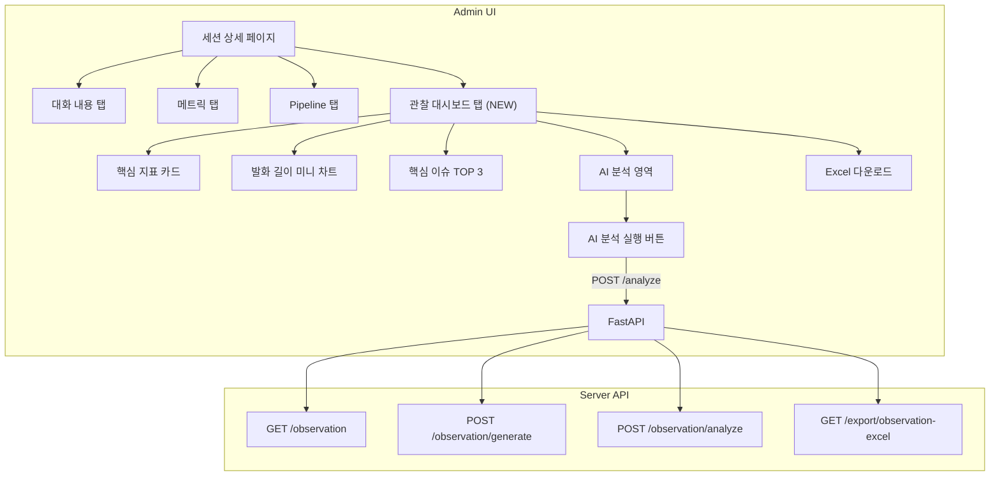

# Phase 4: Admin UI (관찰 대시보드 탭 + Excel Export)

---

## 명령 프롬프트 (이 텍스트를 Claude 세션에 복사하세요)

```
아래 기획서를 읽고 Phase 4를 구현해줘.
기획서 경로: docs/plan/session-observation-impl-phase4.md
개요 기획서 경로: docs/plan/session-observation-system.md (§5 Admin UI 변경 참고)

선행 조건 확인:
- Phase 1, 2, 3이 모두 완료되어야 함
- 서버 API 엔드포인트가 동작해야 함:
  - GET /sessions/{id}/observation
  - POST /sessions/{id}/observation/generate
  - POST /sessions/{id}/observation/analyze
  - GET /reporting-prompt (프롬프트 관리 — Phase 3에서 구현)
  - PUT /reporting-prompt

구현할 것:
1. Admin 프론트엔드 — 관찰 데이터 API 호출 함수 추가
2. Admin 프론트엔드 — 관찰 데이터 타입 정의 추가
3. Admin 프론트엔드 — 세션 상세 페이지에 "관찰 대시보드" 탭 추가
4. Admin 프론트엔드 — "AI 분석 실행" 버튼 + 로딩 UI
5. Admin 프론트엔드 — Reporting LLM 프롬프트 편집기 (AI 분석 설정 영역)
6. Admin 서버 — Excel Export API 엔드포인트 추가
7. Admin 프론트엔드 — Excel 다운로드 버튼
8. (선택) 세션 목록 페이지에 관찰 데이터 미리보기 컨럼 추가

주의사항:
- 프로젝트의 FSD (Feature-Sliced Design) 구조를 준수할 것
- shadcn/ui 컴포넌트 사용 (Card, Badge, Button, Tabs 등)
- TanStack Query 패턴 사용 (기존 useSessions, useSession 참고)
- 기존 탭(대화 내용, 메트릭, Pipeline)에 영향을 주지 말 것
- Reporting LLM 프롬프트 편집기는 Phase 3에서 구현한 API 엔드포인트 사용:
  - GET /api/v1/conversations/reporting-prompt (API 경로 확인 후 작성)
  - PUT /api/v1/conversations/reporting-prompt
  - GET /api/v1/conversations/reporting-prompt/default
  - GET /api/v1/conversations/reporting-prompt/history

관찰 대시보드 탭 구성:
- 핵심 지표 카드 (참여도, 상세도, 최고 레벨, 교정 횟수)
- 발화 길이 추이 미니 차트 (word_count_per_turn 시각화)
- 핵심 이슈 TOP 3 (primary_issues)
- AI 분석 영역 (Layer 3, 수동 트리거)
- Reporting LLM 프롬프트 편집기 (설정 카드)
- Excel 다운로드 버튼
```

---

## 목표

- 세션 상세 페이지에 **"관찰 대시보드" 탭** 추가
- Layer 1+2 자동 데이터를 카드형 UI로 시각화
- Layer 3 수동 트리거 ("AI 분석 실행" 버튼)
- Excel Export (다중 시트, 턴별 상세 포함)
- (선택) 세션 목록에 관찰 데이터 미리보기 컬럼



---

## 현재 코드베이스 컨텍스트 (이 Phase에서 참조하는 파일들)

### 핵심 파일 경로

| 파일 | 역할 | 수정/생성 |
|------|------|----------|
| `apps/admin/src/(fsd)/features/conversations/api/conversationsApi.ts` | API 클라이언트 | **수정** (observation 함수 추가) |
| `apps/admin/src/(fsd)/features/conversations/model/types.ts` | 타입 정의 | **수정** (observation 타입 추가) |
| `apps/admin/src/(fsd)/features/conversations/model/useSessions.ts` | TanStack Query 훅 | **수정** (observation 훅 추가) |
| `apps/admin/src/(fsd)/features/conversations/index.ts` | Barrel export | **수정** (새 export 추가) |
| `apps/admin/src/app/(dashboard)/conversations/sessions/[id]/page.tsx` | 세션 상세 페이지 | **수정** (탭 추가) |
| `apps/admin/src/(fsd)/features/conversations/ui/SessionList.tsx` | 세션 목록 | **(선택) 수정** |
| `apps/server/app/api/v1/conversations.py` | 서버 API | **수정** (Excel export 엔드포인트) |

### 현재 세션 상세 페이지 탭 구조

```tsx
// apps/admin/src/app/(dashboard)/conversations/sessions/[id]/page.tsx
<Tabs value={activeTab} onValueChange={setActiveTab}>
    <TabsList>
        <TabsTrigger value="conversation">대화 내용</TabsTrigger>
        <TabsTrigger value="metrics">메트릭</TabsTrigger>
        <TabsTrigger value="pipeline">
            <Zap className="h-3.5 w-3.5 mr-1" />
            Pipeline
        </TabsTrigger>
        {/* ← 여기에 "관찰 대시보드" 탭 추가 */}
    </TabsList>
    {/* ... */}
</Tabs>
```

### 현재 API 클라이언트 패턴

```typescript
// apps/admin/src/(fsd)/features/conversations/api/conversationsApi.ts
const CONVERSATIONS_BASE = '/api/v1/conversations';

// 예시: 세션 메트릭 조회
export const getSessionMetrics = async (sessionId: string): Promise<SessionMetrics> => {
    return api.get<SessionMetrics>(`${CONVERSATIONS_BASE}/sessions/${sessionId}/metrics`);
};

// 예시: Excel 다운로드 (Blob 처리)
export const exportSessions = async (sessionIds: string[]): Promise<void> => {
    const response = await fetch(`${API_BASE_URL}${CONVERSATIONS_BASE}/sessions/export`, {
        method: 'POST',
        headers: { 'Content-Type': 'application/json', 'ngrok-skip-browser-warning': 'true' },
        body: JSON.stringify(sessionIds),
    });
    // ... blob 다운로드 처리
};
```

### 현재 TanStack Query 훅 패턴

```typescript
// apps/admin/src/(fsd)/features/conversations/model/useSessions.ts
// 기존 패턴 확인 후 동일하게 추가
export const useSession = (id: string) => {
    return useQuery({
        queryKey: ['session', id],
        queryFn: () => getSession(id),
        enabled: !!id,
    });
};
```

### 현재 barrel export

```typescript
// apps/admin/src/(fsd)/features/conversations/index.ts
// 기존 export 목록 확인 후 새 함수/타입 추가
```

### shadcn/ui 사용 가능한 컴포넌트

```
apps/admin/src/shared/ui/
├── badge.tsx
├── button.tsx
├── card.tsx
├── tabs.tsx
└── ... (기타)
```

---

## Task 4-1: 타입 정의 추가

### 수정 파일: `apps/admin/src/(fsd)/features/conversations/model/types.ts`

**파일 하단에 추가:**

```typescript
// ============================================================================
// Session Observation
// ============================================================================

export interface ObservationLayer1 {
    session_duration_sec: number | null;
    total_user_turns: number;
    total_ai_turns: number;
    avg_user_utterance_length: number | null;
    max_user_utterance_length: number | null;
    min_user_utterance_length: number | null;
    utterance_length_trend: string | null;
    avg_user_response_interval_sec: number | null;
    short_reply_count: number;
    silence_timeout_count: number;
    first_user_response_time_sec: number | null;
    completion_status: string | null;
    word_count_per_turn: number[] | null;
    long_latency_turn_count: number;
    long_latency_turn_ratio: number | null;
    long_gap_count: number;
    followup_after_short_answer: number;
}

export interface ObservationLayer2 {
    avg_overall_score: number | null;
    score_trend: string | null;
    level_progression: number[] | null;
    max_level_reached: number | null;
    level_up_count: number;
    level_down_count: number;
    primary_issues: string[] | null;
    correction_count: number;
    fluency_wpm_trend: number[] | null;
    template_specific_data: Record<string, unknown> | null;
}

export interface ElaborationTurn {
    turn_index: number;
    question_weight: number;
    question_type: string;
    word_count: number;
    elaboration_score: number;
    judgment: string;
    feedback: string;
}

export interface ObservationLayer3 {
    learning_behavior_summary: string | null;
    engagement_level: string | null;
    key_learning_points: string[] | null;
    struggle_points: string[] | null;
    communication_style: string | null;
    topic_maintenance_score: number | null;
    question_back_count: number | null;
    natural_conversation_score: number | null;
    improvement_suggestions: string[] | null;
    elaboration_adequacy: {
        overall_score: number;
        trend: string;
        avg_utterance_length_feedback: string;
        evaluated_turns: ElaborationTurn[];
    } | null;
    explicit_clarification_analysis: {
        count: number;
        details: Array<{
            turn_index: number;
            expression: string;
            stt_original: string;
            type: string;
        }>;
    } | null;
    response_start_quality: string | null;
    response_start_quality_detail: Array<Record<string, unknown>> | null;
    flow_maintenance: string | null;
    flow_maintenance_detail: Array<Record<string, unknown>> | null;
    coping_attempt: {
        count: number;
        examples: Array<{
            turn_index: number;
            strategy: string;
            text: string;
        }>;
    } | null;
    clarification_success: {
        no_clarification: boolean;
        total: number;
        successful: number;
        failed: number;
        details: Array<Record<string, unknown>>;
    } | null;
    avoidance_vs_response: {
        avoidance_count: number;
        response_count: number;
        ratio: number;
        pattern: string;
    } | null;
}

export interface SessionObservation {
    id: string;
    session_id: string;
    account_id: string | null;
    layer1: ObservationLayer1;
    layer2: ObservationLayer2;
    layer3: ObservationLayer3;
    generated_at: string;
    reporting_llm_model: string | null;
    reporting_llm_duration_ms: number | null;
    has_layer3: boolean;
}
// ============================================================================
// Reporting LLM Prompt Setting
// ============================================================================

export interface ReportingPromptSetting {
    id: string | null;
    name: string;
    system_prompt: string | null;
    llm_model: string;
    temperature: string;
    is_active: boolean;
    is_default: boolean;
    created_at?: string | null;
    updated_at?: string | null;
}

export interface ReportingPromptHistoryItem {
    id: string;
    name: string;
    llm_model: string;
    temperature: string;
    is_active: boolean;
    created_at: string | null;
}
```

---

## Task 4-2: API 클라이언트 함수 추가

### 수정 파일: `apps/admin/src/(fsd)/features/conversations/api/conversationsApi.ts`

**import 섹션에 타입 추가:**

```typescript
import type {
    // ... 기존 import들 ...
    SessionObservation,
} from '../model/types';
```

**파일 하단 (기존 API 함수들 아래)에 추가:**

```typescript
// ============================================================================
// Session Observation API
// ============================================================================

/** Get session observation data (Layer 1+2+3) */
export const getSessionObservation = async (
    sessionId: string,
): Promise<SessionObservation> => {
    return api.get<SessionObservation>(
        `${CONVERSATIONS_BASE}/sessions/${sessionId}/observation`,
    );
};

/** Generate/regenerate observation data (Layer 1+2) */
export const generateSessionObservation = async (
    sessionId: string,
): Promise<SessionObservation> => {
    return api.post<SessionObservation>(
        `${CONVERSATIONS_BASE}/sessions/${sessionId}/observation/generate`,
        null,
    );
};

/** Run AI analysis (Layer 3) — manual trigger */
export const analyzeSessionObservation = async (
    sessionId: string,
): Promise<SessionObservation> => {
    return api.post<SessionObservation>(
        `${CONVERSATIONS_BASE}/sessions/${sessionId}/observation/analyze`,
        null,
    );
};

/** Download observation Excel export */
export const exportObservationExcel = async (
    sessionId: string,
): Promise<void> => {
    const response = await fetch(
        `${API_BASE_URL}${CONVERSATIONS_BASE}/sessions/${sessionId}/export/observation-excel`,
        {
            method: 'GET',
            headers: { 'ngrok-skip-browser-warning': 'true' },
        },
    );

    if (!response.ok) {
        throw new Error(`Export failed: ${response.status}`);
    }

    const blob = await response.blob();
    const url = window.URL.createObjectURL(blob);
    const a = document.createElement('a');
    a.href = url;
    a.download = `observation_${sessionId.slice(0, 8)}_${new Date().toISOString().slice(0, 10)}.xlsx`;
    document.body.appendChild(a);
    a.click();
    window.URL.revokeObjectURL(url);
    document.body.removeChild(a);
};

// ============================================================================
// Reporting LLM Prompt API
// ============================================================================

/** Get active reporting LLM prompt setting */
export const getReportingPrompt = async (): Promise<ReportingPromptSetting> => {
    return api.get<ReportingPromptSetting>(`${CONVERSATIONS_BASE}/reporting-prompt`);
};

/** Update reporting LLM prompt (creates new version) */
export const updateReportingPrompt = async (
    data: { name?: string; system_prompt: string; llm_model?: string; temperature?: string },
): Promise<{ id: string; name: string; message: string }> => {
    return api.put<{ id: string; name: string; message: string }>(
        `${CONVERSATIONS_BASE}/reporting-prompt`,
        data,
    );
};

/** Get default (code-embedded) reporting prompt text */
export const getDefaultReportingPrompt = async (): Promise<{
    system_prompt: string;
    llm_model: string;
    temperature: string;
}> => {
    return api.get(`${CONVERSATIONS_BASE}/reporting-prompt/default`);
};

/** Get reporting prompt version history */
export const getReportingPromptHistory = async (): Promise<{
    items: ReportingPromptHistoryItem[];
    total: number;
}> => {
    return api.get(`${CONVERSATIONS_BASE}/reporting-prompt/history`);
};
```

> [!TIP] import 타입 추가
> `conversationsApi.ts` 상단의 import에 `ReportingPromptSetting`, `ReportingPromptHistoryItem`도 추가하세요.

---

## Task 4-3: TanStack Query 훅 추가

### 수정 파일: `apps/admin/src/(fsd)/features/conversations/model/useSessions.ts`

**기존 import에 추가:**

```typescript
import {
    getSessionObservation,
    generateSessionObservation,
    analyzeSessionObservation,
} from '../api/conversationsApi';
```

**기존 훅들 아래에 추가:**

```typescript
/** 세션 관찰 데이터 조회 */
export const useSessionObservation = (sessionId: string) => {
    return useQuery({
        queryKey: ['session-observation', sessionId],
        queryFn: () => getSessionObservation(sessionId),
        enabled: !!sessionId,
        retry: false,  // 404는 정상 (아직 생성 안 됨)
    });
};

/** 관찰 데이터 수동 생성/재생성 (Layer 1+2) */
export const useGenerateObservation = () => {
    const queryClient = useQueryClient();
    return useMutation({
        mutationFn: (sessionId: string) => generateSessionObservation(sessionId),
        onSuccess: (_, sessionId) => {
            queryClient.invalidateQueries({ queryKey: ['session-observation', sessionId] });
        },
    });
};

/** AI 분석 실행 (Layer 3) */
export const useAnalyzeObservation = () => {
    const queryClient = useQueryClient();
    return useMutation({
        mutationFn: (sessionId: string) => analyzeSessionObservation(sessionId),
        onSuccess: (_, sessionId) => {
            queryClient.invalidateQueries({ queryKey: ['session-observation', sessionId] });
        },
    });
};

/** Reporting LLM 프롬프트 조회 */
export const useReportingPrompt = () => {
    return useQuery({
        queryKey: ['reporting-prompt'],
        queryFn: () => getReportingPrompt(),
    });
};

/** Reporting LLM 프롬프트 업데이트 */
export const useUpdateReportingPrompt = () => {
    const queryClient = useQueryClient();
    return useMutation({
        mutationFn: (data: { name?: string; system_prompt: string; llm_model?: string; temperature?: string }) =>
            updateReportingPrompt(data),
        onSuccess: () => {
            queryClient.invalidateQueries({ queryKey: ['reporting-prompt'] });
        },
    });
};
```

> [!WARNING] import 확인
> `useMutation`, `useQueryClient`가 이미 import 되어 있는지 확인하세요.
> 없다면 추가:
> ```typescript
> import { useQuery, useMutation, useQueryClient } from '@tanstack/react-query';
> ```

---

## Task 4-4: Barrel export 업데이트

### 수정 파일: `apps/admin/src/(fsd)/features/conversations/index.ts`

**새 export 추가:**

```typescript
// Observation API & Hooks
export {
    getSessionObservation,
    generateSessionObservation,
    analyzeSessionObservation,
    exportObservationExcel,
} from './api/conversationsApi';

export {
    useSessionObservation,
    useGenerateObservation,
    useAnalyzeObservation,
} from './model/useSessions';

// Observation Types
export type {
    SessionObservation,
    ObservationLayer1,
    ObservationLayer2,
    ObservationLayer3,
} from './model/types';

// Reporting LLM Prompt API & Hooks
export {
    getReportingPrompt,
    updateReportingPrompt,
    getDefaultReportingPrompt,
    getReportingPromptHistory,
} from './api/conversationsApi';

export {
    useReportingPrompt,
    useUpdateReportingPrompt,
} from './model/useSessions';

// Reporting LLM Prompt Types
export type {
    ReportingPromptSetting,
    ReportingPromptHistoryItem,
} from './model/types';
```

> [!TIP] 기존 index.ts 확인
> 현재 export 방식 (named export vs re-export)을 확인하고 동일한 패턴을 따르세요.

---

## Task 4-5: 세션 상세 페이지 — 관찰 대시보드 탭 추가

### 수정 파일: `apps/admin/src/app/(dashboard)/conversations/sessions/[id]/page.tsx`

#### 단계 1: 새 import 추가

```typescript
import { Eye, Download, Brain, TrendingUp, Award, AlertCircle } from 'lucide-react';
import {
    useSessionObservation,
    useAnalyzeObservation,
    exportObservationExcel,
} from '@/(fsd)/features/conversations';
import type { SessionObservation } from '@/(fsd)/features/conversations';
```

#### 단계 2: 컴포넌트 내부에 훅 추가

기존 `useSessionMetrics` 아래에:

```typescript
const { data: observation, isLoading: obsLoading, refetch: refetchObs } = useSessionObservation(id);
const analyzeObs = useAnalyzeObservation();
const [excelLoading, setExcelLoading] = useState(false);
```

#### 단계 3: TabsList에 새 탭 추가

기존 Pipeline TabsTrigger 아래에:

```tsx
<TabsTrigger value="observation">
    <Eye className="h-3.5 w-3.5 mr-1" />
    관찰 대시보드
</TabsTrigger>
```

#### 단계 4: TabsContent 추가

Pipeline TabsContent 아래에 전체 관찰 대시보드 탭을 추가합니다.

> [!IMPORTANT] 아래 코드가 길기 때문에 별도 컴포넌트로 분리하는 것을 권장합니다.
> 하지만 현재 세션 상세 페이지가 단일 파일(771줄)로 구성되어 있으므로,
> 기존 패턴을 따라 같은 파일에 추가해도 됩니다.
> 다만 코드 양이 많다면 `ObservationDashboard.tsx` 컴포넌트로 분리하세요.

```tsx
{/* Observation Dashboard Tab */}
<TabsContent value="observation" className="space-y-4">
    {obsLoading ? (
        <Card>
            <CardContent className="py-8 text-center animate-pulse">
                <div className="h-4 bg-muted rounded w-1/4 mx-auto" />
            </CardContent>
        </Card>
    ) : !observation ? (
        <Card>
            <CardContent className="py-8 text-center text-muted-foreground">
                <Eye className="h-8 w-8 mx-auto mb-2 opacity-30" />
                <p>관찰 데이터가 아직 생성되지 않았습니다</p>
                <p className="text-xs mt-1">
                    세션 완료 시 자동 생성되거나, 수동으로 생성할 수 있습니다
                </p>
            </CardContent>
        </Card>
    ) : (
        <>
            {/* ── 핵심 지표 카드 ── */}
            <div className="grid grid-cols-2 md:grid-cols-4 gap-4">
                {/* 참여도 */}
                <Card>
                    <CardContent className="py-4 text-center">
                        <div className="text-sm text-muted-foreground mb-1">참여도</div>
                        <div className="text-2xl font-bold">
                            {observation.has_layer3 && observation.layer3.engagement_level ? (
                                <Badge
                                    variant={
                                        observation.layer3.engagement_level === 'high' ? 'default'
                                        : observation.layer3.engagement_level === 'medium' ? 'secondary'
                                        : 'destructive'
                                    }
                                    className="text-lg px-3 py-1"
                                >
                                    {observation.layer3.engagement_level.toUpperCase()}
                                </Badge>
                            ) : (
                                <span className="text-muted-foreground text-base">-</span>
                            )}
                        </div>
                    </CardContent>
                </Card>

                {/* 상세도 점수 */}
                <Card>
                    <CardContent className="py-4 text-center">
                        <div className="text-sm text-muted-foreground mb-1">상세도</div>
                        <div className="text-2xl font-bold">
                            {observation.layer3.elaboration_adequacy?.overall_score ?? '-'}
                            {observation.layer3.elaboration_adequacy?.overall_score != null && (
                                <span className="text-sm font-normal text-muted-foreground">/100</span>
                            )}
                        </div>
                        {observation.layer3.elaboration_adequacy?.trend && (
                            <div className="text-xs mt-1">
                                {observation.layer3.elaboration_adequacy.trend === 'improving' && '⬆ 향상'}
                                {observation.layer3.elaboration_adequacy.trend === 'stable' && '➔ 안정'}
                                {observation.layer3.elaboration_adequacy.trend === 'declining' && '⬇ 하락'}
                            </div>
                        )}
                    </CardContent>
                </Card>

                {/* 최고 레벨 */}
                <Card>
                    <CardContent className="py-4 text-center">
                        <div className="text-sm text-muted-foreground mb-1">최고 레벨</div>
                        <div className="text-2xl font-bold">
                            {observation.layer2.max_level_reached != null
                                ? `Lv.${observation.layer2.max_level_reached}`
                                : '-'}
                        </div>
                        {observation.layer2.level_progression && observation.layer2.level_progression.length > 1 && (
                            <div className="text-xs mt-1 text-muted-foreground">
                                {observation.layer2.level_progression[0]} → {observation.layer2.level_progression[observation.layer2.level_progression.length - 1]}
                            </div>
                        )}
                    </CardContent>
                </Card>

                {/* 교정 횟수 */}
                <Card>
                    <CardContent className="py-4 text-center">
                        <div className="text-sm text-muted-foreground mb-1">교정 횟수</div>
                        <div className="text-2xl font-bold">
                            {observation.layer2.correction_count}
                            <span className="text-sm font-normal text-muted-foreground">회</span>
                        </div>
                    </CardContent>
                </Card>
            </div>

            {/* ── 발화 길이 추이 미니 차트 ── */}
            {observation.layer1.word_count_per_turn && observation.layer1.word_count_per_turn.length > 0 && (
                <Card>
                    <CardHeader className="py-3">
                        <CardTitle className="text-base flex items-center gap-2">
                            <TrendingUp className="h-4 w-4" />
                            발화 길이 추이
                            {observation.layer1.utterance_length_trend && (
                                <Badge variant="outline" className="text-xs">
                                    {observation.layer1.utterance_length_trend === 'improving' && '⬆ 향상'}
                                    {observation.layer1.utterance_length_trend === 'stable' && '➔ 안정'}
                                    {observation.layer1.utterance_length_trend === 'declining' && '⬇ 하락'}
                                    {observation.layer1.utterance_length_trend === 'insufficient_data' && '데이터 부족'}
                                </Badge>
                            )}
                        </CardTitle>
                    </CardHeader>
                    <CardContent className="py-2">
                        <div className="flex items-end gap-1 h-16">
                            {observation.layer1.word_count_per_turn.map((wc, idx) => {
                                const maxWc = Math.max(...(observation.layer1.word_count_per_turn || [1]));
                                const height = maxWc > 0 ? (wc / maxWc) * 100 : 0;
                                return (
                                    <div
                                        key={idx}
                                        className="flex-1 rounded-t transition-all"
                                        style={{
                                            height: `${Math.max(height, 4)}%`,
                                            backgroundColor: wc <= 3 ? 'hsl(var(--destructive))' : 'hsl(var(--primary))',
                                            opacity: 0.7 + (idx / (observation.layer1.word_count_per_turn!.length)) * 0.3,
                                        }}
                                        title={`Turn ${idx + 1}: ${wc} words`}
                                    />
                                );
                            })}
                        </div>
                        <div className="flex justify-between text-xs text-muted-foreground mt-1">
                            <span>평균: {observation.layer1.avg_user_utterance_length?.toFixed(1)} 단어</span>
                            <span>짧은 답변: {observation.layer1.short_reply_count}회</span>
                        </div>
                    </CardContent>
                </Card>
            )}

            {/* ── Layer 1+2 상세 메트릭 ── */}
            <div className="grid grid-cols-1 md:grid-cols-2 gap-4">
                {/* Layer 1 핵심 수치 */}
                <Card>
                    <CardHeader className="py-3">
                        <CardTitle className="text-base">📊 학습 행동 지표</CardTitle>
                    </CardHeader>
                    <CardContent className="space-y-2 text-sm">
                        <div className="flex justify-between">
                            <span className="text-muted-foreground">세션 시간</span>
                            <span className="font-medium">
                                {observation.layer1.session_duration_sec
                                    ? `${Math.round(observation.layer1.session_duration_sec / 60)}분 ${Math.round(observation.layer1.session_duration_sec % 60)}초`
                                    : '-'}
                            </span>
                        </div>
                        <div className="flex justify-between">
                            <span className="text-muted-foreground">사용자 턴 / AI 턴</span>
                            <span className="font-medium">
                                {observation.layer1.total_user_turns} / {observation.layer1.total_ai_turns}
                            </span>
                        </div>
                        <div className="flex justify-between">
                            <span className="text-muted-foreground">평균 응답 간격</span>
                            <span className="font-medium">
                                {observation.layer1.avg_user_response_interval_sec
                                    ? `${observation.layer1.avg_user_response_interval_sec.toFixed(1)}초`
                                    : '-'}
                            </span>
                        </div>
                        <div className="flex justify-between">
                            <span className="text-muted-foreground">첫 응답 시간</span>
                            <span className="font-medium">
                                {observation.layer1.first_user_response_time_sec
                                    ? `${observation.layer1.first_user_response_time_sec.toFixed(1)}초`
                                    : '-'}
                            </span>
                        </div>
                        <div className="flex justify-between">
                            <span className="text-muted-foreground">긴 간격 (>5초)</span>
                            <span className="font-medium">{observation.layer1.long_gap_count}회</span>
                        </div>
                        <div className="flex justify-between">
                            <span className="text-muted-foreground">완료 상태</span>
                            <Badge variant="outline" className="text-xs">
                                {observation.layer1.completion_status || '-'}
                            </Badge>
                        </div>
                    </CardContent>
                </Card>

                {/* 핵심 이슈 + Pipeline 지표 */}
                <Card>
                    <CardHeader className="py-3">
                        <CardTitle className="text-base flex items-center gap-2">
                            <AlertCircle className="h-4 w-4" />
                            Pipeline 분석 요약
                        </CardTitle>
                    </CardHeader>
                    <CardContent className="space-y-2 text-sm">
                        <div className="flex justify-between">
                            <span className="text-muted-foreground">평균 점수</span>
                            <span className="font-medium">
                                {observation.layer2.avg_overall_score?.toFixed(1) ?? '-'}
                                {observation.layer2.score_trend && (
                                    <span className="text-xs ml-1">
                                        ({observation.layer2.score_trend})
                                    </span>
                                )}
                            </span>
                        </div>
                        <div className="flex justify-between">
                            <span className="text-muted-foreground">레벨 업 / 다운</span>
                            <span className="font-medium">
                                ⬆{observation.layer2.level_up_count} / ⬇{observation.layer2.level_down_count}
                            </span>
                        </div>
                        {observation.layer2.primary_issues && observation.layer2.primary_issues.length > 0 && (
                            <div className="pt-2 border-t">
                                <div className="text-muted-foreground mb-1">핵심 이슈 TOP 3</div>
                                {observation.layer2.primary_issues.map((issue, idx) => (
                                    <div key={idx} className="flex items-center gap-2">
                                        <span className="text-muted-foreground">{idx + 1}.</span>
                                        <Badge variant="outline" className="text-xs">{issue}</Badge>
                                    </div>
                                ))}
                            </div>
                        )}
                    </CardContent>
                </Card>
            </div>

            {/* ── AI 분석 영역 (Layer 3) ── */}
            <Card>
                <CardHeader className="py-3">
                    <div className="flex items-center justify-between">
                        <CardTitle className="text-base flex items-center gap-2">
                            <Brain className="h-4 w-4" />
                            AI 분석 (Layer 3)
                        </CardTitle>
                        <div className="flex items-center gap-2">
                            {observation.reporting_llm_model && (
                                <span className="text-xs text-muted-foreground font-mono">
                                    {observation.reporting_llm_model}
                                    {observation.reporting_llm_duration_ms &&
                                        ` · ${(observation.reporting_llm_duration_ms / 1000).toFixed(1)}s`}
                                </span>
                            )}
                            <Button
                                size="sm"
                                onClick={() => analyzeObs.mutate(id)}
                                disabled={analyzeObs.isPending}
                            >
                                {analyzeObs.isPending ? (
                                    <>
                                        <span className="animate-spin mr-1">⏳</span>
                                        분석 중...
                                    </>
                                ) : observation.has_layer3 ? (
                                    '재분석'
                                ) : (
                                    'AI 분석 실행'
                                )}
                            </Button>
                        </div>
                    </div>
                </CardHeader>
                <CardContent>
                    {!observation.has_layer3 ? (
                        <div className="text-center text-muted-foreground py-6">
                            <Brain className="h-8 w-8 mx-auto mb-2 opacity-30" />
                            <p>"AI 분석 실행" 버튼을 눌러 학습 행동을 분석하세요</p>
                            <p className="text-xs mt-1">gemini-3.1-pro가 전체 대화를 분석합니다</p>
                        </div>
                    ) : (
                        <div className="space-y-4">
                            {/* 학습 행동 요약 */}
                            {observation.layer3.learning_behavior_summary && (
                                <div className="p-3 bg-muted rounded-lg">
                                    <div className="text-sm font-medium mb-1">📝 학습 행동 요약</div>
                                    <p className="text-sm">{observation.layer3.learning_behavior_summary}</p>
                                </div>
                            )}

                            {/* 핵심 포인트 / 어려움 */}
                            <div className="grid grid-cols-1 md:grid-cols-2 gap-3">
                                {observation.layer3.key_learning_points && observation.layer3.key_learning_points.length > 0 && (
                                    <div className="p-3 border rounded-lg">
                                        <div className="text-sm font-medium mb-1 text-green-700">✅ 핵심 학습 포인트</div>
                                        <ul className="text-sm space-y-1">
                                            {observation.layer3.key_learning_points.map((point, idx) => (
                                                <li key={idx} className="pl-2 border-l-2 border-green-300">{point}</li>
                                            ))}
                                        </ul>
                                    </div>
                                )}
                                {observation.layer3.struggle_points && observation.layer3.struggle_points.length > 0 && (
                                    <div className="p-3 border rounded-lg">
                                        <div className="text-sm font-medium mb-1 text-red-700">⚠️ 어려움 포인트</div>
                                        <ul className="text-sm space-y-1">
                                            {observation.layer3.struggle_points.map((point, idx) => (
                                                <li key={idx} className="pl-2 border-l-2 border-red-300">{point}</li>
                                            ))}
                                        </ul>
                                    </div>
                                )}
                            </div>

                            {/* 개선 제안 */}
                            {observation.layer3.improvement_suggestions && observation.layer3.improvement_suggestions.length > 0 && (
                                <div className="p-3 border rounded-lg">
                                    <div className="text-sm font-medium mb-1">💡 개선 제안</div>
                                    <ul className="text-sm space-y-1">
                                        {observation.layer3.improvement_suggestions.map((sug, idx) => (
                                            <li key={idx} className="pl-2 border-l-2 border-blue-300">{sug}</li>
                                        ))}
                                    </ul>
                                </div>
                            )}

                            {/* 상세 분석 — 아코디언 */}
                            <details className="border rounded-lg">
                                <summary className="p-3 cursor-pointer text-sm font-medium hover:bg-muted/50">
                                    📊 상세 분석 결과 보기
                                </summary>
                                <div className="p-3 pt-0 space-y-3 text-sm">
                                    {/* 대화 스타일 & 점수 */}
                                    <div className="grid grid-cols-3 gap-3">
                                        <div>
                                            <span className="text-muted-foreground">대화 스타일</span>
                                            <div className="font-medium">{observation.layer3.communication_style || '-'}</div>
                                        </div>
                                        <div>
                                            <span className="text-muted-foreground">주제 유지율</span>
                                            <div className="font-medium">{observation.layer3.topic_maintenance_score ?? '-'}</div>
                                        </div>
                                        <div>
                                            <span className="text-muted-foreground">자연스러움</span>
                                            <div className="font-medium">{observation.layer3.natural_conversation_score ?? '-'}</div>
                                        </div>
                                    </div>

                                    {/* 되묻기 / 대처 전략 */}
                                    <div className="grid grid-cols-2 gap-3">
                                        <div>
                                            <span className="text-muted-foreground">되묻기 횟수</span>
                                            <div className="font-medium">
                                                {observation.layer3.explicit_clarification_analysis?.count ?? 0}회
                                                {observation.layer3.clarification_success && !observation.layer3.clarification_success.no_clarification && (
                                                    <span className="text-xs ml-1">
                                                        (성공: {observation.layer3.clarification_success.successful}/{observation.layer3.clarification_success.total})
                                                    </span>
                                                )}
                                            </div>
                                        </div>
                                        <div>
                                            <span className="text-muted-foreground">대처 시도</span>
                                            <div className="font-medium">
                                                {observation.layer3.coping_attempt?.count ?? 0}회
                                            </div>
                                        </div>
                                    </div>

                                    {/* 회피 vs 대응 */}
                                    {observation.layer3.avoidance_vs_response && (
                                        <div>
                                            <span className="text-muted-foreground">회피 vs 대응</span>
                                            <div className="font-medium">
                                                회피 {observation.layer3.avoidance_vs_response.avoidance_count} / 대응 {observation.layer3.avoidance_vs_response.response_count}
                                                <Badge variant="outline" className="text-xs ml-2">
                                                    {observation.layer3.avoidance_vs_response.pattern}
                                                </Badge>
                                            </div>
                                        </div>
                                    )}

                                    {/* 반응 시작 품질 / 흐름 유지 */}
                                    <div className="grid grid-cols-2 gap-3">
                                        <div>
                                            <span className="text-muted-foreground">반응 시작 품질</span>
                                            <div className="font-medium">
                                                {observation.layer3.response_start_quality || '-'}
                                            </div>
                                        </div>
                                        <div>
                                            <span className="text-muted-foreground">흐름 유지</span>
                                            <div className="font-medium">
                                                {observation.layer3.flow_maintenance || '-'}
                                            </div>
                                        </div>
                                    </div>
                                </div>
                            </details>
                        </div>
                    )}
                </CardContent>
            </Card>

            {/* ── Excel 다운로드 ── */}
            <Card>
                <CardContent className="py-3">
                    <div className="flex items-center justify-between">
                        <div className="text-sm text-muted-foreground">
                            전체 관찰 데이터 + 턴별 상세를 Excel로 내보냅니다
                        </div>
                        <Button
                            variant="outline"
                            size="sm"
                            onClick={async () => {
                                setExcelLoading(true);
                                try {
                                    await exportObservationExcel(id);
                                } catch (e) {
                                    console.error('Excel export failed:', e);
                                } finally {
                                    setExcelLoading(false);
                                }
                            }}
                            disabled={excelLoading}
                        >
                            <Download className="h-4 w-4 mr-1" />
                            {excelLoading ? '다운로드 중...' : 'Excel 다운로드'}
                        </Button>
                    </div>
                </CardContent>
            </Card>
        </>
    )}
</TabsContent>
```

---

## Task 4-6: Excel Export API (서버)

### 수정 파일: `apps/server/app/api/v1/conversations.py`

**추가할 import**:
```python
from fastapi.responses import StreamingResponse
import io
import openpyxl
from openpyxl.styles import Font, PatternFill, Alignment
```

**추가할 엔드포인트**:

```python
@router.get("/sessions/{session_id}/export/observation-excel")
async def export_observation_excel(
    session_id: UUID,
    db: DbSession,
):
    """관찰 데이터를 Excel로 내보내기 (다중 시트)."""
    from app.services.conversation.observation_service import ObservationService

    obs_service = ObservationService(db)
    obs = await obs_service.get_observation(session_id)
    if not obs:
        raise HTTPException(status_code=404, detail="Observation not found")

    # 턴 데이터 조회
    turns_result = await db.execute(
        select(ConversationTurn)
        .where(ConversationTurn.session_id == session_id)
        .order_by(ConversationTurn.turn_index)
    )
    turns = list(turns_result.scalars().all())

    # Pipeline 로그 조회
    pipeline_result = await db.execute(
        select(PipelineLog)
        .where(PipelineLog.session_id == session_id)
        .order_by(PipelineLog.turn_index)
    )
    pipeline_logs = list(pipeline_result.scalars().all())

    # Excel 생성
    wb = openpyxl.Workbook()

    # 시트 1: 개요
    ws_overview = wb.active
    ws_overview.title = "개요"
    _write_overview_sheet(ws_overview, obs)

    # 시트 2: 턴별 상세
    ws_turns = wb.create_sheet("턴별 상세")
    _write_turns_sheet(ws_turns, turns, pipeline_logs, obs)

    # 시트 3: AI 분석 보고서 (Layer 3)
    if obs.learning_behavior_summary:
        ws_analysis = wb.create_sheet("AI 분석 보고서")
        _write_analysis_sheet(ws_analysis, obs)

    # 바이트 스트림으로 저장
    output = io.BytesIO()
    wb.save(output)
    output.seek(0)

    filename = f"observation_{str(session_id)[:8]}_{obs.generated_at.strftime('%Y%m%d') if obs.generated_at else 'unknown'}.xlsx"

    return StreamingResponse(
        output,
        media_type="application/vnd.openxmlformats-officedocument.spreadsheetml.sheet",
        headers={"Content-Disposition": f'attachment; filename="{filename}"'},
    )


def _write_overview_sheet(ws, obs) -> None:
    """개요 시트 — Layer 1+2 전체 메트릭."""
    header_font = Font(bold=True, size=11)
    header_fill = PatternFill(start_color="E2EFDA", end_color="E2EFDA", fill_type="solid")

    # Layer 1
    ws.append(["=== Layer 1: Rule-Based 메트릭 ==="])
    ws.cell(row=ws.max_row, column=1).font = Font(bold=True, size=12)

    metrics_l1 = [
        ("세션 시간 (초)", obs.session_duration_sec),
        ("총 사용자 턴", obs.total_user_turns),
        ("총 AI 턴", obs.total_ai_turns),
        ("평균 발화 길이 (단어)", obs.avg_user_utterance_length),
        ("최대 발화 길이", obs.max_user_utterance_length),
        ("최소 발화 길이", obs.min_user_utterance_length),
        ("발화 길이 추이", obs.utterance_length_trend),
        ("평균 응답 간격 (초)", obs.avg_user_response_interval_sec),
        ("짧은 답변 수 (≤3단어)", obs.short_reply_count),
        ("침묵 타임아웃 수", obs.silence_timeout_count),
        ("첫 응답 시간 (초)", obs.first_user_response_time_sec),
        ("완료 상태", obs.completion_status),
        ("높은 레이턴시 턴 수", obs.long_latency_turn_count),
        ("높은 레이턴시 비율", obs.long_latency_turn_ratio),
        ("긴 간격 수 (>5초)", obs.long_gap_count),
        ("짧은 답변 후 개선 횟수", obs.followup_after_short_answer),
    ]
    for label, value in metrics_l1:
        ws.append([label, value])

    ws.append([])  # 빈 행

    # Layer 2
    ws.append(["=== Layer 2: Pipeline 집계 ==="])
    ws.cell(row=ws.max_row, column=1).font = Font(bold=True, size=12)

    metrics_l2 = [
        ("평균 Overall Score", obs.avg_overall_score),
        ("점수 추이", obs.score_trend),
        ("최고 도달 레벨", obs.max_level_reached),
        ("레벨 업 횟수", obs.level_up_count),
        ("레벨 다운 횟수", obs.level_down_count),
        ("교정 횟수", obs.correction_count),
        ("핵심 이슈 TOP 3", ", ".join(obs.primary_issues) if obs.primary_issues else None),
    ]
    for label, value in metrics_l2:
        ws.append([label, value])

    # 컬럼 너비 조정
    ws.column_dimensions["A"].width = 30
    ws.column_dimensions["B"].width = 25


def _write_turns_sheet(ws, turns, pipeline_logs, obs) -> None:
    """턴별 상세 시트."""
    headers = [
        "턴#", "유형", "화자", "발화 내용", "단어 수", "응답 간격(초)",
        "E2E(ms)", "Evaluator 점수", "주요 이슈", "레벨", "Path",
        "교정", "더 나은 표현",
    ]

    # 헤더 작성
    ws.append(headers)
    header_fill = PatternFill(start_color="4472C4", end_color="4472C4", fill_type="solid")
    header_font = Font(bold=True, color="FFFFFF")
    for col in range(1, len(headers) + 1):
        cell = ws.cell(row=1, column=col)
        cell.fill = header_fill
        cell.font = header_font
        cell.alignment = Alignment(horizontal="center")

    # Pipeline 로그를 turn_index로 인덱싱
    eval_by_turn = {}
    plan_by_turn = {}
    cond_by_turn = {}
    for log in pipeline_logs:
        if not log.output_json:
            continue
        if log.module_name == "evaluator":
            eval_by_turn[log.turn_index] = log.output_json
        elif log.module_name == "planner":
            plan_by_turn[log.turn_index] = log.output_json
        elif log.module_name == "conductor":
            cond_by_turn[log.turn_index] = log.output_json

    for t in turns:
        word_count = len(t.content_text.split()) if t.content_text else 0
        response_interval = None
        if t.t_first_speech and t.t_recording_start and t.t_first_speech >= t.t_recording_start:
            response_interval = round((t.t_first_speech - t.t_recording_start) / 1000.0, 2)

        e2e_ms = None
        if t.t0_user_end and t.t3_audio_play_start:
            e2e_ms = round(t.t3_audio_play_start - t.t0_user_end, 0)

        # Pipeline 데이터
        eval_data = eval_by_turn.get(t.turn_index, {})
        plan_data = plan_by_turn.get(t.turn_index, {})
        cond_data = cond_by_turn.get(t.turn_index, {})

        eval_score = eval_data.get("aggregate", {}).get("overall_score") if isinstance(eval_data, dict) else None
        primary_issue = eval_data.get("diagnosis", {}).get("primary_issue") if isinstance(eval_data, dict) else None
        level = plan_data.get("persona_plan", {}).get("current_level") if isinstance(plan_data, dict) else None
        path = plan_data.get("decision", {}).get("path") if isinstance(plan_data, dict) else None
        corrections = ", ".join(cond_data.get("corrections", [])) if isinstance(cond_data, dict) else None
        better_expr = ", ".join(cond_data.get("better_expressions", [])) if isinstance(cond_data, dict) else None

        turn_type_str = t.turn_type.value if hasattr(t.turn_type, "value") else str(t.turn_type)

        ws.append([
            t.turn_index,
            turn_type_str,
            t.speaker_name or "",
            t.content_text or "",
            word_count if turn_type_str == "user" else None,
            response_interval,
            e2e_ms,
            eval_score,
            primary_issue,
            level,
            path,
            corrections,
            better_expr,
        ])

    # 컬럼 너비 조정
    widths = [6, 10, 12, 50, 8, 12, 10, 12, 18, 8, 14, 30, 30]
    for i, w in enumerate(widths, 1):
        ws.column_dimensions[openpyxl.utils.get_column_letter(i)].width = w


def _write_analysis_sheet(ws, obs) -> None:
    """AI 분석 보고서 시트 (Layer 3)."""
    header_font = Font(bold=True, size=11)

    sections = [
        ("학습 행동 요약", obs.learning_behavior_summary),
        ("참여도", obs.engagement_level),
        ("대화 스타일", obs.communication_style),
        ("주제 유지율", obs.topic_maintenance_score),
        ("자연스러움 점수", obs.natural_conversation_score),
        ("되묻기 횟수", obs.question_back_count),
        ("반응 시작 품질", obs.response_start_quality),
        ("흐름 유지", obs.flow_maintenance),
    ]

    for label, value in sections:
        ws.append([label, str(value) if value is not None else "-"])
        ws.cell(row=ws.max_row, column=1).font = header_font

    ws.append([])

    # 핵심 학습 포인트
    if obs.key_learning_points:
        ws.append(["=== 핵심 학습 포인트 ==="])
        ws.cell(row=ws.max_row, column=1).font = Font(bold=True, size=12)
        for point in obs.key_learning_points:
            ws.append(["•", point])

    ws.append([])

    # 어려움 포인트
    if obs.struggle_points:
        ws.append(["=== 어려움 포인트 ==="])
        ws.cell(row=ws.max_row, column=1).font = Font(bold=True, size=12)
        for point in obs.struggle_points:
            ws.append(["•", point])

    ws.append([])

    # 개선 제안
    if obs.improvement_suggestions:
        ws.append(["=== 개선 제안 ==="])
        ws.cell(row=ws.max_row, column=1).font = Font(bold=True, size=12)
        for sug in obs.improvement_suggestions:
            ws.append(["•", sug])

    ws.append([])

    # Elaboration Adequacy 상세
    if obs.elaboration_adequacy and isinstance(obs.elaboration_adequacy, dict):
        ws.append(["=== 상세도 적정성 분석 ==="])
        ws.cell(row=ws.max_row, column=1).font = Font(bold=True, size=12)
        ws.append(["전체 점수", obs.elaboration_adequacy.get("overall_score")])
        ws.append(["추이", obs.elaboration_adequacy.get("trend")])
        ws.append([])
        if obs.elaboration_adequacy.get("evaluated_turns"):
            ws.append(["턴#", "질문 유형", "가중치", "단어 수", "점수", "판정", "피드백"])
            for et in obs.elaboration_adequacy["evaluated_turns"]:
                if isinstance(et, dict):
                    ws.append([
                        et.get("turn_index"),
                        et.get("question_type"),
                        et.get("question_weight"),
                        et.get("word_count"),
                        et.get("elaboration_score"),
                        et.get("judgment"),
                        et.get("feedback"),
                    ])

    # 컬럼 너비 조정
    ws.column_dimensions["A"].width = 25
    ws.column_dimensions["B"].width = 60
```

> [!WARNING] import 확인
> `conversations.py` 파일 상단에 아래 import가 이미 있는지 확인하세요:
> ```python
> from app.models.conversation import ConversationTurn
> from app.models.pipeline_log import PipelineLog
> ```
> 없다면 추가하세요. `PipelineLog`는 별도 파일(`pipeline_log.py`)에 정의되어 있습니다.

---

## Task 4-7: Reporting LLM 프롬프트 편집기 UI

### 설계 의도

관찰 대시보드 탭 내 AI 분석 영역 아래에 프롬프트 편집 섹션을 추가합니다.

- **접기/펼치기**: 기본적으로 접혀있고, "프롬프트 설정" 버튼을 클릭하면 열림
- **현재 프롬프트 표시**: 현재 활성 프롬프트 이름 + 모델 + 기본값 여부
- **편집기**: textarea + 모델/temperature 설정
- **기본값 리셋**: 코드 내장 기본 프롬프트로 되돌리기
- **저장**: PUT API 호출로 새 버전 생성

### 세션 상세 페이지에 추가할 훅

```typescript
import {
    useReportingPrompt,
    useUpdateReportingPrompt,
    getDefaultReportingPrompt,
} from '@/(fsd)/features/conversations';
```

컴포넌트 내부:

```typescript
const { data: reportingPrompt, isLoading: promptLoading } = useReportingPrompt();
const updatePrompt = useUpdateReportingPrompt();
const [promptEditorOpen, setPromptEditorOpen] = useState(false);
const [editedPrompt, setEditedPrompt] = useState('');
const [editedModel, setEditedModel] = useState('gemini-3.1-pro');
const [editedTemperature, setEditedTemperature] = useState('0.3');
const [editedName, setEditedName] = useState('');
```

### UI 코드 (관찰 대시보드 탭 내 Excel 다운로드 카드 위에 배치)

```tsx
{/* ── Reporting LLM 프롬프트 설정 ── */}
<Card>
    <CardHeader className="py-3">
        <div className="flex items-center justify-between">
            <CardTitle className="text-base flex items-center gap-2">
                ⚙️ Reporting LLM 프롬프트 설정
            </CardTitle>
            <div className="flex items-center gap-2">
                {!promptLoading && reportingPrompt && (
                    <span className="text-xs text-muted-foreground">
                        {reportingPrompt.is_default
                            ? '기본 프롬프트 (코드 내장)'
                            : `${reportingPrompt.name} · ${reportingPrompt.llm_model}`}
                    </span>
                )}
                <Button
                    variant="outline"
                    size="sm"
                    onClick={() => {
                        setPromptEditorOpen(!promptEditorOpen);
                        if (!promptEditorOpen && reportingPrompt) {
                            // 편집기 열 때 현재 값 로드
                            if (reportingPrompt.system_prompt) {
                                setEditedPrompt(reportingPrompt.system_prompt);
                            } else {
                                // 기본값 로드
                                getDefaultReportingPrompt().then((d) => {
                                    setEditedPrompt(d.system_prompt);
                                });
                            }
                            setEditedModel(reportingPrompt.llm_model);
                            setEditedTemperature(reportingPrompt.temperature);
                            setEditedName(reportingPrompt.is_default
                                ? 'v1 사용자 정의'
                                : reportingPrompt.name);
                        }
                    }}
                >
                    {promptEditorOpen ? '닫기' : '프롬프트 설정'}
                </Button>
            </div>
        </div>
    </CardHeader>
    {promptEditorOpen && (
        <CardContent className="space-y-3">
            {/* 프롬프트 이름 */}
            <div>
                <label className="text-xs font-medium text-muted-foreground">프롬프트 이름</label>
                <input
                    type="text"
                    className="w-full border rounded px-2 py-1 text-sm mt-1"
                    value={editedName}
                    onChange={(e) => setEditedName(e.target.value)}
                    placeholder="예: v2 상세 분석"
                />
            </div>

            {/* 모델 + Temperature */}
            <div className="grid grid-cols-2 gap-3">
                <div>
                    <label className="text-xs font-medium text-muted-foreground">LLM 모델</label>
                    <input
                        type="text"
                        className="w-full border rounded px-2 py-1 text-sm mt-1 font-mono"
                        value={editedModel}
                        onChange={(e) => setEditedModel(e.target.value)}
                    />
                </div>
                <div>
                    <label className="text-xs font-medium text-muted-foreground">Temperature</label>
                    <input
                        type="text"
                        className="w-full border rounded px-2 py-1 text-sm mt-1 font-mono"
                        value={editedTemperature}
                        onChange={(e) => setEditedTemperature(e.target.value)}
                    />
                </div>
            </div>

            {/* 시스템 프롬프트 */}
            <div>
                <label className="text-xs font-medium text-muted-foreground">시스템 프롬프트</label>
                <textarea
                    className="w-full border rounded px-2 py-1 text-xs font-mono mt-1"
                    rows={15}
                    value={editedPrompt}
                    onChange={(e) => setEditedPrompt(e.target.value)}
                />
            </div>

            {/* 버튼들 */}
            <div className="flex items-center gap-2">
                <Button
                    size="sm"
                    onClick={() => {
                        updatePrompt.mutate(
                            {
                                name: editedName,
                                system_prompt: editedPrompt,
                                llm_model: editedModel,
                                temperature: editedTemperature,
                            },
                            {
                                onSuccess: () => setPromptEditorOpen(false),
                            }
                        );
                    }}
                    disabled={updatePrompt.isPending || !editedPrompt.trim()}
                >
                    {updatePrompt.isPending ? '저장 중...' : '저장'}
                </Button>
                <Button
                    variant="outline"
                    size="sm"
                    onClick={async () => {
                        const defaults = await getDefaultReportingPrompt();
                        setEditedPrompt(defaults.system_prompt);
                        setEditedModel(defaults.llm_model);
                        setEditedTemperature(defaults.temperature);
                    }}
                >
                    기본값으로 리셋
                </Button>
            </div>
        </CardContent>
    )}
</Card>
```

---

## 검증 방법

### 1. 관찰 대시보드 탭 확인

```bash
# Admin 앱 시작
cd apps/admin && npm run dev

# 브라우저에서 세션 상세 페이지 접속
# http://localhost:3000/conversations/sessions/{session_id}

# 확인할 것:
# - "관찰 대시보드" 탭이 표시됨
# - 탭 클릭 시 핵심 지표 카드가 표시됨
# - 발화 길이 미니 차트가 표시됨
# - "AI 분석 실행" 버튼이 표시됨
```

### 2. AI 분석 실행 버튼

```
# "AI 분석 실행" 버튼 클릭
# - 로딩 상태 표시 (⏳ 분석 중...)
# - 완료 후 Layer 3 결과가 표시됨
# - 버튼이 "재분석"으로 변경됨
```

### 3. Reporting LLM 프롬프트 편집기

```
# "프롬프트 설정" 버튼 클릭
# - 편집기가 열림 (textarea + 모델/temperature 설정)
# - 현재 프롬프트가 로드됨 (첫 실행 시 기본값)
# - 프롬프트 수정 후 "저장" 클릭 → 성공 메시지
# - "기본값으로 리셋" 클릭 → 코드 내장 기본 프롬프트 로드
# - 저장 후 "AI 분석 실행" → 수정된 프롬프트로 분석 수행됨
```

### 4. Excel 다운로드

```
# "Excel 다운로드" 버튼 클릭
# - xlsx 파일 다운로드됨
# - 파일에 3개 시트: 개요, 턴별 상세, AI 분석 보고서 (Layer 3가 있는 경우)
# - 턴별 상세에 Pipeline 데이터가 포함됨
```

### 5. 기존 탭에 영향 없음

```
# "대화 내용", "메트릭", "Pipeline" 탭이 기존과 동일하게 동작
```

---

## 완료 체크리스트

### 관찰 대시보드 UI
- [ ] 관찰 데이터 타입 정의 (`types.ts`) 추가
- [ ] API 클라이언트 함수 (`conversationsApi.ts`) 추가 (관찰 + 프롬프트)
- [ ] TanStack Query 훅 (`useSessions.ts`) 추가 (관찰 + 프롬프트)
- [ ] Barrel export (`index.ts`) 업데이트
- [ ] 세션 상세 페이지에 "관찰 대시보드" 탭 추가
- [ ] 핵심 지표 카드 (참여도, 상세도, 최고 레벨, 교정 횟수) 표시
- [ ] 발화 길이 추이 미니 차트 (word_count_per_turn) 시각화
- [ ] Layer 1+2 상세 메트릭 표시
- [ ] "AI 분석 실행" 버튼 동작 (로딩 + 결과 표시)
- [ ] Layer 3 결과 아코디언 표시

### Reporting LLM 프롬프트 편집기
- [ ] 프롬프트 편집기 UI (접기/펼치기, textarea, 저장/리셋)
- [ ] 현재 활성 프롬프트 및 모델 표시
- [ ] 프롬프트 수정 + 저장 동작
- [ ] 저장 후 분석 실행 시 수정된 프롬프트 반영 확인
- [ ] "기본값으로 리셋" 동작

### Excel + 기타
- [ ] Excel Export API 엔드포인트 동작
- [ ] Excel 다운로드 버튼 동작
- [ ] 기존 3개 탭에 영향 없음
