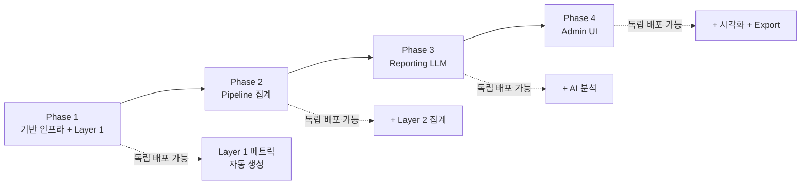

# 세션 관찰 데이터 시스템 — 구현 상세 기획서

## 개요

[[session-observation-system]] (개요 기획서 v2)을 **AI 에이전트가 독립적으로 실행할 수 있는 수준**으로 상세화한 구현 명세입니다.

> [!IMPORTANT] 핵심 원칙
> 1. **템플릿 비종속**: 특정 템플릿(EMF 등)에 종속되지 않음. 모든 My Turn 템플릿에 공통 적용
> 2. **Phase별 독립 배포**: 각 Phase만 배포해도 동작 — Phase 1만으로도 Layer 1 데이터 생성 가능
> 3. **기존 코드 비파괴**: 새 테이블/서비스/탭 추가 방식 — 기존 동작 변경 없음

## Phase 구성

| Phase | 파일 | 내용 | 선행 조건 |
|-------|------|------|----------|
| **Phase 1** | [[session-observation-impl-phase1]] | DB 스키마 + ObservationService (Layer 1) + API | 없음 |
| **Phase 2** | [[session-observation-impl-phase2]] | ObservationService Layer 2 (Pipeline 로그 집계) | Phase 1 |
| **Phase 3** | [[session-observation-impl-phase3]] | ReportingLLMService (Layer 3) + 프롬프트 DB 관리 + 수동 트리거 API | Phase 1+2 |
| **Phase 4** | [[session-observation-impl-phase4]] | Admin UI (관찰 대시보드 탭 + 프롬프트 편집기 + Excel Export) | Phase 1+2+3 |



## 사용 방법

각 Phase 문서의 상단에 **명령 프롬프트**가 있습니다. 해당 프롬프트를 Claude Sonnet 세션에 복사하여 실행하면 됩니다.

> [!TIP] 실행 순서
> 1. Phase 1 문서의 명령 프롬프트를 복사하여 새 Claude 세션에서 실행
> 2. Phase 1 완료 확인 (검증 방법은 문서 하단 참조)
> 3. Phase 2 문서의 명령 프롬프트를 복사하여 새 Claude 세션에서 실행
> 4. 반복...

## 공통 참조: 현재 코드베이스 핵심 구조

> [!NOTE] 아래 정보는 각 Phase 문서에도 필요한 부분만 중복 포함되어 있습니다.

### 서버 디렉토리 구조

```
apps/server/
├── app/
│   ├── main.py
│   ├── api/
│   │   ├── deps.py                    # DbSession, CurrentAccount 등 의존성
│   │   └── v1/
│   │       ├── router.py              # 서브라우터 통합
│   │       └── conversations.py       # 대화 관련 모든 엔드포인트
│   ├── models/
│   │   ├── __init__.py                # 모든 모델 import
│   │   ├── base.py                    # Base(DeclarativeBase)
│   │   └── conversation.py            # Session, Turn, Template, Metrics, PipelineLog
│   ├── schemas/
│   │   ├── conversation.py            # Pydantic 스키마
│   │   └── pipeline_schemas.py        # EvaluatorOutput, PlannerOutput, ConductorOutput
│   └── services/conversation/
│       ├── session_service.py         # 세션 CRUD
│       ├── my_turn_service.py         # My Turn 오케스트레이션 (1400줄+)
│       ├── observation_service.py     # ← Phase 1에서 신규 생성
│       └── reporting_llm_service.py   # ← Phase 3에서 신규 생성
├── migrations/versions/               # Alembic 마이그레이션
└── pyproject.toml                     # openpyxl, pandas 이미 포함
```

### Admin 디렉토리 구조

```
apps/admin/src/
├── app/(dashboard)/conversations/sessions/
│   ├── page.tsx                       # 세션 목록 페이지
│   └── [id]/page.tsx                  # 세션 상세 페이지 (탭: 대화내용/메트릭/Pipeline)
└── (fsd)/
    ├── features/conversations/
    │   ├── api/conversationsApi.ts     # API 클라이언트
    │   ├── model/
    │   │   ├── types.ts               # 타입 정의
    │   │   └── useSessions.ts         # TanStack Query 훅
    │   ├── ui/
    │   │   └── SessionList.tsx        # 세션 목록 테이블
    │   └── index.ts                   # Barrel export
    └── shared/
        ├── ui/                        # shadcn/ui 컴포넌트
        └── lib/api.ts                 # HTTP 클라이언트 (api.get/post/patch)
```

### 최신 마이그레이션 정보

- **최신 revision**: `q2r3s4t5u6v7` (add_energy_flow_enabled, 2026-03-28)
- **down_revision**: `78914c0eaf57`
