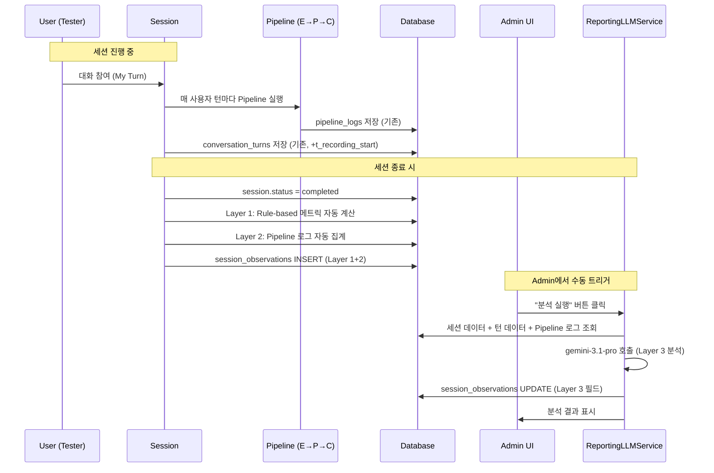

# 세션 관찰 데이터 시스템 — 구현 기획서 v2

> **목적**: 테스트 유저의 My Turn 세션 데이터를 체계적으로 관찰·기록·분석하기 위한 데이터 생성 파이프라인 설계
> **대상**: 모든 My Turn 템플릿 (EMF Reverse Learning, 카페 주문 등)에 공통 적용

---

## 1. 현재 시스템 분석

### 1.1 기존 데이터 소스

| 소스 | 테이블/모델 | 현재 저장 항목 | 비고 |
|------|------------|--------------|------|
| **Session** | `conversation_sessions` | status, started_at, ended_at, user_name, variant, experiment_type, device_type | account_id **미연결** |
| **Turn** | `conversation_turns` | turn_type, speaker_name, content_text, t0~t3 타이밍, input/output_tokens, wer/cer | 사용자 발화 원문 + AI 응답 저장 |
| **PipelineLog** | `pipeline_logs` | module_name, input_json, output_json, duration_ms, prompt_used | Evaluator/Planner/Conductor 실행 로그 |
| **SessionMetrics** | `session_metrics` | e2e/asr/llm/tts latency 집계, 토큰 사용량, wer/cer 평균 | 세션 종료 시 자동 계산 |
| **Account** | `accounts` | email, name, role (admin/tester) | 세션과 **직접 연결 없음** |

### 1.2 핵심 갭 분석

```
현재 시스템이 기록하는 것:
✅ 시간/레이턴시 메트릭 (t0~t3)
✅ 대화 내용 (content_text)
✅ Pipeline LLM 판단 결과 (score, level, path)
✅ 토큰 사용량

현재 시스템이 기록하지 않는 것:
❌ 로그인한 유저의 계정 정보 (account_id)
❌ 학습 행동 지표 (발화 길이 추이, 응답 간격, 되묻기 빈도 등)
❌ Pipeline LLM의 교육적 판단 요약 (overall 학습 진행도)
❌ 대화 품질 분석 (자연스러움, 주제 유지율, 회피 패턴 등)
```

---

## 2. 데이터 분류 및 생성 전략

> [!IMPORTANT]
> 모든 관찰 데이터는 **생성 방식**에 따라 4개 레이어로 분류됩니다. 각 레이어는 독립적으로 구현 가능하며 점진적으로 추가합니다.

### Layer 1 — Rule-Based 자동 집계 (코드 로직)

기존 턴 로그의 `content_text`, `t0~t3`, `turn_type` 등을 집계하여 **코드만으로** 생성 가능한 메트릭.

| # | 메트릭 | 계산 방식 | 비고 |
|---|--------|----------|------|
| 1 | `session_duration_sec` | `ended_at - started_at` | |
| 2 | `total_user_turns` | `COUNT(turn_type='user')` | |
| 3 | `total_ai_turns` | `COUNT(turn_type IN ('ai','moderator'))` | |
| 4 | `avg_user_utterance_length` | `AVG(word_count(content_text))` — **단어 수 기준** | |
| 5 | `max_user_utterance_length` | `MAX(word_count(content_text))` | |
| 6 | `min_user_utterance_length` | `MIN(word_count(content_text))` | |
| 7 | `utterance_length_trend` | 처음 3턴 vs 마지막 3턴 평균 비교 → `improving` / `stable` / `declining` | |
| 8 | `avg_user_response_interval_sec` | 사용자 턴 간 시간 간격 평균. **기준점: 해당 사용자 턴에서 자동 녹음 시작된 시점** → 사용자 발화의 t0까지 시간. [§2.1 참조](#21-응답-간격-측정-기준점-분석) | |
| 9 | `short_reply_count` | 단어 수 ≤ 3인 사용자 턴 수 (초벌 필터, 최종 판정은 Layer 3) | |
| 10 | `silence_timeout_count` | timeout(5초 묵음)으로 자동 종료된 녹음 횟수 | |
| 11 | `first_user_response_time_sec` | 세션 시작 후 **첫 사용자 턴에서 자동 녹음 시작 시점 → 사용자 첫 단어가 감지된 시점**까지 시간. [§2.2 참조](#22-first_user_response_time_sec-측정-가능성-분석) | |
| 12 | `word_count_per_turn` | 각 사용자 턴의 단어 수 배열 `[5, 8, 12, 3, ...]` | JSONB |
| 13 | `completion_status` | `completed` / `timeout` / `error` / `user_exit` | |
| 14 | `long_latency_turn_count` | E2E 레이턴시 **5초 초과**인 턴의 **갯수** | |
| 15 | `long_latency_turn_ratio` | `long_latency_turn_count / total_user_turns` | |
| 16 | `long_gap_count` | 사용자 응답 간격이 **5초 초과**인 턴 수. 모든 사용자 턴 대상. 기준: 자동 녹음 시작 → t0(발화 시작) | |
| 17 | `followup_after_short_answer` | 짧은 답변(≤3단어) 직후, 다음 사용자 턴의 단어 수가 증가한 횟수 | |

> [!NOTE]
> - `avg_user_utterance_length` 기준: **영어 단어(word) 갯수** (공백 split)
> - `long_latency_turn_count`는 기존 `MeasurementConfig.e2e_max_ms`(5000ms) 기준과 동일
> - `long_gap_count` 임계값: **5초** (세션 시작 후 모든 사용자 턴에 대해 측정)

---

### 2.1 응답 간격 측정 기준점 분석

> [!IMPORTANT]
> **핵심 문제: 현재 시스템에 "사용자가 말을 시작한 시점"이 존재하지 않음**

**현재 존재하는 타임스탬프:**

| 타임스탬프 | 의미 | 위치 | 서버 전송 |
|-----------|------|------|----------|
| `startTimeRef.current` | 녹음 시작 시점 (마이크 on) | 클라이언트 `useVoiceRecorder` L272 | ❌ 미전송 |
| `t0_user_end` | **녹음 종료 시점** (마이크 off) | 클라이언트 → 서버 전송 | ✅ |
| (존재하지 않음) | **사용자 첫 단어 발화 시점** | — | ❌ |

**문제**: `t0_user_end`는 사용자가 말을 **끝낸** 시점이지, **시작한** 시점이 아님.
`t0_user_end - t_recording_start`는 "녹음 총 시간"이지 "사용자가 말하기까지 걸린 시간"이 아님.

**응답 간격에 실제로 필요한 측정:**
```
AI 턴 종료 → 사용자 턴 전환 → 자동 녹음 시작 → [사용자 침묵/주저] → 실제 첫 발화
              |                    |                                        |
              |                    t_recording_start                        t_first_speech
              |
              t3_audio_play_start (이전 AI 턴의 TTS 재생 시작)
```

**측정해야 할 3개 타임스탬프 (모두 클라이언트 시계):**

| 신규 필드 | 의미 | 구현 방법 |
|----------|------|----------|
| `t_recording_start` | 자동 녹음 시작 시점 | `useVoiceRecorder`의 `startTimeRef.current`를 `RecordingResult`에 포함 |
| `t_first_speech` | **사용자가 실제 말을 시작한 시점** | VAD 첫 감지: `hasSpokenRef`가 `true`로 변하는 순간의 `Date.now()` 기록 |
| `t0_user_end` | 녹음 종료 시점 (기존) | 변경 없음 |

**이 3개로 계산 가능한 메트릭:**
```
응답 간격 = t_first_speech - t_recording_start
  → 녹음이 시작된 후 실제 말하기까지 주저/생각한 시간
  → avg_user_response_interval_sec, long_gap_count, first_user_response_time_sec 의 기준

발화 길이(시간) = t0_user_end - t_first_speech
  → 실제 말한 시간

대기 시간(녹음 전) = t_recording_start - 이전 AI t3_audio_play_start
  → 시스템 턴 전환 지연 (auto-record 300ms 포함, 오염 요소이므로 별도 기록)
```

**구현 시 이슈:**
1. **서버/클라이언트 시간 차이**: 3개 모두 클라이언트 `Date.now()` 기준이므로 **차분값 계산에는 문제 없음** ✅
2. **VAD 정확도**: 환경 소음이 `vadSilenceThreshold(0.05)`를 넘으면 false positive 가능. 하지만 첫 발화 시점 근사치로는 충분
3. **필요 변경**:
   - `RecordingResult`에 `recordingStartTime`, `firstSpeechTime` 추가
   - `useVoiceRecorder`에서 `hasSpokenRef` 첫 `true` 시점을 별도 ref에 기록 (`firstSpeechTimeRef`)
   - API에 `t_recording_start`, `t_first_speech` 파라미터 추가
   - `conversation_turns`에 해당 컬럼 추가

---

### 2.2 `first_user_response_time_sec` — VAD vs STT Interim 측정 방식 비교

> [!IMPORTANT]
> **결론: VAD가 Primary, STT Interim은 보조 참고용으로만 기록**

#### STT Interim의 동작 원리 (코드 기반 분석)

STT interim 결과는 **서버 측**에서 측정·감지되는 값입니다:

```
[클라이언트]                    [서버: streaming_stt_service.py]
오디오 청크 전송 ──WebSocket──→ Google Speech V2 gRPC 스트리밍
                               ├─ 오디오 청크 feed
                               ├─ 첫 interim 결과 도착 → ttfr_ms 기록 ←── 이 시점
                               └─ WebSocket으로 클라이언트에 전달
                  ←──결과 수신── 클라이언트 화면에 텍스트 표시
```

**`ttfr_ms` 측정 코드** (`streaming_stt_service.py` L203-204):
```python
if self._ttfr_ms is None:
    self._ttfr_ms = int((now - self._start_time) * 1000)
```
→ `_start_time`(스트리밍 세션 시작) → 첫 interim 결과가 서버에 도착한 시점까지의 시간

#### 모델별 속도 차이 원인

| 모델 | 리전 | 특성 | interim 속도 |
|------|------|------|-------------|
| `chirp_3` | `us` | 대형 모델, 높은 정확도 | **느림** — 모델 처리 시간이 길어 첫 interim까지 수 초 소요 |
| `short` (chirp) | `us-central1` | 경량 모델, 실시간 최적화 | **빠름** — 거의 즉시 interim 결과 반환 |

chirp_3에서 화면 텍스트 출력이 느린 이유: 모델이 충분한 오디오 컨텍스트를 수집한 후에야 첫 번째 interim 결과를 반환하기 때문입니다. 이는 모델 아키텍처 차이이며, 네트워크 지연과는 별개입니다.

#### Primary/Secondary 결정 근거

| 비교 항목 | VAD (`t_first_speech`) | STT Interim (`ttfr_ms`) |
|----------|----------------------|------------------------|
| 감지 위치 | **클라이언트** (즉시) | 서버 (네트워크 + 모델 처리 지연 포함) |
| 지연 요소 | VAD 알고리즘 처리만 (ms 단위) | 네트워크 업로드 + 모델 추론 + 네트워크 다운로드 |
| 모델 의존성 | ❌ 없음 | ✅ chirp_3는 수 초, short는 수백 ms |
| "사용자가 말하기 시작한 시점" 정확도 | **높음** (음성 에너지 직접 감지) | 낮음 (처리 후 결과이므로 실제 발화보다 항상 늦음) |
| 환경 소음 영향 | 있음 (false positive 가능) | 적음 (모델이 음성/비음성 구분) |

**결론:**
- **Primary**: `t_first_speech` (VAD, 클라이언트) — 사용자 발화 시작의 가장 정확한 근사치
- **Secondary**: `t_first_stt_interim` (STT, 서버) — 보조 검증용으로 병행 기록하되, 모델에 따라 값이 크게 달라지므로 지표 계산에는 사용하지 않음
- `first_user_response_time_sec` = 첫 번째 사용자 턴의 `t_first_speech - t_recording_start`

---

### 2.3 In-Speech Pause 분석 가능성 (R&D)

> [!WARNING]
> **보류 — R&D 필요 항목**
>
> **목표**: 사용자 발화 중 pause를 natural pause (의미 단위 구분, 쉼표/문장 전환) vs unnatural pause (단어 탐색, 주저, 막힘)로 구분
>
> **기술 스택 검토:**
> - **PyKaldi**: Forced Alignment 가능, pause 위치 + 길이 추출 가능. 단 설치 복잡(Kaldi 종속성)
> - **Wav2Vec2 + CTC alignment**: HuggingFace `torchaudio.functional.forced_align` 사용 가능. 워드 레벨 타임스탬프 추출 → pause 자동 감지
> - **Google STT word_time_offsets**: 현재 STT에서 word-level timestamp 활성화 가능 (`enable_word_time_offsets=True`)
>
> **Natural vs Unnatural 구분 기준 (연구 필요):**
> - Natural pause: 200-500ms, 절/문장 경계에 위치
> - Unnatural pause: 500ms+, 문장 중간(단어 탐색), 같은 단어 반복 후 발생
>
> **현재 단계**: 스키마에 `in_speech_pause_data` JSONB 필드만 예약. Phase 5+ 에서 R&D 진행.

---

### 2.4 Elaboration Adequacy (상세도 적정성) 측정 설계

> [!IMPORTANT]
> 기존 `short_reply_ratio`(짧은 답변의 비율)는 **기계적 수치**로, 질문의 성격을 고려하지 않습니다.
> "Yes/No 질문에 Yes로 답한 것"과 "경험을 묻는 질문에 한 단어로 답한 것"은 본질적으로 다릅니다.
> **Elaboration Adequacy**는 질문 맥락 대비 답변의 적절성을 LLM이 질적으로 판단하는 지표입니다.

#### 지표 명칭

| 영문 | 한국어 | 설명 |
|------|--------|------|
| **Elaboration Adequacy** (채택) | 상세도 적정성 | 질문이 요구하는 정보를 얼마나 충분히 채웠는지 + 과잉 여부까지 판단 |
| Response Completeness | 답변 충실도 | 질문이 요구하는 정보를 얼마나 채웠는지 |
| Expansion Score | 상세 전개 지수 | 단답에 그치지 않고 내용을 얼마나 확장했는지 |

#### LLM 판단 프로세스

```
Step 1: 질문 가중치(Question Weight) 산출 — 1~5점
  ┌──────────────────────────────────────────────────────────────────┐
  │ 질문 유형 (LLM 분류)         기대 답변 (Weight)                    │
  │ ─────────────────────────    ─────────────────                    │
  │ 단순 확인형 (Do you...?)     1~2문장 (Low, 1-2)                   │
  │ 묘사/설명형 (Describe...)    3~5문장 (Mid, 3)                     │
  │ 경험/계기형 (Tell me about)  5문장 이상 (High, 4-5)               │
  └──────────────────────────────────────────────────────────────────┘

Step 2: 답변 풍부도(Answer Richness) 분석
  - 문장 구조 (단문 vs 복문)
  - 연결어/접속사 사용 여부 (and, because, but, so...)
  - 구체적 정보 포함 여부 (이름, 장소, 시간, 이유 등)
  - 의미 단위 chunk 수

Step 3: 최종 지표 계산
  Elaboration Score = (실제 풍부도 / 질문 가중치) × 100
```

#### 구체적인 판단 기준 예시

| 질문 유형 (LLM 분류) | 기대 답변 (Weight) | 사용자 답변 예시 | 지표 결과 (예시) |
|---------------------|-------------------|----------------|----------------|
| 단순 확인형 (Do you...?) | 1~2문장 (Low) | "Yes, I love it." | 적절 (High) |
| 묘사/설명형 (Describe.../What...?) | 3~5문장 (Mid) | "It's a big park." | 부족 (Low) |
| 경험/계기형 (Why.../Tell me about...?) | 5문장 이상 (High) | "Because it's fun." | 매우 부족 (Warning) |

#### 리포팅 방식 (3단계 피드백)

| 판정 | 라벨 | 사용자 피드백 예시 |
|------|------|-----------------|
| 과소 (Under-elaborated) | 🔴 부족 | "질문에 비해 답변이 너무 짧아요. 이유를 한 문장만 더 붙여보세요." |
| 적정 (Well-balanced) | 🟢 적절 | "질문의 의도에 맞게 풍부하게 답변하셨습니다." |
| 과잉 (Over-elaborated) | 🟡 과잉 | "답변이 너무 길어질 수 있으니 핵심 위주로 정리해 보세요." (시험 대비 시) |

#### 핵심: 세션 내 개선 추이 (Trend)

> [!IMPORTANT]
> '짧은 답변의 비율'보다 **짧은 답변이 대화 진행 속에서 얼마나 나아지고 있는지** 정량적 판단이 중요합니다.

```
세션 전반부 (턴 1-5):  Under-elaborated 3회 → 평균 Score 40
세션 후반부 (턴 6-10): Under-elaborated 1회 → 평균 Score 72
→ Trend: "improving" (+32점, 80% 감소)
```

LLM 출력에 `trend` 필드를 포함하여 세션 내 개선 여부를 정량적으로 추적합니다:
- `improving`: 후반부 점수가 전반부보다 20%+ 향상
- `stable`: 변화폭 ±20% 이내
- `declining`: 후반부 점수가 전반부보다 20%+ 하락

#### 기존 `short_reply_ratio`와의 관계

| 항목 | 기존 `short_reply_ratio` | 신규 `elaboration_adequacy` |
|------|------------------------|--------------------------|
| Layer | Layer 3 | Layer 3 (동일) |
| 판단 방식 | 3단어 이하 초벌 필터 + LLM 맥락 확인 | 질문 가중치 × 답변 풍부도 = 정량 점수 |
| 출력 | `{ratio, evaluated_turns[]}` | `{overall_score, trend, evaluated_turns[]}` |
| 핵심 차이 | "짧은 답변이 몇 %인가" (비율) | "질문 대비 적절했나 + 개선되고 있나" (질적 평가 + 추이) |

→ `short_reply_ratio`를 **`elaboration_adequacy`로 명칭 변경** 및 확장. Layer 1의 `short_reply_count`(초벌 필터)는 참고용으로 유지.

---

### Layer 2 — Pipeline LLM 집계 (Evaluator/Planner/Conductor 출력 활용)

> [!NOTE]
> 이 항목들은 **참고자료에 있던 것이 아니라**, 기존 pipeline_logs의 `output_json`에 실제로 저장되는 데이터를 세션 종료 후 집계하여 관찰용으로 재구성한 것입니다. 
> 스키마 출처: `pipeline_schemas.py`의 `EvaluatorOutput`, `PlannerOutput`, `ConductorOutput`

기존 Pipeline 실행 시 이미 생성되는 LLM 출력(`output_json`)을 **세션 종료 후 집계**하여 관찰 데이터로 변환.

| # | 메트릭 | 소스 (실제 필드 경로) | 계산 방식 |
|---|--------|------|----------|
| 1 | `avg_overall_score` | Evaluator `output_json.aggregate.overall_score` (0-100) | `AVG` over all evaluator logs |
| 2 | `score_trend` | Evaluator `aggregate.overall_score` per turn | 처음 3턴 vs 마지막 3턴 비교 |
| 3 | `level_progression` | Planner `output_json.persona_plan.current_level` | `[1, 1, 2, 2, 3, ...]` 배열 |
| 4 | `max_level_reached` | Planner `persona_plan.current_level` | `MAX` |
| 5 | `level_down_count` | Planner `output_json.decision.path` | `COUNT(path='LEVEL_DOWN')` |
| 6 | `level_up_count` | Planner `decision.path` | `COUNT(path='LEVEL_UP')` |
| 7 | `primary_issues` | Evaluator `output_json.diagnosis.primary_issue` | 빈도 TOP 3 |
| 8 | `correction_count` | Conductor `output_json.corrections[]` | 총 교정 횟수 |
| 9 | `fluency_wpm_trend` | Evaluator `output_json.fluency.words_per_minute` | WPM 추이 배열 |
| 10 | `energy_direction_errors` | Planner custom_state (EMF 전용) | template_specific_data에 저장 |
| 11 | `verbs_mastered` | Planner custom_state (EMF 전용) | template_specific_data에 저장 |

---

### Layer 3 — Reporting LLM (신규 서비스)

세션 종료 후, Admin 세션 상세 페이지에서 **수동 트리거 버튼**을 눌러 Reporting LLM을 실행합니다.
모델: **`gemini-3.1-pro`**

이 항목들은 단순 키워드 매칭이나 수치 계산으로는 판단할 수 없고, **대화 맥락(context)을 이해해야** 정확한 분석이 가능합니다.

| # | 분석 항목 | 설명 | 출력 형식 |
|---|----------|------|----------|
| 1 | `learning_behavior_summary` | 전체 학습 행동 요약 | 한국어 2-3문장 |
| 2 | `engagement_level` | 참여도 (발화 길이/간격/되묻기 패턴 종합) | `high` / `medium` / `low` |
| 3 | `key_learning_points` | 핵심 학습 포인트 | 문자열 배열 (최대 5개) |
| 4 | `struggle_points` | 어려움을 겪은 포인트 | 문자열 배열 (최대 3개) |
| 5 | `communication_style` | 대화 스타일 | `reactive` / `proactive` / `balanced` |
| 6 | `topic_maintenance_score` | 주제 유지율 | 0-100 |
| 7 | `question_back_count` | 의미론적 되묻기 횟수 | 정수 |
| 8 | `natural_conversation_score` | 대화 자연스러움 | 0-100 |
| 9 | `improvement_suggestions` | 개선 제안 | 한국어 문자열 배열 |
| 10 | `elaboration_adequacy` | **상세도 적정성 (Elaboration Adequacy)**: 질문 맥락 대비 답변의 충실도를 LLM이 질적으로 평가. 기존 `short_reply_ratio`(기계적 비율)를 대체. [§2.4 참조](#24-elaboration-adequacy-상세도-적정성-측정-설계) | JSONB: `{overall_score, trend, evaluated_turns[]}` |
| 11 | `explicit_clarification_count` | **LLM 기반 되묻기 분석**: "what?", "sorry?", "come again?", "pardon?", "huh?", "could you repeat", "what do you mean", "I don't understand", "excuse me?" 등 다양한 되묻기 표현 + STT 변환 오차 고려한 유사 표현까지 포함 | 정수 + 상세 배열 |
| 12 | `response_start_quality` | 반응 시작의 질: 첫 1-2단어 분석 | `good` / `fair` / `poor` + 턴별 상세 |
| 13 | `flow_maintenance` | 이어 말하기/흐름 유지 분석 | `strong` / `moderate` / `weak` + 상세 |
| 14 | `coping_attempt` | 회피 대신 대응 시도 감지 | JSONB: `{count, examples[]}` |
| 15 | `clarification_success` | **되묻기 성공 여부**: ① 되묻기 없음 → N/A, ② 되묻기 있음 → AI 재설명 후 학생이 이해하여 적절히 응답했는지 / 여전히 이해 못했는지 판단 | JSONB: `{no_clarification, total, successful, failed, details[]}` |
| 16 | `avoidance_vs_response` | 어려운 상황에서 회피 vs 대응 비율 | JSONB: `{avoidance_count, response_count, ratio, pattern}` |

> [!TIP]
> **Layer 1 → Layer 3 이동 사유:**
> - `short_reply_ratio`: 단순 3단어 기준이 아니라 **질문 맥락 대비** 적절한 길이인지 판단 필요
> - `explicit_clarification_count`: STT 변환 오차로 정규식 매칭이 불완전 → LLM이 맥락으로 판단
> - `clarification_success`: 되묻기 후 **실제 이해 여부**는 맥락 분석 필요

> [!WARNING]
> **보류 항목** (현재 로그로는 신뢰성 있는 판단이 어려움):
> - 심리 상태 분석 (긴장/자신감 등) → 음성 프로소디 분석 필요
> - 실전 전이 가능성 → 다수 세션 종단 분석 필요
> - 인과 효과 → 실험 설계(A/B) 필요
> - In-Speech Pause (natural vs unnatural) → §2.3 R&D 필요

---

### Layer 4 — 수동 태깅 (향후)

관찰자가 세션 기록 페이지에서 직접 입력하는 정성적 데이터. 현 단계에서는 **스키마만 준비**합니다.

| # | 필드 | 입력 방식 |
|---|------|----------|
| 1 | `observer_notes` | 자유 텍스트 |
| 2 | `pronunciation_quality` | 1-5 점수 |
| 3 | `confidence_level` | 1-5 점수 |
| 4 | `custom_tags` | 태그 배열 (예: `["hesitant", "creative", "repetitive"]`) |

---

## 3. 데이터 스키마 설계

### 3.1 `session_observation` 테이블 (신규)

```python
class SessionObservation(Base):
    """세션 레벨 관찰 데이터. 세션 종료 후 + Admin 수동 트리거로 생성."""
    __tablename__ = "session_observations"
    
    id = Column(UUID, primary_key=True, default=uuid4)
    session_id = Column(UUID, ForeignKey("conversation_sessions.id"), unique=True)
    account_id = Column(UUID, ForeignKey("accounts.id"), nullable=True)
    
    # ── Layer 1: Rule-based 메트릭 ──
    session_duration_sec = Column(Float, nullable=True)
    total_user_turns = Column(Integer, default=0)
    total_ai_turns = Column(Integer, default=0)
    avg_user_utterance_length = Column(Float, nullable=True)  # 단어 수 기준
    max_user_utterance_length = Column(Integer, nullable=True)
    min_user_utterance_length = Column(Integer, nullable=True)
    utterance_length_trend = Column(String(20), nullable=True)
    avg_user_response_interval_sec = Column(Float, nullable=True)
    short_reply_count = Column(Integer, default=0)  # 초벌 필터 (단어수 ≤ 3)
    silence_timeout_count = Column(Integer, default=0)
    first_user_response_time_sec = Column(Float, nullable=True)  # 첫 턴의 t_first_speech - t_recording_start
    completion_status = Column(String(20), nullable=True)
    word_count_per_turn = Column(JSONB, nullable=True)
    long_latency_turn_count = Column(Integer, default=0)  # E2E > 5초 턴 갯수
    long_latency_turn_ratio = Column(Float, nullable=True)  # count / total_user_turns
    long_gap_count = Column(Integer, default=0)  # 응답 간격 > 5초
    followup_after_short_answer = Column(Integer, default=0)
    in_speech_pause_data = Column(JSONB, nullable=True)  # R&D 예약 필드
    
    # ── Layer 2: Pipeline LLM 집계 ──
    avg_overall_score = Column(Float, nullable=True)
    score_trend = Column(String(20), nullable=True)
    level_progression = Column(JSONB, nullable=True)
    max_level_reached = Column(Integer, nullable=True)
    level_up_count = Column(Integer, default=0)
    level_down_count = Column(Integer, default=0)
    primary_issues = Column(JSONB, nullable=True)
    correction_count = Column(Integer, default=0)
    fluency_wpm_trend = Column(JSONB, nullable=True)
    template_specific_data = Column(JSONB, nullable=True)  # EMF: {verbs_mastered, energy_errors}
    
    # ── Layer 3: Reporting LLM 분석 ──
    learning_behavior_summary = Column(Text, nullable=True)
    engagement_level = Column(String(20), nullable=True)
    key_learning_points = Column(JSONB, nullable=True)
    struggle_points = Column(JSONB, nullable=True)
    communication_style = Column(String(20), nullable=True)
    topic_maintenance_score = Column(Float, nullable=True)
    question_back_count = Column(Integer, nullable=True)
    natural_conversation_score = Column(Float, nullable=True)
    improvement_suggestions = Column(JSONB, nullable=True)
    elaboration_adequacy = Column(JSONB, nullable=True)  # LLM 기반 상세도 적정성 {overall_score, trend, evaluated_turns[]}
    explicit_clarification_analysis = Column(JSONB, nullable=True)  # LLM 기반 {count, details[]}
    response_start_quality = Column(String(20), nullable=True)
    response_start_quality_detail = Column(JSONB, nullable=True)
    flow_maintenance = Column(String(20), nullable=True)
    flow_maintenance_detail = Column(JSONB, nullable=True)
    coping_attempt = Column(JSONB, nullable=True)
    clarification_success = Column(JSONB, nullable=True)  # {no_clarification, total, successful, failed, details[]}
    avoidance_vs_response = Column(JSONB, nullable=True)
    
    # ── Layer 4: 수동 태깅 (향후) ──
    observer_notes = Column(Text, nullable=True)
    pronunciation_quality = Column(Integer, nullable=True)
    confidence_level = Column(Integer, nullable=True)
    custom_tags = Column(JSONB, nullable=True)
    
    # ── 메타 ──
    generated_at = Column(DateTime, default=datetime.utcnow)
    reporting_llm_model = Column(String(100), nullable=True)
    reporting_llm_duration_ms = Column(Float, nullable=True)
    
    # Relationships
    session = relationship("ConversationSession")
    account = relationship("Account")
```

### 3.2 `conversation_sessions` 테이블 변경

```diff
 class ConversationSession(Base):
     ...
+    account_id = Column(UUID, ForeignKey("accounts.id"), nullable=True)
+    account = relationship("Account")
```

### 3.3 `conversation_turns` 테이블 변경

```diff
 class ConversationTurn(Base):
     ...
+    t_recording_start = Column(Float, nullable=True)  # 클라이언트 녹음 시작 시점 (ms)
+    t_first_speech = Column(Float, nullable=True)      # 클라이언트 첫 발화 감지 시점 (ms, VAD 기반)
```

> [!IMPORTANT]
> - `t_recording_start`: 자동 녹음이 시작된 시점 (마이크 on)
> - `t_first_speech`: VAD가 첫 음성을 감지한 시점 (사용자가 실제 말을 시작한 시점)
> - `t0_user_end` (기존): 녹음이 종료된 시점 (마이크 off)
> - **응답 간격** = `t_first_speech - t_recording_start` (주저/생각 시간)

---

## 4. 서비스 아키텍처

### 4.1 데이터 생성 플로우



### 4.2 신규 서비스: `ObservationService`

```
apps/server/app/services/conversation/observation_service.py
```

**책임:**
- **세션 종료 시 자동**: Layer 1 + Layer 2 계산 및 저장
- **Admin 수동 트리거 시**: Layer 3 (ReportingLLMService) 호출 후 결과 저장

### 4.3 신규 서비스: `ReportingLLMService`

```
apps/server/app/services/conversation/reporting_llm_service.py
```

**책임:**
- Layer 3 전담: 전체 대화 컨텍스트를 LLM에 전달
- 구조화된 JSON 출력
- 모델: **`gemini-3.1-pro`**
- 실행 방식: **Admin 세션 상세 페이지에서 수동 트리거 버튼**으로만 실행

#### 4.3.1 Reporting LLM Input Data 사용처 매핑

> [!IMPORTANT]
> 각 Input 변수가 어떤 Output 필드에서 사용되는지, 수집 출처는 어디인지를 명시합니다.
> **미사용/간접 사용 항목**은 프롬프트 토큰 최적화 대상으로 표기합니다.

**Session Metadata:**

| Input 변수 | 수집 출처 | 사용하는 Output 필드 | 비고 |
|-----------|----------|-------------------|----|
| `template_name` | `conversation_sessions.variant` | `learning_behavior_summary` (맥락) | 템플릿별 기대 행동 판단용 |
| `session_duration_sec` | Layer 1 자동 계산 (`ended_at - started_at`) | `engagement_level`, `learning_behavior_summary` | 짧은 세션=조기 이탈 판단 |
| `user_name` | `conversation_sessions.user_name` | `learning_behavior_summary` (호칭용) | |
| `account_email` | `accounts.email` | ❌ **미사용** — 제거 대상 | 분석에 불필요, 개인정보 최소화 |
| `device_type` | `conversation_sessions.device_type` | ❌ **미사용** — 제거 대상 | LLM 학습 행동 분석과 무관 |
| `completion_status` | Layer 1 자동 계산 | `engagement_level`, `learning_behavior_summary` | timeout/user_exit=참여도 하락 근거 |

**Layer 1 Metrics:**

| Input 변수 | 수집 출처 | 사용하는 Output 필드 | 비고 |
|-----------|----------|-------------------|----|
| `total_user_turns` | `COUNT(turn_type='user')` from `conversation_turns` | `engagement_level`, `communication_style` | 발화 빈도 |
| `total_ai_turns` | `COUNT(turn_type IN ('ai','moderator'))` from `conversation_turns` | `communication_style` (user/ai 비율) | |
| `avg_user_utterance_length` | `AVG(word_count(content_text))` from `conversation_turns` | `elaboration_adequacy` (참고), `improvement_suggestions` | 비교 데이터 제공 가능: "평균 문장 길이 4.2단어, 상위 사용자 평균 8.5단어" |
| `utterance_length_trend` | 처음 3턴 vs 마지막 3턴 평균 비교 | `elaboration_adequacy.trend` (검증용), `learning_behavior_summary` | |
| `avg_user_response_interval_sec` | `AVG(t_first_speech - t_recording_start)` from `conversation_turns` | `engagement_level` | 긴 간격=주저/사고 시간 |
| `short_reply_count` | `COUNT(word_count ≤ 3)` from `conversation_turns` | `elaboration_adequacy` (초벌 필터 참고) | LLM이 맥락 재평가 |
| `first_user_response_time_sec` | 첫 턴의 `t_first_speech - t_recording_start` | `engagement_level`, `learning_behavior_summary` | 초기 긴장도 지표 |
| `word_count_per_turn` | 각 턴의 `word_count(content_text)` 배열 | `elaboration_adequacy` (턴별 분석 필수) | **핵심 입력** |
| `long_latency_turn_count` | E2E > 5초 턴 수 from `session_metrics` | ⚠️ **간접 사용** — 시스템 지연이므로 학습 행동과 무관 | 제거 검토. 필요시 `improvement_suggestions`에서 "시스템 응답이 느린 구간이 있었습니다" 정도 |
| `long_latency_turn_ratio` | `long_latency_turn_count / total_user_turns` | ⚠️ **간접 사용** — `long_latency_turn_count`와 동일 | 제거 검토 |
| `long_gap_count` | 응답 간격 > 5초 턴 수 | `engagement_level`, `struggle_points` | 사용자 측 주저 |
| `followup_after_short_answer` | 짧은 답변 직후 단어 수 증가 횟수 | `elaboration_adequacy.trend` (개선 근거) | |

**Layer 2 Metrics:**

| Input 변수 | 수집 출처 | 사용하는 Output 필드 | 비고 |
|-----------|----------|-------------------|----|
| `avg_overall_score` | `AVG(evaluator.aggregate.overall_score)` from `pipeline_logs` | `learning_behavior_summary`, `key_learning_points` | 전체 수준 맥락 |
| `score_trend` | 처음 3턴 vs 마지막 3턴 evaluator score 비교 | `learning_behavior_summary`, `improvement_suggestions` | 향상/하락 근거 |
| `level_progression` | `planner.persona_plan.current_level` 추이 배열 from `pipeline_logs` | `learning_behavior_summary`, `key_learning_points` | 난이도 적응 추이 |
| `max_level_reached` | `MAX(persona_plan.current_level)` | `key_learning_points` | 도달 수준 |
| `level_up_count` | `COUNT(decision.path='LEVEL_UP')` from `pipeline_logs` | `learning_behavior_summary` | |
| `level_down_count` | `COUNT(decision.path='LEVEL_DOWN')` from `pipeline_logs` | `struggle_points` | 레벨 다운=어려움 근거 |
| `primary_issues` | Evaluator `diagnosis.primary_issue` 빈도 TOP 3 | `struggle_points`, `improvement_suggestions` | **핵심 입력** |
| `correction_count` | `SUM(len(conductor.corrections))` from `pipeline_logs` | `improvement_suggestions` | 교정 빈도 |
| `fluency_wpm_trend` | `evaluator.fluency.words_per_minute` 추이 배열 | `learning_behavior_summary`, `improvement_suggestions` | 유창성 변화 |

**Full Conversation Transcript & Pipeline Logs:**

| Input 변수 | 수집 출처 | 사용하는 Output 필드 | 비고 |
|-----------|----------|-------------------|----|
| Transcript | `conversation_turns` (전체) | **거의 모든 Output** — 특히 `elaboration_adequacy`, `explicit_clarification`, `response_start_quality`, `flow_maintenance`, `coping_attempt`, `clarification_success`, `avoidance_vs_response`, `topic_maintenance_score`, `natural_conversation_score` | **핵심 입력** |
| Pipeline Logs | `pipeline_logs` (Evaluator/Planner/Conductor `output_json`) | `key_learning_points`, `struggle_points` (LLM 판단과 교차 검증) | 보조 컨텍스트 |

#### 프롬프트 최적화 — 제거/조정 대상

| 항목 | 조치 | 사유 |
|------|------|------|
| `account_email` | ❌ **제거** | 학습 행동 분석과 무관, 개인정보 최소화 원칙 |
| `device_type` | ❌ **제거** | 디바이스 타입이 학습 행동에 미치는 영향 분석은 현재 범위 밖 |
| `long_latency_turn_count` | ⚠️ **제거 또는 축소** | 시스템 레이턴시는 사용자 행동이 아님. 필요 시 단일 boolean `had_system_delays`로 축소 |
| `long_latency_turn_ratio` | ⚠️ **제거** | 위와 동일 |
| `avg_user_utterance_length` | ✅ **유지 + Output 활용 추가** | `improvement_suggestions`에서 비교 데이터 제공: "평균 문장 길이 N단어. 목표 수준 대비 짧습니다." |
| `avg_user_response_interval_sec` | ✅ **유지 + Output 활용 추가** | `improvement_suggestions`에서 "평균 응답 시간 N초. 즉각 응답 훈련이 필요합니다." |
| `first_user_response_time_sec` | ✅ **유지 + Output 활용 추가** | `learning_behavior_summary`에서 초기 긴장도 언급 |

---

**Reporting LLM 프롬프트 (최적화 반영):**

```
## Role
You are a learning behavior analyst for an English conversation practice app.
Analyze the student's learning behavior patterns with focus on conversation quality,
coping strategies, elaboration adequacy, and communication flow.

## Input Data

### 1. Session Metadata
- template_name: str (템플릿 이름)
- session_duration_sec: float (Layer 1)
- user_name: str
- completion_status: str (Layer 1: completed/timeout/error/user_exit)

### 2. Layer 1 Metrics (Rule-based, 이미 계산된 값)
- total_user_turns: int
- total_ai_turns: int
- avg_user_utterance_length: float (단어 수) — 비교 데이터로 활용할 것
- utterance_length_trend: str (improving/stable/declining)
- avg_user_response_interval_sec: float — 응답 속도 피드백에 활용할 것
- short_reply_count: int (단어수 ≤ 3 초벌 필터) — elaboration_adequacy의 시작점
- first_user_response_time_sec: float — 초기 긴장도 판단에 활용할 것
- word_count_per_turn: int[] (턴별 단어 수) — elaboration_adequacy 턴별 분석 필수
- long_gap_count: int (응답 간격 > 5초)
- followup_after_short_answer: int — 짧은 답변 후 개선 여부

### 3. Layer 2 Metrics (Pipeline 집계, 이미 계산된 값)
- avg_overall_score: float (0-100)
- score_trend: str
- level_progression: int[]
- max_level_reached: int
- level_up_count: int
- level_down_count: int
- primary_issues: str[] (TOP3)
- correction_count: int
- fluency_wpm_trend: float[]

### 4. Full Conversation Transcript
[{turn_index, turn_type, speaker_name, content_text}]
- 전체 대화 내용 (moderator/ai/user 모든 턴)

### 5. Pipeline Log Details (턴별 상세)
[{
  turn_index: int,
  evaluator: {
    overall_score: int,
    slot_scores: {slot_a, slot_b, slot_c},
    diagnosis: {primary_issue, secondary_issues, recommended_action},
    detected: {anchors[], connectors[], used_key_phrases[]},
    fluency: {pause_count, words_per_minute}
  },
  planner: {
    decision: {path, reason[]},
    persona_plan: {current_level, tone}
  },
  conductor: {
    feedback_text: str,
    corrections: str[],
    better_expressions: str[],
    scripts: [{speaker_name, text}]
  }
}]

## Analysis Instructions

### elaboration_adequacy (상세도 적정성) — 기존 short_reply_ratio 대체
1. 각 사용자 턴의 직전 AI 질문을 분석하여 Question Weight(1~5) 산출:
   - 단순 확인형 (Do you...? / Is it...?): Weight 1-2 (1~2문장이면 적절)
   - 묘사/설명형 (Describe... / What...?): Weight 3 (3~5문장 기대)
   - 경험/계기형 (Why... / Tell me about...?): Weight 4-5 (5문장 이상 기대)
2. 사용자 답변의 Answer Richness 분석:
   - 문장 구조 (단문 vs 복문), 연결어 사용, 구체적 정보 포함 여부
3. Elaboration Score 계산: (실제 풍부도 / 질문 가중치) × 100
4. 판정: under_elaborated (부족) / well_balanced (적절) / over_elaborated (과잉)
5. **세션 내 개선 추이(trend)** 계산: 전반부 vs 후반부 평균 Score 비교
   - improving: 후반부 20%+ 향상
   - stable: ±20% 이내
   - declining: 후반부 20%+ 하락
6. avg_user_utterance_length를 활용하여 improvement_suggestions에 구체적 비교 제공:
   "평균 문장 길이가 N단어입니다. 묘사형 질문에서는 5단어 이상으로 답변해 보세요."

### explicit_clarification_count
"what?", "sorry?", "come again?", "pardon?", "huh?", "could you repeat",
"what do you mean", "I don't understand", "excuse me?" 등 다양한 되묻기 표현 감지.
STT 변환 오차 고려 ("come again" → "come a game" 등 유사 패턴 포함).

### response_start_quality
각 사용자 턴의 첫 1-2단어 분석. 적절한 접속사/호응어 사용 여부,
이전 발화와의 자연스러운 연결 판단.

### flow_maintenance
사용자가 이전 대화 맥락을 기억하고 의미적으로 이어서 말하는지 분석.

### coping_attempt
모르는 표현 → 우회(paraphrase), 유사 단어, 설명적 표현 등 대처 전략 감지.

### clarification_success
되묻기 발생 시 → AI 재설명 → 학생 재응답 시퀀스 분석.
되묻기 없으면 no_clarification=true. 있으면 각 되묻기가 성공(이해하고 응답)인지
실패(여전히 이해 못함)인지 판단.

### avoidance_vs_response
Layer 1의 short_reply 상황과 coping_attempt을 종합하여
회피(짧은 답변, 주제 전환, 침묵) vs 대응(우회, 되묻기, 시도) 비율 판단.

### improvement_suggestions 활용 지침
- avg_user_utterance_length: "평균 문장 길이가 N단어입니다" + 목표 제시
- avg_user_response_interval_sec: "평균 응답 시간이 N초입니다" + 즉각 응답 훈련 권고
- first_user_response_time_sec: 초기 긴장도 언급 ("첫 응답까지 N초 소요 — 시작 시 긴장감이 있었습니다")
- primary_issues: 반복 문제 패턴 기반 구체적 개선 방향 제시
- fluency_wpm_trend: WPM 변화 추이 기반 유창성 피드백

## Output (JSON)
{
  "learning_behavior_summary": "한국어 2-3문장 요약",
  "engagement_level": "high|medium|low",
  "key_learning_points": ["..."],
  "struggle_points": ["..."],
  "communication_style": "reactive|proactive|balanced",
  "topic_maintenance_score": 0-100,
  "question_back_count": N,
  "natural_conversation_score": 0-100,
  "improvement_suggestions": ["한국어 ... (구체적 수치 포함)"],
  "elaboration_adequacy": {
    "overall_score": 0-100,
    "trend": "improving|stable|declining",
    "avg_utterance_length_feedback": "평균 N단어 — ...",
    "evaluated_turns": [
      {
        "turn_index": N,
        "question_weight": 1-5,
        "question_type": "confirmation|description|experience",
        "word_count": N,
        "elaboration_score": 0-100,
        "judgment": "under_elaborated|well_balanced|over_elaborated",
        "feedback": "..."
      }
    ]
  },
  "explicit_clarification_analysis": {
    "count": N,
    "details": [
      {"turn_index": N, "expression": "sorry?", "stt_original": "...", "type": "repeat_request|meaning_request"}
    ]
  },
  "response_start_quality": "good|fair|poor",
  "response_start_quality_detail": [
    {"turn_index": N, "start_words": "...", "quality": "...", "reason": "..."}
  ],
  "flow_maintenance": "strong|moderate|weak",
  "flow_maintenance_detail": [
    {"turn_pair": [N, M], "connected": true/false, "evidence": "..."}
  ],
  "coping_attempt": {
    "count": N,
    "examples": [{"turn_index": N, "strategy": "paraphrase|describe|ask", "text": "..."}]
  },
  "clarification_success": {
    "no_clarification": true/false,
    "total": N,
    "successful": N,
    "failed": N,
    "details": [{"trigger_turn": N, "ai_response_turn": N, "student_retry_turn": N, "resolved": true/false}]
  },
  "avoidance_vs_response": {
    "avoidance_count": N,
    "response_count": N,
    "ratio": 0.0-1.0,
    "pattern": "avoidant|responsive|mixed"
  }
}
```

---

## 5. Admin UI 변경 — 관찰 데이터 접근 전략

> [!IMPORTANT]
> **현재 문제**: 세션 상세 페이지의 메트릭/Pipeline 탭은 데이터가 복잡하게 나열되어 있어 빠른 관찰이 어렵습니다.
> **전략**: 웹 UI는 **빠른 개요(At-a-Glance)**에 집중하고, 상세 분석은 **엑셀 다운로드**로 분리합니다.

### 5.1 전략: Web UI (개요) + Excel Export (상세 분석) 이원화

| 채널 | 목적 | 데이터 범위 | 사용 시나리오 |
|------|------|-----------|-------------|
| **Web UI — 관찰 대시보드** | 빠른 판단 (30초 내 세션 품질 파악) | 핵심 지표 5~7개 + Layer 3 요약 | 세션 종료 직후 빠른 확인, 목록에서 이상 세션 선별 |
| **Excel Export** | 심층 분석 (턴 단위 데이터) | Layer 1+2+3 전체 + 턴별 상세 | 복수 세션 비교, 학습자 추이 분석, 외부 공유 |

### 5.2 Web UI — 관찰 대시보드 탭

현재: `대화 내용` | `메트릭` | `Pipeline`
변경: `대화 내용` | `메트릭` | `Pipeline` | **`관찰 대시보드`**

**관찰 대시보드 구성:**

```
┌─────────────────────────────────────────────────────────────┐
│ 🎯 세션 요약 카드 (Layer 1+2 자동, 세션 종료 시 표시)          │
│ ┌──────────┐ ┌──────────┐ ┌──────────┐ ┌──────────┐        │
│ │참여도     │ │상세도    │ │최고 레벨  │ │교정 횟수  │        │
│ │ HIGH     │ │ 72/100  │ │  Lv.3    │ │   5회    │        │
│ │⬆ improving│ │⬆ trend  │ │ 1→3 추이 │ │          │        │
│ └──────────┘ └──────────┘ └──────────┘ └──────────┘        │
│                                                             │
│ 📊 발화 길이 추이 (미니 차트: word_count_per_turn 시각화)       │
│ │ ■■■ ■■■■■ ■■■■■■■ ■■ ■■■■■■■■■ ■■■■■■                    │
│                                                             │
│ 📝 핵심 이슈 TOP 3                                           │
│ • MISSING_SLOT_B (3회)                                      │
│ • LOW_IMITATION (2회)                                       │
│ • MISSING_SLOT_A (1회)                                      │
│                                                             │
├─────────────────────────────────────────────────────────────┤
│ 🔍 AI 분석 (Layer 3, 수동 트리거)                              │
│ [AI 분석 실행] 버튼                                           │
│                                                             │
│ 분석 결과 표시 영역:                                           │
│ • 학습 행동 요약 (learning_behavior_summary)                  │
│ • 상세도 적정성 점수 + 추이 (elaboration_adequacy)             │
│ • 핵심 학습 포인트 / 어려움 포인트                               │
│ • 개선 제안 (구체적 수치 포함)                                  │
│ • 대처 전략 / 되묻기 성공률 요약                                 │
│                                                             │
├─────────────────────────────────────────────────────────────┤
│ 📥 [Excel 다운로드] 버튼                                      │
│ "전체 관찰 데이터 + 턴별 상세를 Excel로 내보냅니다"               │
└─────────────────────────────────────────────────────────────┘
```

**핵심 설계 원칙:**
- **카드형 레이아웃**: 핵심 지표를 카드로 배치하여 한눈에 파악
- **미니 차트**: `word_count_per_turn`을 바 차트로 시각화 → 발화 패턴 즉시 파악
- **Layer 3는 접이식**: AI 분석 결과가 길어지므로 섹션별 아코디언 UI

### 5.3 Excel Export — 상세 분석용

**파일 구조 (다중 시트):**

| 시트명 | 내용 | 데이터 소스 |
|--------|------|-----------|
| **개요** | 세션 메타 + Layer 1+2 전체 메트릭 (1행) | `session_observations` |
| **턴별 상세** | 턴 인덱스, speaker, content_text, 단어 수, 응답 간격, E2E 레이턴시, Evaluator 점수, Planner 레벨, 교정 내용 | `conversation_turns` + `pipeline_logs` JOIN |
| **Elaboration 분석** | 턴별 질문 가중치, 답변 풍부도, 판정, 피드백 | Layer 3 `elaboration_adequacy.evaluated_turns` |
| **AI 분석 보고서** | Layer 3 전체 결과 (텍스트 + 구조화 데이터) | `session_observations` Layer 3 필드 |
| **Pipeline 로그** | Evaluator/Planner/Conductor 원본 output_json | `pipeline_logs` 전체 |

**턴별 상세 시트 컬럼:**

| 컬럼 | 설명 |
|------|------|
| turn_index | 턴 번호 |
| turn_type | user / ai / moderator |
| speaker_name | 화자 이름 |
| content_text | 발화 내용 |
| word_count | 단어 수 |
| response_interval_sec | 응답 간격 (t_first_speech - t_recording_start) |
| e2e_latency_ms | E2E 레이턴시 |
| evaluator_score | Evaluator overall_score |
| evaluator_primary_issue | 주요 이슈 |
| planner_level | 현재 레벨 |
| planner_path | LEVEL_UP / HOLD / LEVEL_DOWN |
| corrections | 교정 내용 (comma 구분) |
| better_expressions | 더 나은 표현 (comma 구분) |
| elaboration_judgment | under/well/over (Layer 3 실행 시) |
| elaboration_score | 상세도 점수 (Layer 3 실행 시) |

**API 엔드포인트:**
```
GET /api/v1/conversations/sessions/{id}/export/excel
→ Content-Type: application/vnd.openxmlformats-officedocument.spreadsheetml.sheet
→ 파일명: session_{session_id}_{date}.xlsx
```

**구현**: 서버에서 `openpyxl` 라이브러리로 생성, StreamingResponse로 반환.

### 5.4 세션 목록 페이지 개선

기존 세션 목록에 **관찰 데이터 미리보기 컬럼** 추가:

| 기존 컬럼 | 추가 컬럼 |
|----------|---------|
| 사용자, 템플릿, 상태, 시작 시간, 종료 시간 | **참여도** (🟢/🟡/🔴), **최고 레벨**, **AI 분석** (✅/—) |

→ 목록에서 이상 세션을 빠르게 선별 가능

---

## 6. 구현 일정 (Phase별)

### Phase 1: 기반 인프라 + Rule-based 메트릭 (Layer 1)

| 작업 | 파일 |
|------|------|
| `session_observations` 모델 정의 | `models/session_observation.py` |
| `conversation_sessions.account_id` 컬럼 추가 | `models/conversation.py` + migration |
| `conversation_turns.t_recording_start` 컬럼 추가 | `models/conversation.py` + migration |
| `RecordingResult`에 `recordingStartTime` 추가 | `useVoiceRecorder.ts` |
| API에 `t_recording_start` 파라미터 추가 | `conversations.py` API |
| `ObservationService` Layer 1 구현 | `services/conversation/observation_service.py` |
| 세션 종료 시 자동 트리거 연결 | `session_service.py` |
| 세션 시작 시 account_id 저장 | `my_turn_service.py` |

### Phase 2: Pipeline LLM 집계 (Layer 2)

| 작업 | 파일 |
|------|------|
| Pipeline 로그 집계 로직 | `observation_service.py` |
| EMF 전용 데이터 추출 | `observation_service.py` |

### Phase 3: Reporting LLM (Layer 3) — 수동 트리거

| 작업 | 파일 |
|------|------|
| `ReportingLLMService` 구현 (gemini-3.1-pro) | `services/conversation/reporting_llm_service.py` |
| 프롬프트 설계 (위 §4.3 기반) | 프롬프트 텍스트 |
| 수동 트리거 API 엔드포인트 | `api/v1/conversations.py` |
| ObservationService 통합 | `observation_service.py` |

### Phase 4: Admin UI (프론트엔드)

| 작업 | 파일 |
|------|------|
| 관찰 데이터 API 호출 hook | `features/conversations/` |
| 세션 상세 "관찰 데이터" 탭 | `sessions/[id]/page.tsx` |
| "AI 분석 실행" 버튼 + 로딩 | 같은 파일 |
| 세션 목록에 계정/참여도 컬럼 추가 | `SessionList` 컴포넌트 |

### Phase 5+ (R&D): In-Speech Pause, first_speech 정밀 측정

---

## User Review Required

> [!IMPORTANT]
> **결정 1: Reporting LLM 실행 방식**
> Admin 세션 상세 페이지에서 **수동 트리거 버튼**으로만 실행합니다. 모델: **gemini-3.1-pro**.

> [!IMPORTANT]
> **결정 2: 응답 간격 기준점**
> `t_recording_start`(자동 녹음 시작 시점)를 서버에 전송하여 기준점으로 사용합니다. 
> 클라이언트 시계 내 차분값이므로 서버/클라이언트 시간차 문제 없습니다.

> [!IMPORTANT]
> **결정 3: `short_reply_ratio` + `explicit_clarification_count` Layer 이동**
> 두 항목 모두 Layer 1 → Layer 3으로 이동. STT 오차 및 질문 맥락 고려를 위해 LLM 판정 필요.

> [!WARNING]
> **제거된 항목**: `emf_min_output`, `example_routine_usage_trace` — 사용하지 않음

## Open Questions

1. **Phase 우선순위**: Phase 1~4를 순서대로 진행할지, 특정 Phase를 먼저 진행할지 확인이 필요합니다.
2. **In-Speech Pause R&D**: Phase 5+로 분류했습니다. 우선순위 및 기술 스택(Google STT word_time_offsets vs Wav2Vec2) 결정이 필요합니다.
3. **`first_user_response_time_sec` 측정 방식**: VAD(첫 음성 감지) + STT interim(첫 텍스트 감지) 병행 기록을 권장합니다. 어떤 값을 primary로 사용할지 결정이 필요합니다.

## Verification Plan

### Automated Tests
- Layer 1 메트릭 계산의 단위 테스트 (mock 턴 데이터로 검증)
- Reporting LLM 프롬프트 출력 JSON 스키마 검증
- `t_recording_start` 전달 + 저장 통합 테스트

### Manual Verification
- 실제 EMF 템플릿 세션 수행 후 관찰 데이터 생성 확인
- Admin 세션 상세 페이지에서 "AI 분석 실행" 버튼 동작 확인
- 계정 정보가 세션 목록에 정상 표시되는지 확인
