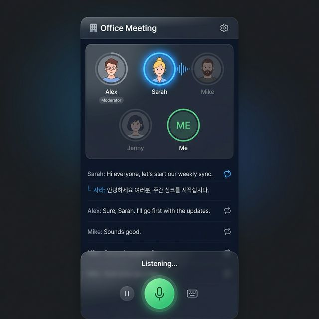

# My Turn 화면 개선 — 구현 계획서 v3

> **작성일**: 2026-02-23  
> **핵심 방향**: 모바일 우선, 실제 앱 수준의 UX, 기존 채팅 UI 완전 교체

---

## 1. UI 컨셉: "Virtual Conversation Stage"

기존 채팅 UI를 폐기하고, **몰입형 대화 스테이지** UI로 전면 교체합니다.

### 1-1. 목업

````carousel

<!-- slide -->

````

### 1-2. 화면 구조 (모바일)

```
┌──────────────────────────┐
│ ← 🏢 Office Meeting   ⚙ │  Header
├──────────────────────────┤
│  (Alex)(Sarah)(Mike)     │  참여자 아바타 영역
│     (Jenny)  (Me)        │  2-5명 동적 배치
├──────────────────────────┤
│ Sarah: "Let's start..." 🔄│  
│  └ 사라: "시작합시다..."   │  대화 타임라인
│ Alex: "Sure, I'll go..." 🔄│  (스크롤 가능)
│ Mike: "Sounds good."   🔄│  🔄 = 번역 토글
│ Me: "I agree."         🔄│
├──────────────────────────┤
│  ⏸    [ 🎤 ]     ⌨️     │  하단 녹음 바
│      Your Turn!          │
└──────────────────────────┘
```

### 1-3. 핵심 설계 결정

| 항목 | 결정 |
|------|------|
| **참여자 수** | 2~5명 동적 지원. 3명 이하: 1열, 4~5명: 2열 배치 |
| **대화 표시** | AI↔AI 포함 **전체 발화 타임라인** (자막 리스트 스타일) |
| **번역** | 각 발화 옆 🔄 아이콘 탭 → 한국어 번역 inline 표시 |
| **아바타** | 발화 중: glow ring + 파형 애니메이션, 대기 중: dimmed |
| **역할 분기** | tester: 간소 설정(속도/난이도), admin: 전체 모델 설정 |

### 1-4. 화면 상태

| 상태 | 시각적 표현 |
|------|------------|
| AI 발화 중 | 해당 아바타 blue glow, 타임라인에 텍스트 실시간 추가 |
| 내 차례 (대기) | 화면 green glow, "Your Turn! 🎤" 배너 |
| 내 차례 (녹음) | 마이크 pulse, 파형, 타이머, 일시정지 버튼 |
| 처리 중 | 로딩 스피너, "Processing..." |
| 텍스트 모드 | 마이크 → 텍스트 입력, blue accent |
| 세션 종료 | 요약 카드 (턴 수, 시간, 일시정지 통계) |

### 1-5. Tester vs Admin

| 요소 | Tester | Admin |
|------|--------|-------|
| 설정 (⚙) | 바텀시트: 속도/난이도만 | 사이드패널/바텀시트: 전체 모델 설정 + 저장 |
| 모델 정보 | 숨김 | STT/LLM/TTS/Voice per participant |
| 데스크톱 | 중앙 정렬 스테이지 | 스테이지 + 우측 설정 패널 |

---

## 2. 컴포넌트 구조

```
features/conversations/ui/
  ConversationStage.tsx     [NEW]  메인 스테이지 뷰
  ParticipantCircle.tsx     [NEW]  아바타 (2-5명 동적 레이아웃)
  TranscriptTimeline.tsx    [NEW]  전체 대화 타임라인 + 번역
  RecordingBar.tsx          [NEW]  하단 바 (마이크/일시정지/텍스트)
  TextInputBar.tsx          [NEW]  텍스트 모드 입력 (Phase 4)
  SettingsDrawer.tsx        [NEW]  바텀 시트 설정 (역할별)
  ScenarioCard.tsx          [NEW]  시나리오 선택 카드
  SessionSummary.tsx        [NEW]  세션 종료 요약
  MyTurnRunner.tsx          [DELETE]
  SessionSettings.tsx       [DELETE]
```

---

## 3. Phase별 구현 계획

### Phase 1: 스테이지 UI + 모바일 레이아웃

| 파일 | 변경 |
|------|------|
| [page.tsx](file:///Users/ochihyo/Documents/antigravity/study-english/apps/admin/src/app/(dashboard)/conversations/my-turn/page.tsx) | 풀스크린 스테이지 레이아웃, `useAuth()` 역할 분기 |
| ConversationStage.tsx `[NEW]` | 아바타 + 타임라인 + 녹음바 통합 뷰 |
| ParticipantCircle.tsx `[NEW]` | 2-5명 동적 배치, glow 인디케이터 |
| TranscriptTimeline.tsx `[NEW]` | 전체 대화 리스트, 🔄 번역 토글 (클라이언트 번역 API) |
| RecordingBar.tsx `[NEW]` | 마이크 + 상태 + 일시정지/텍스트 placeholder |
| SettingsDrawer.tsx `[NEW]` | tester: 속도/난이도, admin: 모델 설정 |
| ScenarioCard.tsx `[NEW]` | 시나리오 선택 카드 |
| SessionSummary.tsx `[NEW]` | 종료 요약 |

> [!IMPORTANT]
> **번역 기능**: 클라이언트에서 Google Translate API 또는 서버 `/api/v1/translate` 엔드포인트를 통해 처리. 번역 결과는 로컬 캐시.

---

### Phase 2: 모델 선택 (역할별 분기)

| 파일 | 변경 |
|------|------|
| SettingsDrawer.tsx | admin: 참여자별 모델 선택 + "저장" 버튼 |
| [conversation.py](file:///Users/ochihyo/Documents/antigravity/study-english/apps/server/app/models/conversation.py) | Participant에 `llm_model`, `tts_provider`, `tts_model`, `stt_model` 추가 |
| Server API `[NEW]` | `PUT /templates/{id}/participant-models` (admin 전용) |
| [my_turn_service.py](file:///Users/ochihyo/Documents/antigravity/study-english/apps/server/app/services/conversation/my_turn_service.py) | 모델 해상도: variant → participant DB → 기본값 |

> [!WARNING]
> DB 스키마 변경 → Alembic 마이그레이션 필요

---

### Phase 3: 핸즈프리 녹음

| 파일 | 변경 |
|------|------|
| [useVoiceRecorder.ts](file:///Users/ochihyo/Documents/antigravity/study-english/apps/admin/src/(fsd)/features/conversations/model/useVoiceRecorder.ts) | `autoStart`, 3초 무음 자동종료, 잡음 필터 |
| RecordingBar.tsx | 자동 녹음, "💡 일시정지 가능" 힌트, 통계 수집 |
| Server audio endpoint | 무발화 응답, 일시정지 파라미터 수신 |

---

### Phase 4: 텍스트 입력 모드

| 파일 | 변경 |
|------|------|
| TextInputBar.tsx `[NEW]` | 텍스트 입력 + 전송, RecordingBar 내 토글 전환 |
| [useMyTurn.ts](file:///Users/ochihyo/Documents/antigravity/study-english/apps/admin/src/(fsd)/features/conversations/model/useMyTurn.ts) | `sendText()` 추가 |
| Server API `[NEW]` | `POST /sessions/{id}/text` (STT 스킵) |

---

### Phase 5: 감정 분석 파이프라인

| 파일 | 변경 |
|------|------|
| [stt_service.py](file:///Users/ochihyo/Documents/antigravity/study-english/apps/server/app/services/conversation/stt_service.py) | 감정 메타데이터 추출 |
| [my_turn_service.py](file:///Users/ochihyo/Documents/antigravity/study-english/apps/server/app/services/conversation/my_turn_service.py) | LLM 프롬프트에 감정 컨텍스트 주입 |
| [tts_service.py](file:///Users/ochihyo/Documents/antigravity/study-english/apps/server/app/services/conversation/tts_service.py) | 감정 기반 TTS 파라미터 조절 |

---

### Phase 6: 턴 배분 지능화

| 파일 | 변경 |
|------|------|
| [scenario_director.py](file:///Users/ochihyo/Documents/antigravity/study-english/apps/server/app/services/conversation/scenario_director.py) | `next_speaker_id` 활성화, 발화 의도 분석 |
| [my_turn_service.py](file:///Users/ochihyo/Documents/antigravity/study-english/apps/server/app/services/conversation/my_turn_service.py) | `next_speaker_id` 기반 턴 배분, 라운드로빈 fallback |

---

## Verification Plan

| Phase | 핵심 테스트 |
|-------|-----------|
| 1 | 2명/3명/5명 시나리오 레이아웃, AI↔AI 대화 표시, 번역 토글, 모바일 375px |
| 2 | Admin 모델 저장 → tester 세션 적용 |
| 3 | 자동 녹음 시작, 3초 무발화 종료, 일시정지/재개 |
| 4 | 텍스트↔음성 전환, 텍스트 전송 → AI 응답 |
| 5 | 감정 메타 로그, LLM 톤 변화 |
| 6 | "Hey Sarah" → Sarah 턴, 일반 발화 → 라운드로빈 |
